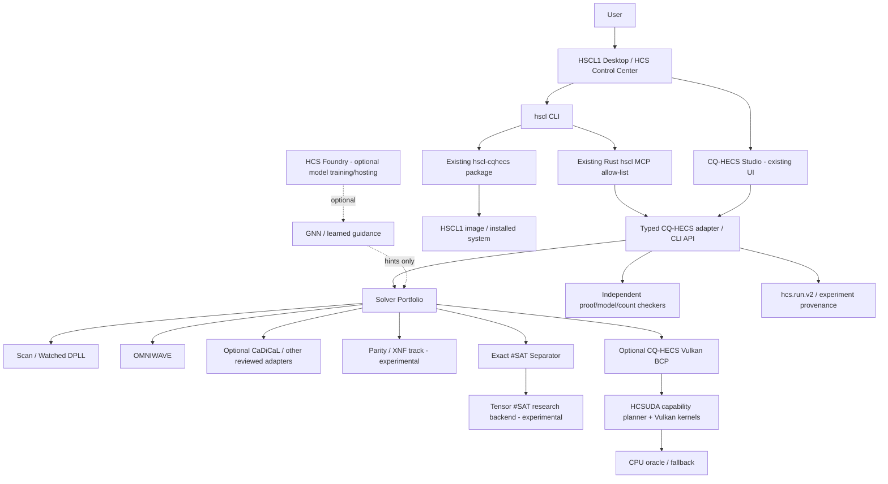

# HCS Ecosystem – Master Agent Contract

**Date / repository snapshot:** 7 November 2026, approximately 23:03 CET  
**Purpose:** One coherent operating contract for HSCL1, CQ-HECS, HCSUDA and their optional research/model integrations.  
**Audience:** Codex, Claude Code, OpenCode, Gemini agents and human contributors.  
**Owner principle:** *Reuse first. Measure second. Verify every claim. Integrate once.*  
**Credit:** Made with love by hcsmedia · HCSMEDIA

> **This document supplements the existing root `AGENTS.md` in `timfromhcs/HSCL1`. It does not replace it and does not weaken it.** The repository's root `AGENTS.md`, explicit owner decisions, safety/security policies and repository permissions remain authoritative. If this document conflicts with the root contract, source code, tests or a later owner decision, stop and reconcile the conflict before changing code.

---

# 0. North star and non-negotiable rules

## 0.1 The product being built

The goal is not a new application called HCSPNP and not a collection of loosely connected demos. The goal is one coherent **HCS computing and research ecosystem**:

- **HSCL1** is the operating system, desktop experience, Control Center, `hscl` CLI, packaging, permissions, image/installer and user-facing integration layer.
- **CQ-HECS** is the reusable solver, quantum/classical simulation, exact counting, proof, experiment and Studio engine.
- **HCSUDA** is the capability-aware CPU/Vulkan compute substrate. It supplies measured kernels and memory/dispatch primitives; it is not itself a SAT solver or a generic LLM runtime.
- **HCSEASYMATH** is the mathematical/scientific workbench being developed inside HSCL1 first. It must use the existing Rust MCP and HCSUDA contracts instead of adding another MCP server, GGUF runtime or competing compute stack.
- **HCS Foundry** is an optional source of model-management, training and verified task-generation capabilities. Reuse its existing interfaces after inspection; do not create a second model runtime merely to make one research feature work.
- **HCS Discovery Studio** is a separate product. Its workflow, experiment-selection and evidence-presentation patterns may be studied and reused at clear API boundaries; do not merge unrelated domain code into HSCL1 or CQ-HECS.
- **HCSPNP** is a feature family / research track inside CQ-HECS and HSCL1, **not** a separate repository, package, daemon, UI or model runtime. `timfromhcs/HCSPNP` returned 404 in the snapshot below.

The integrated result should feel like one product to the user while preserving small, testable modules underneath. It should work on ordinary consumer hardware with a complete CPU path and optional acceleration when the actual device supports it.

## 0.2 Absolute engineering rules

1. **Never invent capability.** A plan, class, shader, UI control, dependency resolution or compile is not proof that a feature works. Use the status vocabulary in §2.6.
2. **Never change a mathematical verdict with a heuristic.** GNNs, LLMs, learned branching, RL, tensor contraction order, cubing and hardware schedulers may guide or accelerate a complete algorithm; they never become the SAT/UNSAT authority unless they themselves implement a complete, checked proof-producing procedure.
3. **Fail closed.** Invalid input, timeout, exhausted memory, unavailable backend, failed checker, unsupported type or cancelled job returns a typed refusal / `UNKNOWN`; never fabricate a partial exact answer.
4. **SAT models are checked against the original input.** Preprocessing, CNF rewriting, parity extraction and cube decomposition must retain a reversible mapping or a proof that the transformation preserves the required result.
5. **UNSAT evidence stays honest.** An exhaustive search without a checked proof is not equivalent to a checker-accepted proof. The UI, API, CLI and documentation must expose the distinction.
6. **Exact #SAT is exact or `UNKNOWN`.** No partial count, float approximation or sampled estimate may be labelled an exact count.
7. **CPU reference first.** Every GPU/HCSUDA path has a CPU reference and an equivalence test. The GPU path is optional and may be slower.
8. **No automatic “SSD as VRAM” claim.** `mmap`, page cache, swap, staging buffers and Vulkan device-local memory are distinct mechanisms. Describe the actual copy and ownership path.
9. **No second copy of a platform capability.** Reuse the CQ-HECS Studio, `hcs.run.v2`, HSCL1 `hscl` CLI, Rust MCP server, HCSUDA planner and existing package boundaries.
10. **No hidden network service.** Local APIs bind to loopback, validate Host/Origin, use per-launch authentication where they expose operations, have request/concurrency limits and stop when the application exits. No root daemon or autostart unless the root contract explicitly approves it.
11. **No unsafe shell bridge.** MCP tools are typed allow-listed operations. No model or browser input may become an arbitrary shell command, path traversal or unbounded process.
12. **Protect user data and hardware.** Never wipe disks, flash devices, modify miner firmware, write to physical hardware, alter voltage/frequency, or perform irreversible operations without explicit owner approval and the required verified backup / recovery gate.
13. **One heavy job at a time on the owner workstation.** Do not overlap VM boot/install, long solver runs, local LLM inference, large model loading, full image builds or intensive GPU benchmarks. Small CPU-only unit tests may run in parallel when resource use is demonstrably low.
14. **Tests are not weakened to make a PR green.** A failing test is investigated. If the gate is wrong, fix the gate and add a regression test. Never delete, relax, skip or quarantine a failing assertion merely to pass CI.
15. **Keep negative results.** A slower heuristic, failed model, memory regression, unsupported Vulkan path or inconclusive result is valuable evidence and stays in the ledger.
16. **Do not push cross-repository work without the relevant owner authorization.** The current permission to research and prepare this plan is not permission to push modifications to CQ-HECS, HCS Foundry or HCS Discovery Studio.
17. **No automatic merge or release.** Prepare a reviewable PR or draft release. Human approval is required for merges/releases unless a later explicit owner instruction says otherwise.
18. **Never claim P = NP, ETH falsity, a SHA-256 break, practical polynomial SAT, competition-grade proof checking or universal GPU speedup from a benchmark of a few instances.** See §11.

## 0.3 What “unified” means

Unified means shared contracts, entry points, run records, UX, test gates, resource policies and plan bookkeeping. It does **not** mean merging all source code into one crate or making every component depend on every other component.

A good integration is a thin, typed adapter over an existing capability. A bad integration duplicates an engine, creates an independent server, introduces a circular dependency, or changes an external solver's trusted code without a reason.

## 0.4 User-facing outcome

When mature, the user should be able to open HSCL1 and:

- see what hardware and backends are actually available;
- open one integrated research workspace;
- create, inspect and solve SAT/CNF, XOR/XNF, #SAT and circuit experiments;
- compare complete solver portfolios, cube strategies and optional learned guidance;
- inspect proofs, proof status, model verification and refusal reasons;
- run CPU and Vulkan/HCSUDA experiments without changing the correctness contract;
- see memory, timing, throughput, power/thermal metadata when measured, and backend decisions;
- export a reproducible run with the exact input, digest, source revision, limits, seeds and results;
- ask an agent to create an experiment plan, run safe tools, compare results and propose a patch;
- understand which features are stable, experimental, planned or unsupported.

---

# 1. Repository reality snapshot (7 November 2026)

Every agent must refresh this section at the start of a new engineering session. The following is a point-in-time snapshot, not a permanent guarantee.

## 1.1 Repositories and main revisions

| Repository | Main SHA observed | Date / version | Role | Status notes |
|---|---|---|---|---|
| `timfromhcs/HSCL1` | `37d2f6dc1b4d92477d77d67d146d362257e6e54f` | 2026-11-07 21:52 UTC; README `0.1.3-alpha.0` | OS, HCS desktop, CLI, Control Center, packaging, HCSUDA | Pre-alpha; VM-verified areas exist, physical hardware not validated, releases unsigned. |
| `timfromhcs/CQ-HECS` | `30c7f1484af01cf71a8843cca56ff38786eeaf92` | 2026-11-02 17:44 UTC; `v5.0.0` | Solver, #SAT, proof, simulation, Studio, MCP, provenance | Apache-2.0; no open PRs observed; main contains substantial SAT infrastructure. |
| `timfromhcs/hcs-foundry` | `cfea6fab4ea4bd0ffb1517dc59e98a80f830096a` | 2026-11-02 17:15 UTC; changelog `7.5.0` | Optional model/training platform | Main only, no open PR observed; inspect API before reuse. |
| `timfromhcs/hcs-discovery-studio` | `fdd6ccb7a58fb63313ce2ec928f1234c022fb813` | 2026-11-04 11:42 UTC; release v3.0.1 | Separate domain product | Main + release branch; no open PR observed. Reuse only clear patterns/interfaces. |
| `timfromhcs/HCSPNP` | Not found (404) | 2026-11-07 check | Not a separate product/repo | Do not create it. Deliver HCSPNP features through CQ-HECS + HSCL1. |

Main commits and code are the source of truth until a later fetch proves otherwise. A branch name such as `codex/hscl1-v1` is not “main” and must not be represented as merged.

## 1.2 HSCL1 branch and PR state

### Main

- `main`: `37d2f6dc1b4d92477d77d67d146d362257e6e54f`.
- PR #28 is merged; it reconciled HCSUDA documentation and added the H3c-3a Qwen3-style CPU layer work plus the HCSEASYMATH Track E research/plan.

### Work branch newer than main

- Branch: `codex/hscl1-v1`.
- At the latest inspection it was **4 commits ahead of main** and its tip was `1a24b20ba7ddafb142cb1df15785ff2b4c1ef697`.
- Open PR #29: [HCSEASYMATH M1: safe parser, isolated worker, loopback API, hash-locked cp314 gate](https://github.com/timfromhcs/HSCL1/pull/29).
- PR #29 had 46 changed files, `mergeable=true`, `mergeable_state=unstable`, and had not been merged at inspection time.
- Its commits include:
  - safe allow-list expression parser and exact derivative engine;
  - isolated worker with time/memory/output/environment caps;
  - loopback API with Host/Origin/per-launch token checks;
  - minimal page/CSP and CLI `doctor`/`serve`;
  - Python 3.14 hash-locked dependencies and WSL/CI gate;
  - HCSPNP baseline, decisions, research ledger and execution plan;
  - Forge documentation command gate fix.
- PR description reports 112 tests in a fresh WSL Ubuntu 26.04.1 / Python 3.14.4 venv and a green local `forge check`. GitHub CI still decides the runner compatibility gate. Reported limitations: warm worker and additional operations not built; frontend toolchain, `hscl math`, MCP, Control Center integration, package and image/VM are not done.

**Agent instruction:** First read current PR #29 state and CI checks. If it is still open, do not duplicate its work or make conflicting edits on a second branch. If merged, use the merged files as the Track E baseline. If closed without merge, inspect its final diff and tests before continuing; do not assume close means discard or merge.

### Other open HSCL1 PRs

At inspection there were four Dependabot PRs:

- #1 `actions/checkout` 4.2.2 → 7.0.1;
- #2 `actions/upload-artifact` 4.6.2 → 7.0.2;
- #3 `sha2` 0.10.9 → 0.11.1;
- #4 `thiserror` 1.0.69 → 2.0.21.

Review dependency compatibility, Rust MSRV, lockfile, workflow permissions, pinned action SHAs and full CI before merge. Do not merge them all as an unreviewed batch. Update security/licence inventory after an accepted dependency change.

## 1.3 CQ-HECS branches newer than `main`

There were no open CQ-HECS PRs at inspection. Thirty-plus branches existed; most were older ancestors of main (zero commits ahead). Do not interpret old branch names like `v4` or `v3.7` as newer capability.

The three diverged branches that contained unique commits were:

| Branch | Ahead / behind main | Unique work seen | Decision |
|---|---:|---|---|
| `agent/v4-studio-mfit2-sat` | 7 ahead / 100 behind | old Studio, old SAT engine, noise fit, old v4 evidence and documentation | Stale and heavily diverged. Do not merge. Inspect individual ideas/files only; reimplement or cherry-pick only after API, correctness and current-test review. |
| `claude/beautiful-rubin-3hcoym` | 1 ahead / 125 behind | an old v2.5.1 release audit note | Historical record only; compare with current release state before reuse. |
| `claude/vigilant-ritchie-mscxry` | 1 ahead / 78 behind | old v3.3 SAT certificate changes/tests | Current main already has newer SAT certificate machinery. Do not cherry-pick blindly; salvage any missing edge-case test only after checking current code. |

Examples of branches that were fully behind main at the time: `dev/sha-forge-hardware-lab`, `agent/v3.7.0-omniwave-branching`, `agent/v3.6.0-sat-core`, `agent/v3.2-pnp-oracles`, `agent/v4.0.0-foundation`, older release branches and older web branches. Their ideas may still be useful, but the branch itself is not a source of truth.

**Branch hygiene rule:** every start-of-session audit must fetch remote refs, compare heads to `main`, classify each as `equal`, `ahead`, `behind`, or `diverged`, list open PRs and their checks, and then write a short snapshot into the current baseline ledger. Never delete branches or rewrite history automatically.

## 1.4 HCS Foundry and Discovery Studio

- HCS Foundry main has a verified-task-generator RFT trainer commit (`f9ba8c69...`) and later v7.5.0 documentation. Potential reuse: verified task generation and training data workflows. Not established: a fully compatible public inference API for every target. Inspect exact source, schema, licensing and dependency requirements before integrating.
- HCS Discovery Studio main has v3.0.1 release evidence and real Postgres/Lighthouse testing. Its previous work includes a `select.sat` workflow node and an Adaptive Evidence Ladder concept in earlier PR work. Potential reuse: cost-aware experiment selection, evidence hierarchy and workflow-node UX. Keep it separate unless a stable reusable package/API is demonstrated.

## 1.5 Session-start commands

Run from fresh local clones or authenticated GitHub CLI as applicable. Do not assume local branches are current.

```bash
git fetch --all --prune
git status --short --branch
git rev-parse HEAD
git rev-parse origin/main
git log --oneline --decorate -12 origin/main
git branch -vv
git diff --stat origin/main...HEAD
```

GitHub inventory:

```bash
gh pr list --state open --limit 100
gh pr list --state all --limit 100
gh api repos/timfromhcs/HSCL1/branches?per_page=100
gh api repos/timfromhcs/CQ-HECS/branches?per_page=100
gh api repos/timfromhcs/HSCL1/commits/main
gh api repos/timfromhcs/CQ-HECS/commits/main
```

If `gh` is unavailable, use the GitHub connector/API or public GitHub endpoints. Record failures as `NOT CHECKED`; do not silently reuse yesterday's snapshot.

---

# 2. Existing functionality and honest capability boundaries

## 2.1 CQ-HECS today

The v5.0.0 main branch already contains the core that HCSPNP should extend:

- `cqhecs.sat`: DIMACS parser, scan DPLL, watched-literal DPLL, model checks, deadlines and tree-resolution certification path.
- `cqhecs.sat_external`: optional CaDiCaL through `python-sat`; optional dependency, not guaranteed in the HSCL1 runtime.
- `cqhecs.drat`: separate in-repo DRAT checker.
- `cqhecs.unified`: portfolio result under `hcs.sat.unified.v1`; capabilities, attempts, per-engine time budgets, deterministic order and original-CNF model re-verification.
- `cqhecs.omniwave`: exhaustive multi-front/cube search, BCP, nogoods, wave scheduling, DRAT proof logging and CPU/Vulkan batched BCP.
- `cqhecs.omniwave.learned`: optional `FeatureScorer` and `HfScorer` for branch-variable selection; Jeroslow–Wang remains the fallback.
- `cqhecs.sat_separator`: exact #SAT by bucket / variable elimination with deterministic min-fill planning, induced-width estimates and refusal on table/time budget exhaustion.
- `cqhecs.sha.preimage_sat`: reduced-round SHA-256-style CNF encoder, exact toy-width oracle, independent SHA reference, model decoding and replay.
- `cqhecs.studio`: existing local Studio with SAT Lab and the existing quantum/circuit workspace.
- `cqhecs.provenance`: shared `hcs.run.v2` record for input payload/digest, engine, precision/mode, seed, software/source revision, result and limits.
- `cqhecs.mcp_server`: existing CQ-HECS local MCP surface.
- Native C++20/Vulkan code, including a native SAT candidate, tensor diagnostic and tiered-storage code. These are not automatically equivalent to the Python reference or ready to be trusted as production backends.

### Important solver distinctions

| Existing engine | What it actually does | Do not call it |
|---|---|---|
| Scan / watched DPLL | Complete DPLL-style search; scan path has a tree-resolution certifying search; watched path is an efficient propagation variant | CDCL, modern industrial solver |
| CaDiCaL adapter | Optional mature external solver via PySAT; model recheck and DRAT check if enabled | A CQ-HECS fork or guaranteed installed backend |
| OMNIWAVE | Exhaustive cube/front exploration, BCP, shared nogoods and checked DRAT result | CDCL, full Cube-and-Conquer, general-purpose replacement for CaDiCaL |
| Branch `FeatureScorer` / tiny BERT | Picks a branch variable; search and proof system remain in charge | SAT classifier or proof generator |
| #SAT separator | Exact bounded-width bucket elimination | General fast counter for all CNFs |
| Current native C++ SAT | Separate implementation requiring audit and proof-contract parity | Fully trusted/certified UNSAT path |

OMNIWAVE uses cubes/fronts internally, but it is not the same thing as a complete **Cube-and-Conquer** workflow with a pre-solver, cube generation, independent CDCL conquer jobs, load balancing, and proof stitching. Build that as a distinct research track only if the benchmark corpus identifies families where it helps.

## 2.2 Current CQ-HECS evidence that must be preserved

1. **Learned branching had a negative held-out result.** On pigeonhole-8-7, Jeroslow–Wang returned UNSAT in 27.4 s / 10,079 fronts. The learned scorer timed out at 60 s with 157,973 fronts. It remains opt-in. The prior target (“does assigning this variable immediately refute a branch?”) produced poor decisions. Do not remove this finding or promote ML by enthusiasm.
2. **OMNIWAVE is not best on every SHA CNF.** Existing reduced-round SHA experiments show watched DPLL solving W=8, rounds=16 in 0.070 s versus OMNIWAVE in 0.46–0.49 s; W=16, rounds=16 in 0.148 s versus 1.07–1.21 s. OMNIWAVE is slower by 6.5–8x on these propagation-dominated cases. It remains useful where exhaustive cube coverage and checked DRAT output matter.
3. **Propagation optimisation helped selected families only.** An occurrence-list change improved one SHA family by 2.4x but made little difference on pigeonhole; record per-family behavior and front counts rather than hiding it in a global average.
4. **#SAT separator has a structural sweet spot.** It can be excellent on low-width structured formulas and may refuse high-width/random 3-SAT due to table growth. Keep exact preflight and `UNKNOWN` semantics.
5. **The 64-round SHA verification test is not a preimage attack.** It fixes all input message words and asserts the output; it validates the encoder against a reference. Reduced-round preimage experiments with one free word are overdetermined at small round counts. At W=32, 1 free word/16 rounds propagated to SAT without decisions. A 17-round instance is `UNKNOWN` within a 3 s budget; W=8/17 rounds with free word 0 is `UNKNOWN` after 1,023 decisions / 466 conflicts. These are bounded observations, not cryptographic breaks.
6. **The current SHA CPU reference and WebGPU tests are scoped.** A single measured browser run of ~4.6 M compressions/s versus ~0.115 M/s for a deliberately readable TypeScript reference is not a performance claim. Repeat against an optimised CPU baseline on the same device.

## 2.3 Critical gaps before HCSPNP is exposed in HSCL1

- The existing CQ-HECS Studio HTTP server binds to loopback but, at the inspected main revision, has no Host/Origin/per-launch-token protection. Its POST endpoints can start solver jobs. **Do not launch it from a desktop entry until the guard is implemented and tested.**
- The HSCL1 `hscl-cqhecs` package currently has a doctor/status launcher; the desktop entry runs `hscl-cqhecs doctor` in a terminal. It does not launch the Studio.
- `hscl cqhecs ...`, a CQ-HECS Control Center card and typed `hscl mcp` CQ-HECS tools were not present in the checked main snapshot.
- HSCL1's pinned CQ-HECS runtime excludes `python-sat`; CaDiCaL must report `unavailable` until a tested, hash-pinned optional runtime extra is added. Do not advertise it by name only.
- CQ-HECS docs include stale Python compatibility wording in `docs/UNIFIED_SOLVER.md`; source `pyproject.toml` allows Python >=3.11 and the HSCL1 runtime is CPython 3.14. Reconcile this with test evidence.
- The CQ-HECS test suite had not yet been recorded as passing from a clean clone in the HSCL1 HCSPNP baseline. This is P-M0, not an assumption.
- `src/sat_solver.cpp` must be audited against the Python contract; it must not be listed as a certified UNSAT engine until independent proof production/checking exists.

## 2.4 HCSUDA today

The HCSUDA implementation is evolving inside HSCL1. Latest inspected progress:

- `hcsuda-core`: tensor/dtype/capability/planner/CPU reference.
- `hcsuda-vk`: Vulkan dispatch, device/memory/shader/timestamp infrastructure.
- `hcsuda-cli`: capability, plan, selftest and benchmark commands.
- H2 includes measured/tested matrix and tensor kernels such as f32, f16, int8 and cooperative-matrix GEMM; RoPE and common normalisation/activation operations.
- H3a reads GGUF headers; H3b reads/dequantises a bounded supported set of GGUF types and compares against the official GGUF Python implementation; H3c builds transformer reference/compute kernels.
- H3c-2 GPU transformer block was checked against CPU and NumPy on a small deterministic fixture, with max relative-to-1 error `4.6e-7`, <=256 tokens. It is a correctness kernel, not a tuned multi-layer runtime.
- H3c-3a supports Qwen3-style GQA, optional QK norm and GGUF `[out][in]` weight layout on CPU; checked against a NumPy fixture with worst absolute error `1.9e-6`.
- H3c-3b (streaming real GGUF layers, final norm/tied output head and logits versus llama.cpp/server) was still planned/paused at the latest ledger snapshot.

Do not call HCSUDA a GNN engine, SAT/CDCL engine, complete tensor-network solver, GGUF editor, or general LLM runtime. Do not make speed claims for transformer kernels that have only correctness measurements.

## 2.5 Native code and memory reality

- `src/tensor_network.cpp` describes a compact GHZ/parity diagnostic representation, not a general-purpose quantum tensor simulator or a SAT tensor-network counter.
- `src/tiered_storage.cpp` maps a 256 MiB cold pool and copies pages with `memcpy` to and from mapped storage. It is not direct HDD-to-Vulkan memory, not PCIe peer DMA and not zero-copy VRAM.
- `mmap` maps a file-backed region in the CPU virtual address space. Vulkan access needs an explicitly supported external-memory/host-pointer path, matching alignment, valid memory properties, lifetime and synchronization. On a UMA iGPU, device-local and host-visible memory may be the same physical DRAM; that still requires capability and bandwidth measurements.
- The C++ SAT solver has historical custom-state/hash machinery. Audit exact collision handling, variable indexing, deadline enforcement, proof semantics and fuzz coverage before making it a production portfolio entry.

## 2.6 Status vocabulary (use everywhere)

| Status | Minimum evidence | Must not imply |
|---|---|---|
| `PLANNED` | Written scope and acceptance test | Code exists |
| `IMPLEMENTED` | Code is present and reaches the intended code path | Correctness or integration is proven |
| `TESTED` | Relevant unit/property/fuzz tests pass | VM or hardware behavior |
| `VM-VERIFIED` | Exact artifact boots and relevant end-to-end guest checks pass | Physical hardware support |
| `HARDWARE-VERIFIED` | Named physical device, driver/firmware, measurement and oracle log | Universal device support |
| `EXPERIMENTAL` | Opt-in prototype with reproducible limited evidence | Stable/default/supported |
| `BLOCKED` | A named blocker, reproducer and next action exist | Quietly abandoned |
| `UNKNOWN` | The algorithm could not decide within explicit limits | Likely SAT/UNSAT or an approximate answer |
| `NOT TESTED` | It was not run | It passed |

Use these statuses in code capability objects, run records, README, `CLAIMS.md`, `KNOWN_LIMITATIONS.md`, HCSUDA capability matrix, Studio badges and release notes. No implicit status upgrade.

---

# 3. Target architecture and integration boundaries

## 3.1 Architecture overview



This is a target map. Dashed edges are optional research integrations, not installed or trusted capabilities by default.

## 3.2 Ownership table

| Responsibility | Single owner | Integration rule |
|---|---|---|
| SAT/CNF semantics, solver portfolio, #SAT, proof interfaces, Studio API, `hcs.run.v2` | CQ-HECS | Keep algorithms and schemas reusable outside HSCL1. |
| OS packages, launchers, CLI shell, Control Center, MCP allow-list, handbook, image gates | HSCL1 | Call the CQ-HECS contract; don't copy the solver implementation. |
| CPU/Vulkan capability detection, generic kernels, device memory, timestamps, CPU reference | HCSUDA | Integrate only through capability/plan contracts; CQ-HECS has its own existing Vulkan BCP path first. |
| Mathematical workbench | `apps/hcseasymath/` in HSCL1 initially | No second GGUF reader, runtime, theme system or Python MCP server. |
| Model inventory/training/runtime when a concrete need exists | HCS Foundry or existing HSCL1 AI stack | Inspect current API and licensing; reuse one server and model cache. |
| Discovery-domain workflow | HCS Discovery Studio | Reuse patterns or a stable library; do not couple the OS to a full separate domain app. |

## 3.3 Required integration surfaces

1. **One source of truth for engine execution:** CQ-HECS Python/native engine APIs with typed results. Do not implement UI business logic as a second solver.
2. **One provenance format for a run:** extend `hcs.run.v2` only through a deliberate backward-compatible version/schema plan. Do not silently redefine existing fields.
3. **One OS command surface:** extend `hscl` with a `cqhecs` namespace after reading its Clap structure, command help generator and current doc tests.
4. **One MCP server in HSCL1:** add typed, bounded tools to the existing Rust `hscl mcp` allow-list. No parallel Python MCP daemon.
5. **One app surface:** extend the existing CQ-HECS Studio SAT Lab and Control Center. No second HCSPNP frontend.
6. **One optional compute path:** HCSUDA is a backend selected by capabilities, not a requirement for solver correctness.

## 3.4 Schemas and compatibility

Current contracts to preserve:

- `hcs.sat.unified.v1` – SAT portfolio decision, attempts, resource budgets, formula digest, model/certificate fields and proof state.
- `hcs.run.v2` – exact run input and digest, engine, precision/mode, seed, software/revision, result, limits and error categories.
- Existing SHA traces and miner data are separate contracts (`hcs.sha.trace.v1`, `hcs.sha.miner.v1`); never overload circuit or SAT schemas with hardware fields.

Proposed additive contract, only after the base is audited:

- `hcs.experiment.v1`: experiment ID, hypothesis ID, dataset/split ID, exact command/config, source revisions for all participating repos, hardware profile digest, software/driver/toolchain versions, seed, budget, repetitions, warm/cold state, raw artifact hashes, metrics, checker verdict, limitations and promotion decision.

A schema change requires: schema file, validation code, backward/forward compatibility decision, fixture, migrations or explicit refusal, CLI/Studio/browser tests and documentation update. Unknown fields must be handled according to an explicit policy, not guessed.

---

# 4. Hardware contract and resource-aware execution

## 4.1 Owner workstation profile – starting hypothesis, not runtime truth

The owner development host observed across project records:

- Windows 11 Pro x86_64; WSL2 Ubuntu 26.04.1 is used for Linux gates.
- AMD Ryzen 7 7735HS, 8 CPU cores / 16 threads, Zen 3+ generation.
- Integrated AMD Radeon 680M, 12 compute units, RDNA 2 class, Vulkan path; no NVIDIA CUDA device.
- Approximately 24 GB reported shared/system RAM in prior project records. The integrated GPU uses shared system memory, not a discrete 8 GB VRAM card. BIOS UMA reservation and driver-visible budget can vary.
- Local NVMe/system storage and an external USB 3 HDD may be available. Treat the external disk as cold dataset/artifact storage unless benchmarks prove an access pattern suitable for hot data.

AMD's public Ryzen 7 7735HS specification lists 8 cores / 16 threads and Radeon 680M with 12 graphics cores; the exact machine's driver and Vulkan memory properties still have to be probed. AMD also publishes current driver builds, but laptop OEM custom drivers may be preferable. See §14.

## 4.2 Runtime probing, not assumptions

At every backend-selection session, record:

- CPU model, logical/physical cores, ISA flags (`AVX2`, `SHA` and others as exposed by CPUID/compiler runtime); do not assume a particular intrinsic is available from a marketing label.
- GPU device name, vendor/device IDs, Vulkan API version, driver version, queue families, subgroup size, supported shader/storage features, memory heaps/types, host-visible/device-local properties, timestamp support and relevant extensions.
- System RAM available, process memory limits, GPU shared-memory budget, disk free space, filesystem type, USB disk status if used.
- OS version, WSL/kernel/VM state, compiler versions, build mode and power/thermal state when measurable.

Use the current HCSUDA capability commands and emit machine-readable JSON. If a required capability is missing, mark that backend `unavailable` and use the CPU reference when safe.

## 4.3 Workload policy

Default to the least expensive safe route:

1. Parse and validate input on CPU.
2. Run algorithmic preflight and estimate time/memory/width/cube counts before allocating large structures.
3. Run CPU baseline or cheap reference for small inputs.
4. Use existing CQ-HECS Vulkan BCP only when capability detection succeeds and the batch is large enough to amortize staging/dispatch overhead.
5. Use HCSUDA only when its planner has a measured matching kernel and the CPU oracle validates it.
6. Keep the exact final verifier on CPU unless an independently checked GPU verifier is established.
7. Persist large raw data to the external disk only as an artifact/cold tier; do not place live queues, hot proof logs or random-access tensors on a slow disk without benchmarking.

## 4.4 Resource budgets

The system must expose user-configurable limits for:

- wall-clock deadline;
- maximum variables, clauses, clause literals and total parsed input bytes;
- max active fronts / queue length / worker count;
- memory budget for SAT engine, #SAT tables, tensors and proof log;
- maximum output/proof/log size;
- GPU batch size and maximum in-flight buffers;
- number of concurrent jobs (default one heavy job on this workstation);
- cancellation and cleanup time.

If the preflight upper bound is unsafe, refuse before allocation with a typed `resource_limit` / `UNKNOWN` result and an explanation. Do not rely on the operating system to kill an out-of-memory process.

## 4.5 Performance hypotheses specific to this machine

Prioritise investigations that can be validated on a Radeon 680M and a Zen 3+ CPU:

- Compare AVX2/CPU bitset BCP, scalar CPU BCP and current Vulkan BCP; CPU may beat GPU on small batches due to launch/transfer overhead.
- Profile GPU BCP batch sizes, subgroup/warp assumptions, memory coalescing, branch divergence, atomic contention, and resident formula representation. Never import CUDA warp assumptions directly into Vulkan shaders.
- Test many independent partial assignments as a GPU workload; this maps better to GPU parallelism than a single highly branchy CDCL state.
- Investigate CPU SHA instruction extensions only after CPUID and compiler-intrinsic verification; compare against a scalar FIPS reference and measure round throughput, not miner GH/s.
- Treat GPU shared-memory pressure as a first-class limit. More UMA reservation may reduce memory available to the CPU/OS; tune BIOS/driver only with owner consent and measured stability.
- Measure cold and warm storage separately; use file-backed streaming for large DIMACS/benchmark corpora, but do not call mmap “zero copy to GPU.”

---

# 5. Research directions from 2026 literature – hypotheses, not borrowed speed claims

Research snapshot cut-off: 7 November 2026. Read the full paper and artifacts before copying a method. A publication's reported gain is not a forecast for CQ-HECS or the owner workstation.

## 5.1 Cube-and-Conquer / Smart Cubing

**Research anchor:** Kirchweger et al., *Smart Cubing for Graph Search: A Comparative Study*, CP 2026. It studies cube-and-conquer for graph search with a propagator, includes pre-runs that gather learned constraints, cubing strategies and algorithm configuration. The paper reports large gains on its own benchmarks; it does not show that every CNF or this workstation will obtain the same result.

**Project relation:** OMNIWAVE already explores exhaustive cubes/fronts and shares short nogoods, but it is not a full Smart Cubing / Cube-and-Conquer stack. The new track should test whether a pre-solve, formula graph analysis, cube generator, independent conquer engines and dynamic load balancer outperform the existing single-engine routes on selected hard families.

**Proposed architecture:**

1. Pre-run using a bounded baseline solver; collect BCP consequences, verified short learned constraints and variable activity where the API supports it.
2. Build a deterministic cube tree. Every cube must be a conjunction of literals over the original formula. Children must partition their parent exactly (for binary split: `C∧x` and `C∧¬x`).
3. Assign cubes to independent conquer workers using CaDiCaL only if the optional backend is installed and hash-pinned; otherwise choose a supported CQ-HECS engine and record that fact.
4. Record each cube's status, runtime, resource budget and proof artefact. Reassemble UNSAT only if every leaf is closed and the proof stitcher validates the whole result.
5. Adapt future cube size from measured work, not unbounded speculative splitting. Balance the tail: a queue of many trivially small cubes with one enormous cube is not a win.

**Research questions:**

- Which cube heuristic best predicts `tail_time`, not just average cube time?
- Does a short CPU pre-run improve the GPU/CPU conquer phase enough to repay its cost?
- Can OMNIWAVE produce a useful cube schedule for CaDiCaL without duplicating CaDiCaL internals?
- Does nogood sharing across cubes preserve proof correctness and improve runtime, or cause bandwidth/lock overhead?
- What is the right split criterion for parity-heavy, SHA-derived, pigeonhole, random-3SAT and industrial families?

**Tests:** exhaustive coverage on 8–20 variable formulas against brute force; prove each child partition; kill/restart workers; randomize queue order and ensure identical verdict; inject duplicate/lost cube IDs; test proof stitching on all-UNSAT trees; mix SAT and UNSAT leaves; memory-cap the queue; compare fixed and adaptive schedules with identical total budgets.

**Promotion gate:** at least one named family improves ≥15% in median total wall-clock including preprocessing and proof checking, with no ≥10% regression on the held-out suite, same final correctness and no loss of checked proof status. Otherwise keep it experimental or reject it.

## 5.2 GPU BCP and high-throughput probing / sampling

**Research anchor:** Nadel, Shalmon & Strichman, *SAT Sampling at Scale via GPU-based Boolean Constraint Propagation* (arXiv 2610.28805, 20 Oct 2026). Gpap runs many independent partial assignments against one shared formula in parallel and supports a sampling workflow. Its published speedups are for their sampling benchmarks and hardware, not a generic exact SAT result.

**Project relation:** CQ-HECS already has CPU batched BCP and a Vulkan batched BCP path for OMNIWAVE. HCSUDA offers a separate capability-aware Vulkan compute layer. The next useful experiment is not “rewrite the solver on GPU”; it is to test larger batches of independent BCP trajectories, probe-based simplification and optional sample generation.

**Subtracks:**

- **A – batch BCP:** take the current CPU reference and current CQ Vulkan BCP as baselines; experiment with contiguous formula storage, job-state bitsets, per-clause offsets and workgroup layout.
- **B – probes:** run bounded single-literal and pair probes to detect forced assignments, short implications and equivalences. A simplifier may apply only proven-equivalent transformations.
- **C – sampling:** create a separate sampler interface with an explicit statistical quality contract. Sampling is not exact counting and must have a distinct result type from SAT/UNSAT.
- **D – HCSUDA adapter:** only after a CPU reference and a measured win exists, provide the kernel through HCSUDA; do not create a second competing BCP engine.

**Tests:** bit-identical propagated literals to CPU for every batch; random CNFs; contradictory/duplicate/tautological clauses; variables with no occurrences; empty and unit clauses; partial assignment validity; cancellation at every pass; 1, 2, 4, 16, 64, 256, 1024 and 4096 trajectories as memory allows; queue overflow; no stale output buffer reuse; device-lost fallback. For sampling: statistical tester and reproducibility seed; report acceptance/rejection and do not claim uniformity without a proven or tested contract.

**Promotion gate:** CPU equivalence 100%; measured end-to-end win after input/output transfer and checker cost; memory and temperature stable; no false implication. If iGPU dispatch costs more than CPU BCP, keep CPU default.

## 5.3 Native XOR / XNF and CDCL(⊕) for SHA/ARX

**Research anchor:** Beame & Sun, *Extending CDCL to Disjunctions of Parity Equations*, SAT 2026. It introduces CDCL(⊕) for XNF, branching on parity equations, linear-algebraic propagation and learned linear clauses with LRUP(⊕)-style proof logging. This is highly relevant to XOR-heavy encodings but is a proof-of-concept research solver, not a drop-in feature of current CQ-HECS.

**Project relation:** SHA-256 includes XOR functions, bit rotations and modular additions. Current `preimage_sat.py` emits Tseitin CNF; preserving XOR relations natively may reduce encoding overhead or improve reasoning on parity-rich structures. However, SHA includes AND and carry logic too, so XOR-only algebra is not enough.

**Implementation sequence:**

1. Add a separate, explicit formula format for native parity rows / XNF clauses. Do not silently reinterpret DIMACS CNF.
2. Build a small GF(2) Gaussian elimination / parity propagation reference on CPU.
3. Add a CNF↔XNF conversion on tiny fixtures with truth-table equivalence tests.
4. Compare against current CNF plus `sat.py`, OMNIWAVE, optional CaDiCaL and appropriate external parity solvers.
5. Only then evaluate an external Xorcle adapter or a minimal local CDCL(⊕) prototype. Check licence, build, interface, proof format and reproducibility first.
6. Design proof logging and an independent LRUP(⊕) checker before calling an XNF UNSAT result certified.

**Questions:** Which SHA round/word width/unknown-word pattern has enough parity structure to benefit? Does extracting XOR rows reduce variables/clauses or merely move work into elimination? Do carries dominate after XOR propagation? Is the proof-checking cost acceptable? Does a mixed CNF+XNF interface preserve original input identity?

**Tests:** parity truth tables for n≤16; random GF(2) systems versus brute force; row elimination and contradiction witness tests; transform round-trip; SHA reference/differential tests; all FIPS 180-4 known-answer vectors; toy widths 8/16 with exhaustive enumeration; 32-bit actual SHA encoding; mutated parity signs, constants and bit ordering must fail. Every solver output is checked against the original bit-vector reference and original CNF/XNF.

## 5.4 Factoring learned clauses / Extended Resolution

**Research anchor:** Pollitt et al., *Factoring Learned Clauses*, SAT 2026. It studies extracting repeated XOR/ITE gates from learned clauses and an inprocessing strategy with Extended Resolution considerations. It highlights a key problem: stronger proof reasoning is useful only if the proof format and checker can validate it.

**Project experiment:** treat gate factoring as an optional preprocessing/inprocessing plugin, starting on SHA and Tseitin circuits. Build a reversible mapping, measure formula size and solve time, and preserve a proof route. Never run a preprocessing step that changes the formula but leaves the checker validating only the transformed formula without mapping it back to the original.

**Tests:** equivalence by brute force on small formulas; proof translation; proof checker adversarial cases; variable elimination / extension-variable map replay; formula size and solve time measured independently.

## 5.5 GNN guidance / RLAF

**Research anchor:** Tönshoff & Grohe, *Learning from Algorithm Feedback: One-Shot SAT Solver Guidance with GNNs*, ICLR 2026. RLAF proposes one-shot GNN variable weights and polarities fed into existing solver branching; training uses solver computational cost as reward with policy-gradient methods such as GRPO. The paper reports >2× speedup in some evaluated distributions. This is not a promise for CQ-HECS.

**Important limit:** Peltonen & Wattenhofer, *On the Expressive Power of GNNs for Boolean Satisfiability*, ICLR 2026, proves that the full Weisfeiler–Leman hierarchy cannot distinguish every SAT/UNSAT pair in general. Therefore GNNs are heuristics, not a complete truth oracle.

**Project path:**

- Reproduce the existing JW and `FeatureScorer` baseline first, including the negative Pigeonhole result.
- Implement a clean `BranchPolicy` adapter that returns variable weights/polarities or a candidate ordering; it must not write assignments or certificates.
- Add graph features: variable/clause incidence, clause length, occurrence balance, parity density, component structure, estimated treewidth, propagation statistics and history features only if deterministic/reproducible.
- Train on one dataset split, tune on a distinct validation split and evaluate only on held-out problem families. Split by instance family, not random rows from the same instance.
- Use cost-aware reward: PAR-2/PAR-10 or bounded run cost with a clear timeout penalty; separate solve-time cost from proof-check cost.
- Keep an opt-in policy manifest with model hash, feature version, dataset hashes, seed, training code revision and hardware.

**Tests:** wrong/NaN/Inf model outputs; absent model; model crash; adversarial model; deterministic inference; no model changes verdict; no overfit to one family; a trained model beating a trivial random baseline; benchmark with identical solver build, budgets and seeds. The default remains JW/auto unless the promotion gate is met.

## 5.6 Automated heuristic evolution (AESAT-like research agent)

**Research anchor:** Luo et al., *Bridging LLMs and SAT Solving: Automated Evolution of High-Performance Heuristics*, IJCAI 2026. AESAT combines LLM-guided code/heuristic refinement with evolutionary exploration. Its published result reports a derived solver winning the 2025 SAT Competition Main Track; that is the paper's reported system and benchmark, not a result transferred to this repository.

**Project path:** create a constrained “heuristic-evolution lab”, not an autonomous source-code writer with unrestricted commits:

1. Expose a narrow plugin ABI / Python protocol for branching policies and cube ordering.
2. Give the agent benchmark metadata, baseline metrics and a small allowed source template.
3. Generate candidate policies in disposable git worktrees or temp dirs.
4. Run formatting, static analysis, compile, unit tests, fuzz tests and a bounded smoke benchmark.
5. Run full held-out benchmark only on candidates that pass cheap gates.
6. Compare with baseline using pre-registered promotion criteria.
7. Retain only source, config, result card and parent-candidate ID. No direct merge, push, binary loading or arbitrary code execution in the main process.

**Security:** sandbox generated code in a restricted subprocess/container where available; no network, no filesystem beyond its scratch directory, strict CPU/RAM/time/output budgets; kill and clean up after failure. Sign or hash candidate artefacts. Agent-generated code is untrusted.

## 5.7 GaloisSAT / differentiable finite-field experiments

**Research anchor:** Kim et al., *GaloisSAT: Differentiable Boolean Satisfiability Solving via Finite Field Algebra* (arXiv 2603.28796). It describes a hybrid GPU differentiable engine followed by a CPU CDCL phase and reports PAR-2 improvements on the SAT Competition 2024 suite. These results use a different implementation and GPU setup.

**Project decision:** do not make this the first GPU priority. It is a research track after existing BCP, parity and benchmark infrastructure are stable. Start with a small, bounded finite-field objective experiment and a CPU reference, then measure whether the 680M can sustain the GPU portion without memory pressure. The final SAT decision remains in a complete verifier/solver.

**Tests:** exact Boolean-to-finite-field mapping on small widths; gradient sanity checks; precision stability; reproducible seeds; model extraction and original-CNF validation; SAT and UNSAT categories separated; memory/time cap; CPU fallback; no gradient score presented as a proof.

## 5.8 Tensor-based #SAT and contraction planning

**Research anchor:** Beyersdorff et al., *Proof Systems for Tensor-based Model Counting*, AAAI 2026. It provides theoretical analysis of tensor-based proof systems and their relative simulation strength. The paper does not provide a ready-to-run proof checker or establish that every tensor backend can claim proof-checked counts.

**Project path:** reuse `sat_separator.py` as the exact reference. Translate factors to a tensor/factor graph, build a contraction planner, expose estimated largest intermediate size and memory, then run exact CPU contraction for small cases. Compare only within the same formula and count convention.

**Tests:** brute-force oracle for n≤20 (where feasible); separator agreement; isolated components; free variables; empty clauses; tautologies; repeated clauses; high-width refusal; arbitrary precision count; exact count not converted to float; stable contraction path; cancellation and output limit. If numerical tensor arithmetic is considered, it is an approximation and must have a different result kind, explicit error bound and no exact `COUNTED` status.

## 5.9 Adaptive benchmark-instance selection

**Research anchor:** Anastacio, Matricon & Hoos, *Instance Selection Methods in Automated Algorithm Configuration* (2026). The work studies how to choose informative benchmark instances during configuration rather than blindly sampling all candidates at every tuning step.

**Project path:** a benchmark curator may select representative instances to shorten early experimentation, using features such as family, nvars, clauses, width estimate, parity fraction, propagation rate, SAT/UNSAT balance, runtime and memory. Selection is only for the inner tuning loop.

**Non-negotiable:** final promotion uses the full held-out suite. Never use the selection algorithm to hide a regression or choose only favorable families. Store the selection manifest and random seed.

## 5.10 Complexity-theory watch track: ETH, SH and recent preprints

Two November 2026 publications are important enough to watch, but neither should be used as a practical solver implementation shortcut:

- OpenAI's 25 October 2026 preprint *The Exponential Time Hypothesis is False* claims a deterministic subexponential exact #SAT algorithm for fixed-k CNF. OpenAI announced an external examination led by Russell Impagliazzo, Ramamohan Paturi and Ryan Williams. The public discussion distinguishes the paper's sharp stated bound from a weaker bound in the published Lean scope; the reviewers explicitly caution that their participation is not certification. This is a research claim under examination, not a settled consensus result or a practical speedup claim.
- Brunner et al., *ETH is Dead, Long Live SH* (arXiv 2611.02650, 2 November 2026) distinguishes ETH from Stearns–Hunt / Weak ETH and argues that the latter remains a meaningful hardness hypothesis under its framework.

**Project instruction:** maintain a theory notebook that records exact statements, quantifiers, assumptions, asymptotic bounds, Lean file/scope, axioms, independent reviews, revisions and disagreements. Do not claim P=NP, do not claim practical fast SAT, and do not alter solver priorities because a speculative asymptotic result appeared. A subexponential asymptotic result can still be useless at present-day instance sizes.

---

# 6. Derived research questions and benchmark families

The agent must turn each research direction into a falsifiable hypothesis before implementation. Use this question bank as a starting point, not as permission to implement all tracks simultaneously.

## 6.1 Solver portfolio and structural classification

- Can a low-cost feature extractor predict whether `watched`, `scan`, OMNIWAVE, optional CaDiCaL, a parity adapter, separator or cube-and-conquer is appropriate?
- Which features generalise across families: clause size histogram, primal graph degree, min-fill width, connected components, parity density, unit-propagation closure, conflict rate, backbone fraction, clause/variable ratio, or a short probe?
- Can the portfolio learn a selection policy without leaking correctness authority or training/test data?
- Is it better to allocate a fixed per-solver budget or use a staged race with graceful cancellation and proof-check reserve?
- How much of the total cost comes from solving, proof generation, proof checking, parsing, transfer, Studio overhead and serialisation?

**Fixtures:** random 3-SAT under/near/over threshold; pigeonhole; Tseitin/parity; graph coloring; scheduling; crafted unsat; SHA reduced-round; circuit equivalence; small real-world DIMACS; empty/unit/trivial formulas; disconnected components.

## 6.2 Cube-and-Conquer

- Does pre-run guidance reduce the number of final cubes and tail latency?
- Can cubes be balanced by measured propagation work rather than equal depth?
- When does a pre-run's learned information become stale after splitting?
- Does sharing short clauses help or create locking/communication overhead on 8 CPU cores?
- Can the proof stitcher preserve a complete checked UNSAT certificate across interrupted/retried cubes?

**Fixtures:** hard pigeonhole, Tseitin, random 3-SAT, graph coloring and a cryptographic test family. Include deliberately skewed cases where one cube is much harder than the rest.

## 6.3 Parity / SHA / ARX

- What fraction of each CNF can be extracted as XOR rows without losing carry/AND structure?
- Does a GF(2) preprocessor reduce decisions or just shift cost into dense elimination?
- Which schedule positions / word bits create the greatest propagation gap in the current SHA preimage encoder?
- Can we separate message schedule, round function and feed-forward into independently checked encodings while preserving composition?
- Does CPU SHA ISA support improve the reference path and test throughput? It does not accelerate SAT automatically.

**Fixtures:** W=8 and W=16 toy encodings with exhaustive oracle; W=32 reference verification; selected reduced-round preimages; FIPS vectors; mutants for bit order, rotation, K, IV, feed-forward and output assertion. Never treat a toy-width result as SHA-256 evidence.

## 6.4 #SAT / tensor networks

- Can min-fill/treewidth preflight predict actual intermediate size and peak memory closely enough?
- Is a sparse tensor representation better than the existing sparse factor join for selected formula families?
- Can tensor contraction exploit disconnected components and free variables as the separator already does?
- Is there a proof/checking method for the selected tensor operations, or is the result only independently recomputed on tiny cases?
- How do exact integer contraction and modular/float contraction differ in memory and validity?

**Fixtures:** small 2-CNF, low-width graph CNF, parity/XOR systems, disconnected formulas, random high-width CNF, counting formulas with known closed forms.

## 6.5 GPU / HCSUDA

- At which batch size does Vulkan BCP beat CPU batch BCP after all transfers and dispatches?
- Does the RDNA2 680M benefit from bit-packed front state, clause-major or variable-major layout, subgroup reduction or a two-stage scan?
- Can one shader handle mixed clause lengths efficiently, or do separate kernels work better?
- Does GPU batching cause enough memory pressure to reduce available LLM/desktop memory?
- Can a GPU BCP path share a stable interface with HCSUDA without duplicating the CQ-HECS current Vulkan implementation?

**Fixtures:** CPU oracle outputs; small/medium/large clause sets; batches from 1 to 4096 fronts; clause lengths 1–16+; sparse/dense; adversarial tails; device-loss and no-Vulkan path.

## 6.6 Agent and model research

- Can an LLM generate a heuristic within a narrow typed ABI that survives fuzz and proof tests?
- Does RLAF-style GNN guidance generalise to a new instance family and a smaller Radeon 680M host?
- Do local 2B–4B models produce stable improvements versus existing manual heuristics after inference overhead is counted?
- Can a research agent use a cheap instance selector to decide which benchmarks run first while preserving a fixed final holdout?
- How can model uncertainty trigger a baseline fallback rather than an unsafe choice?

---

# 7. Correct priority list and integrated roadmap

This order reflects current blockers, existing working code, the owner workstation and research dependencies. Reorder only when new evidence or a real blocker justifies it; update the ledger with the reason.

## P0 – Synchronise and freeze the real baseline

**Goal:** stop building on stale assumptions.

1. Refresh HSCL1 main, PR #29 head/checks, Dependabot PRs, CQ-HECS main/branches, HCS Foundry and Discovery Studio revisions.
2. Resolve PR #29 first: observe CI, review the 46-file diff, inspect the safe parser/worker/API, and land only if all gates pass and root `AGENTS.md` conditions are satisfied.
3. Run CQ-HECS from a **clean clone on WSL ext4**, using Python 3.14 and the project's dev/test extras. Record install, test count, skip reasons, runtime, peak RAM, exact SHA and environment.
4. Read the required SAT files in full: `sat.py`, `sat_external.py`, `drat.py`, `unified.py`, `sat_separator.py`, `omniwave/bcp.py`, `omniwave/gpu.py`, `omniwave/engine.py`, `omniwave/learned.py`, `studio/app.py`, `provenance.py`, `mcp_server.py`, SHA encoder and C++ candidates.
5. Reconcile stale `docs/UNIFIED_SOLVER.md`, benchmark docs and HCSUDA capability docs from evidence. Do not rewrite historical records; mark and supersede them.

**Gate:** a clean-checkout report exists and `HCSPNP_BASELINE.md` matches the actual state. No new solver algorithm work before this gate.

## P1 – Make the existing Studio safe and usable

**Goal:** no desktop launch until the local API is guarded.

1. Patch Host validation, Origin allow-list, per-launch token and strict content-type/body-size/concurrency limits in CQ-HECS Studio.
2. Test DNS rebinding/cross-origin POST, missing/wrong token, malformed JSON, oversized body, request floods, shutdown cleanup, port collision and browser navigation.
3. Keep loopback-only and ensure the token is not logged or included in referrer/network URLs. If using URL fragments for initial UI handoff, remove the fragment immediately and use the token only in the required auth header.
4. Run all CQ-HECS tests and add adversarial regression tests. Prepare the patch locally first; ask for/obtain owner approval before pushing to CQ-HECS.

**Gate:** the security tests fail before the patch and pass after; Studio only starts after the guard is in the released/pinned CQ-HECS version.

## P2 – Single HSCL1 command and launch path

**Goal:** use the package already present.

1. Add read-only `hscl cqhecs status` first, wrapping the existing `hscl-cqhecs doctor --json` rather than duplicating detection.
2. Once the guarded Studio is pinned, add `hscl-cqhecs studio` and a `hscl cqhecs studio` wrapper.
3. Change the existing desktop entry to open the Studio only after the security gate and VM proof. Do not create another package or second desktop application.
4. Extend existing Debian package, installed runtime pins, image contents tests and handbook. Optional CaDiCaL is disabled until a pinned CPython 3.14 wheel has been installed, version-checked and tested.

**Gate:** clean installed HSCL1 VM starts the guarded existing Studio; no port remains after exit; CPU-only SAT/UNSAT fixtures run and produce correct JSON/provenance.

## P3 – Trust / proof UX before advanced features

**Goal:** a user can understand what the solver actually proved.

- Display `SAT`, `UNSAT` or `UNKNOWN` with reason and engine.
- For SAT, show original-formula model verification.
- For UNSAT, display proof type and checker state: tree resolution checked, DRAT checked, optional external checker, exhaustive without certificate, checker failure or incomplete.
- Never badge an unchecked UNSAT as “certified”.
- Display exact counts versus estimates/samples as different result types.
- Show attempts, budgets, elapsed time, proof-check time, memory and backend availability.

**Gate:** snapshot/UI tests cover every status/proof type, including unknown, unavailable and checker failure; no UI copy overstates a result.

## P4 – One benchmark and debugging control

**Goal:** make each later improvement cheap to measure.

1. Keep the current `scripts/forge.py` as the one control point. Existing commands are `check`, `build`, `boot` and `diff`; `test`, `install`, `cycle`, `release` are planned, not implemented.
2. Add the next smallest non-breaking functionality only: `forge status` / `forge plan` if needed, a reproducible benchmark runner and structured run summaries. No second build orchestrator.
3. Add a cross-repo manifest of participating SHAs and schema versions for each experiment.
4. Separate fast local tests, changed-subsystem tests, full suites, VM tests and physical-hardware tests.
5. Make failures reproducible with exact commands, exit codes, stdout/stderr paths, seed and generated artifacts.

**Gate:** same command on clean checkout produces same test selection, exact artifact list and status; `--dry-run` and `--strict` semantics are documented; a skipped mandatory step cannot be reported as pass.

## P5 – Problem classification, portfolio and benchmark corpus

**Goal:** choose the right existing engine before inventing a new one.

- Create a labelled benchmark corpus with stable hashes and families.
- Add a low-cost structural analysis report: size, degree, clause histogram, components, parity density, propagation closure, width estimate and budget estimate.
- Compare `watched`, `scan`, OMNIWAVE, optional CaDiCaL, exact separator and trivial/special-case solvers.
- Measure solve time and proof checking separately.
- Use benchmark selection only for quick tuning; final acceptance uses the fixed held-out suite.

**Gate:** portfolio selection never changes correctness; unavailable engines are explicitly shown; benchmark corpus manifests and hashes are stored.

## P6 – Smart Cubing / Cube-and-Conquer

**Goal:** test the next high-value solver architecture on hard families.

- Pre-run + cube generation + conquer scheduler + proof stitching.
- Use existing OMNIWAVE cubes as a related baseline, not as an assertion that the workflow is already implemented.
- Keep the backend pluggable; use CaDiCaL if installed and reviewed, or existing exact engines otherwise.

**Gate:** exhaustive cube coverage, checked UNSAT reconstruction and a held-out performance win including pre-run and proof cost.

## P7 – Parity/XNF for cryptographic and parity-heavy families

**Goal:** exploit a structural feature rather than simply increase generic SAT complexity.

- CPU GF(2) prototype and explicit XNF schema.
- Exact equivalence against CNF/brute force on tiny cases.
- Proof logging and independent checker design.
- External Xorcle/CryptoMiniSat or other adapter only after license/version/artifact audit.

**Gate:** parity tests and SHA reference tests; no certification label before proof checker is complete.

## P8 – HCSUDA BCP collaboration

**Goal:** choose one proven acceleration path.

- Compare CQ-HECS CPU batched BCP, existing CQ-HECS Vulkan BCP and an HCSUDA prototype on the same workloads.
- Only then decide whether to consolidate shader/resource management behind HCSUDA. No two concurrent GPU implementations with divergent semantics.
- Use Gpap-style independent trajectories as a separate sampling/probing mode, not as a proof-producing solver.

**Gate:** bit-exact output to CPU reference; measured end-to-end speedup on Radeon 680M with exact driver, batch size, temperature, memory and transfer costs, or explicitly no promotion.

## P9 – Streaming, storage and memory-bounded jobs

**Goal:** process larger inputs without false zero-copy assumptions.

- Streaming DIMACS parser and incremental digest.
- File-backed immutable CNF dataset with safe offsets, alignment, truncation detection and recovery.
- Bounded active front/cube and proof-log queues.
- Explicit GPU staging buffers; no access to disk-backed pages unless Vulkan host-pointer/external-memory capabilities are proven.
- Benchmark cold/warm page cache and USB 3 HDD separately.

**Gate:** memory cap, truncation and corruption tests; exact same formula digest and result as in-memory reference on bounded fixtures.

## P10 – Tensor #SAT after the separator baseline

**Goal:** add a bounded class of exact counting where it helps.

- Factor graph representation and width/contract-path planner.
- Exact CPU prototype; compare to separator and brute force.
- Only then GPU or approximate experiments.

**Gate:** exact integer agreement on all testable instances, resource-limit refusal, and documented family-level benefit. No “proof-checked tensor count” without an actual proof checker.

## P11 – GNN / RLAF and heuristic evolution

**Goal:** learn better guidance without weakening the engine.

- Reproduce current JW and FeatureScorer baselines.
- Build GNN one-shot guidance and/or an LLM-generated heuristic plugin in disposable sandboxes.
- Keep the default fixed; promotion requires repeated held-out wins.

**Gate:** no changed verdict, no regression beyond gate, training data split by family, artifact hashes, ablation and inference overhead included.

## P12 – HCSUDA inference track and HCSEASYMATH completion

Continue the separate in-flight product tracks without overloading the current HCSPNP milestones:

- Track E: HCSEASYMATH M1 PR #29; then warm worker/operations and CLI, Rust MCP integration, Control Center, package and image gates in its execution plan.
- HCSUDA H3c-3b: real Qwen3 GGUF layer streaming, tied head/final norm and comparison of CPU logits versus llama.cpp/server; one heavy job only.
- HCSUDA later: dequant-GEMV, more GGUF types, longer contexts and multi-layer runtime only when correctness and memory gates pass.

No duplicated GGUF parser/runtime in HCSPNP, HCSEASYMATH or CQ-HECS.

## P13 – QBF/TQBF and theoretical research (later)

Only after the SAT proof/result contracts and resource controls have stabilised. QBF requires quantifier-aware data structures, solver algorithms and proof formats; it is not “SAT with a bigger formula”. General TQBF is PSPACE-complete. Keep it as a distinct track.

## P14 – Release hardening

- Schema/version freeze; SBOM; license audit; security review; clean checkout tests; CPU fallback; VM install/upgrade; visual QA; release notes; checksum and provenance.
- Sign releases only when the owner-controlled key/signing workflow exists.
- Only claims with evidence enter README/website/release notes.

---

# 8. One development loop for all repositories

## 8.1 Canonical loop

Every task, including documentation and UI changes, follows:

**OBSERVE → CLASSIFY → HYPOTHESIS → PRE-REGISTER → CHEAPEST EXPERIMENT → SMALLEST PATCH → TARGETED VERIFY → SUBSYSTEM VERIFY → FULL GATE → RECORD → REVIEW → COMMIT → PUSH/PR (only if authorised).**

No stage is silently skipped. For a documentation-only task, “cheapest experiment” may be link validation, command validation or schema validation; for a code change it is the smallest failing test.

## 8.2 Start-of-session loop

1. Fetch GitHub state and all remote branches.
2. Record main SHAs, working branch, dirty files, open PRs and CI checks.
3. Read the live cross-repo ledger, most recent plan and open blockers.
4. Check file ownership locks; do not edit a locked group.
5. Probe host capabilities and available memory before scheduling heavy jobs.
6. Identify one priority task with dependencies satisfied.
7. Write a short action plan with exact files and test commands into the ledger before code changes.

## 8.3 Task loop

1. **Observe:** read the source, tests, docs and call chain. Do not code based on a file name or stale README.
2. **Classify:** bug, feature, performance, security, UX, integration, research or documentation drift.
3. **Hypothesis:** state why the current behavior occurs and what measurement should change.
4. **Pre-register:** exact input family, baseline, oracle, seed, budget, metric, threshold, holdout and falsification condition.
5. **Cheapest experiment:** reproduce the bug or capture a baseline before editing.
6. **Smallest patch:** one cohesive change in one owner area; avoid unrelated formatting or cross-repo churn.
7. **Targeted verification:** relevant single test or microbenchmark.
8. **Subsystem verification:** package tests / module suite / API integration / visual regression.
9. **Full gate:** clean suite, static checks, changed tests under Linux, and VM/image tests only when change scope requires them.
10. **Record:** update live ledger, BUILD_LOG, CLAIMS and plan with status + evidence paths.
11. **Review:** inspect full diff for accidental changes, stale status, secrets, untracked files and license/copyright.
12. **Commit:** only after checking exit codes and clean intended file list.
13. **Push / PR:** only with repo authorization; no auto-merge.

## 8.4 Test-first debugging loop

For every failure:

1. Save reproducer, environment and exact failing command.
2. Read full stdout/stderr and first failing stack or assertion; classify the failure.
3. Reduce to the smallest reproducer without removing the failing condition.
4. Determine whether it is source, test, environment, race, resource, driver, stale artifact or documentation drift.
5. Add or repair a test that fails for the defect.
6. Apply one fix.
7. Rerun the exact failing case, then subsystem suite, then full required gate.
8. Attempt at most **three meaningful fixes**. After three failed attempts, mark `BLOCKED`, record evidence and stop changing random things.

A green gate followed by a real failure means the gate is incomplete. Fix the gate, add the real-world reproducer and repeat.

## 8.5 Update and plan-reconciliation loop

Maintain one **live master ledger** in HSCL1 (current candidate: `docs/superpowers/plans/2026-11-08-selfheal-masterplan.md`) as the execution index. Subplans are focused detail, not independent competing priority lists.

At the end of every accepted batch:

- update the ledger status and exact evidence path;
- update `docs/BUILD_LOG.md` with measurable results;
- update `docs/CLAIMS.md` and `docs/KNOWN_LIMITATIONS.md` if a user-facing claim changed;
- update the track plan only if its scope/order/dependency changed;
- update the repo baseline table only after re-fetching commit/PR/branch state;
- add a research-ledger entry for every paper or technical source used in a design decision;
- keep historical data and negative results; never overwrite a failed experiment with only the final success.

Do not copy the same mutable priority list into many files. The master ledger points to track plans; track plans point to source/research decisions. If two plans disagree, list the conflict, compare authority and recency, then update one source of truth and add a reconciliation note.

## 8.6 Cross-repository file locks

Only one active track may modify each shared group at a time:

- `cli/hscl/`;
- `apps/control-center/`;
- `packages/debian/`;
- `distro/live/verify-image.sh`;
- `scripts/remaster-iso.sh`, `scripts/forge.py` and shared CI/workflows;
- schemas/provenance interfaces;
- HCSUDA planner/capability contracts.

When acquiring a lock, record `LOCK: <track> — <paths> — <owner> — <reason> — <start SHA>` in the live ledger. Release it with the commit/merge or mark why it remains active. Parallel agents may research/read in parallel, but may not concurrently edit the same locked files.

## 8.7 Parallel agent roles

Use roles to divide work, not to multiply code churn:

- **Repo Auditor:** read-only inventory of SHAs, branch drift, stale plans and code capabilities.
- **Research Analyst:** read primary papers/specs, extract exact claims, limitations and tests.
- **Solver Engineer:** CQ-HECS algorithms, parsers, proofs and benchmark suite.
- **Compute Engineer:** HCSUDA/Vulkan kernels and CPU oracle only.
- **OS Integrator:** HSCL1 CLI, package, Control Center, ISO gates.
- **Frontend/UX Engineer:** existing Studio and Control Center flows; accessibility and visual regression.
- **QA/Security Engineer:** adversarial tests, proof checker tests, permission boundary and dependency audit.
- **Release Engineer:** manifest, SBOM, release notes, checksums and attestations.

Each role gets an explicit file allow-list and output artifact. A lead agent integrates only after checking the diff and test evidence. Do not have multiple agents independently “fix” the same file.

---

# 9. One benchmark contract

## 9.1 Correctness and performance are different questions

A correctness test answers “did the implementation preserve semantics?” A benchmark answers “how much time/memory/energy did it use on this named workload?” Never let a speed improvement substitute for correctness; never use a correctness-only smoke test as a speed claim.

## 9.2 Run metadata required

Every benchmark result must include:

- run ID and UTC timestamp;
- repo SHAs for every participating repository and clean/dirty status;
- exact command/configuration, solver/engine versions and optional backend versions;
- formula/data-set ID, SHA-256 input digest, family, split and licence/source;
- hardware model, CPU features, GPU device ID/name, Vulkan driver/API/features, OS/kernel/WSL, compiler/runtime versions;
- seeds, time/memory/output budgets, worker counts, GPU batch sizes;
- warm-up count, repetition count, cold/warm cache status;
- raw repetitions or enough raw telemetry to reproduce summary statistics;
- status `SAT`, `UNSAT`, `UNKNOWN`, `COUNTED`, `SAMPLED`, error/refusal;
- model checker/proof checker and proof-check time;
- median, p95, min, max, MAD or confidence interval where meaningful;
- peak RSS, GPU memory/heap estimate, queue/front count, conflicts, propagations, decisions, restarts, proof bytes;
- exact limitations and any missing metrics.

Store raw JSON/JSONL plus hashes under `artifacts/` (ignored by Git unless deliberately curated). Commit compact manifests, summaries and reproducible scripts, not giant unreviewed raw dumps.

## 9.3 Benchmark protocol

1. Freeze the workload and metric before seeing the outcome.
2. Run one warm-up, then enough repetitions to estimate spread; increase repetitions for noisy GPU/thermal runs.
3. Compare old/new on the same host, same driver, same power policy and same formula set. Interleave runs or randomise order to reduce thermal/order bias.
4. Use medians and p95; report outliers rather than deleting them without a reason.
5. For SAT competition-style sets, report PAR-2 / PAR-10 with explicit timeout penalty and the solved-count table. Do not report only mean time for solved instances.
6. Report SAT and UNSAT separately; proof generation/checking separately; unknown/timeouts count as timeouts, not omitted samples.
7. Include startup + parsing + transfer + solve + proof + UI/export cost for end-to-end measures. Also show kernel-only numbers as a separate microbenchmark.
8. Keep training/validation/test instance families separate. No random split of derived rows from the same formula family that leaks structure.
9. Use active/representative instance selection for quick iteration only. Final promotion is measured on the full predeclared holdout.
10. Preserve all negative and inconclusive outcomes.

## 9.4 Promotion rules (initial defaults; tune only with recorded evidence)

- **Correctness:** 100% agreement with oracle/reference for the tested domain; zero false SAT/UNSAT/COUNTED; all expected proof checks pass.
- **Performance:** ≥15% median end-to-end win on at least one declared target family, and no ≥10% regression on the fixed held-out corpus; also report p95 and solved-count/PAR impact.
- **Memory:** never exceed declared job budget; no swap storm or GPU OOM; cleanup passes after cancellation.
- **GPU:** compare with CPU after all transfer and dispatch costs; a kernel-only speedup is insufficient.
- **Learned heuristic:** same verdict/proof, no family-leakage, held-out win repeated across ≥3 seeds, inference overhead included. Keep disabled by default until accepted.
- **Approximation/sampling:** only promoted as a clearly separate approximate result with statistical quality tests and explicit error/coverage. Never substitute for exact result.

## 9.5 Benchmark suites

Maintain distinct corpus tags:

- `sat-smoke`: trivial SAT/UNSAT, parser edges, fast unit tests.
- `sat-structured`: pigeonhole, Tseitin, graph coloring, parity/XOR, crafted formulas.
- `sat-random`: 3-SAT density sweeps, generated seeds, phase-transition cases.
- `sat-industrial`: legally redistributable public competition/formal-verification CNFs.
- `sat-cryptographic`: SHA/ARX/SHA-derived fixtures, with all reductions documented.
- `count-lowwidth`: known exact counts and low-width formulas.
- `count-highwidth`: expected refusals and memory bounds.
- `gpu-bcp`: formula + batch-size matrix for CPU and Vulkan.
- `sha-reference`: FIPS known-answer tests, traces and bounded toy-width exhaustive oracles.
- `ui-e2e`: desktop and mobile sizes, keyboard, screen-reader tree, API, loading/error/cancel/proof states.

Each suite has `manifest.json` containing source, licence, stable digest, generation seed, family tag, train/val/test split and restrictions. Never add private user formulas or hardware identifiers to public test data.

---

# 10. One build, test, update and release control

## 10.1 Existing `forge.py` status

The current `scripts/forge.py` implements:

- `check`: local gates (pytest, changed tests in WSL, bash syntax, ShellCheck when available, secret scan, CLI documentation checks when relevant, HCSEASYMATH WSL gate when its app changes);
- `build`: clean-tree preflight, WSL ISO remaster and manifest;
- `boot`: QEMU boot harness and result summary;
- `diff`: manifest field comparison.

Its own docstring and current forge plan state that `test`, `install`, `cycle` and `release` are **planned**, not yet implemented. Do not call them or claim they exist until the code and `--help` prove it.

## 10.2 Target unified workflow (future additions, not current commands)

The desired end state is:

```text
forge status
forge plan
forge check [--strict] [--full]
forge test [--suite NAME]
forge bench [--suite NAME] [--baseline REF]
forge build [--fast|--full]
forge boot IMAGE
forge install IMAGE
forge cycle [--scope changed|full]
forge diff IMAGE_A IMAGE_B
forge release TAG --draft
```

Implement incrementally and only after reading the current parser/Step/Result abstractions. Keep standard library as far as practical; do not introduce a second task runner. An optional `justfile` may delegate to `forge.py`, never duplicate logic.

## 10.3 Required semantics of each future command

- `status`: current repo/branch/SHAs, dirty files, locks, latest ledger row, resource state and open blockers.
- `plan`: print exact actions, changed-path classification, required gates, resource budget and estimated output path. `--dry-run` never writes or starts heavy tasks.
- `check`: static and fast unit gates. Must report every skip; `--strict` fails on a skipped mandatory step.
- `test`: named subsystem or full suite; exit code and raw logs captured.
- `bench`: fixed suite, baseline comparison, structured run metadata and raw artifact hashes.
- `build`: clean tree or explicit dev-only override; deterministic manifest includes SHA, base image digest, version, dirty flag and toolchain.
- `boot`: serial logs, screenshots, failure classifier, firmware mode and boot timeout.
- `install`: only disposable virtual disk; snapshot/overlay; no real disk path allowed by default.
- `cycle`: run in correct order, stop on first failure, no concurrent heavy tasks, final status matrix.
- `diff`: manifest and extracted ISO contents: boot entries, initrd files, squashfs listing, packages, permissions and config; manifest-only comparison is labelled partial.
- `release`: draft-only by default; build/test/boot/install all green; checksum every part and joined image; download after upload and reverify; SBOM/licence report; provenance/attestation; no overwrite without explicit owner flag.

## 10.4 Cheapest-first CI matrix

- Python format/static/type checks → targeted unit tests → full CQ-HECS suite.
- Rust fmt/clippy/test → `hscl` command documentation tests.
- Vulkan compile/shader validation → CPU/GPU oracle tests on available runner/device; report `NOT RUN` if device unavailable.
- Web typecheck/unit → build/bundle budgets → Playwright/axe at desktop/tablet/mobile sizes.
- Package manifest/permissions tests → image-content inspection → VM boot → VM install/upgrade only for relevant scope.
- Release artifact verification → signature/attestation tests.

CI may shard independent lightweight suites. It must not simulate a physical GPU or VM verification by a unit test. Hardware-specific jobs report the hardware and may remain non-blocking when no matching runner exists, but cannot upgrade the feature status.

---

# 11. Proof, mathematics and complexity guardrails

## 11.1 SAT and UNSAT

- SAT is accepted only after the assignment satisfies the original formula, not only a preprocessed formula.
- UNSAT is accepted as “certified” only when an independent checker validates the proof format produced by the backend.
- For the current code: scan/tree-resolution and OMNIWAVE/CaDiCaL/DRAT paths are distinct evidence types. Watched DPLL can report exhaustive UNSAT without the same independent proof artifact. Show the right label.
- The in-repo DRAT checker is an independent code path, but it is not automatically equivalent to a formally verified competition checker. Optional dpr-trim, GRAT, VeriPB, cake_lpr or other checkers require version/license/build review.
- Competition rules in 2026 require models for satisfiable instances and UNSAT certificates in Main Track; use that as a useful quality target, not as a claim that CQ-HECS is competition-compliant.

## 11.2 #SAT and tensor counting

- Exact count is an arbitrary-precision integer or `UNKNOWN`.
- Preflight induced width, estimated table entries, time and memory before construction.
- If a tensor backend is approximate or uses floating point, use a separate approximate schema and show error bounds. Do not call it exact or proof checked.
- No theoretical proof-system paper substitutes for implementing and validating an actual checker.

## 11.3 SHA-256 research

- Label experiments by actual round count, word width, free input bits/words, fixed state/message, output constraints and CNF digest.
- Use W=8/W=16 only as toy models for exhaustive correctness. Use W=32 only for actual SHA-256 width, and distinguish verification instances from preimage-search instances.
- A 64-round verification with known input checks encoding/reference equivalence; it is not a preimage attack.
- Reduced-round or overdetermined SAT instances do not demonstrate full SHA-256 weakness.
- Keep software replay, WebGPU compute, firmware trace and ASIC hash rate as separate metrics and result classes.
- The BM1366 miner is a fixed Bitcoin-style SHA-256d nonce-search device, not a general SHA research accelerator and not a source of internal round state unless the firmware explicitly computes and exports that state.

## 11.4 P vs NP, ETH, Weak ETH and new November 2026 work

- P vs NP is a statement about all input sizes/families and polynomial bounds, not whether one instance is solved quickly.
- NP-hardness is not a synonym for “hard on this machine”.
- An ETH or #ETH claim requires a proof with correct quantifiers, assumptions, reductions, asymptotic bounds and formal statement correspondence.
- The October/November 2026 ETH preprints are tracked as theory work. Do not infer P=NP from an ETH statement. Do not infer a practical solver speedup from an asymptotic algorithm.
- Maintain the difference between a proof that the Lean kernel checks, the exact proposition encoded in Lean, and the proposition stated in the manuscript. Independent review and paper/Lean correspondence matter.
- Never advertise a new CQ-HECS experiment as solving P=NP, disproving NP-hardness or breaking SHA-256 without a mathematically correct, independently reviewed proof accepted by the owner.

---

# 12. Studio, Control Center, CLI, MCP and user experience

## 12.1 Existing UI first

Extend the existing CQ-HECS Studio and HSCL1 Control Center. Do not build a second HCSPNP web app or desktop app. Keep solver/compute logic in backend modules, not in JavaScript or QML.

## 12.2 Studio navigation target

Use one consistent research navigation with progressively revealed detail:

- **Overview:** backend availability, resource budget, active jobs, recent runs and blockers.
- **Solver Lab:** DIMACS editor/upload, formula structure, engine/portfolio selection, budget, result and attempt list.
- **Cube Lab:** pre-run, cube tree, worker queue, per-cube status, tail-latency chart and proof stitch status.
- **Parity Lab:** XOR/XNF rows, GF(2) simplification, CNF translation, parity proof status.
- **Counting Lab:** exact #SAT, width preflight, separator/tensor plan, memory estimate, count or typed refusal.
- **Proof Explorer:** original input digest, model/proof artefact, checker, status, time, failure explanation.
- **Compute:** CPU and Vulkan/HCSUDA capabilities, queue, memory types, staging, batch size and device errors.
- **Research Runs:** hypotheses, datasets, configs, seeds, baseline comparisons, export/import of reproducible run cards.

Only expose a tab after the capability actually exists. Planned items are shown as “planned” in a roadmap view, not as working controls.

## 12.3 Required result panel

Every result should show:

- status and human-readable meaning;
- engine(s) attempted, order and per-engine budget/time;
- proof/model/count verification level;
- input digest and run ID;
- CPU/GPU backend and actual device/driver;
- elapsed time, peak memory, work counters and proof-check time;
- resource-limit refusal, timeout or cancellation reason;
- exportable run card and raw data links;
- “what this does not prove” note when a user could overinterpret the result.

Never display only a green tick or a speed number without a corresponding evidence record.

## 12.4 Interaction and accessibility

- Keyboard-first: all actions operable without a mouse; visible focus; logical tab order; Escape closes dialogs; shortcuts discoverable.
- Use semantic headings, proper labels, ARIA roles/parents and live regions for job status.
- Colour is not the only indication of SAT/UNSAT/UNKNOWN/proof level; add text and icons.
- EN/DE/FR strings must be complete and consistent; do not ship untranslated critical safety states.
- Layout must work at 360, 390, 768, 1280 and 1920 CSS pixels without horizontal overflow or clipped controls.
- Respect reduced-motion settings, high contrast and font scaling.
- Do not use hidden auto-refresh that consumes CPU or submits requests repeatedly.
- Long jobs require explicit start, visible budget, pause/cancel when supported, and confirmation for high resource use.
- Empty, loading, partial, unavailable, failed, cancelled and no-data states must be intentionally designed.

## 12.5 Visual QA

For a UI change:

1. Run unit/build checks.
2. Capture before/after screenshots at all target viewport sizes.
3. Run keyboard-only navigation and axe accessibility scan.
4. Test empty/loading/success/UNKNOWN/failed/cancelled states.
5. Test long strings in EN/DE/FR, small screen and 200% zoom.
6. Check console/network for errors, unexpected external requests, secrets or duplicate polling.
7. Compare screenshots and review differences; do not accept a screenshot solely because the page loaded.

## 12.6 CLI and MCP

Extend the existing `hscl` command tree. Proposed commands, only after their implementation:

```bash
hscl cqhecs status --json
hscl cqhecs capabilities --json
hscl cqhecs studio
hscl cqhecs solve --cnf problem.cnf --engine unified --json
hscl cqhecs count --cnf problem.cnf --method auto --json
hscl cqhecs inspect-run RUN_ID --json
```

All documented commands must exist in Clap and pass the doc-command test. MCP tools must be typed and explicitly allow-listed, for example `cqhecs_status`, `cqhecs_solve`, `cqhecs_count`, `cqhecs_inspect_run`. They accept paths from an approved scope or bounded input text; they do not accept arbitrary shell fragments. Large formulas need file/size limits, explicit budgets and cancellation. Never add a second Python MCP server.

---

# 13. Security, privacy, dependencies and supply chain

- CQ-HECS Studio and HCSEASYMATH local API: loopback only; Host/Origin checks; unpredictable per-launch token; bounded bodies/concurrency; no wildcard CORS; no remote bind; clean shutdown; no secrets in logs.
- Reject malformed UTF-8, malformed DIMACS, duplicate or out-of-range variable IDs, truncated files and oversized clause literals with clear typed errors.
- All user-controlled paths are canonicalised and confined to the approved data directory. No path traversal or symlink escape.
- No `eval`, `exec`, `sympify` or unsafe expression parsing on untrusted mathematical input. Keep allow-list AST parser and hostile input tests.
- Every symbolic / solver operation runs in a killable worker process where practical, with time/memory/output caps. Threads alone cannot safely terminate an unbounded CAS call.
- No unreviewed dependency addition. Record source, version, hash, license, transitive dependencies and update policy. CPython 3.14 packages should use hash-pinned wheels and `--require-hashes` according to the existing Track E policy.
- Generated heuristic code and model artifacts are untrusted. Run in a restricted subprocess with no network, explicit paths and hard resource limits.
- Release SBOM, licence report, provenance, checksums and artifact verification are mandatory before public release.
- Do not include private miner MAC, BSSID, wallet, IP, tokens, user paths, local model files or private prompt data in committed artifacts.

---

# 14. Research bibliography and primary references (checked by 7 Nov 2026)

Read primary sources, not just search snippets. For each implementation candidate, record the full paper, supplemental material, source code, licence, benchmark data, limitations and exact claim. The citations below are research leads; they are not an instruction to import code.

1. **RLAF / one-shot GNN guidance:** Jan Tönshoff & Martin Grohe, *Learning from Algorithm Feedback: One-Shot SAT Solver Guidance with GNNs*, ICLR 2026. [Proceedings abstract](https://proceedings.iclr.cc/paper_files/paper/2026/hash/a04c50c0bd6937760a3b89ee10010c96-Abstract-Conference.html). Variable weights/polarities are hints into an existing solver; reward is solver computational cost. More than 2× appears only on some evaluated distributions.
2. **GNN expressivity limit:** Saku Peltonen & Roger Wattenhofer, *On the Expressive Power of GNNs for Boolean Satisfiability*, ICLR 2026. [Proceedings](https://proceedings.iclr.cc/paper_files/paper/2026/hash/cd52ac59cd8ba77478d69304da1149e5-Abstract-Conference.html) · [arXiv](https://arxiv.org/abs/2602.08745). The full Weisfeiler–Leman hierarchy cannot separate every SAT/UNSAT pair in general.
3. **GPU BCP sampling:** Alexander Nadel, Yogev Shalmon & Ofer Strichman, *SAT Sampling at Scale via GPU-based Boolean Constraint Propagation*, arXiv 2610.28805, 20 Oct 2026. [arXiv](https://arxiv.org/abs/2610.28805). Sampling/probing workload, not a complete proof solver.
4. **Smart cubing:** Markus Kirchweger, Tomáš Peitl, Stefan Szeider & Hai Xia, *Smart Cubing for Graph Search: A Comparative Study*, CP 2026. [TU Wien record / DOI](https://repositum.tuwien.at/handle/20.500.12708/231691). It studies cube-and-conquer strategies with propagators; the benchmark claims apply to its tested families.
5. **CDCL with parity / XNF:** Paul Beame & Glenn Sun, *Extending CDCL to Disjunctions of Parity Equations*, SAT 2026. [Dagstuhl full record and PDF](https://drops.dagstuhl.de/entities/document/10.4230/LIPIcs.SAT.2026.5). Includes CDCL(⊕), XNF and LRUP(⊕) proof logging as research.
6. **Factoring learned clauses:** Florian Pollitt et al., *Factoring Learned Clauses*, SAT 2026. [Dagstuhl SAT 2026 volume](https://drops.dagstuhl.de/entities/volume/LIPIcs-volume-377). Investigates gate factoring / Extended Resolution and proof concerns.
7. **Automated evolving heuristics:** Mao Luo et al., *Bridging LLMs and SAT Solving: Automated Evolution of High-Performance Heuristics*, IJCAI 2026, pp. 2309–2318. [IJCAI primary page](https://ijcai.org/proceedings/2026/257). Reproduce claims only against its specified baselines and suite.
8. **Differentiable finite-field SAT:** Curie Kim et al., *GaloisSAT: Differentiable Boolean Satisfiability Solving via Finite Field Algebra*, arXiv 2603.28796. [arXiv](https://arxiv.org/abs/2603.28796). Hybrid GPU training/CPU CDCL; not an automatic fit for the 680M.
9. **Tensor #SAT proof complexity:** Olaf Beyersdorff et al., *Proof Systems for Tensor-based Model Counting*, AAAI 2026. [AAAI primary page](https://ojs.aaai.org/index.php/AAAI/article/view/38430). Theory about proof systems, not an off-the-shelf proof checker.
10. **Benchmark instance selection:** Marie Anastacio, Théo Matricon & Holger H. Hoos, *Instance Selection Methods in Automated Algorithm Configuration*, 2026. [RWTH open-access record](https://publications.rwth-aachen.de/record/1038797/). Use for efficient inner-loop tuning, never to replace final held-out tests.
11. **Model counting lower bounds:** Diptarka Chakraborty, Lawqueen Kanesh & Kuldeep S. Meel, *On approximability of propositional model counting*, 15 Jun 2026. [ScienceDirect](https://www.sciencedirect.com/science/article/pii/S0304397526001891). Relevant to treewidth-parameterised #SAT claims; do not assume approximation removes the width barrier.
12. **SAT Competition 2026 requirements:** [Official rules](https://satcompetition.github.io/2026/rules.html) and [official output/proof format](https://satcompetition.github.io/2026/output.html). Main track requires model output and an UNSAT proof file checked by supported proof checkers.
13. **ETH / SH theory:** OpenAI, *The Exponential Time Hypothesis is False*, 25 Oct 2026. [OpenAI preprint repository](https://github.com/openai/math/tree/main/preprints/The-Exponential-Time-Hypothesis-is-False-October-25-2026) · [OpenAI explanation and external-review plan](https://openai.com/index/building-scientific-understanding-with-academic-communities/). Track the exact Lean scope and review status; it is not a settled engineering performance result.
14. **ETH / Weak ETH distinction:** Brunner et al., *ETH is Dead, Long Live SH*, arXiv 2611.02650, 2 Nov 2026. [arXiv](https://arxiv.org/abs/2611.02650). A theory track, not a solver implementation spec.
15. **GPU memory semantics:** [Vulkan Guide – Memory Allocation](https://docs.vulkan.org/guide/latest/memory_allocation.html) and [Vulkan Specification – Memory](https://docs.vulkan.org/spec/latest/chapters/memory.html). Distinguish integrated/UMA from discrete memory and explicit host-visible/device-local memory types.
16. **Owner CPU/GPU specification:** [AMD Ryzen 7 7735HS official specs](https://www.amd.com/en/products/processors/laptop/ryzen/7000-series/amd-ryzen-7-7735hs.html) (8-core/16-thread CPU, Radeon 680M, 12 graphics cores listed). For laptops, follow OEM driver guidance and record the actual installed driver.
17. **CQ-HECS source of truth:** [CQ-HECS main](https://github.com/timfromhcs/CQ-HECS) and [unified solver documentation](https://github.com/timfromhcs/CQ-HECS/blob/main/docs/UNIFIED_SOLVER.md).
18. **HSCL1 source of truth:** [HSCL1 main](https://github.com/timfromhcs/HSCL1), [Claims](https://github.com/timfromhcs/HSCL1/blob/main/docs/CLAIMS.md), [Known limitations](https://github.com/timfromhcs/HSCL1/blob/main/docs/KNOWN_LIMITATIONS.md).

## 14.1 Ambiguous voice-dictated research terms

The request included terms transcribed approximately as “silber”, “cube corner” and “corner the flange”. Searches did not identify a clear SAT paper/tool called **SILVER** or an algorithm called **corner the flange**. Do not invent an algorithm, repository or result from these words.

Working interpretation for planning only:

- “cube corner” may mean **Cube-and-Conquer / Smart Cubing**; this is covered in §5.1.
- “corner the flange” may mean **corner cases / edge cases**; the test matrices explicitly include adversarial parser, graph, formula, memory, timeout, queue and proof edge cases.
- “silber” may be the spoken word **solver** or a proper name not resolved. Before integrating a specific SILVER system, require its exact paper title, project URL or acronym expansion. Until then this remains `UNRESOLVED`, not `PLANNED` code.

---

# 15. Acceptance test matrix (minimum coverage)

## 15.1 Formula/parser correctness

- DIMACS header exactness, multiline clauses, comments, `%` terminator, empty clause, zero-variable case, duplicate literals, tautologies, malformed header, literal > variable count, non-integer, overlong clause, truncated final clause, size limits, invalid UTF-8 and huge input.
- Stable original text digest and canonical formula digest must be distinct and named.
- Parse/re-serialise round trip; fuzz with Hypothesis; mutation tests for silent variable truncation and token overflow.

## 15.2 Solver correctness and proof

- Every known SAT model satisfies every original clause.
- Brute force oracle for small formulas.
- SAT/UNSAT agreement across backends where all finish.
- Timeout and node/front budget always return `UNKNOWN`.
- No engine may upgrade another engine's UNSAT evidence.
- DRAT/tree-resolution proof mutation (delete/add/change lemma) must fail checker.
- Checker timeout/failure never returns `certified=true`.
- Work stealing, duplicate-state detection and queue snapshots are race-tested.
- Exact cube cover: partition tests and all leaves accounted for.

## 15.3 #SAT and tensor

- Counts known for no clauses, empty clause, tautology, duplicate clause, disjoint components, free variables, small parity systems and tiny brute-force random CNF.
- Arbitrary precision count does not overflow at 32/64-bit boundaries.
- Width preflight returns expected bound; table/memory budget returns `UNKNOWN`, not partial count.
- Tensor and separator exact counts agree with brute force on all accepted small formulas.

## 15.4 GPU/HCSUDA

- Same bitset layout, bit ordering, signed literal encoding and clause offsets across CPU/GPU.
- Compare every output of a deterministic fixture; randomised property tests; shader validation; dispatch/timeline/fence correctness; buffer bounds and no stale data.
- Device unavailable/driver error/device-lost leads to CPU fallback without corrupting state.
- Distinguish `HOST_VISIBLE`, `DEVICE_LOCAL`, coherent and cached memory types from driver data.
- Cancellation frees all allocations and leaves no Vulkan objects live.
- Benchmark repeated runs and include dispatch/transfer.

## 15.5 SHA and parity

- FIPS SHA-256 known-answer tests; SHA-256d vectors; boundary message lengths; all round trace equations; constants and IV independently derived.
- Toy widths versus exhaustive oracle.
- CNF model replay against independent SHA reference.
- Reduced-round preimage target and free words always recorded.
- Parity extraction/encoding round-trip; all truth tables through n≤16; GF(2) rank and contradiction tests.
- No test is described as full SHA cryptanalysis unless it actually uses the full target, real unknowns and an independently verified result.

## 15.6 UI/API security and UX

- Host, Origin, token, CSRF, body length, content-type, concurrency, rate limit, port-in-use, shutdown, cancellation, malformed JSON and long-running request tests.
- No external requests from default local Studio.
- EN/DE/FR critical labels; keyboard-only; axe; screen reader state; 360/390/768/1280/1920 sizes; 200% zoom; reduced motion.
- All result types and proof labels rendered correctly; errors never hidden; no green “success” for `UNKNOWN`.

## 15.7 Package/image/VM

- Package metadata, dependencies, CPython version/hash pins, file ownership/permissions, entry points and uninstall cleanup.
- Image verifier checks exact files, launcher, package version, schema version, desktop entry and no autostart.
- VM boot and installed-system boot are separate gates.
- Installer tests use disposable virtual disks only.
- Release artifacts are extracted/read back and compared with intended payload; test the artifact, not only source files.

---

# 16. Definition of done

A task is complete only when all applicable items are true:

- [ ] The exact target and non-goals were written before implementation.
- [ ] The current repo/branch/PR state was fetched and recorded.
- [ ] The owning repository and allowed files are clear; shared locks were respected.
- [ ] The change extends existing architecture rather than duplicating it.
- [ ] A regression test fails without the fix and passes with it.
- [ ] Relevant fuzz, mutation, reference, proof and resource tests pass.
- [ ] Performance claims include repeated measurements and raw artifacts.
- [ ] UI is accessible, responsive and localized where required.
- [ ] Security boundaries and cleanup are tested.
- [ ] CPU fallback remains complete.
- [ ] Source/API/schema/docs/CLI/MCP/UI/packaging are compatible and versioned.
- [ ] `BUILD_LOG`, baseline, track plan, claims and known limitations were updated where applicable.
- [ ] Final diff contains only intended files; secret scan and licence checks are clean.
- [ ] A clean checkout can reproduce the result.
- [ ] PR or commit is reviewable and no unapproved push/merge/release occurred.

---

# 17. First actions for the next autonomous agent

Do not start by coding a new solver. Follow this exact sequence:

1. **Refresh the repository snapshot.** Fetch all branches and PRs in HSCL1, CQ-HECS, HCS Foundry and HCS Discovery Studio. Update §1 facts in the live ledger, including the current state of HSCL1 PR #29 and its CI checks. Compare every branch to current `main`.
2. **Read the existing owner/root contracts.** Read HSCL1 `AGENTS.md`, current self-heal masterplan, Track E plan, Track P plan, Forge loop plan and the full `AGENTS_HCSPNP_HSCL1_LATEST.md` if it is present. This master document complements, not replaces them.
3. **Review PR #29.** If still open, review the current head diff and CI rather than rewriting it. If merged, update the baseline to its merged commit. If blocked, record the precise reason.
4. **Run P-M0 in a clean CQ-HECS checkout on WSL ext4.** Use Python 3.14; run the complete suite and record every skip, version, runtime and peak memory. Do not run a local model or VM concurrently.
5. **Audit the Studio security gap.** Add failing tests first, then prepare the smallest Host/Origin/token guard patch in a local CQ-HECS clone. Do not push until owner approval for CQ-HECS is explicit.
6. **Implement the read-only HSCL1 status slice** only if file locks are clear and it does not conflict with Track E or HCSUDA.
7. **Create the benchmark corpus and unified run summary** before advanced optimization. Use `hcs.run.v2` for current runs and propose `hcs.experiment.v1` only with schema review.
8. **Choose one research experiment.** Recommended after P0–P4: a Smart Cubing baseline on an existing hard family or a GPU batch-BCP profiling experiment, not both at once.
9. **Record a next-action table** with owner, exact file paths, test command, dependency, status and evidence target. Do not leave a plan ending with vague “continue research”.
10. **Stop after one accepted batch** and reconcile all plans. Do not start a second heavy task until resources are free.

Expected first deliverables:

- fresh repository/PR/branch baseline;
- CQ-HECS full test result from clean clone;
- Studio API security gap report and first patch file list;
- refreshed master ledger / HCSPNP plan statuses;
- benchmark corpus manifest proposal;
- no duplicate HCSPNP product/repository/package;
- no performance claim unsupported by the owner workstation.

---

# 18. Final engineering principle

The goal is not the largest feature list, the biggest model, the most GPU kernels or the most impressive benchmark headline. The goal is a system where each component has one clear responsibility, every optimization is measured against a fair baseline, every mathematical result has an honest trust level, every UI claim maps to real backend capability, every agent works inside explicit boundaries, and every accepted improvement makes the next development cycle cheaper and more reproducible.

**One ecosystem. Reusable engines. One user experience. One evidence trail. No fake progress.**
