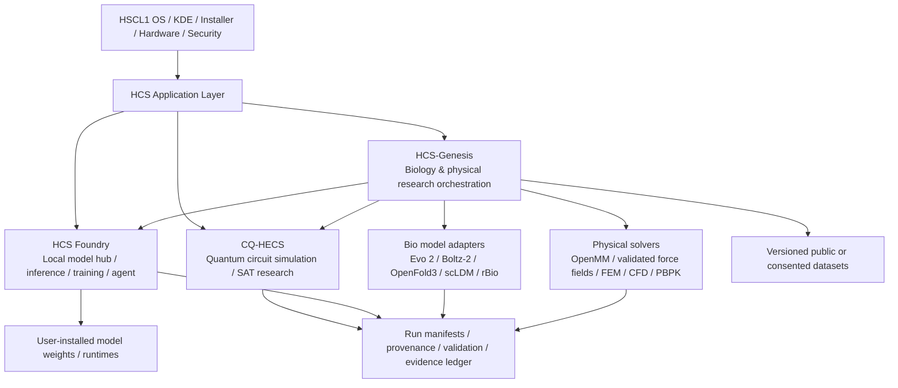

# HCS Genesis & HSCL1 Integration — Autonomous Engineering Agent Contract

**Project family:** HCS Media / `timfromhcs`  
**Primary OS repository:** <https://github.com/timfromhcs/HSCL1>  
**Scientific compute repository:** <https://github.com/timfromhcs/CQ-HECS>  
**Local AI workbench repository:** <https://github.com/timfromhcs/hcs-foundry>  
**Product:** HCS-Genesis / OmniBioSim Engine  
**Publisher / credit:** HCS Media Group — *Made with love by hcsmedia*  
**Research snapshot in this document:** 2026-11-07  
**Default integration target:** HSCL1 `main`; discover the actual default branch before every operation.

> **How to use this file safely:** This is a companion instruction file, not a replacement for the existing `HSCL1/AGENTS.md`. Read and obey that file first. Do not overwrite, truncate, or silently merge it. Keep this file as `AGENTS_HCS_GENESIS.md` (or place it in a dedicated `hcs-genesis` repository as a companion `AGENTS.md`). If the owner later asks to consolidate the instructions, preserve all existing HSCL1 requirements and create a reviewed diff.

---

# 0. Mission, scope, and definition of success

## 0.1 Mission

Act as a long-horizon, autonomous, evidence-driven engineering and research team. Advance the HCS software ecosystem so that:

1. **HSCL1** remains the operating system, desktop, hardware detection, security boundary, installer, package manager integration, ISO build and release system.
2. **HCS Foundry** becomes the shared local AI/model/inference/training workbench. Do not create a second general-purpose model manager or duplicate llama.cpp supervision unless there is a proven technical reason.
3. **CQ-HECS** remains a separately testable classical quantum-circuit simulation and SAT/research engine. Use it for its actual supported workloads, not as a generic quantum chemistry or molecular dynamics solver.
4. **HCS-Genesis** becomes a modular biological and physical research orchestration platform. It composes specialised models and numerical solvers through typed, versioned, provenance-carrying interfaces. It must not pretend that today's models constitute a fully validated digital human.
5. A user can discover, launch, update and uninstall the applications from HSCL1. The live ISO stays small, safe, bootable and useful offline. Large model weights, training stacks, datasets and specialist scientific runtimes are installed on demand after explicit user action and capability checks.
6. Each meaningful change moves through a repeatable **inspect → plan → implement → build → test → inspect evidence → repair → repeat** cycle. Publish only after local and remote verification succeeds.

## 0.2 What success means

A successful result is not a polished screenshot or a green badge alone. It is a set of working, independently tested software components, integrated into an installable OS, with traceable evidence and honest limitations.

The end state should include:

- Three cleanly packaged HSCL1 applications or application modules: `hscl-cqhecs`, `hscl-foundry`, and `hscl-genesis` (names may be refined after package-policy inspection).
- Dedicated Python virtual environments or equivalent isolated runtimes; no uncontrolled `pip install` into the system Python.
- Desktop launchers, icons, app metadata, command-line entry points and user-level service lifecycle.
- Model/runtime installation driven by signed or hash-pinned manifests, explicit licence status, storage estimates and hardware/resource preflight.
- A Genesis API and MCP server with typed tools, capability checks, local-only defaults and no arbitrary shell execution.
- A first scientifically defensible vertical slice that completes from input to output and can be reproduced, benchmarked and compared with an independent baseline.
- Tests for every integration seam: package installation, startup, loopback binding, cancellation, offline mode, clean uninstall, model/runtime absence, low-memory refusal, data provenance and ISO inclusion.
- A bootable HSCL1 ISO that has actually been tested in virtual machines, including a disposable-disk install path when the release scope includes installer verification.
- Updated German, English and French project documentation where the surrounding product provides those languages.
- A build log, evidence ledger, release report, SBOM, checksums and, when signing infrastructure exists, verified artifact signatures.
- A feature branch and reviewed pull request; merge only after the gates in this file and the parent HSCL1 instructions are satisfied.

## 0.3 Hard boundary: no claim of a complete digital human

HCS-Genesis is initially a **research workbench for selected biological and physical questions**. It is not a validated full-body human simulator, a substitute for animal or human studies, a clinical decision system, a drug approval engine, or a medical device.

The following are not permitted product claims unless supported by separate, externally reviewed evidence and the exact context of use:

- “A complete human can be simulated from atoms to behaviour.”
- “A model predicts a clinically effective or safe therapy.”
- “A two-hour simulation replaces years of wet-lab and clinical research.”
- “The system can guarantee zero toxicity, zero off-target effects or a percentage improvement in vision/lung function.”
- “Evo 2 converts a longevity gene from another species into a safe human treatment.”
- “Boltz-2 outputs a universal experimental IC50.”
- “CQ-HECS is a quantum chemistry, electron orbital, molecular dynamics or protein-folding solver.”
- “A model passed because its own generated answer says that it passed.”

Always distinguish **observed experimental data**, **simulator output**, **model prediction**, **statistical estimate**, **synthetic fixture**, **illustrative UI value** and **unknown**.

## 0.4 Current known repository baseline (verify again locally)

The GitHub repositories were inspected on 2026-11-07. These are observed starting facts, not a substitute for checking the current checkout, default branch, tags, CI and actual file contents:

| Repository | Observed branch | Observed snapshot | Observed purpose |
|---|---|---|---|
| `timfromhcs/HSCL1` | `main` | tree `d8f653322225d053d625a30d26d83297a4f0e0ed` | Ubuntu/Kubuntu 26.04.1 + KDE Plasma 6 HCS workstation, Rust CLI, Qt/QML Control Center, Debian packages, ISO remaster and VM/security tests |
| `timfromhcs/CQ-HECS` | `main` | tree `30c7f1484af01cf71a8843cca56ff38786eeaf92` | Python/C++20 classical quantum-circuit simulator, SAT/research, Vulkan integration, browser UI and MCP |
| `timfromhcs/hcs-foundry` | `main` | tree `cfea6fab4ea4bd0ffb1517dc59e98a80f830096a` | Local AI workbench, GGUF model management, llama.cpp supervision, training/benchmark tools, agent and MCP |

Observed metadata at inspection: HSCL1 default branch was `main`, status pre-alpha (`0.1.2-alpha.0` according to its README), and its README stated it had only been tested in VMs, had unsigned releases, and had no physical hardware verification. CQ-HECS README described v5.0.0; HCS Foundry README described v7.5.0. Verify all versions from source files and tags before writing build scripts or manifests.

The connected GitHub read access used for the inspection reported no push permission. Do not assume that an agent's current credentials can push or merge. Check the actual local remotes and authenticated permissions before attempting publication.

---

# 1. Role model and system architecture

## 1.1 Responsibility boundaries



This diagram describes orchestration, not a claim that every adapter or solver already exists.

## 1.2 HSCL1 — operating-system layer

HSCL1 owns:

- OS image, base distribution, kernel, desktop, graphical session and login.
- Hardware detection, CPU/RAM/GPU/storage capability profile.
- User-level app installation and package lifecycle.
- System security policy, firewall defaults, permissions, systemd integration and offline docs.
- ISO build, image verification, VM test harness, installer test and release artifacts.

Do not move all application logic into the OS CLI or into privileged system services. The OS should launch and supervise user applications, not become a monolithic research runtime.

## 1.3 HCS Foundry — local AI workbench

Foundry should own:

- Model repository lookup and model-file metadata.
- GGUF discovery, hashing and licence inspection.
- llama.cpp runtime discovery and process supervision.
- Inference request streaming, metrics and cancellation.
- Resource governor and safe model-fit estimate.
- Optional training stacks, data preparation and model evaluation.
- Its existing agent and MCP tool surface.

Genesis should call Foundry through a documented local API or a versioned adapter. It should not independently download arbitrary models or launch a second unmanaged `llama-server`.

Observed Foundry architecture notes described a service binding to `127.0.0.1:8770`, a supervised llama-server child, SQLite persistence and a single inference server at a time. Treat those as baseline claims to re-check in source. The repository's older known-limitations document may lag behind its current README and code; source and tests are authoritative.

## 1.4 CQ-HECS — bounded scientific compute component

CQ-HECS is a distinct scientific engine. Its supported domain includes classical quantum-circuit emulation, capability-based routing, typed result contracts, SAT/#SAT and research workflows. Its four classical paths and output limits must remain explicit.

Important integration rules:

- The Python package is the most practical initial install surface. The observed `pyproject.toml` identifies package `cqhecs`, CLI `cq-hecs`, Python `>=3.11`, NumPy and Qiskit dependencies, with SAT/dev extras.
- The native C++ build uses CMake/C++20 and requires Vulkan SDK headers/libraries in the observed configuration. A CPU Python install does not imply that a CPU-only native C++ build is supported by the current CMake configuration.
- A compiled shader, Vulkan device enumeration or verified primitive dispatch does not prove end-to-end acceleration.
- Preserve CQ-HECS result status, provenance format (`hcs.run.v2` in the inspected README), approximation/error distinctions and typed refusals.
- Do not call it an electron-structure or molecular quantum simulator. It is not a replacement for quantum chemistry packages.

## 1.5 HCS-Genesis — new orchestration and validation layer

Genesis should be a separate product module. Prefer a dedicated repository (`hcs-genesis`) once the first vertical slice is sufficiently clear. Until then, develop it in a clearly isolated subtree such as `apps/genesis/` and keep the boundary portable so that it can later move without major rewrites.

Genesis owns:

- Research question and context-of-use representation.
- Typed workflow graph and task scheduler.
- Model/solver adapters and capability discovery.
- Multiscale data contracts, coordinate/unit conversions and coupling rules.
- Benchmark datasets, baselines and validation pipelines.
- Provenance, uncertainty, sensitivity and reproducibility metadata.
- MCP resources/tools and the Genesis research UI.
- Evidence reports and exports.

Genesis does **not** own a duplicate general model hub, a bespoke universal molecular dynamics engine, a new quantum circuit simulator, a clinical records database or an autonomous clinical decision-maker.

---

# 2. HSCL1 app integration and packaging

## 2.1 Packaging strategy

Use HSCL1's existing Debian package pattern. Inspect `packages/debian/*`, `scripts/build-deb.sh`, `scripts/remaster-iso.sh`, `distro/live/hooks/010-hscl-defaults.sh` and `distro/live/verify-image.sh` before changing anything.

Proposed package split (adjust after reviewing naming, dependency policy and package size):

| Debian package | Purpose | Default installation |
|---|---|---|
| `hscl-cqhecs` | launcher, Python environment, CLI wrapper, app metadata, docs, optional native runtime descriptor | installed as a small app shell; native extras optional |
| `hscl-foundry` | local app/service launcher, API/UI, user-level service templates, config and docs | installed as a small app shell; heavyweight training extras optional |
| `hscl-genesis` | Genesis UI/API/MCP core, schemas, scientific adapter registry, docs | installed as a small app shell; model packs optional |
| `hscl-science-runtimes` (optional) | vetted shared runtime helpers and numerical dependencies | not part of the default live image unless small and proven necessary |

Do not install all optional packages by default. Keep the ISO footprint, boot memory, disk use and offline install experience measured. The user should be able to install each app after installation, remove it cleanly, and keep using HSCL1 without it.

## 2.2 Isolated Python environments

- Never install these applications into `/usr/lib/python3/dist-packages` by running arbitrary `pip install` against system Python.
- Prefer distro-packaged Python modules when available and stable; otherwise build pinned wheels into a local wheelhouse during CI and install to app-specific virtual environments.
- Use dedicated locations such as `/opt/hscl/venvs/cqhecs`, `/opt/hscl/venvs/foundry` and `/opt/hscl/venvs/genesis`, or a user-managed equivalent when the application has write/update needs.
- Keep mutable database, models, caches, logs and job artifacts under `$XDG_DATA_HOME`, `$XDG_CACHE_HOME`, `$XDG_CONFIG_HOME` or a configured removable/external data directory, never under `/opt`.
- Pin dependency versions and hashes. Generate an SBOM for the package and its bundled wheels.
- Do not vendor wheels or binaries without recording source URL, version, licence, SHA-256, build recipe and update policy.
- Avoid using a shared Python environment for applications with conflicting or independently evolving scientific dependencies.

## 2.3 Debian package requirements

Every new package must:

- Have correct `DEBIAN/control` metadata and versioning.
- Have correct ownership and permissions; no writable-by-everyone executable or config paths.
- Include a launcher (`.desktop`) and icon where appropriate.
- Include a man page or integrated offline help if the CLI is user-facing.
- Add and remove systemd user service templates safely; no daemon should become enabled automatically in the live ISO.
- Avoid network access from maintainer scripts (`postinst`, `preinst`, `prerm`, `postrm`). Package installation must work offline when dependencies are already available.
- Never write credentials or model weights into the package payload.
- Be idempotent on install/upgrade/removal and pass package lifecycle tests.
- Expose an explicit health/status command; it must test real service readiness, not only that a file exists.

Suggested package skeleton:

```text
packages/debian/hscl-genesis/
  DEBIAN/control
  DEBIAN/postinst          # only safe, idempotent cache/schema setup if needed
  usr/bin/hscl-genesis     # safe launcher; no arbitrary shell interpolation
  usr/share/applications/hscl-genesis.desktop
  usr/share/icons/hicolor/.../apps/hscl-genesis.png
  usr/share/hscl/genesis/schemas/
  usr/share/hscl/genesis/adapters/
  usr/lib/systemd/user/hscl-genesis.service
```

Do not copy this skeleton blindly; inspect HSCL1 package conventions and use their existing builders.

## 2.4 Integration with the existing ISO build

The ISO build should install small package shells only. It must not download model weights, start a training process, fetch data sets or silently open network services.

Tasks:

1. Add packages to the package build list in `scripts/remaster-iso.sh` only after their package builds work independently.
2. Update `distro/live/verify-image.sh` to assert package presence, installed file checksums/permissions, app launchers, Python venv metadata and disabled-by-default services.
3. Add package-level unit tests and image-level assertions.
4. Test the exact produced image, not just the staging rootfs.
5. Extract the finished SquashFS or query the booted guest to prove that every expected file and package exists in the ISO.
6. Build the app launchers in live mode and installed mode. Ensure they display a clear first-run state if no model runtime or model weights are installed.
7. Prove the live session can boot offline and that no Genesis/Foundry listener appears until the user launches the app.
8. Prove clean package removal does not remove user research data unless the user explicitly requests its deletion.

Do not weaken the existing HSCL1 rootfs ownership, initramfs, squashfs, checksum, Workshop-inert or credential-scan gates.

## 2.5 Service lifecycle and privilege boundary

- Run Foundry and Genesis as the logged-in desktop user, not root.
- Prefer systemd user services, D-Bus activation or explicit launch-on-demand.
- Services must bind to loopback by default. Do not bind `0.0.0.0` or `[::]` without an explicit, documented remote-access mode with authentication and transport security.
- Do not start any service in the live ISO automatically.
- Keep stdout of stdio MCP servers reserved for JSON-RPC; send diagnostics to stderr.
- Do not expose generic `shell`, `exec`, `sudo`, arbitrary Python evaluation or unrestricted filesystem tools through MCP.
- Use narrow allowlists, schema validation, path containment, timeouts, cancellation and resource limits.
- Do not create a system-wide privileged helper for features that can run in the user's account.

## 2.6 Start menu and user workflow

The HSCL1 desktop should present three coherent scientific applications:

- **CQ-HECS Studio** — open quantum-circuit/SAT research and scientific computation.
- **HCS Foundry** — local model hub and AI workbench.
- **HCS-Genesis** — biological/physical simulation workflows and experiment evidence.

Add a concise first-run capability page with:

- CPU/RAM/GPU/driver detection result.
- Available disk budget and optional external data location.
- Installed app versions and runtime status.
- Offline/online status.
- Model weights present/missing and licence known/unknown.
- What is available on the current hardware vs what requires optional hardware or a remote machine.
- Clear installation/update buttons that do not run implicitly.

Do not advertise GPU acceleration merely because a GPU exists. Require a real backend self-test and a measured representative workload.

---

# 3. Model and data installation policy

## 3.1 No large model weights inside the base ISO

Never embed Evo 2 40B, large Boltz/OpenFold weights, large single-cell models or broad public datasets into the base ISO. Model weights can dwarf the OS, become stale, create licensing problems and make ISO builds unmanageable.

Instead, package small signed manifests and fetch weights only after explicit user action. Every asset needs:

- Model name, upstream repository and immutable revision/commit.
- Exact file names and sizes.
- SHA-256 (and source-provided digest when available).
- Licence and licence URL; unknown licence means blocked from automatic download/use.
- Intended task and context of use.
- Model card and limitations URL.
- Runtime compatibility and tested precision/quantization.
- Minimum and recommended RAM/VRAM/disk estimates.
- Whether weights require a gated account or special agreement.
- Date last verified and the person/agent that performed the check.

## 3.2 Capability-aware installation

Before download or launch:

1. Detect CPU architecture and supported instruction sets.
2. Detect total and available RAM, swap, disk, filesystem type and write permission.
3. Detect GPUs, actual driver, Vulkan/OpenCL/CUDA/ROCm/DirectML support where relevant.
4. Run a backend smoke test. A device name alone does not establish working compute.
5. Estimate model memory, context/KV cache, runtime overhead and output storage.
6. Apply a conservative safety reserve. Avoid allocations that may freeze or kill the desktop.
7. Present the size, licence and risk to the user.
8. Require explicit confirmation before downloading large assets or using metered/remote compute.
9. Download to a temporary file, verify digest, atomically move into place and record provenance.
10. Make failed downloads resumable and clean up incomplete partial files safely.

Use Foundry's machine governor and GGUF library rather than creating a parallel set of contradictory RAM rules. Extend its interfaces only where required.

## 3.3 External storage

Support an optional external SSD/HDD for models, datasets and research artifacts. Requirements:

- User-selectable storage root and clear mount/permission diagnostics.
- No assumption that removable media is always present.
- Jobs fail gracefully if a volume disconnects; never corrupt the internal database.
- Store manifests and small metadata locally; large weights/artifacts remain on configured storage.
- Validate filesystem writeability, free space and case-sensitivity constraints.
- Never execute programs directly from an untrusted removable drive without an explicit trust action.

## 3.4 Offline-first behaviour

- App shells, CLI help, schemas and docs work offline.
- Model registry browsing can use a cached manifest; show its age.
- Download, upstream API queries and remote compute are clearly network-dependent.
- No hidden telemetry or model uploads.
- User research data stays local unless explicitly exported or synced.

---

# 4. Scientific architecture and model selection

## 4.1 Five biological/physical scales

Use the five scales as an orchestration taxonomy, not as an assumption that each scale can currently be simulated at clinical fidelity.

### Scale 1 — Molecular structure, chemistry and molecular dynamics

Possible components:

- Boltz-2 for biomolecular structure/co-folding and affinity-related prediction within its documented domain.
- OpenFold3-preview for selected structure-prediction workloads after checking supported cases, weights, licence, GPU requirements and parity evidence.
- Molecular mechanics / molecular dynamics packages such as OpenMM with validated force-field families for their intended biomolecular domains.
- MACE-OFF as an evaluated candidate for appropriate organic/biomolecular interatomic-potential tasks, not a universal replacement for a quantum chemistry package.
- Conventional quantum chemistry packages or external computational chemistry backends for tasks that genuinely need electronic structure, subject to licensing and resource constraints.

Rules:

- Do not use MACE-MP-0 as a generic protein/ligand force field. It is primarily materials-oriented; evaluate a task-appropriate model such as MACE-OFF and validate against reference calculations and experimental observables.
- An ML interatomic potential typically predicts energies and forces within a learned domain. Do not claim it computes exact orbitals, arbitrary bond-breaking chemistry, excited states or all long-range phenomena.
- Validate protonation state, tautomer, stereochemistry, pH, ionic strength, solvent, cofactors, metal ions and force-field coverage.
- Treat Boltz outputs as computational predictions, not experimental Kd/Ki/IC50. Record assay type, model output semantics and units separately.
- Preserve uncertainty and score calibration. Do not convert a model confidence score to a probability of clinical success.

### Scale 2 — Genome, transcriptome, epigenome and proteome

Candidate components:

- Evo 2 for genomic sequence modelling, comparative sequence exploration and hypothesis generation.
- Variant annotation and established bioinformatics tools for mapping, alignment, orthology/paralogy, transcript isoforms and functional annotation.
- Open and curated public data sources with versioned snapshots.

Rules:

- Evo 2's scale and long context do not turn it into a validated gene therapy design engine.
- Cross-species transfer requires explicit orthology, isoform, regulatory context, expression, cell/tissue and functional evidence.
- Separate sequence similarity from functional conservation and from therapeutic safety.
- Never assert that a sequence generated by a model is safe, effective or clinically suitable.
- The bowhead-whale CIRBP literature may be a case-study dataset and hypothesis. It is not an instruction to synthesize or administer a human gene-editing intervention.
- Any future sequence-design functionality requires separate biosafety review and human authorization; it is not in the initial MVP.

### Scale 3 — Single cell / perturbation response

Candidate components:

- scLDM and comparable single-cell perturbation models for defined datasets and tasks.
- scGPT/Geneformer-style representations only where the exact released model, data and licence support the use case.
- CZI Rbio as a biology-reasoning assistant, not as a mechanistic cell simulator.
- Experimental single-cell RNA/protein data and transparent mechanistic baselines.

Rules:

- Evaluate across held-out perturbations, donors, batches and cellular contexts. Random cell-level splits can leak near-identical biological conditions into train and test sets.
- Include simple baselines (mean response, control-cell mean, linear/regularized models) and report when they win.
- Evaluate gene-level effect sizes, rank correlation, differential expression and distributional similarity separately. One aggregate metric is insufficient.
- Check cell-type identity, perturbation dose/time, viability, batch effects, missing genes and out-of-distribution cases.
- Mark predictions outside the training domain as exploratory/unsupported.

### Scale 4 — Tissue and organ mechanics

Candidate methods:

- Finite Element Methods (FEM) for defined mechanical boundary-value problems.
- Computational Fluid Dynamics (CFD) for flow fields under declared constitutive and boundary assumptions.
- Physics-Informed Neural Networks (PINNs) as surrogate/solver candidates, compared against conventional numerical solvers.
- Electrophysiology and tissue-specific models for narrowly scoped tasks.

Rules:

- Start with one organ/task, not a full anatomy platform. Define geometry, units, material law, mesh, boundary/initial conditions, calibration data and numerical solver.
- Compare PINNs against FEM/CFD reference solvers on held-out conditions. PINNs are not automatically more accurate or faster.
- Report mesh/time-step convergence, residuals, stability, solver tolerance and sensitivity.
- Do not output synthetic ECG or other waveforms as clinical evidence. Validate against independent, appropriately licensed clinical datasets and known reference cases.
- Distinguish tissue mechanics from organ function and from patient outcomes.

### Scale 5 — Whole-body systems, PK/PD and immune/endocrine coupling

Candidate methods:

- Physiologically Based Pharmacokinetic/Pharmacodynamic (PBPK/PD) compartment models.
- ODE-based mechanistic models and sensitivity analysis.
- Carefully specified age/epigenetic marker models where measurement and validation are available.
- Immunological models for narrow, well-characterized questions.

Rules:

- Begin with a small, inspectable PBPK model and a published benchmark, not a general "virtual human".
- Represent population variability explicitly. Do not fit all parameters to the same cohort and claim external prediction.
- Track parameter identifiability, uncertainty intervals, sensitivity and validation against independent studies.
- A biological aging clock estimates a biomarker-associated quantity; it does not prove rejuvenation, lifespan extension or organ recovery.
- Do not create a synthetic patient dossier that looks like a real patient record. The initial dataset should be synthetic and clearly labelled.

## 4.2 Coupling across scales

Never wire model outputs together without a declared coupling contract.

Each adapter must define:

- Input and output schema versions.
- Biological entity and granularity (sequence, residue, molecule, cell, tissue, organ, subject cohort).
- Coordinate frame, units, normalization and reference genome/sequence where applicable.
- State variables and boundary/initial conditions.
- Time scale and sampling interval.
- Model version, code revision, weight digest and runtime version.
- Training/evaluation data provenance and model card.
- Known domain limits and unsupported cases.
- Numerical error, statistical uncertainty and prediction intervals as distinct concepts.
- Resource estimate, supported backends and cancellation semantics.

Coupling must include explicit conversion code with unit tests, invariants and reference values. If a value cannot be mapped to the next scale defensibly, stop with a typed `UNSUPPORTED_COUPLING` or `UNRESOLVED` result. Do not interpolate a missing biological mechanism just to keep the workflow running.

## 4.3 Model adapter contract

Define a common typed adapter interface, for example:

```python
class ScientificAdapter(Protocol):
    adapter_id: str
    adapter_version: str

    def describe_capabilities(self) -> CapabilityManifest: ...
    def validate_input(self, request: RunRequest) -> ValidationReport: ...
    def estimate_resources(self, request: RunRequest) -> ResourceEstimate: ...
    async def run(self, request: RunRequest, context: RunContext) -> RunResult: ...
    async def cancel(self, run_id: str) -> CancelResult: ...
    def validate_output(self, result: RunResult) -> ValidationReport: ...
```

The final contract may differ in language/framework, but it must be explicit, versioned and testable. Never accept arbitrary model names and construct shell commands from them. Adapter launch uses fixed executable paths, validated argument arrays and controlled environment variables.

## 4.4 Result statuses

Use explicit statuses such as:

- `SUCCESS`: run completed and result passed configured numerical/structural checks; does not mean biological truth or clinical validity.
- `PARTIAL`: some outputs are available; incomplete areas listed.
- `UNRESOLVED`: insufficient evidence, resources or numerical confidence.
- `UNSUPPORTED`: task lies outside the model's declared capability.
- `FAILED`: execution failed.
- `CANCELLED`: user or supervisor cancelled the task.
- `INVALID_INPUT`: schema, unit or scientific precondition failed.

A green UI must not erase `PARTIAL`, `UNRESOLVED` or `UNSUPPORTED` status.

---

# 5. Research evidence, datasets and provenance

## 5.1 Data sources and interpretation

Potential public data sources include:

- ClinicalTrials.gov for trial registrations and published/posted results.
- ChEMBL for curated bioactivity and assay-linked compound/target data.
- FDA/openFDA/FAERS for reported adverse events and associated product data.
- Public omics/perturbation repositories and peer-reviewed supplementary data.
- Structural repositories and benchmark sets whose licence and terms permit the intended use.

Never combine these into one undifferentiated "failed drug graveyard" score.

In particular, FAERS is a spontaneous-reporting system. Reports can be incomplete, duplicated, confounded or unverified, and do not establish causation or incidence. The UI must say **reported safety signal**, not **proven drug toxicity**, unless causal evidence exists. ClinicalTrials.gov trial status/outcome fields are not a complete explanation for all failures; link trial records with publications, regulatory reviews and other evidence where possible.

## 5.2 Evidence record

Every ingested document/row/dataset must record:

- Source name, stable identifier and URL.
- Download/retrieval timestamp and publication/update date.
- Source revision, snapshot or version where available.
- Licence, terms and permitted use.
- Raw-file SHA-256 and normalized-data SHA-256.
- Schema/parser/ETL version.
- Inclusion/exclusion logic and deduplication decisions.
- Missingness, known reporting bias and coverage warnings.
- Whether a fact is reported, inferred, predicted or experimentally measured.

Use deterministic ETL, immutable raw snapshots where legally allowed, idempotent transforms and a lineage graph. Do not silently update historical data in place. Create a new snapshot/version and maintain migration/reproducibility metadata.

## 5.3 Negative-data evidence registry

The "Graveyard Shield" should be a structured **Evidence Registry**, not a magical RAG that declares a molecule unsafe from text similarity.

Store separate evidence classes:

1. Trial stopped/terminated, with documented reason and source.
2. Trial completed but failed its prespecified endpoint.
3. Safety signal reported in a spontaneous report system.
4. Preclinical toxicity observation.
5. Mechanistic hypothesis or computational alert.
6. Publication-level negative result.
7. Unknown/undisclosed reason.

Any similarity match must display:

- What is similar (chemical scaffold, target, pathway, assay, dose, model prediction or text).
- Which evidence class is being surfaced.
- Source, date and population/species/assay context.
- Whether the result is causal, associative or hypothetical.
- A warning that similarity is not proof of shared efficacy or toxicity.

## 5.4 Privacy, consent and human data

- Default to synthetic/public de-identified data, not patient identifiers.
- Never ingest personal genome, clinical records or identifiable omics without documented permission, valid legal basis, clear purpose limitation, data minimization, retention policy and access controls.
- Encrypt sensitive datasets at rest where applicable; keep secrets out of logs, crash reports, MCP responses and screenshots.
- Make deletion/export behaviour explicit and test it.
- Do not upload personal data to a cloud model by default. A remote adapter must display the destination, data types and user consent before transmission.
- Treat GDPR, research ethics approvals, data licences and institutional access rules as separate requirements; software tests do not establish legal compliance.

---

# 6. Validation and scientific quality gates

## 6.1 Verification is not validation

Maintain separate records:

- **Code verification:** does the implementation solve the equations/algorithm it claims to implement?
- **Numerical verification:** are discretization, precision, convergence and solver tolerances controlled?
- **Scientific validation:** do model outputs agree with independent real-world observations for a defined context of use?
- **External generalization:** does performance hold on unseen cells, perturbations, subjects, institutions, devices or study conditions?
- **Decision credibility:** is the model sufficiently credible for the decision it is intended to inform?

A passing unit test validates code behaviour against an assertion; it does not validate a biological hypothesis.

## 6.2 Mandatory baseline hierarchy

For every new model/solver experiment, define before tuning:

1. Naive baseline (e.g. constant mean, no-effect/control response, simple physical estimate).
2. Simple statistical baseline (e.g. linear/regularized model).
3. Established domain model or reference solver where available.
4. Candidate AI model / hybrid method.

Report all results on the same held-out dataset and with the same metric definitions. Do not cherry-pick one metric or one dataset.

## 6.3 Data splits and leakage checks

- Split at the meaningful independent unit: perturbation, donor, patient, study, institution, batch, time period or molecular scaffold as relevant.
- Never use random cell-level splits when cells from the same donor/condition can appear in both train and test without a scientifically justified design.
- Freeze split manifests and hashes before model tuning.
- Keep a final holdout untouched by model selection.
- Include out-of-distribution tests and report failures.
- Document leakage checks, duplicated records and preprocessing fit boundaries.

## 6.4 Numerical and biological checks

Depending on the module, require appropriate checks such as:

- Unit/dimension consistency.
- Mass/charge/atom-count conservation when applicable.
- Probability normalization and non-negativity.
- Symmetry, conservation or boundary-condition invariants.
- Solver convergence and mesh/time-step refinement.
- Reference-case comparison against independent implementations.
- Calibration, coverage and sharpness of uncertainty intervals.
- Sensitivity to parameter variation and initial conditions.
- Seed/repeat variability and deterministic replay where feasible.
- Comparison to empirical observations with confidence intervals.

No model may silently replace missing or invalid values with zero, identity transformations or default physiological values without recording and testing the policy.

## 6.5 Benchmark protocol

Each benchmark record must include:

- Hypothesis and intended context of use.
- Pre-registered task definition where appropriate.
- Dataset identifiers, splits and hashes.
- Model/solver and weight hashes.
- Hardware/driver/runtime/precision.
- Full command/configuration/seed.
- Wall time, peak RAM/VRAM, disk I/O and energy/power data if measured.
- Metrics, confidence intervals and test count.
- Baselines and negative results.
- Known limitations and reproducibility instructions.

Run repeated trials and report dispersion. A single machine run is an observation, not a general performance claim. Never claim a 1,000-patient cohort completes in two hours until that exact workload, configuration, output quality and machine have been reproduced and benchmarked.

## 6.6 Scientific release gate

A model adapter cannot be promoted to `SUPPORTED` merely because it starts. It needs:

- Upstream license and weight revision checked.
- Adapter input/output schema tests.
- Known-answer/reference cases.
- Independent baseline comparison.
- Intended-domain and unsupported-domain documentation.
- Memory/latency benchmark on at least one declared machine.
- Provenance capture.
- Failure/cancellation/restart tests.
- Review of generated claims and UI wording.

Use states such as `PROTOTYPE`, `EXPERIMENTAL`, `BENCHMARKED`, `VALIDATED_FOR_CONTEXT`, `DEPRECATED` and `BLOCKED`. `VALIDATED_FOR_CONTEXT` must always name that context; it must never imply universal validity.

---

# 7. HCS-Genesis API, MCP and agent orchestration

## 7.1 API architecture

A practical initial shape is:

```text
Genesis UI (browser/desktop shell)
       |
       v
Genesis local API / job coordinator
       |-- capability and resource preflight
       |-- workflow graph / typed run state
       |-- evidence and provenance store
       |-- model adapter registry
       |-- validation and report exporter
       |-- Foundry adapter (local inference)
       |-- CQ-HECS adapter (circuit/SAT workloads)
       |-- biological model adapters
       |-- numerical solver adapters
```

Start with a small local API. Do not introduce Redis, Celery, Kubernetes or containers just because the concept document mentions them. Add distributed infrastructure only after a measured workload demonstrates that the simple job runner is insufficient. A local SQLite-backed queue may be enough for the first release.

## 7.2 Local security defaults

- Bind only to `127.0.0.1` by default.
- Require an unguessable session token or local pairing for browser mutations.
- Validate Host and Origin; apply CSRF protections where applicable.
- Set request, body, upload and job timeouts.
- Limit concurrent jobs according to hardware governor output.
- Use private per-run directories with unpredictable IDs and strict path containment.
- Never interpret submitted filenames/IDs as paths without canonicalization and root containment.
- Keep CORS narrow; do not use wildcard origins with credentials.
- Do not expose an internet-facing API without a separate threat model, auth, transport security and review.
- Log run metadata but redact secrets, personal data and raw genetic/clinical content by default.

## 7.3 MCP design

Implement a dedicated `hcs-genesis-mcp` server using the current MCP SDK/protocol version selected at build time. Pin the dependency and test against protocol-version negotiation. Transport: stdio for local desktop agents initially.

Initial read-only resources may include:

- `genesis://capabilities`
- `genesis://models/catalog`
- `genesis://datasets/catalog`
- `genesis://runs/{run_id}/summary`
- `genesis://runs/{run_id}/provenance`
- `genesis://evidence/{evidence_id}`

Initial tools should be narrow and safe:

- `genesis_capabilities` — detect installed adapters and their capability limits.
- `genesis_plan` — validate a workflow and return a dry-run plan/resource estimate.
- `genesis_benchmark_run` — execute only a registered benchmark profile, not arbitrary user shell text.
- `genesis_run_get` — retrieve state/summary/log tail for an existing run.
- `genesis_run_cancel` — cancel a user-owned run.
- `genesis_validate_result` — run configured validators on an existing result.
- `genesis_export_report` — create a new report under an approved export directory.

Later mutating tools require a human approval step and an auditable approval record. Do not expose tools that directly order synthesis, create biological agents/pathogens, generate wet-lab protocols for hazardous biological activity, administer therapies or modify any patient's clinical record.

## 7.4 Agent planning and execution

The agent should operate as a research orchestrator, not an omnipotent shell user.

Every task follows:

1. Interpret the research question and ask for missing critical assumptions only when unavoidable. Otherwise state the assumptions in the plan.
2. Resolve context of use, biological entity, endpoint and data permissions.
3. Discover adapters and supported capabilities.
4. Produce a dry-run plan with resource estimates, expected outputs and failure conditions.
5. Reject unsupported coupling or invalid data before execution.
6. Require user approval for costly downloads, remote compute, personal data access or consequential writes.
7. Execute a bounded workflow with cancellation and checkpointing.
8. Validate outputs against registered checks and independent baselines.
9. Record provenance, uncertainties and limitations.
10. Present results with status and evidence type; never overstate the conclusion.

No unbounded self-improvement loop, self-modifying production model or autonomous release to users. The agent can propose changes and run benchmarks; human review gates promotion.

---

# 8. UI / UX requirements

## 8.1 Product experience

Create an original HCS Cybernetic Bio-IDE that fits the HSCL1 visual language and the HCS Foundry interaction model. The interface can be dark and data-rich, but scientific clarity takes priority over decorative telemetry.

Core screens:

1. **Research Home:** installed modules, recent runs, data sources, machine status and blocked capabilities.
2. **Workflow Composer:** typed nodes with explicit input/output ports and versioned contracts.
3. **Scale Explorer:** molecular / genomic / cellular / tissue / system context navigation, with the current scale and data provenance visible.
4. **Run Inspector:** logs, progress, resource usage, cancellation, checkpoint and artifact list.
5. **Evidence Registry:** observed, predicted, reported, synthetic and unknown evidence separated.
6. **Validation Lab:** baselines, holdouts, metrics, confidence intervals, calibration and failure analysis.
7. **Model/Adapter Registry:** upstream source, weights, version, licence, capability and limitations.
8. **Report Builder:** reproducible research report with exact run manifest and references.

## 8.2 Three-dimensional viewport

Three.js/WebGPU can be an optional visualization layer, not a hard dependency for core science. A 3D render must not imply the object is being simulated with molecular accuracy. The UI must distinguish:

- actual measured input geometry/data,
- model-predicted geometry,
- illustrative or synthetic visualization,
- missing/unresolved regions.

Provide CPU/browser fallback and accessible 2D charts. WebGPU availability requires runtime probe, shader compilation and numerical comparison with a known CPU reference before the UI marks the backend available.

## 8.3 Chrono-scrubber and node graph

- Time axis must map to an actual model time variable and unit; never equate wall-clock time with biological time.
- Node execution state is tied to a run ID and provenance.
- Node parameters are schema-validated and persisted with versioning.
- Any unsupported node configuration is blocked before execution.
- The UI must show uncertainty and missing data alongside predicted values.

## 8.4 No misleading sample values

All example values (e.g. 89% response, −3.4 years, 0% toxicity, +18% visual field) must be generated from explicitly synthetic fixtures and carry a permanent `DEMO / SYNTHETIC` label. They must not appear in production report exports as experimental results. Add tests that reject accidental use of demo fixture values in a real run report.

## 8.5 Accessibility and localization

- Keyboard-first navigation and visible focus.
- Screen-reader labels for charts, status and graph nodes.
- Contrast, scalable text and reduced-motion setting.
- No colour-only meaning; pair red/green with labels/icons.
- EN/DE/FR resources with key parity tests.
- Keep scientific terms consistent across translations; do not translate identifiers, units or model names inconsistently.

---

# 9. Safety, biosecurity and responsible research

This platform handles biological data and may eventually interact with models that generate sequences or experimental hypotheses. Build an explicit governance layer before enabling advanced generative features.

- The MVP is limited to public/synthetic data, descriptive analysis, model comparison, non-hazardous computational modelling and narrowly scoped literature/assay evidence.
- Do not implement workflows for pathogen engineering, increasing transmissibility/virulence/host range, toxin optimization, evasion of immune detection, harmful biological agent construction or other dangerous biological enhancement.
- Do not auto-generate synthesis orders, acquisition instructions or wet-lab execution protocols for hazardous biological work.
- Any future sequence design or gene-editing feature is disabled by default and must undergo a separate documented biosafety/legal review, capability gating and human approval.
- Never automatically submit generated biological sequences, molecules or interventions to a provider, synthesis vendor or external service.
- Separate “in silico hypothesis” from “laboratory result” and “clinical evidence”.
- Keep a safety decision log and tests preventing prohibited tools from entering MCP or the UI accidentally.

The product must not be used to diagnose, treat, monitor or recommend patient care. Add a clear research-only notice in the application and exported reports. This is not a replacement for institutional biosafety, ethics, regulatory or clinical oversight.

---

# 10. Long-horizon implementation roadmap

Work in small slices. Complete exit criteria for each phase before moving to the next. The agent may reorder work if source inspection or blockers justify it, but must record the decision and preserve the phase gates.

## Phase 0 — Baseline, repository map and claims audit

Tasks:

- Inspect local clones, branch/remotes/tags, clean/dirty state, licences, all `AGENTS.md` files and relevant workflows.
- Read HSCL1 `README.md`, `docs/ARCHITECTURE.md`, `docs/BUILDING.md`, `docs/TESTING.md`, `docs/CLAIMS.md`, `docs/KNOWN_LIMITATIONS.md`, `docs/THREAT_MODEL.md` and current `AGENTS.md`.
- Read CQ-HECS canonical README/architecture/limitations/test instructions and HCS Foundry architecture/MCP/model/runtime/security docs.
- Identify existing overlap and conflicts; do not duplicate functionality.
- Capture actual versions, package dependencies, service ports, MCP tools and app startup paths.
- Establish baseline local test and remote CI status for all three repos.
- Create `docs/genesis/BASELINE.md`, `RESEARCH_LEDGER.md`, `DECISIONS.md`, `BLOCKERS.md` and `TEST_MATRIX.md` (or a dedicated Genesis repo equivalent).

Exit criteria:

- Baseline commit SHAs, toolchain versions and branch status recorded.
- Every planned capability labelled implemented/experimental/planned/blocked.
- No code changes have overwritten existing user work.
- A scope map states which repository owns each capability.

## Phase 1 — Shared contracts and packaging spike

Tasks:

- Define versioned JSON schemas for capabilities, runs, provenance, evidence and reports.
- Define adapter contract and common result statuses.
- Build one minimal Debian package for CQ-HECS or Foundry launcher.
- Add a package test install/uninstall cycle in a disposable environment.
- Add `.desktop` entry and basic `hscl` discovery integration.
- Validate that no network call or model download occurs at package install.

Exit criteria:

- Schema fixtures and compatibility tests pass.
- Package can be built twice from clean sources and installed/uninstalled without system Python pollution.
- CLI reports real installed version and missing optional runtime correctly.

## Phase 2 — CQ-HECS integration

Tasks:

- Package the supported Python install first.
- Add a CLI wrapper and launchable Studio where supported.
- Add optional SAT dependencies only when requested.
- Add optional C++/Vulkan package only when SDK/build prerequisites and target hardware are established.
- Preserve provenance contract, engine capability limits and error semantics.
- Add HSCL1-specific integration tests and documentation.

Exit criteria:

- Circuit reference corpus and SAT tests pass in the isolated environment.
- A real `cq-hecs doctor` and small deterministic example run from HSCL1.
- No claim of full GPU acceleration without workload evidence.
- CQ-HECS can be removed without damaging HSCL1 or deleting research data.

## Phase 3 — HCS Foundry integration

Tasks:

- Package the small service/UI shell and user-level service template.
- Reuse Foundry's model library/governor and `llama-server` supervisor.
- Expose safe launcher and status/doctor integration.
- Add local pairing, loopback-only and no-autostart defaults.
- Keep training dependencies out of the base ISO; install optional groups into isolated environments.
- Add a verified model manifest update workflow and user-selected storage root.

Exit criteria:

- Foundry starts only when explicitly launched.
- Service binds to loopback and pairing auth works.
- `llama-server` is supervised, cancellation/shutdown works and no orphan process remains.
- With no runtime, no weights or no GPU, app surfaces an honest actionable state.
- Offline app shell and clean uninstall pass.

## Phase 4 — Genesis MVP: research registry and workflow graph

Tasks:

- Create Genesis project skeleton, API, local SQLite metadata store and React/QML-compatible UI decision record.
- Implement model/dataset/adapter registry and typed workflow graph.
- Implement run lifecycle: plan, preflight, run, cancel, resume where supported, validate, export.
- Implement provenance contract and artifact hashing.
- Implement a mock adapter strictly labelled as a fixture; prevent mock outputs from being represented as real results.
- Add read-only MCP resources and initial safe tools.

Exit criteria:

- End-to-end synthetic workflow is reproducible and labelled synthetic.
- MCP stdio protocol tests pass; stdout contains only JSON-RPC.
- No arbitrary shell or unrestricted file path tool exists.
- Data is local-only and services are disabled by default.

## Phase 5 — First scientific vertical slice

Do not attempt all five scales simultaneously. Select one focused, public-data, independently testable research question. Recommended candidates:

- Single-cell perturbation prediction benchmark, comparing simple baseline, scLDM or another precisely versioned model, and an out-of-distribution split; or
- A small molecular structure/binding benchmark using Boltz-2 with assay provenance and careful score semantics; or
- A small PBPK published reference case with transparent ODE equations, parameter sensitivity and held-out validation.

Tasks:

- Write a research question, context of use, dataset card and validation plan before implementation.
- Freeze data and split hashes.
- Reproduce the baseline first.
- Integrate one candidate model/solver.
- Compare on the identical test conditions.
- Record uncertainty, failures and domain limitations.
- Create a reproducible HTML/Markdown/PDF report only after source and values are verified.

Exit criteria:

- Baseline is reproduced.
- Candidate is not promoted if it fails to improve or is not calibrated.
- External holdout and failure analysis are included.
- Results are reproducible from a clean environment.
- Every reported number links to run provenance and source data.

## Phase 6 — Cross-scale coupling prototype

Tasks:

- Add exactly one two-scale coupling path with explicit unit/coordinate/time contracts.
- Validate conversion functions independently.
- Propagate uncertainty or stop where propagation is unsupported.
- Compare the coupled result with either a joint reference model or independently measured observables.
- Add tests for incompatible schemas, units, missing conditions and out-of-domain inputs.

Exit criteria:

- No silent unit conversion or implicit default conditions.
- Coupling validation and uncertainty handling are documented.
- Unsupported coupling results in a typed refusal.
- No whole-human claim is made from the prototype.

## Phase 7 — Organ/tissue and system modules

Tasks:

- Introduce FEM/CFD/PINN module only for a bounded target and with independent reference comparisons.
- Introduce PBPK/PD module with a published reference case and sensitivity analysis.
- Add data/model lineage and context-of-use reports.
- Only add a 3D visualization for outputs that have a clear scientific representation.

Exit criteria:

- Each model has a separate benchmark and validation dossier.
- Every module declares numerical assumptions and failure modes.
- The coupled workflow can be independently replayed.

## Phase 8 — UI/UX and scientific IDE hardening

Tasks:

- Implement workflow composer, run inspector, evidence registry and validation lab.
- Add 3D viewport as optional, CPU-fallback presentation.
- Add chrono-scrubber only for a real time variable.
- Add EN/DE/FR translation parity, responsive layouts, accessibility and visual regression tests.
- Add demo synthetic state and tests to prevent it leaking into real results.

Exit criteria:

- Core functionality works without WebGPU.
- All user-visible numbers have provenance/status labels.
- UI tests cover success, blocked, partial, failed, cancelled and offline modes.
- No decorative animation causes unacceptable CPU/memory use.

## Phase 9 — Security, privacy, packaging and full ISO integration

Tasks:

- Threat-model review for new service endpoints, MCP, downloads, data, model files and user jobs.
- Package lifecycle, filesystem permissions, network binding and process ownership tests.
- SBOM and licence inventory for new dependencies/models.
- Integrate app packages into HSCL1 ISO with no large weights.
- Verify live session, installed session, app launch, offline mode, optional download, uninstall and upgrade.
- Re-run all existing HSCL1 security and release gates.

Exit criteria:

- No new high/critical unresolved security finding.
- No unexpected listening sockets or auto-start services.
- ISO contains correct package versions and no credentials/model weights.
- Installer VM test writes only to disposable virtual disks.
- All release claims are evidence-backed.

## Phase 10 — Release candidate, remote CI and merge

Tasks:

- Run full local test suite for every changed repository.
- Build packages and ISO from clean state.
- Boot/test the exact artifacts that will be published.
- Push a feature branch only if credentials and permissions are present.
- Open PR, inspect all remote CI and preview results, repair failures, rerun until green.
- Review diffs, dependency changes, SBOM, licence report, checksums, docs and known limitations.
- Update README, changelog, build log, evidence and release notes with exact evidence.
- Merge only after all merge gates pass and repository policy allows it.
- Verify the merged default branch and published artifacts from a clean checkout.

Exit criteria:

- All required local gates pass.
- All required remote checks pass on the exact head SHA.
- No unresolved P0/P1 defects or known data-loss/security issues.
- PR is approved according to repo policy; agent must not self-approve or bypass required reviews.
- Merge is performed without force-push or history rewrite.
- Post-merge checks and artifact checksum verification pass.

---

# 11. Long-horizon self-healing engineering loop

## 11.1 Mandatory iteration loop

For every feature or bug:

1. **Inspect:** read relevant source, tests, docs, issue, git diff and dependency versions.
2. **Reproduce:** create the smallest deterministic failing test or command. Capture exact output and environment.
3. **Hypothesize:** write a short cause hypothesis and the evidence that would disprove it.
4. **Plan:** identify files, API contracts, security impact, test additions and rollback path.
5. **Implement:** make the smallest coherent change. Avoid unrelated refactors.
6. **Build:** build the affected package/application in a clean output directory.
7. **Test:** run targeted tests, relevant full suite, static checks and integration checks.
8. **Review:** inspect diff, generated artifacts, permissions, dependency drift and user-visible claims.
9. **Repair:** if a gate fails, diagnose the cause; do not suppress the test or loosen assertions without a documented correctness reason.
10. **Record:** update execution log, evidence, decisions and next action.

Repeat until all gates pass or a real blocker is documented. Do not continue to stack features on top of an unresolved defect.

## 11.2 Bounded repair behaviour

- Run a maximum of three focused repair attempts for the same failure hypothesis before pausing implementation and reassessing the design.
- Do not blindly rerun a failing command hoping for a different result.
- After two failed attempts, inspect lower-level logs, environment assumptions and test validity.
- After three attempts, create a blocker record with reproduction steps, observed output, suspected root cause and next experiment. Continue on independent safe tasks only.
- Never disable a failing test, mark it xfail/skip, lower a timeout or widen a resource budget solely to make CI green.
- Any changed test oracle or tolerated range must be justified in a decision record and reviewed against an independent source.

## 11.3 Test pyramid

Run the smallest relevant checks after each edit, then expand:

1. Formatter/linter/type checks.
2. Unit tests for the changed function/module.
3. Adapter contract tests.
4. API/MCP integration tests.
5. Package install/uninstall tests.
6. UI/visual/accessibility tests.
7. Cross-repo integration tests.
8. ISO build and image verification.
9. VM boot/live/installer/installed-system tests.
10. Remote GitHub CI, deployed preview and release artifact checks.

Do not run the full multi-hour ISO build after every trivial source edit. First pass fast gates, then build the image at integration milestones and release candidates.

## 11.4 Continuous evidence log

Maintain a chronological `docs/genesis/EXECUTION_LOG.md` (or dedicated Genesis repo equivalent). Each entry includes:

- UTC date/time.
- Repository and branch.
- Commit SHA before/after.
- Goal and changed files.
- Command(s) executed.
- Exit code and test counts.
- Environment/hardware/runtime.
- Artifact paths and SHA-256.
- Failure and resolution.
- What remains unverified.

Maintain:

- `BASELINE.md`
- `ARCHITECTURE.md`
- `DECISIONS.md` (ADRs)
- `RESEARCH_LEDGER.md`
- `EVIDENCE_LEDGER.md`
- `TEST_MATRIX.md`
- `BLOCKERS.md`
- `KNOWN_LIMITATIONS.md`
- `EXECUTION_LOG.md`
- `RELEASE_REPORT.md`

Never rewrite historical experiment records to make the result look better. Append corrections with clear timestamps.

---

# 12. Local build and test commands

Always discover exact scripts and package managers first. The following commands are examples anchored in observed repository instructions; use the current checked-out versions.

## 12.1 HSCL1 baseline checks

```bash
cargo fmt --all -- --check
cargo clippy --all-targets -- -D warnings
cargo test --all
python -m pytest tests -q
python scripts/check-tokens.py
python scripts/gen_qml_theme.py --check
```

If Qt 6 development packages are installed:

```bash
cmake -S apps/control-center -B build/cc -G Ninja
cmake --build build/cc
ctest --test-dir build/cc --output-on-failure
```

Shell scripts, when shellcheck is available:

```bash
shellcheck -S warning scripts/*.sh distro/live/*.sh distro/live/hooks/*.sh packages/debian/*/build.sh
```

## 12.2 ISO build and VM test

Read `docs/BUILDING.md` and `docs/TESTING.md` before running. The observed image path was:

```bash
scripts/fetch-base-iso.sh
scripts/remaster-iso.sh --out "$HOME/hscl1-build/out/HSCL1-dev.iso" --fast
```

Release builds should use the documented release compression mode, not `--fast`.

The builder requires substantial disk and RAM. Respect the current script's own checks. Do not lower memory/disk guards to force a build on inadequate hardware. Use a dedicated scratch directory with enough space. Never run destructive installer tests against a real disk.

Use the current `scripts/qemu_boot_test.py` options and `docs/TESTING.md` to test UEFI, BIOS and available Secure Boot modes. For install tests, attach only a newly created disposable qcow2 image. Verify the installed system boots after the installer completes.

## 12.3 CQ-HECS checks

Use the current repository docs and exact `pyproject.toml`/CMake targets. At minimum:

```bash
python -m pip install -e '.[dev]'
python -m pytest -q
```

For native C++/Vulkan targets, use the documented CMake configure/build/CTest workflow and only declare the backend available after shader compile, native tests and a representative runtime self-test. Do not infer acceleration from compilation.

## 12.4 HCS Foundry checks

The observed Python project lives under `server/`:

```bash
cd server
python -m pip install -e '.[dev]'
python -m pytest -q
```

Run frontend tests/build using `web/package.json` and its lockfile, after verifying current scripts. Run MCP protocol tests, local security tests, model/runtime discovery tests, and startup/shutdown integration tests.

## 12.5 Genesis checks

Create reproducible scripts for:

```bash
# Illustrative targets; use actual project commands after implementation.
python -m pytest -q
ruff check .
ruff format --check .
python -m mypy <configured-source-paths>
npm ci
npm run test
npm run build
```

Do not leave example commands in final docs unless they have been proven to run. Record exact command output and toolchain versions.

---

# 13. CI, branches, pushing and merge policy

## 13.1 Inspect Git before any write

At the start and before every push/merge:

```bash
git status --short --branch
git branch --show-current
git branch -vv
git remote -v
git log --oneline --decorate -n 20
git diff --stat
git diff --check
```

- Preserve unrelated modifications and untracked user files.
- Never use `git reset --hard`, `git clean -fdx`, force push, rebase published history or delete branches/tags without explicit authorization.
- Never assume `main` vs `master`; query the remote default branch.
- Read branch protection/rulesets and repository contribution policy where accessible.

## 13.2 Feature branch and commits

- Create a focused branch from the current default branch, e.g. `feature/hscl1-genesis-integration`.
- Keep commits coherent and descriptive; avoid one enormous opaque commit.
- Do not commit generated ISO files, VM disks, model weights, datasets, caches, credentials, private logs or user data.
- Include lockfile updates and SBOM/licence changes where dependencies change.
- Do not modify unrelated repositories or release tags merely to get a green status.

## 13.3 Push only when authorized

Before push, verify:

- Authenticated account and repository.
- Push permission to the target repository.
- Correct remote URL and branch.
- No secret in staged files, commit diff or CI logs.
- Local required gates green.

If push access is not available, do not fake a push or claim remote verification. Finish local work, provide the branch/commit and exact safe push instructions to the owner.

## 13.4 Remote CI repair loop

After pushing an authorized feature branch:

1. Capture the pushed commit SHA.
2. Inspect all GitHub Actions workflows and required status checks.
3. Wait only within the current execution session for triggered jobs; do not promise background follow-up.
4. Fetch failed logs and reproduce locally.
5. Fix root cause on the feature branch.
6. Re-run local checks, push normally and inspect the new exact SHA's checks.
7. Repeat until all required workflows pass.
8. Inspect deployed preview/website checks if the change affects them.

A green CI for an earlier commit does not verify the latest commit. A branch being mergeable does not mean all scientific validation gates passed.

## 13.5 Merge gates

Merge into the discovered default branch only when all are true:

- PR diff is reviewed and contains no unintended file changes.
- All required CI jobs pass on the latest head SHA.
- Required human approvals are present; do not self-approve or bypass policy.
- Unit, integration, package, UI, security and ISO/VM gates applicable to the scope pass.
- Scientific claims are evidence-backed and limitation text is current.
- SBOM, licence inventory and checksums are generated.
- No unresolved P0/P1 bug, data-loss risk or security vulnerability remains.
- No known regression in HSCL1 boot/install or existing apps.
- Merge method complies with repository policy.

Do not create or merge a `master` branch if the repository's actual default is `main`. Do not force-push. If merge permission is absent, stop after the PR is ready and report the blocker.

## 13.6 Post-merge verification

After merge:

- Fetch the default branch and confirm the merge commit.
- Verify the tree includes the intended changes.
- Re-run fast local checks against the merged commit.
- Verify remote CI on the merged commit.
- Build or retrieve the release artifact associated with that exact commit.
- Verify SHA-256 and, if available, signatures.
- Verify installed package versions and ISO manifest commit SHA.
- Update final release evidence.

“Zero bugs” cannot be proven absolutely. Say **no known blocking defects after the defined verification matrix** and list any remaining untested dimensions.

---

# 14. README, documentation and release quality

Before every release candidate:

- Update root README with current architecture, install/run instructions and actual supported capabilities.
- Keep EN/DE/FR versions aligned if multilingual docs exist.
- Update the component matrix with `SUPPORTED`, `EXPERIMENTAL`, `PLANNED`, `BLOCKED` and hardware support.
- Update `CHANGELOG.md` with user-visible changes and migrations.
- Update `docs/KNOWN_LIMITATIONS.md` and `docs/CLAIMS.md`.
- Update API/MCP schemas and examples from the actual code.
- Include package footprint, installed disk size, idle RAM, run-time RAM and representative latency measurements.
- Include security model, data privacy, loopback endpoints, service startup and uninstall steps.
- Include full model licensing/provenance notes; “open source” does not imply all model weights/data are unrestricted.
- Include the exact ISO build and VM test evidence.
- Include SBOM, SHA-256 manifest and signature verification instructions when applicable.

Do not write “production-ready”, “stable”, “fully secure”, “clinically validated”, “real-time” or “SOTA” without defining and proving the relevant claim.

---

# 15. Definition of Done checklist

## Engineering

- [ ] Baseline and all applicable agent instructions read.
- [ ] No user changes overwritten or discarded.
- [ ] New APIs and schemas versioned and tested.
- [ ] No silent defaults, hidden fallback or fake success.
- [ ] Static checks and targeted/full tests pass.
- [ ] Error paths, cancellation and process cleanup pass.
- [ ] Dependency tree, licences and SBOM reviewed.

## OS integration

- [ ] Debian packages build and install/uninstall cleanly.
- [ ] System Python remains intact.
- [ ] No package maintainer script downloads data or enables an app service.
- [ ] Desktop launchers and CLI actually start real apps.
- [ ] Services run as the user and bind loopback only.
- [ ] Live ISO does not autostart inference, training or research jobs.
- [ ] Model weights are not embedded in the base ISO.
- [ ] Offline first-run and missing-runtime states work.
- [ ] Updated ISO image verifier passes.
- [ ] Exact ISO boots in VM; installer/installed-system tests pass when in scope.

## Scientific validation

- [ ] Context of use and research question stated.
- [ ] Dataset source/licence/version/hash recorded.
- [ ] Split/holdout leakage checks pass.
- [ ] Baselines measured and included.
- [ ] Numerical and domain checks pass.
- [ ] Uncertainty and limitations shown.
- [ ] Predicted vs measured vs synthetic values visibly separated.
- [ ] No clinical efficacy/safety claim without external evidence.

## Security and privacy

- [ ] Threat model updated.
- [ ] No arbitrary shell/exec MCP tool.
- [ ] File paths constrained to approved roots.
- [ ] No credentials or personal data in commits/logs/artifacts.
- [ ] No unexpected service listeners/autostart.
- [ ] Downloads verified and licence-gated.
- [ ] Biosecurity review completed for any newly introduced generative biological capability.

## Release

- [ ] README/changelog/known limitations/evidence log updated.
- [ ] All required local CI gates pass.
- [ ] All required remote CI checks pass on latest SHA.
- [ ] PR review/approval requirements satisfied.
- [ ] Merge performed without history rewrite.
- [ ] Post-merge verification passes.
- [ ] Artifact manifests/checksums/SBOM published and verified.
- [ ] Final report lists exact evidence and what remains unverified.

---

# 16. Research ledger and primary references

The following references informed the 2026-11-07 architecture review. Re-check release status, versions, model cards, licences and guidance before integrating a dependency. A paper is not a validation certificate for a particular local model build.

## Genomics and sequence models

- Brixi et al., **Genome modelling and design across all domains of life with Evo 2**, *Nature* (2026): <https://pmc.ncbi.nlm.nih.gov/articles/PMC13128491/> (DOI: <https://doi.org/10.1038/s41586-026-10176-5>).
- Arc Institute / Evo 2 source and model cards: <https://github.com/ArcInstitute/evo2> (verify current official URL and release before use).
- Bowhead whale DNA repair and CIRBP, *Nature* (2025): <https://www.nature.com/articles/s41586-025-09694-5>. Treat as mechanistic research evidence, not a clinical intervention blueprint.

## Protein structure and molecular models

- Boltz-2 paper / open access copy: <https://pmc.ncbi.nlm.nih.gov/articles/PMC12262699/>. Read the benchmarks and blind-assay limitations, not only the speed headline.
- Boltz source: <https://github.com/jwohlwend/boltz> (verify exact maintained upstream and commit).
- OpenFold3 preview: <https://github.com/aqlaboratory/openfold-3> (verify the exact model-card, feature completeness and weight terms; do not assume preview status is unchanged).
- MACE documentation: <https://mace-docs.readthedocs.io/>.
- MACE-OFF publication, *Journal of the American Chemical Society* (2025): search the exact article by PMID 40387214 and verify the final metadata before citing in product docs.
- OpenMM: <https://openmm.org/> and <https://github.com/openmm/openmm>.

## Single-cell / virtual cell

- scLDM, *Bioinformatics* (2026), DOI/article page: <https://academic.oup.com/bioinformatics/article/42/10/btag727/8842599>. Confirm exact final bibliographic metadata and released code/weights before integrating.
- CZI Rbio model card: <https://virtualcellmodels.cziscience.com/model/rbio>.
- CZI Rbio repository: <https://github.com/czi-ai/rbio>.
- Perturbation prediction benchmarking: *Nature Methods* (2026), article DOI 10.1038/s41592-025-02980-0: <https://www.nature.com/articles/s41592-025-02980-0>.
- OpenProblems: <https://openproblems.bio/> (select current perturbation prediction task and dataset version).

## Regulatory / model credibility

- FDA, **M15 General Principles for Model-Informed Drug Development**, Final Level 1 Guidance, June 2026: <https://www.fda.gov/regulatory-information/search-fda-guidance-documents/m15-general-principles-model-informed-drug-development>.
- FDA, **Assessing the Credibility of Computational Modeling and Simulation in Medical Device Submissions**, November 2023: <https://www.fda.gov/regulatory-information/search-fda-guidance-documents/assessing-credibility-computational-modeling-and-simulation-medical-device-submissions>.
- ASME V&V 40: <https://www.asme.org/codes-standards/find-codes-standards/v-v-40-assessing-credibility-computational-modeling-verification-validation-application-medical-devices> (check edition/access terms).
- EMA / ICH M15: <https://www.ema.europa.eu/> (locate the current ICH M15 Step 5 guideline and effective date before asserting regulatory status in release docs).

## Data sources and caveats

- ClinicalTrials.gov API: <https://clinicaltrials.gov/data-api/about-api>.
- ChEMBL web services: <https://www.ebi.ac.uk/chembl/> and <https://www.ebi.ac.uk/chembl/api/data/docs>.
- openFDA drug adverse events / FAERS description: <https://open.fda.gov/apis/drug/event/>. FAERS is spontaneous reports, not causal incidence evidence.
- HHS ASPE, **Drug Development: Final Report**, 26 September 2024: <https://aspe.hhs.gov/sites/default/files/documents/ce102c41a7626cd885f7c88a9f2c4807/drug-development.pdf>. Use cost definitions carefully; distinguish out-of-pocket estimates from capitalized expected cost including failures.
- Clinical development attrition systematic evidence: use the underlying systematic review and definitions when quoting a percentage; attrition estimates vary by period, modality, therapeutic area and denominator.

## Project source repositories

- HSCL1: <https://github.com/timfromhcs/HSCL1>
- CQ-HECS: <https://github.com/timfromhcs/CQ-HECS>
- HCS Foundry: <https://github.com/timfromhcs/hcs-foundry>

---

# 17. Final handoff format

At the end of an execution session, produce a report with:

1. **Outcome:** completed / partial / blocked.
2. **Repository state:** branches, SHAs, working-tree status and remotes.
3. **What changed:** concise list of source/package/UI/docs changes.
4. **Builds:** exact commands and results.
5. **Tests:** exact commands, passed/failed/skipped counts and reasons.
6. **ISO/VM:** image SHA-256, manifest, firmware mode, live/installer/installed tests and evidence paths.
7. **Scientific evidence:** datasets, splits, baselines, model versions, metrics, uncertainty and limitations.
8. **Security/privacy:** listeners, service state, permission review, dependency/SBOM and unresolved findings.
9. **Cloud:** branch push, PR URL, exact head SHA, workflow runs, preview status and merge SHA; or precise explanation why these actions were unavailable.
10. **Remaining work:** blockers ordered by severity, with reproduction steps.
11. **Honest status:** what is implemented, tested, VM-verified, hardware-verified, experimental and not verified.

Never write that the project is “bug-free”. Use: **“All defined release gates passed for commit `<SHA>`; no known blocking defects remain in the tested matrix. The following dimensions remain unverified: …”**

**North star:** Build a genuinely useful research workstation by composing validated tools—not by disguising uncertainty as intelligence. Keep HSCL1 reliable, Foundry reusable, CQ-HECS mathematically honest and Genesis scientifically auditable.
