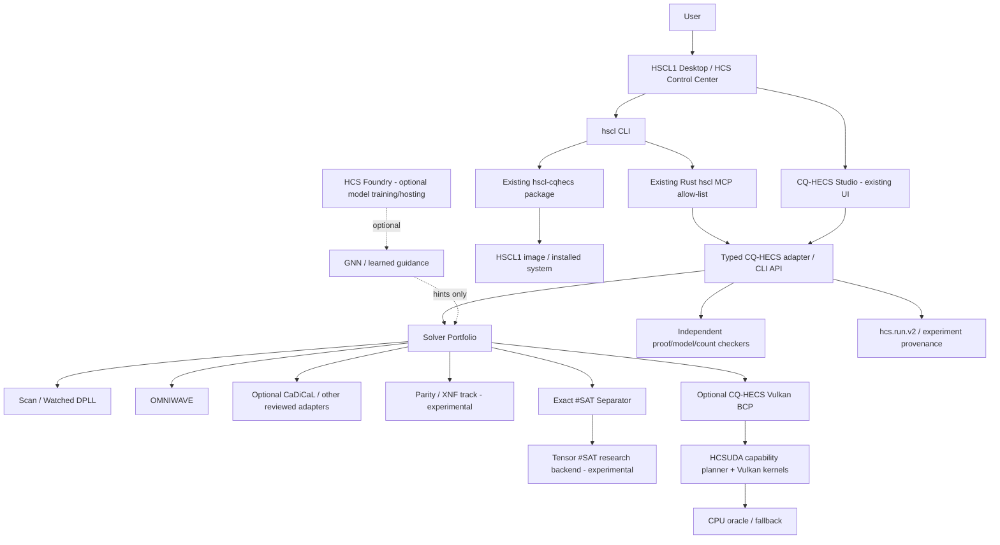

# HCS Unified Ecosystem — Autonomous Engineering, Research & Self-Healing Agent Contract

**Revision:** 2026-11-08 (CET)  
**Repository snapshot checked:** 2026-11-08, approximately 00:09–00:20 CET  
**Primary home:** `timfromhcs/HSCL1`  
**Companion document:** this file is designed to supplement, not replace, the repository's existing root `AGENTS.md`, the live self-heal ledger, and the 7 November Ecosystem Master.  
**Operating principle:** *Reuse first. Measure second. Verify every claim. Integrate once. Update every plan before the next task.*  
**Credit:** Made with love by hcsmedia · HCSMEDIA · timfromhcs

> **Authority and precedence.** This document is an expanded owner-side execution contract. It does not override `AGENTS.md` in HSCL1, repository security policies, explicit human decisions, actual source code, tests, branch protection, repository permissions, or a newer approved live ledger. The latest observed root `AGENTS.md` is 113,402 bytes (blob `88a8a9cc3fd25929a240619799b366bc8deff8fb`). The latest proposed live ledger is in unmerged PR #30 (`docs/superpowers/plans/2026-11-08-selfheal-masterplan.md`, branch `codex/hscl1-v1`, head `a82b7a5d45d04aa11b7585641729f427492fe9eb`). Read both before changing anything. A proposal in an open PR is not yet a merged main-branch rule.
>
> **This document is a plan, not evidence that planned modules, scheduler jobs, patches, or code already exist.** Status words and gates below must be applied literally. No capability may be marked complete merely because this file describes it.

---

# PART I — CURRENT REALITY, REPOSITORY AUDIT AND DECISIONS

## 0. Executive operating contract

HSCL1 is intended to become one coherent HCS operating system and autonomous science/engineering environment. It is not a reason to merge every source tree into one giant binary. The architecture must be unified at the level of contracts, user experience, run provenance, agent orchestration, observability, security, resource scheduling, testing, and plan management. Implementations remain modular and independently testable.

The ecosystem has these established ownership boundaries:

| Product or track | Correct responsibility | Integration boundary |
|---|---|---|
| **HSCL1** | Linux OS, desktop, Control Center, CLI, installer/image, permissions, packaging, release orchestration, integrated end-user experience | Main product and integration host |
| **HCSUDA** | Shared capability-aware CPU/Vulkan compute runtime and verified kernels | Rust crates under `HSCL1/hcsuda/` today; no separate public repo observed |
| **HCSEASYMATH** | Safe symbolic/algebraic mathematical workbench, exact derivative operations and isolated worker | Implemented inside HSCL1 at `apps/hcseasymath/`; extend its typed API instead of creating an unrelated math app |
| **CQ-HECS** | Classical quantum-circuit emulation, SAT/solver portfolio, exact model counting experiments, proof and run provenance, existing Studio | Separate repository, Apache-2.0; cross-repo changes require owner approval |
| **HCSPNP** | Research track for SAT/NP-complexity-adjacent methods | Not a repository; `timfromhcs/HCSPNP` returned 404. Implement through CQ-HECS/HSCL1 only |
| **HCS Physics** | Future deterministic classical/continuum/quantum/field-theory research engine described by the supplied PDF | Proposed domain module inside HSCL1; not a separate live repository. `timfromhcs/hcsphysics` returned 404 |
| **HCS Foundry** | Optional model/training/verified-task ecosystem | Separate repository; inspect exact APIs and license before any reuse |
| **HCS Discovery Studio** | Separate domain product, possible reference for workflow and evidence UX | Separate repository; reuse only generic, reviewed interfaces or design patterns |

**Never create a second solver, second compute runtime, second MCP server, second run-provenance format, or second Control Center merely because a feature is not yet exposed in the UI.** Extend the existing boundary and keep the new capability behind a typed adapter.

### 0.1 What the finished platform should become

A person opens HSCL1 and finds one coherent desktop and one HCS Control Center. From there they can open a research workspace, choose a domain (mathematics, SAT/logic, quantum circuits, classical physics, continuum physics, or later field theory), describe an experiment, review a typed plan, run it locally, inspect its resource use, and export a reproducible evidence package. Agents can help with literature retrieval, hypothesis formation, safe input generation, code changes, test authoring, benchmark campaigns, debugging, and documentation. Deterministic engines, numerical checkers, formal proof assistants, and independent reference implementations—not the language model—decide whether results are correct.

### 0.2 Five laws that govern the entire ecosystem

1. **One product experience, modular engines.** Common UI and contracts; no monolithic cross-domain solver.
2. **The model proposes; the verifier disposes.** Agents can suggest and orchestrate; they cannot mark their own outputs correct.
3. **Evidence is a first-class output.** Every run and change produces machine-readable provenance and a human-readable summary.
4. **Resource-aware by default.** Every operation declares estimated CPU, RAM, GPU memory, storage, runtime and network needs before execution.
5. **Plans are live engineering state.** Synchronize the repository snapshot and reconcile all affected plans before beginning the next unit of implementation.

## 1. Fresh repository snapshot — 8 November 2026

This snapshot was obtained from the GitHub API and public repository content around 00:09–00:20 CET. It supersedes the 7 November snapshot in the inherited companion contract below. Refresh it at every future session; never assume it remains current.

### 1.1 Main repositories and permissions

| Repository | Main SHA / observed date | Visibility / license | Role | Connector permission observed |
|---|---|---|---|---|
| `timfromhcs/HSCL1` | `4bdcb2f8ab628023ef85c3560b438024b90836eb`, 2026-11-07 22:34:39 UTC | Public | OS + core integration + HCSUDA + HCSEASYMATH | pull yes, push no |
| `timfromhcs/CQ-HECS` | `30c7f1484af01cf71a8843cca56ff38786eeaf92`, 2026-11-02 17:44:47 UTC | Public, Apache-2.0 | quantum emulator + SAT / #SAT / Studio / provenance | pull yes, push no |
| `timfromhcs/hcs-foundry` | `cfea6fab4ea4bd0ffb1517dc59e98a80f830096a`, 2026-11-02 17:15:07 UTC | Public | optional model/training system | pull yes, push no |
| `timfromhcs/hcs-discovery-studio` | `fdd6ccb7a58fb63313ce2ec928f1234c022fb813`, 2026-11-04 11:42:36 UTC | Public | separate discovery platform | pull yes, push no |
| `timfromhcs/hcsphysics` | 404 | no repository observed | future physics track only | n/a |
| `timfromhcs/HCSPNP` | 404 | no repository observed | research track only | n/a |
| `timfromhcs/HCSUDA` | 404 | no separate repository observed | HCSUDA is inside HSCL1 today | n/a |

The currently connected GitHub integration reported `push: false` for each accessible repository. This file may direct a future local agent to prepare diffs, but it must not claim that it has pushed a commit, opened a PR, merged, tagged, released, or deployed unless the actual tool and repository permission demonstrate that action.

### 1.2 HSCL1: latest main and recent merged work

`main` is `4bdcb2f8ab628023ef85c3560b438024b90836eb`, a merge of PR #29. The latest main log contains, in order, the following significant changes:

| Commit / PR | What was added | Evidence boundary / what remains |
|---|---|---|
| PR #29 / merge `4bdcb2f` | HCSEASYMATH M1: allow-list expression parser, exact derivative engine, typed result schema, hostile-input corpus, resource-limited isolated worker, loopback API with Host/Origin/per-launch token, CLI `doctor`/`serve`, hash-locked CPython 3.14 environment and CI/Forge gate | 112 tests in a fresh locked Python 3.14.4 environment; `pip check` clean; 16/16 PR CI checks succeeded. M2 and beyond remain: evaluator/solver coverage, warm worker, plotting, UI/toolchain, `hscl math`, MCP exposure, Control Center card, package/VM/image integration |
| `832bcdb` | HCSEASYMATH M1 worker/API implementation | API security and resource limits must remain regression-tested |
| `b3a4c09` | safe parser, exact derivative engine, typed result | This is not a full CAS, theorem prover, numerical solver, or verified floating-point library |
| `1a24b20` | documentation command gate and Forge check enhancement | Corrects a non-existent `hscl` command in docs; the gate catches drift |
| `74ae50b` | HCSPNP Track P research plan, repository/web investigation, desktop entry/Studio observations, file locks | Product patches described in that plan were not pushed to CQ-HECS |
| PR #27 / `5595f99` | HCSUDA GPU transformer block built from kernels and checked against CPU block; mask-off mutation test | Correctness path only; up to 256 tokens in the recorded scope; not tuned as a production LLM runtime |
| PR #26 / `d161349` | GGUF header/tensor reading and dequantisation | Verified against official `gguf` fixtures for documented types; GGUF writing and additional types remain planned |
| PR #25 / `38e0269` | f16 and cooperative-matrix GEMM, probe | Capability-gated; unsupported matrix paths must be refused/fallback |
| PR #24 / `dd6de9f` | tiled int8 dot GEMM, planner evidence and RoPE | Recorded 1.38× is for the exact benchmark shape/device; never generalize |
| PR #23 / `aa22427` | HCSUDA H2 kernels and self-heal plan | The current HCSUDA gates and device evidence remain authoritative |

### 1.3 HSCL1: PRs currently open at the snapshot

| PR | State | Head | Summary | Required treatment |
|---|---|---|---|---|
| #30 | open, non-draft, mergeable when read | `codex/hscl1-v1` at `a82b7a5d45d04aa11b7585641729f427492fe9eb` | Reconciles the live self-heal master ledger, HCSPNP research and baseline, decision records, file locks, and P0–P14 ordering; includes detailed local-only cross-repo test evidence | Read fully. It is docs-only per PR description; 16/16 check runs returned `success`. Do not represent as merged until state says merged |
| #1 | open Dependabot | `dependabot/github_actions/actions/checkout-7.0.1` | actions/checkout 4.2.2 → 7.0.1 | Review action major-version behavior, pinned SHA, permissions, workflow syntax and CI |
| #2 | open Dependabot | `dependabot/github_actions/actions/upload-artifact-7.0.2` | upload-artifact 4.6.2 → 7.0.2 | Review retention, artifact immutability/digest behavior, permissions and CI |
| #3 | open Dependabot | `dependabot/cargo/sha2-0.11.1` | sha2 0.10.9 → 0.11.1 | Review MSRV/API/lockfile and cryptographic test vectors |
| #4 | open Dependabot | `dependabot/cargo/thiserror-2.0.21` | thiserror 1.0.69 → 2.0.21 | Review MSRV/macros/downstream compilation |

The #30 check-run endpoint returned 16/16 successful check runs, including Windows and Ubuntu HCSUDA, QML tests, Cargo formatting/clippy/tests, dependency audit, license/source audit, Python/shell/design token tests and HCSEASYMATH Python 3.14 lock test. This shows that this particular documentation branch passed its checks; it does not certify every scientific engine or cross-repo patch.

### 1.4 HSCL1 branch inventory

Observed branch names included `main`, `codex/hscl1-v1`, three release/evidence branches (`codex/release-0.1.1-docs`, `codex/release-0.1.1-evidence`, `codex/release-0.1.2`) and four Dependabot branches corresponding to PRs #1–#4. Use exact SHAs and compare endpoints rather than branch labels. Do not create a competing long-running branch when `codex/hscl1-v1` already contains the current PR work. Do not reset it or force-push it.

### 1.5 CQ-HECS: latest main, current PR and branch reality

`main` remains `30c7f1484af01cf71a8843cca56ff38786eeaf92` (2026-11-02 17:44:47 UTC), release 5.0.0. Search returned no open PRs. The last merged work includes:

- #52: one `hcs.run.v2` provenance contract for CLI, Studio and browser;
- #51: CaDiCaL measured through the optional python-sat adapter, with engine order checked against benchmark data;
- #50: web circuit conformance against Qiskit, measured engine table; WebGPU explicitly not run;
- #49: public browser build, run cards and version surfaces;
- #48: web conformance corpus, bundle budget and deployment verifier;
- #47: unified four-engine SAT surface and OMNIWAVE correctness fix;
- #46: device campaign, independent verification, frontier report and explicit P-vs-NP boundary;
- #43: exact variable-elimination #SAT and per-observable path D bounds;
- #41: structure-aware OMNIWAVE branching.

Branch listing showed 34 branches besides main. The current plan's recent full compare snapshot records **31 behind, 0 equal, 0 ahead, and 3 diverged**:

| Diverged branch | Ahead / behind | Handling |
|---|---:|---|
| `agent/v4-studio-mfit2-sat` | 7 / 100 | Heavily diverged and stale; inspect ideas/tests only, never merge wholesale |
| `claude/beautiful-rubin-3hcoym` | 1 / 125 | Historical audit note only |
| `claude/vigilant-ritchie-mscxry` | 1 / 78 | Old SAT certificate work; compare every change to current main; salvage only demonstrably missing regression cases |

No CQ-HECS branch or commit is automatically promoted by this contract. Before any future pull request or push into CQ-HECS, owner approval is required. That is especially important because the latest HCSPNP review found defects and prepared fixes in a local WSL clone only.

### 1.6 CQ-HECS: test and security evidence discovered in PR #30 (not upstream)

A clean clone of CQ-HECS main was exercised on WSL ext4 using Python 3.14.4, Qiskit 2.6.2, NumPy 2.5.4, qiskit-aer 0.18.2, Stim 1.16.0 and python-sat 1.9.dev21:

- First recorded full-suite result: **2,739 passed / 1 failed / 110 skipped / 1 deselected**, around 176 seconds and 460 MB peak RSS.
- The one failure exposed a platform-dependent hardware bridge issue: `cqhecs/hardware/bridge.py` sent an early rejection (including rate-limit 429) without consuming the declared POST body. On Linux, closing a socket with unread request bytes may reset the connection, causing a lost response / `RemoteDisconnected` under repeated rate-limit requests.
- A local-only patch drained the declared request body within the configured limit before replying. The relevant file passed 16/16 three times and the full suite became **2,740 passed / 0 failed / 110 skipped**, about 177 seconds and 457 MB peak RSS. This patch is not in the public repo.
- The Studio review found that the current CQ-HECS Studio API server in main lacked Host/Origin allow-lists and per-launch bearer authentication. In a local reproduction against unmodified main, a `text/plain` POST with a foreign Host, foreign Origin and no token returned 200 and started a solver job.
- A second keep-alive issue was reproduced: after an oversized POST was rejected with 413, its unread body could be parsed as a subsequent request on the same connection. A `GET /api/health` embedded in the body was observed to execute after the 413 response.
- A local tests-first guard patch added Host/Origin allow-lists, per-launch token on every `/api/` route, JSON-only POST, bounded body-draining, rejection of unneeded `OPTIONS`/CORS and connection-close behavior for invalid/oversized requests. The token handoff used a URL fragment and the frontend removed it from the address bar after reading it into memory.
- 19 new adversarial security tests were described; six guard mutations each made their corresponding test fail when the guard was removed. The combined local integration branch (bridge fix + Studio guard) recorded **2,759 passed / 0 failed / 110 skipped**, about 186 seconds and 457 MB peak RSS. Playwright browser check: Studio opened with token, address bar cleaned, SAT Lab solved a fixture with verified SAT model; unauthenticated API requests returned 401.

**All of the above fixes remain local-only** in branches such as `hcspnp/early-reply-drains-body`, `hcspnp/studio-guard`, and `hcspnp/integration` under the local clone. No code was pushed to `timfromhcs/CQ-HECS`. The latest PR #30 states owner approval is required before anything leaves the machine. This is a hard gate. Do not expose the Studio through an HSCL1 launcher or auto-start it until a guarded, version-pinned CQ-HECS release exists and is verified in a disposable VM.

### 1.7 HCS Foundry and Discovery Studio

- HCS Foundry main `cfea6fa` (2026-11-02) and HCS Discovery Studio main `fdd6ccb` (2026-11-04) were checked; neither had an open PR in the search response. Their complete source was not audited in this session. Treat them as adjacent systems, not verified dependencies.
- Reuse only after source-level inspection of API, schema, license, security posture, offline behavior, dependency graph, release state and current tests.
- Do not add runtime network dependency on either service to make HSCL1's core boot, math, solver or physics path work.

### 1.8 Current root files and project layout

HSCL1 root includes `AGENTS.md`, `hcsuda/`, `apps/`, `cli/`, `services`/distribution packaging, `scripts/`, `tests/`, `docs/`, `website/`, `themes/`, `packages/`, `.github/`, and MCP/agent configuration. Current docs include architecture, build log, claims, known limitations, CLI, decisions, dev loop, installer facts, packages, release, security lab, testing and threat model. HCSUDA is under `hcsuda/`; HCSEASYMATH is under `apps/hcseasymath/`. Do not introduce duplicate top-level engines.

## 2. Immediate repository decisions

1. **PR #30 is the current proposed plan reconciliation.** Its proposed live ledger is the best current working reference, but it is not merged. Root `AGENTS.md` remains higher authority. The next coding agent must read PR #30, compare its branch to the current main and check whether it has since merged or changed.
2. **P0 is not complete merely because repositories were listed.** The HCSPNP baseline explicitly still requests a full source audit of CQ-HECS files such as `sat.py`, `sat_external.py`, `drat.py`, `unified.py`, `sat_separator.py`, `omniwave/{bcp,gpu,engine,learned}.py`, `studio/app.py`, `provenance.py`, `mcp_server.py`, and `src/sat_solver.cpp` against the capability claims.
3. **Do not integrate Studio yet.** Local security patches require owner authorization and upstream review/PR/release/pin/VM verification.
4. **Do not automatically merge Dependabot.** Review each independently and only merge under the current explicit owner merge policy and all-green checks.
5. **Do not push to external repos.** The connected GitHub permission is read-only, and the PR #30 decision register explicitly requires owner approval for CQ-HECS changes.
6. **No `hcsphysics` or `HCSPNP` repo creation.** Physics and PNP are tracks inside the existing architecture.
7. **Do not start a physics engine implementation before its numerical contract, evidence schema, baseline and first oracle fixtures are reviewed.** The supplied PDF is an architecture/research outline, not a verified numerical specification.

---

# PART II — UNIFIED ECOSYSTEM ARCHITECTURE

## 3. Unified architecture: six layers, one evidence spine

```text
┌───────────────────────────────────────────────────────────────────┐
│ HSCL1 OS / Desktop / Control Center / Global Search                │
│ Workstation · Security Lab · Privacy · Research Workspace          │
└──────────────────────────────┬────────────────────────────────────┘
                               │ Typed UI actions / local IPC
┌──────────────────────────────▼────────────────────────────────────┐
│ Agent Orchestration Layer                                          │
│ Prime Agent · role agents · plans · memory · budgets · approvals    │
│ MCP tools / skills / task queue / run-state / policy engine         │
└──────────────────────────────┬────────────────────────────────────┘
                               │ Typed domain commands / events
┌──────────────────────────────▼────────────────────────────────────┐
│ Domain Applications                                                │
│ HCSEASYMATH · CQ-HECS/HCSPNP · HCS Physics · future domain modules  │
│ Each module has a headless API, own tests, explicit capabilities    │
└──────────────────────────────┬────────────────────────────────────┘
                               │ Kernel requests / backend selection
┌──────────────────────────────▼────────────────────────────────────┐
│ HCSUDA Compute Substrate                                           │
│ CPU reference · Vulkan · device capabilities · memory · scheduler   │
│ typed tensors · kernel registry · timing · fallback                 │
└──────────────────────────────┬────────────────────────────────────┘
                               │ State, traces, outputs, manifests
┌──────────────────────────────▼────────────────────────────────────┐
│ Evidence / Verification / Reproducibility                           │
│ hcs.run.v2 (existing CQ-HECS contract) · domain payloads             │
│ hashes · traces · invariants · certificates · benchmarks · reports │
└──────────────────────────────┬────────────────────────────────────┘
                               │ Signed / hashed artifacts
┌──────────────────────────────▼────────────────────────────────────┐
│ Storage / Build / CI / Release / Update / Rollback                  │
│ SQLite or append-only metadata · artifacts · cache · SBOM · builds  │
└───────────────────────────────────────────────────────────────────┘
```

The evidence spine crosses all layers. It is not another database with a new truth model; it is a common run envelope that binds exact inputs, versions, compute plans, results, checks, and provenance.

### 3.1 What is shared and what is not

**Shared across all modules:**

- identity, workspace, project and experiment IDs;
- run envelope and status vocabulary;
- capability descriptors and backend selection semantics;
- resource budget declaration and telemetry format;
- structured logs, correlation IDs and error taxonomy;
- source revision, dependency lock, environment and build manifest;
- common approval model for network/write/privileged operations;
- common benchmark metadata and reproducibility labels;
- shared UI components/design tokens/locale handling/accessibility;
- one orchestrator and one task ledger;
- typed MCP/API registration, where appropriate.

**Not shared as generic abstractions without a proof of fit:**

- solver-specific algorithms and proof formats;
- quantum circuit semantics and continuum field equations;
- physics time-steppers and SAT search state;
- model weights and domain datasets;
- domain-specific numerical tolerances and invariant sets;
- UI visualizations whose interaction semantics differ by domain.

Do not force every domain into a generic graph abstraction if a narrower typed structure is safer. Keep generic layers small and domain logic explicit.

## 4. Module ownership and dependency direction

The dependency graph is one-way and capability-based:

```text
UI / Control Center / CLI / MCP clients
                 │
                 ▼
        Domain API / App service
          │           │
          ▼           ▼
       HCSEASYMATH  CQ-HECS adapters     HCS Physics core
          │           │                     │
          └───────────┴──────────────┬──────┘
                                     ▼
                               HCSUDA API
                                     │
                         CPU reference / Vulkan
                                     │
                                     ▼
                          Evidence & run contract
```

The graph is conceptual; actual crate/application dependency direction must be confirmed against source and build files before editing. Avoid cyclic dependencies. HCSUDA must not depend on CQ-HECS; a physics module must not embed a second SAT solver; CQ-HECS does not need to import the future physics engine merely to show it in a common Control Center.

### 4.1 HCSUDA: unified compute service contract

HCSUDA should offer a versioned capability/dispatch API rather than letting every domain inspect Vulkan itself. The minimal contract should expose:

- device identity: vendor, model, driver, API version, device UUID where safe;
- feature set: queue types, timestamp queries, shader float types, subgroup support, cooperative matrices, storage buffer limits, memory heaps/types, atomics, fp64 support if exposed;
- backend capabilities by operation/dtype/shape, not only “GPU exists”;
- validated kernel IDs and kernel versions;
- CPU reference operation and dtype/tolerance contract;
- memory budget, allocation ownership, alignment and lifetime rules;
- explicit host-visible/device-local/staging paths and synchronization;
- queue submission, fences/barriers, and host timing versus device timing;
- fallback reason and decision trace;
- per-operation benchmark evidence.

HCSUDA’s current conservative planner is a key asset: an unverified operation path resolves to CPU or `UNAVAILABLE`, not an untested shader. Promotion requires correctness, repeatable results and measured benefit on the named device. Keep its existing ≥1.05× promotion rule unless a later benchmark design justifies a more statistically sound threshold.

### 4.2 HCSEASYMATH: symbolic and exact layer

The current M1 supports a deliberately small safe mathematical expression surface and exact derivative operations. Treat it as a safe starting point, not a general CAS. Future scope may include:

- expression parsing into typed AST (no `eval`, `sympify`, dynamic code compilation or arbitrary Python execution from prompt text);
- exact rational, integer, polynomial and supported algebraic operations;
- dimensional analysis and units as a separate type layer;
- simplification rules with provenance and equivalence tests;
- solving small symbolic equations with explicitly bounded algorithms;
- numerical evaluation only through declared precision policies;
- plotting from computed data, not through arbitrary expression execution;
- theorem/proof export (Lean) for supported mathematical propositions;
- symbolic mechanics derivation (Lagrangian/Hamiltonian equations) later.

Never return an unsupported expression as “simplified” or “solved”. The result should say `unsupported`, `unresolved`, `timeout`, or `resource_limit` with a typed reason.

### 4.3 CQ-HECS: solver and quantum-circuit layer

Retain its current ownership for SAT, exact #SAT experiments, solver portfolio, certificate verification, quantum-circuit execution, circuit-path routing, Studio and `hcs.run.v2` provenance. Existing `Path A/B/C/D` semantics apply to circuit simulation and must not be misrepresented as general continuous-variable quantum mechanics or arbitrary PEPS/field simulation.

### 4.4 Proposed HCS Physics engine

Build the physics capability as a domain module inside HSCL1, initially headless and CPU-first. The supplied PDF suggests an hcsphysics core with scene representation, graph optimizer, solver engine, CPU/Vulkan abstraction, UI and evidence layer. Adopt the structure, but do not blindly adopt every technical assertion or package. The first goal is a deterministic small classical mechanics engine plus evidence/verification—not an all-in-one relativistic/QFT/string solver.

Suggested future module layout (names are proposals; inspect project conventions first):

```text
apps/hcsphysics/
  README.md
  pyproject.toml or Cargo.toml (choose one primary implementation boundary)
  schemas/
    hcs-scene-v1.schema.json
    hcs-physics-run-v1.schema.json
  src/ or hcsphysics/
    scene/          parser, typed AST, schema validation
    model/          entities, units, fields, constraints
    mechanics/      Newton, Lagrange, Hamiltonian forms
    integrators/    Verlet, leapfrog, symplectic compositions, RK methods
    numerics/       precision, stability, convergence and diagnostics
    solvers/        ODE, PDE, spectral and later tensor adapters
    backends/       CPU reference first; HCSUDA adapter second
    evidence/       traces, invariants, hashes and reports
    api/            typed local API; no independent generic MCP server
    cli/            thin CLI over the same service
  tests/
    fixtures/       analytic systems and manufactured solutions
    property/       conservation, symmetries, dimensional checks
    differential/   CPU reference / SciPy or independent solver comparisons
    regression/     golden traces with tolerance model
  benchmarks/
    corpus/         named scenes and expected ranges
    device/         machine/driver-specific outputs
  docs/
    numerical_contract.md
    validation_matrix.md
    known_limitations.md
```

Do not create all those directories in one scaffold step. Add them incrementally when the first executable slice justifies them.

## 5. Unified IR, experiment scene and run envelope

### 5.1 Scene IR is not the same thing as the compute DAG

The supplied PDF proposes `hcs-scene.json` as a declarative DAG. Preserve the useful idea, but distinguish:

1. **Physical scene/model:** bodies, fields, materials, constraints, geometry, boundary and initial conditions, units and parameters.
2. **Numerical method plan:** equations, discretization, integrator, grid, precision, timestep, solver tolerances and backend requirements.
3. **Compute graph:** the DAG of kernel/operator dependencies for one numerical step or batch.
4. **Dynamic state:** the evolving state vector and trajectory. This is not itself a static DAG.
5. **Evidence stream:** input and state hashes, checkpoints, measurements, invariant reports and final outputs.

Keeping these objects separate prevents a UI scene editor from hard-coding implementation details and prevents a compiler DAG from being confused with physical causality.

### 5.2 Minimal scene contract (illustrative only)

```json
{
  "$schema": "hcs-scene-v1",
  "meta": {
    "id": "double-pendulum-demo",
    "title": "Double pendulum",
    "schema_version": 1,
    "seed": 42,
    "precision": "f64",
    "units": "SI"
  },
  "model": {
    "domain": "classical_mechanics",
    "coordinates": "generalized",
    "entities": [],
    "constraints": [],
    "fields": []
  },
  "initial_conditions": {},
  "environment": {
    "gravity_m_s2": [0.0, -9.80665, 0.0]
  },
  "numerics": {
    "method": "velocity_verlet",
    "dt_seconds": 0.001,
    "steps": 10000,
    "precision": "f64",
    "adaptive_step": false
  },
  "resources": {
    "backend_preference": ["cpu_reference", "hcsuda_vulkan"],
    "max_ram_bytes": 536870912,
    "max_gpu_bytes": 268435456,
    "max_wall_seconds": 20
  },
  "validation": {
    "invariants": ["total_energy_drift", "linear_momentum_drift"],
    "tolerances": {"relative_energy_drift": 0.00001}
  }
}
```

This is an illustration, not an approved final schema. JSON Schema, runtime validation and semantic validation are separate gates. Validate dimensional consistency and method compatibility after syntax validation. Unknown fields must be rejected or explicitly retained under a versioned `extensions` object; never silently ignored when they affect physics.

### 5.3 Existing run provenance is the starting point

CQ-HECS main contains `hcs.run.v2` provenance for CLI, Studio and browser. Reuse it rather than inventing `hcsphysics.run`, `hcs-run-v3`, or a second run envelope. First inspect the actual schema, compatibility tests and consumers. Add a namespaced domain payload (e.g. `domain.kind = "physics"`) only through a versioned, backwards-compatible extension proposal. A proposed extension name such as `hcs.physics.run.v1` may label the payload, but not replace the outer envelope without an explicit migration decision.

Every physics run record should include, where applicable:

- schema version and experiment ID;
- exact scene input or content-addressed input artifact;
- input canonicalization algorithm and digest;
- source repository, commit SHA, dirty state, build ID and binary hash;
- dependency lock hashes and compiler flags;
- host OS/kernel, CPU model/features, GPU model, driver, Vulkan API, enabled extensions;
- backend and kernel identifiers/versions;
- method/integrator, discretization, dt, grid, boundary conditions, precision;
- seed and RNG algorithm/stream IDs;
- resource limits and actual telemetry;
- start/stop timestamps, wall time, CPU time, GPU time, memory peak, output bytes;
- checkpoint/state hashes and trace artifact digest;
- physical invariants and their initial/final/max-drift metrics;
- analytic/reference comparison, norm and error estimates;
- convergence study summary where run;
- status: completed / unresolved / unsupported / cancelled / timed_out / resource_limit / verification_failed;
- verifier identity/version and result;
- claims allowed by the evidence level;
- replay instructions and required artifacts.

### 5.4 Hashes and Merkle structures

A SHA-256 digest or Merkle root proves identity/integrity of the bytes hashed, assuming the hash implementation and artifact-handling chain are correct. It does **not** prove that a physical model is correct, that equations are true, or that a numerical solution approximates the physical world. Keep three separate concepts:

- **Integrity:** bytes match the recorded digest.
- **Reproducibility:** another run under a declared environment reproduces an output within the defined equivalence contract.
- **Scientific validity:** model assumptions, equations, numerical method, uncertainties and evidence justify the scientific conclusion.

Use Merkle/chunk hashes for large traces only if checkpoint/replay and partial transfer benefits justify the implementation overhead.

## 6. User experience and application integration

### 6.1 One workspace, domain panels

The integrated UI should present one common workspace, with domain-specific panels and editors. Do not launch a standalone application window for every future science module unless the platform's desktop architecture demands it. Existing CQ-HECS Studio should be exposed only after its security guard is merged, released and pinned.

Suggested navigation:

- **Overview:** active project, recent experiments, system health, queued jobs, priority tasks.
- **Research:** papers, evidence ledger, hypotheses, experiment plans, citations.
- **Math:** expressions, derivations, units, exact results, symbolic verification.
- **Logic/SAT:** formulas, solver portfolio, cubes, proofs, #SAT counts, resource limits.
- **Quantum circuits:** circuits, path routing, state/expectation inspection, conformance.
- **Physics:** scene editor, method selection, 2D/3D viewer, phase portraits, field and spectrum inspectors.
- **Compute:** HCSUDA device capabilities, kernel tests, planner decision trace, utilization.
- **Evidence:** run cards, traces, invariant checks, proofs, logs and replay commands.
- **Agents:** planned tasks, approvals, active role agents, memory/research/decision ledger.
- **Build & Health:** build status, CI, test matrix, packages, VM boot test, resource budget.

### 6.2 Physics UI minimum slice

Do not begin with a full 3D engine. The first usable UI slice should:

- load a schema-validated scene;
- display bodies, constraints, mass and units;
- expose initial state and solver parameters in a typed form;
- run a short CPU-reference simulation;
- show position/velocity vs time, energy and momentum drift, and an XY phase plot;
- show backend/method/precision/seed/resource limits;
- allow exporting scene + run report;
- refuse invalid physical units and unsupported method/entity combinations.

### 6.3 Rendering and performance

Three.js/WebGPU or a native Qt/Slint/ImGui layer are presentation candidates, not requirements. Reuse the HSCL1 visual system and existing QML/Control Center patterns. Keep rendering independent from simulation correctness. A 120 FPS streaming target appears in the uploaded concept, but it is only a target hypothesis: measure scene size, point count, trace rate, end-to-end latency, dropped frames, CPU/GPU time, and transfer overhead before making a claim. Render from decimated/cached display samples where appropriate; preserve full-resolution scientific trace separately.

### 6.4 Accessibility and internationalization

All panels must support keyboard navigation, screen-reader labels, scalable typography, high contrast, reduced motion and clear focus order. Physics controls need explicit units and accessible numeric entry. All user-facing strings use existing EN/DE/FR conventions; translations should be reviewed rather than machine-labelled as professionally reviewed.

## 7. API, CLI and MCP integration rules

1. One domain service owns validation, resource preflight, job lifecycle and evidence generation.
2. CLI, desktop UI, web UI and MCP call that service through the same typed contract.
3. Do not add a second MCP server just for HCS Physics or HCSPNP. Extend the existing HCS/HSCL1 MCP host or add a namespaced tool adapter only after its lifecycle/security design is inspected.
4. Use typed request/response schemas, bounded payloads, allow-listed operations, timeouts, cancellation, idempotency keys and structured error codes.
5. Loopback APIs validate Host and Origin, authenticate every mutating API route, enforce JSON/content type where required, cap body sizes, drain/close invalid request bodies safely and limit concurrent jobs.
6. A model prompt must never be interpolated into a shell command. No generic `run_command(command_string)` tool.
7. For MCP tool definitions, keep reads and writes distinct. Reads can return capability snapshots/logs/status. Writes require narrowly scoped args and explicit approval depending on side effect.
8. Tool descriptions must state required permissions, resource costs, allowed domains, possible side effects, output schemas and refusal conditions.
9. Respect the MCP 2026-07-28 spec's stateless core, authorization hardening and extensions model only after the actual client/server SDK support is confirmed. Do not assume every connected client supports every optional task/UI/skills extension.
10. Keep `stdio` local-only unless a separately reviewed transport is needed; remote HTTP must implement current spec authorization and TLS assumptions and must not be casually exposed to LAN/Internet.

### 7.1 Proposed physics tools (future, not yet implemented)

- `hcs.physics.validate_scene(scene)` — pure schema + semantic checks; no execution.
- `hcs.physics.plan_run(scene, budget)` — chooses method/backend and emits resource estimate; no execution.
- `hcs.physics.run(scene, plan_id, approval)` — runs one bounded job and returns a run ID.
- `hcs.physics.get_run(run_id)` — typed status.
- `hcs.physics.get_evidence(run_id)` — summary and artifact refs.
- `hcs.physics.assert_invariant(run_id, invariant, tolerance)` — recomputes from recorded state, does not mutate the experiment.
- `hcs.physics.export_evidence(run_id)` — builds bounded archive after verification.

Every mutating or expensive operation needs a per-run budget and a clear cancel operation. Parameter changes during a run create a new immutable run or branch of a run, never silently change a running experiment's input.

---

# PART III — HCS PHYSICS: SCIENCE ROADMAP AND NUMERICAL CONTRACT

## 8. Use the uploaded hcsphysics document accurately

The user-supplied PDF, **“Suche von leicht bis schwer sota research im Inter…”**, describes an `hcsphysics` ecosystem in four levels. The structure should be preserved:

1. **Light / classical & analytical mechanics and electromagnetism:** point masses, springs, Kepler, Lagrange and Hamilton equations, RLC circuits, Gauss and Lorentz forces; Verlet, Leapfrog and fourth-order Ruth-type symplectic integration.
2. **Medium / continuum mechanics, thermodynamics and soft matter:** Navier–Stokes, Material Point Method (MPM), heat conduction, Ising/Boltzmann ensembles, differentiable physics, SPH and GPU compute.
3. **Hard / quantum mechanics, GR and field theory:** Schrödinger equation, Hilbert-space states, Einstein field equations, geodesics, Yang–Mills lattice fields; MPS/PEPS, split-operator FFT and adaptive ODE methods.
4. **Extreme / research:** path integrals, string scattering amplitudes, moduli spaces, AdS/CFT, Calabi–Yau compactifications; graded differential algebras, worldsheet Monte Carlo and computational topology verification.

It proposes:

- a scene/experiment description;
- a deterministic compute core and solver/IR/compiler;
- hardware abstraction (CPU and Vulkan);
- evidence state logs, SHA-256/Merkle integrity, golden-master regression and fixed-step CI;
- a native desktop and WebGPU/Three.js interface;
- MCP and Python DSL control;
- automated invariant and benchmark tests;
- Linux packages, Windows stand-alone and Python wheels;
- staged implementation from deterministic core through verification, UI, agents and packaging.

The PDF is an architectural starting point, not a validated detailed numerical method specification. Its claims and names must be checked as follows.

## 9. Scientific corrections that must be applied before implementation

### 9.1 Symplectic is not the same as exact energy conservation

A symplectic integrator preserves the symplectic geometric structure (under the method's assumptions). It generally does **not** conserve the exact original Hamiltonian at every step. For many stable fixed-step symplectic methods, backward error analysis explains near-conservation of a modified/shadow Hamiltonian over long intervals. Therefore:

- measure energy error as a trajectory diagnostic;
- test symplecticity/area or form preservation with suitable diagnostics;
- never say `energy_conservation` is mathematically exact merely because the integrator is symplectic;
- distinguish exact analytic invariants from numerical drift tolerances.

### 9.2 Do not name a method `symplectic_rk4` without defining it

Classical explicit RK4 is not symplectic in general. A fourth-order symplectic composition (for example a Yoshida/Ruth-type composition of symplectic substeps) is a different method with a distinct formula, coefficient set and stability properties. The method registry must use exact known identifiers and include the equations/coefficients and citations for each supported integrator. Do not use an ambiguous `symplectic_rk4` alias.

### 9.3 Adaptive timesteps require care

Naive adaptive step-size control can destroy symplecticity. The MVP should use fixed-step Verlet/leapfrog for appropriate separable Hamiltonian systems. Adaptive integration is a separate method family with its own error estimates and invariants; use symplectic adaptive formulations only when implemented and justified. A method must declare whether it is fixed-step, variable-step, explicit, implicit, symplectic, energy-preserving, constraint-preserving, or merely high-order.

### 9.4 Floating-point determinism has levels

`-fno-fast-math`, fixed seeds and deterministic thread scheduling are helpful but do not guarantee bitwise equality across different CPU/GPU vendors, compiler versions, drivers, FMA settings, libm implementations or shader execution paths.

Use explicit reproducibility levels:

- **R0 — exact symbolic/integer:** same mathematical representation and exact arithmetic.
- **R1 — same build/same device bitwise replay:** only when actually measured and the operation path supports it.
- **R2 — same platform bounded replay:** same build, device/driver, input and seed; output falls within strict per-field tolerance.
- **R3 — cross-platform numerical equivalence:** reference-based tolerances and error norms, not bitwise identity.
- **R4 — scientifically reproducible:** independent implementation/solver, documented model assumptions, numerical convergence and validated physical diagnostics.

The result record must say which level was achieved. A SHA-256 state hash identifies an exact trace; a different floating-point trace can be scientifically equivalent without having the same hash.

### 9.5 A DAG is a computation representation, not the physical trajectory

A physical scene can compile to a dependency graph for one step, an operator evaluation or a batch. The time-evolving state is a sequence/checkpoint stream. Don't model all simulation time as one unbounded static DAG.

### 9.6 A numerical residual is not automatically an error bound

Small PDE residual, energy drift or relative error against one solver does not by itself prove closeness to the exact physical solution. Distinguish:

- residual of the discretized equations;
- discretization error estimate;
- time integration error estimate;
- floating-point roundoff estimate;
- model/parameter uncertainty;
- solver convergence evidence;
- rigorous enclosure/error bound.

For rigorous enclosures, use interval/ball arithmetic or formally checked certificates on supported subproblems. Do not derive a confidence interval from a residual without mathematical justification.

### 9.7 GPU shared memory is not universal zero-copy

On integrated GPUs host and device may share physical memory, but ownership, mapping, coherency, visibility, barriers, alignment and queue synchronization still matter. Device-local, host-visible, coherent and cached memory are distinct Vulkan memory properties. The engine must record the actual memory path and transfer/dispatch times. Do not claim “shared GPU memory means no copies” without code and hardware evidence.

### 9.8 Mathematical correctness is not established by a hash

Merkle roots, SHA-256 and signed evidence attest artifact integrity/provenance, not the truth of equations, the correctness of a model, or the validity of a simulation. Independent checking, formal proof or a well-defined numerical analysis is separate.

### 9.9 “Mathematically unassailable” must not be used as a product claim

The output can be auditable, reproducible, independently checked or formally verified within a stated scope. Real physical models include assumptions, parameter uncertainty and idealizations. The engine must expose those boundaries in both UI and docs.

## 10. Physics level-by-level implementation roadmap

Do not attempt all four levels in parallel. Begin with a small, high-confidence core and increase mathematical complexity only when the earlier test gates are stable.

### PHYS-0 — Research specification and domain contracts

**Deliverables:** research ledger; model/units vocabulary; initial scene schema; exact first supported problem family; solver registry design; validation policy; evidence fields; baseline fixtures; dependency/license review.

**Questions:**
- Which equations and coordinate conventions are supported first?
- Which units system is canonical (SI for MVP)?
- Which entities and constraints are expressible?
- What are the accepted initial/boundary condition forms?
- Which invariants are analytic and which are only numerical diagnostics?
- Which CPU reference is independent enough to catch implementation bugs?
- Which error metrics and convergence rates are expected?
- What do we return for stiff, singular, chaotic or unsupported systems?

**Gate:** no implementation beyond parser/schema prototypes until the first three reference fixtures and mathematical acceptance criteria exist.

### PHYS-1 — Classical mechanics, circuits and simple electromagnetism

Start with:

- one-dimensional harmonic oscillator;
- two-body Kepler orbit (with carefully stated assumptions);
- simple pendulum at small angle and full nonlinear angle;
- double pendulum as a chaotic sensitivity test, not as a “predict long-term exact trajectory” demonstration;
- RLC circuit as a low-dimensional dynamical system;
- Lorentz-force particle in uniform magnetic field as an EM trajectory case;
- rigid-body rotation only after quaternion/rotation conventions and angular momentum are tested.

MVP methods:

- exact/analytic solution where available;
- velocity Verlet / position Verlet where applicable;
- leapfrog kick-drift-kick;
- higher-order symplectic composition only after a reference implementation;
- adaptive RK methods as a separate non-symplectic option for non-Hamiltonian or stiff test cases where appropriate.

**Minimum verification:**

- oscillator period and phase error vs analytic solution;
- energy error curve, not only final energy;
- symplecticity test for the numerical map;
- momentum/angular momentum preservation for systems where the method/model predicts it;
- convergence under dt, dt/2, dt/4;
- units/dimensional consistency;
- symmetry transformations and reversibility checks where appropriate;
- CPU reference differential test; if GPU is enabled, CPU/GPU bounded comparison.

The PDF's suggested `ΔE/E0 < 1e-7` over 10^6 steps can be used only as a proposed benchmark target after fixing the method, units, initial conditions, timestep and error definition. It is not a universal acceptance threshold for every integrator/system.

### PHYS-2 — Continuum mechanics and thermodynamics

Recommended ordering:

1. 1D heat/diffusion equation with analytic/manufactured solutions.
2. 2D heat equation and explicit/implicit schemes.
3. linear advection and wave equation.
4. incompressible fluid baseline using a well-understood discretization.
5. simplified Navier–Stokes with stable boundary conditions and explicit CFL/viscosity constraints.
6. SPH/MPM only as isolated modules with benchmark families and material models.
7. Ising model and Boltzmann ensembles as stochastic statistical mechanics modules (separate RNG/reproducibility policy).

Methods and references must be domain-specific:

- finite difference / finite volume / finite element where appropriate;
- weak forms and boundary conditions explicitly represented;
- conservative fluxes for conservation law problems;
- stability checks (e.g. CFL, diffusion number, condition estimates);
- multigrid or preconditioned linear solvers only when validated against small dense references;
- MPM material constitutive models validated with small canonical tests;
- SPH kernel, density estimate, boundary handling and tensile/pressure instabilities measured explicitly.

**Test matrix:** grid refinement, timestep refinement, mass/energy conservation where expected, boundary condition checks, positivity, divergence constraints, manufactured solutions, convergence order, mass/volume drift, robustness under parameter extremes, and memory/resource caps.

### PHYS-3 — Differentiable physics and inverse problems

Do not start with learned physics replacing numerical physics. First establish a trusted forward simulator; then differentiate it.

- Define which variables are differentiable and which are discrete/branching.
- Validate gradients against finite differences and automatic differentiation from an independent framework on small examples.
- Include gradient checks over random parameter points and perturbation scales.
- Report non-smoothness and failed differentiability regions.
- Compare optimization algorithms under equal wall-time and evaluation budgets.
- Hold out parameter regimes and noisy observations.
- Compare recovered parameter error, forward residual, constraint violation, uncertainty and convergence—not only training loss.
- Separate differentiable simulator gradients from a learned surrogate gradient.

Use differentiable MPM/SPH/Neural ODE/Neural Operator methods as optional research modules after deterministic baselines. NVIDIA Warp is CUDA-oriented for its GPU acceleration path; it must not become a hard dependency for the Ryzen/Radeon Vulkan host. Use it only as an optional external comparison or CPU fallback where compatible, after licensing/dependency audit.

### PHYS-4 — Quantum mechanics and many-body physics

Begin with small, exactly solvable/diagonalizable systems:

- 1D free particle and harmonic oscillator wave packets;
- finite-difference Schrödinger equation with known spectrum;
- split-operator FFT for separable kinetic/potential Hamiltonians;
- normalization, unitarity and probability current checks;
- small spin chains with exact dense diagonalization;
- MPS at small bond dimension with an explicit truncation budget and measured discarded weight;
- PEPS/iPEPS only after memory/algorithm research and comparison with established implementations.

Important separation:

- CQ-HECS's circuit simulator studies discrete gate circuits and certain quantum state representations. It is not automatically a general Schrödinger PDE solver.
- MPS/PEPS in physics and tensor-network methods in CQ-HECS share contractions and linear algebra but have distinct semantics and error budgets.
- Tensor truncation must be explicit. Record bond dimension, singular values, discarded spectral weight and any known/unknown propagated error.
- No “zero error” claim merely because no deliberate truncation was performed; floating point remains.

For tensor contraction, use path planners/benchmarks on real graph structures. A contraction order is a performance choice, not a proof of exactness. Compare small networks against dense tensors.

### PHYS-5 — General Relativity and field theory

This is long-term research, not an initial milestone. Start with well-posed subproblems and standard test suites, not a UI that claims to “simulate black holes” before the equations and discretization are verified.

Required concepts include:

- metric/signature conventions, units, index placement and tensor algebra;
- coordinate and gauge choices;
- constraint equations and their propagation;
- stable hyperbolic formulations and boundary conditions;
- convergence under spatial and temporal refinement;
- benchmark initial data and published reference solutions;
- divergence-free magnetic fields for MHD where applicable;
- constraint monitoring and constraint-preserving methods.

A November 2026 accepted GRACE paper describes an open-source CPU/GPU numerical relativity framework built around Kokkos and p4est with Z4c, constrained transport and AMR; it is a research reference to study, not a dependency recommendation for the current Vulkan iGPU. Any new GR implementation must first demonstrate a tiny validated subsystem and compare against a standard reference.

### PHYS-6 — Path integrals, lattice gauge theory, strings, AdS/CFT and algebraic topology

This is exploratory frontier work. Do not promise implementation of string theory or quantum gravity because a conceptual architecture includes them.

Potential subtracks:

- Monte Carlo sampling with explicit RNG, autocorrelation, mixing and uncertainty estimates;
- lattice gauge actions and gauge-invariance diagnostics;
- algebraic topology with exact combinatorial representations and independently checked homology where feasible;
- symbolic graded differential algebra for selected finite-dimensional examples;
- path-integral toy models with convergence and sign-problem reporting;
- string worldsheet or AdS/CFT toy computations only after literature review and a crisp, falsifiable target problem.

A task is accepted only if it has a formal mathematical target, executable reference case, resource budget, and a verification plan. “Simulate AdS/CFT” is not an actionable task; “reproduce observable X for a specified toy model under reference assumptions” may be.

## 11. Numerical methods registry and validation contracts

Every numerical method has a contract with fields such as:

- equation class and assumptions;
- state dimension and variable domains;
- explicit/implicit/stochastic status;
- fixed/adaptive timestep semantics;
- symplectic/energy/momentum/charge/gauge properties, if proven;
- order of accuracy and stability region where known;
- supported dtype and precision;
- CPU reference identifier;
- GPU kernel IDs and required features;
- error estimator and known limitations;
- resource model and scaling assumptions;
- citations and version.

The registry must distinguish `supported`, `experimental`, `unsupported`, and `unresolved` per specific equation/method/precision combination. A method is not “supported for physics” globally.

### 11.1 Manufactured solutions

For PDE modules, implement the Method of Manufactured Solutions (MMS): choose a smooth field, derive its source term and boundary/initial conditions, then verify observed convergence order as the grid is refined. MMS tests the implementation of the numerical method and boundary handling even when a closed-form solution of the original practical problem is unavailable.

### 11.2 Convergence study

For grid spacings `h`, `h/2`, `h/4` or time steps `dt`, `dt/2`, `dt/4`, report error norms and observed order. Keep spatial and temporal errors separately controlled. Do not call a single-resolution run a convergence study.

### 11.3 Invariants and physical diagnostics

An invariant must be attached to a model/method where it is mathematically expected. Example diagnostics:

- total energy and relative drift;
- linear/angular momentum;
- mass/volume conservation;
- norm/probability conservation;
- divergence constraints (`div B = 0`, Gauss law, as applicable);
- gauge constraints;
- positivity/non-negativity and admissible states;
- symplectic form defect;
- Hamiltonian constraint residuals;
- boundary-condition violation;
- residual and condition number.

Every metric must identify its formula, normalization, sample points, time window and tolerance origin.

### 11.4 Chaos and Lyapunov tests

The double pendulum is sensitive to initial conditions. Do not compare long trajectories pointwise as though they remain close forever. Use convergence on short horizons, conserved quantities, Poincaré sections and Lyapunov exponent estimates with declared algorithms/window length/fit. A plausible exponent range must be sourced and reproduced, not invented.

### 11.5 Stochastic/statistical physics

Record RNG family/version/seed/substream; independent run count; burn-in; autocorrelation; effective sample size; confidence intervals; acceptance rates; Monte Carlo error; and random stream splitting across CPU/GPU. A fixed seed alone does not prove a chain mixed or an estimator unbiased.

---

# PART IV — SOTA RESEARCH LEDGER AND DERIVED EXPERIMENTS

## 12. Evidence policy for research

Rank sources in this order:

1. peer-reviewed paper/proceedings/journal article and supplementary material;
2. official specification/documentation for APIs, libraries and standards;
3. source repository and reproducible scripts attached to a paper;
4. preprint with code/data and identifiable experiments;
5. research blog or institutional announcement;
6. secondary summaries.

Always record publication date, access date, version, peer-review status, method, benchmark, hardware, limitations and what is directly relevant. If only an abstract was read, label it `ABSTRACT ONLY`. Do not write “SOTA says” unless the evidence is sufficiently compared and dated. Newer is not automatically better.

## 13. Agentic coding and self-improvement research

### 13.1 VeRO — harness optimisation, not self-modifying magic

The ICML 2026 paper **VeRO: A Harness for Agents to Optimize Agents** introduces Versioning, Rewards and Observations: versioned candidate harnesses, budget-controlled evaluations and structured traces. Apply its discipline:

- snapshot each agent/harness/config version;
- define fixed tasks, environments, budgets and evaluation scripts;
- store full traces and outcomes;
- compare candidates on the same held-out task set;
- prevent a candidate from editing its own evaluator or test set;
- preserve failed attempts and regressions;
- accept improvements only with repeatable evidence.

Never let a self-improving agent redefine the reward to make itself look better. Candidate harness optimization is a separate benchmarked project with immutable evaluation protocols.

### 13.2 SWE-Compass and repository-level software engineering

SWE-Compass (ICML 2026) contains 2,000 instances curated from real GitHub PRs across eight task types, eight programming scenarios and ten languages. Use it as a conceptual model for evaluating the whole development workflow—not as an automatic replacement for project-specific tests. The local task suite should include bug fixes, feature additions, test generation, build repair, refactors, docs, security and multi-language tasks.

SWE-bench Science is especially relevant because scientific software has semantic contracts that ordinary code tests may miss. A physics agent must preserve numerical stability, units and invariants; a SAT agent must preserve proof semantics; a quantum emulator must preserve circuit conformance. Evaluate both code completion and domain correctness.

### 13.3 FIRE-Bench and Autonomous Science Bench

FIRE-Bench (ICML 2026) asks agents to rediscover established findings by independently designing experiments, running them and drawing evidence-backed conclusions. It targets a crucial reliability gap: research completion is not equivalent to scientific correctness. The Autonomous Science Bench 0.1 has only six pilot tasks and is an early benchmark; its leaderboard should not be generalized beyond those workflows.

Adopt the approach of known-result rediscovery before novel claims:

1. reproduce a published small/cheap result;
2. match reference setup and metrics;
3. pre-register expected result range and failure conditions;
4. run the exact experiment;
5. independently reprocess raw data;
6. write conclusion with evidence and uncertainty;
7. only then formulate a novel hypothesis.

### 13.4 Reliability survey and operational implications

The 17 October 2026 lifecycle survey of scientific agents describes a field with gains in retrieval-grounded research and ML engineering, but persistent weaknesses in open-ended ideation, end-to-end discovery and faithful reporting. It reports hallucinated results, miscitation and overconfidence as recurring failure modes. Consequently:

- every factual research claim must have a source and retrieval date;
- every experimental claim must point to raw result artifacts;
- LLM-generated papers/plots must be independently regenerated from stored data;
- uncertainty and failed experiments must be visible;
- agents must not grade their own conclusions without independent validators;
- a role called “scientific reviewer” does not substitute for a numerical/proof checker.

### 13.5 Agent architecture to implement

Use one orchestrator plus role-specific workers, not a swarm that all edits the same repository files:

- Orchestrator / Prime Agent: task selection, dependencies, budget, approvals, final status.
- Repository Auditor: SHAs, PRs, branches, issues, CI, status.
- Research Librarian: source discovery, retrieval, paper reading, source ledger.
- Systems Architect: module ownership, schema, APIs, migration design.
- Domain Scientist: mathematical/physical model, equations and assumptions.
- Numerics Reviewer: stability, convergence, error estimates and numerical claims.
- Solver Engineer: SAT/circuit/solver code and certificates.
- Compute Engineer: HCSUDA kernels, Vulkan and memory.
- Test Engineer: unit/property/fuzz/differential tests and mutation testing.
- Benchmark Engineer: experimental design, baselines, statistics, resource measurements.
- Security Reviewer: threat model, API auth, sandboxing and secrets.
- UX Engineer: UI architecture, design tokens, accessibility, i18n.
- Release/Docs Engineer: changelog, claims, limitations, packaging, provenance and plans.

Role workers return structured proposals, patches or artifacts. The orchestrator owns the single task ledger and merge order. Shared directories are protected by explicit file locks and each code-writing agent receives an isolated worktree/branch.

## 14. Mathematical and formal-verification research

### 14.1 Lean theorem proving

Goedel-Prover-V2 (ICLR 2026) demonstrates scaffolded synthetic data generation, self-correction from Lean compiler feedback and checkpoint-based test-time exploration. Reported MiniF2F and PutnamBench results are benchmark-specific. Use the architecture pattern—formal checker feedback, candidate diversity and test-time exploration—but do not assume an 8B or local model can reproduce those results on a small AMD iGPU.

FormalMATH (EMNLP 2026) contains 5,560 semantically validated Lean4 statements. The strongest reported model in that paper achieved 28.31% Pass@32 on the benchmark. This is an important reminder that strong informal explanations do not equal machine-checked proofs and that more sampling is not guaranteed to solve the hard tail.

**Integration design:**

- HCSEASYMATH remains the safe symbolic frontend;
- add an optional Lean 4 / mathlib worker behind a separate verified tool boundary;
- pin Lean toolchain and mathlib commit;
- store theorem statement, import context, proof term, Lean output and source hash;
- use Lean kernel acceptance as proof evidence only for the exact statement and environment;
- never label a numerical conjecture “proved” because a model wrote a Lean-looking script;
- keep theorem tasks bounded; no unrestricted code execution from user formula input.

### 14.2 Exact arithmetic and rigorous numerics

Use rational/integer arithmetic whenever possible for algebraic identities, SAT encodings, symbolic transformations and small finite objects. For analytic/numerical computations requiring rigorous bounds, investigate FLINT's Arb/Acb ball arithmetic and LeanCert-style interval/Taylor model proof checking as optional adapters.

Arb/FLINT ball arithmetic encloses true results within midpoint-radius intervals and propagates rounding/input uncertainty. LeanCert's approach is to let an untrusted numerical candidate be checked by a Lean proof kernel for a supported certificate. This is a strong pattern for small rigorous tasks (root isolation, bounds, matrix enclosures) but not a blanket certification of every PDE/physics run.

### 14.3 Algebra and symbolic compiler architecture

Use a typed expression AST; define canonical forms; keep rewrite rules named, versioned and tested. Every simplification rule must have:

- domain/side conditions;
- input/output type signatures;
- exact proof or trusted derivation;
- property/metamorphic tests;
- regression examples;
- deterministic ordering/termination policy.

For differentiation, validate identities against exact polynomial/rational examples and finite-difference checks on smooth numeric examples (the latter only as an independent diagnostic, not exact proof). For unit-aware algebra, addition requires compatible dimensions; products combine dimensions; derivatives modify units; undefined or ambiguous dimensions return a typed error.

## 15. Solver, SAT and complexity research

The existing CQ-HECS solver work must be extended only after full audit. Current code/docs indicate:

- watched DPLL and scan/reference paths, model checking and tree-resolution path;
- optional CaDiCaL via python-sat;
- in-repo DRAT checking for certain proofs;
- unified solver schema `hcs.sat.unified.v1`;
- SAT models rechecked against original CNF;
- UNSAT proof status never upgraded from an engine's claim;
- exact separator #SAT path with width cap in automatic selection;
- OMNIWAVE cube/front search, BCP and Vulkan batch BCP;
- learned logistic/GNN-like hints are opt-in and retain negative benchmark results.

### 15.1 RLAF / GNN branching

The ICLR 2026 RLAF paper uses a one-shot GNN to assign variable weights/polarities injected into an existing SAT solver's branching policy; the solver's computational cost is the reward signal. This is an excellent candidate for an opt-in branch policy experiment, but not for the correctness layer. Local CQ-HECS evidence already shows a learned policy performing much worse than JW on held-out pigeonhole-8-7. Therefore:

- maintain JW and other deterministic heuristics as baselines;
- train only on declared benchmark families and maintain a held-out split by instance family;
- record model hash, data hashes, training compute, solver version and policy parameters;
- compare not just mean time but solved count under fixed budgets, nodes/decisions, propagation cost, memory and variance;
- require 3 or more independent seeds/runs when stochastic;
- reject regressions; keep learned policy optional and never trust it for verdicts.

### 15.2 Cube-and-Conquer / Smart Cubing

Treat the partitioner and conquer engine separately. Measure: cube depth, cube balance, propagation work, duplicate/conflicting cubes, total frontier size, memory, parallel efficiency, proof merge cost, and aggregate completion. Every cube needs a sound partition relation; all cubes must cover the full search space without overlap/omission or with a proof of the transformation. A GPU batching win in BCP may be offset by host-device transfer or proof logging.

### 15.3 XOR/XNF / parity reasoning for SHA/ARX

A separate native parity representation can help formulas where XOR structure is prominent. The CNF baseline remains; compare Gaussian elimination / XOR-aware propagation / CDCL(⊕)-style methods against current solvers. Maintain SAT model mapping and proof output semantics for parity preprocessing. Reduced-round SHA results are not a break of SHA-256.

### 15.4 GPU BCP

CQ-HECS currently has a Vulkan batch BCP path with CPU reference. HCSUDA might host reusable GPU primitives if doing so reduces duplication, but integration requires:

- exact CPU oracle;
- differential test on random and adversarial formulas;
- fuzzing of literal/clause offsets and batch bounds;
- explicit synchronization/memory visibility;
- measurement of upload, dispatch, readback and checker overhead;
- a workload regime where the GPU wins on the target iGPU.

### 15.5 Tensor #SAT

The AAAI 2026 proof-systems paper studies tensor-based model counting proof complexity; it is theoretical, not a complete ready-to-use production checker. Build an exact CPU baseline first, relate factor graph width/tree decomposition to the current separator method, then test tensor contraction with an external path optimizer. For small instances compare to brute force. Any count not fully justified by a supported proof/check path is `UNKNOWN` or “experimental numeric estimate”, never exact.

### 15.6 QBF and complexity boundaries

QBF/TQBF is a later track after the SAT proof contract is stable. It is PSPACE-complete and not a shortcut to P=NP. Do not mix QBF claims with ordinary SAT or imply QBF progress solves P-vs-NP.

## 16. Research-to-project experiment matrix

| Research topic | Candidate integration | First test | Baseline | Acceptance condition | Non-claim |
|---|---|---|---|---|---|
| VeRO agent optimization | versioned agent harness and immutable eval tasks | baseline same tasks on current agent | current harness SHA | repeatable improvement on held-out set under equal budget | agent has become generally more intelligent |
| SWE-Compass style coding | repo-specific tasks in multiple languages | one known bugfix and one feature task | human PR/test result | build/tests/semantic checks plus review | benchmark replaces project tests |
| FIRE-Bench science | known-result rediscovery workflow | reproduce one published small physics result | published reference + own script | raw data and independent analysis agree within defined metric | novel science discovery |
| Lean theorem proving | optional Lean worker for supported math | known theorem and deliberately invalid theorem | Lean kernel | proof accepted only for exact statement | LLM reasoning is formal proof |
| FLINT/Arb | rigorous numerical adapter | interval enclosure of known roots | exact rational polynomial / trusted root | enclosure contains true root with valid certificate | all simulator results rigorous |
| PINNs / neural operators | optional surrogate for parametric PDE workloads | 1D/2D PDE with held-out coefficients | finite difference/FEM solver | lower error-cost frontier across OOD and matched budgets | replaces numerical solver universally |
| symplectic neural methods | research candidate for long Hamiltonian dynamics | nonlinear pendulum | Yoshida/Verlet + analytic check | comparable invariants and held-out robustness | neural integrator inherently better |
| MPM/SPH | later GPU physics kernels | elastic column / dam break with canonical references | validated CPU implementation or established reference | convergence and physical diagnostics pass | physically accurate for every material |
| iPEPS/CTMRG QR | research reading/integration only in quantum many body | small Heisenberg lattice | trusted reference values | accuracy/performance at measured precision on actual device | H100 speedup transfers to 680M |
| GRACE numerical relativity | long-term architecture reference | only a small standard GR subproblem | published test result | constraints and convergence validated | present HSCL1 solves full GR |
| Vulkan 1.4 | compute API contracts and memory model | kernel conformance on Radeon 680M | CPU oracle | test + capture backend metadata | all extensions supported |

---

# PART V — AGENTIC OPERATING SYSTEM, SELF-HEALING AND 2-MINUTE SCHEDULER

## 17. One live plan, not plan sprawl

The live self-heal ledger at the time of the audit is proposed in PR #30. It sets a P0–P14 priority map, a single next-action table and a file-lock convention. The agent must keep one priority list as the canonical order. Track plans may hold their own implementation details but must point back to the master ledger; they must not invent a competing priority ordering.

### 17.1 Plan file responsibilities

| File | Responsibility | Update trigger |
|---|---|---|
| Root `AGENTS.md` | governing repository contract | only when owner-approved project policy changes |
| `2026-11-08-selfheal-masterplan.md` | live snapshot, priority map, locks, next actions, current blockers | every session start and after each completed/blocked unit |
| `docs/BUILD_LOG.md` | dated factual implementation/build/test record | after each material test/build/integration result |
| `docs/CLAIMS.md` | supported product/scientific claims and evidence refs | when claim status changes |
| `docs/KNOWN_LIMITATIONS.md` | limitations, missing verification, supported hardware and scope | when new gap/limitation found or fixed |
| `docs/research/*LEDGER*.md` | papers, sources, hypotheses, evidence levels | every research batch |
| `docs/research/*BASELINE*.md` | versioned reproducible baseline with commands and outcomes | when new baseline rerun or code changes affect it |
| `docs/DECISIONS.md` / ADR | architecture/compatibility/ownership decisions | every durable choice or rejected alternative |
| `docs/ARCHITECTURE.md` | current module boundaries and diagrams | any architecture contract change |
| `docs/DEV_LOOP.md` | build/test/VM/resource workflow | any tool or scheduler change |
| `docs/TESTING.md` | actual test commands and validation matrix | tests added/removed/changed |
| `CHANGELOG.md` | user-visible shipped changes only | release or owner-defined changelog milestone |
| `README` EN/DE/FR | public and user-facing truth | visible capability, install, requirements changes |

No plan file should copy the whole mutable priority list. A reference link is enough.

### 17.2 Required update-before-next-work contract

After any task that changes source, tests, schemas, dependencies, builds, performance, or a verified capability:

1. record exact changed files and commits;
2. record commands and exit codes;
3. record pass/fail/skip counts and skip reasons;
4. record raw artifact paths/digests;
5. update `BUILD_LOG.md`;
6. update the owning track plan and research ledger;
7. update claims/limitations/architecture/decision record if affected;
8. update the live master ledger next-action table, dependency and status;
9. release the file lock;
10. only then select the next task.

If the update would exceed the task budget, stop coding at a stable checkpoint and do the plan update before the next tick. Never begin a new feature while previous completed work is undocumented.

## 18. Canonical engineering loop

```text
SYNC REPOSITORIES & PLANS
        ↓
OBSERVE CURRENT STATE / CAPABILITIES / RESOURCES
        ↓
CLASSIFY TASK + RISK + DEPENDENCIES + OWNER PERMISSION
        ↓
RESEARCH / READ SOURCE / REPRODUCE BASELINE
        ↓
FORM A FALSIFIABLE HYPOTHESIS
        ↓
PRE-REGISTER METRIC, BUDGET AND ACCEPTANCE CRITERIA
        ↓
RUN CHEAPEST USEFUL EXPERIMENT
        ↓
CREATE SMALLEST TEST-FIRST PATCH IN ISOLATED WORKTREE
        ↓
TARGETED TEST → SUBSYSTEM TEST → FULL REPO GATE
        ↓
DIFFERENTIAL / PROOF / NUMERICAL VERIFICATION
        ↓
BENCHMARK AGAINST BASELINE AND HELD-OUT INPUTS
        ↓
SECURITY / ARCHITECTURE / CODE REVIEW
        ↓
UPDATE ALL AFFECTED PLANS & EVIDENCE
        ↓
COMMIT / PREPARE PR ONLY IF AUTHORIZED
        ↓
RE-OBSERVE STATE → PICK NEXT CANONICAL ACTION
```

The loop is continuous across separate scheduler ticks. It is not one unbounded process that stays alive forever.

### 18.1 Observe

At each fresh session/tick:

- `git status --short --branch`, current SHA, dirty state, branch, remotes;
- fetch or query fresh `main`, all PRs, checks, branch refs and most recent commits;
- compare open branch heads against main; classify ahead/behind/diverged;
- inspect pending CI failures and workflow artifacts;
- inspect running processes, memory, CPU/GPU, free disk and WSL state before heavy work;
- read root `AGENTS.md`, active master ledger, owning track plan and relevant ADRs;
- identify uncommitted/untracked changes and preserve them;
- check whether the task is authorized and whether another track holds a lock.

### 18.2 Classify

Every task receives:

- owner and repo;
- priority ID from the live ledger;
- type: docs / research / code / test / benchmark / security / build / VM / release;
- expected files;
- risk level: low / medium / high / critical;
- permissions required;
- resource estimate;
- dependency IDs;
- acceptance criteria;
- rollback strategy;
- maximum attempts and wall time.

### 18.3 Research and hypothesis

A hypothesis must be falsifiable and specific. Example:

> “For batched CNFs with at least N independent cube fronts, the Vulkan BCP batch path will reduce total wall time by at least 5% on Radeon 680M after including transfer and proof logging, without changing the solver result or proof status.”

Bad hypothesis:

> “The GPU will make SAT faster.”

Before patching, list what measurement would disprove the hypothesis. Keep a negative result if disproved.

### 18.4 Pre-register

Store in the experiment plan:

- benchmark corpus version and input hashes;
- primary/secondary metrics;
- hardware/software environment;
- seed count and splitting rule;
- time/memory/energy budget;
- expected result/range;
- success/failure/blocked conditions;
- test commands;
- evaluator code hash.

Do not change metrics after seeing results without recording a new experiment version.

### 18.5 Smallest patch

- one logical change per patch;
- test before implementation where feasible;
- don't mix refactor with new algorithm unless unavoidable;
- don't touch locked files;
- no unrelated formatting storms;
- do not change the default engine until held-out evidence justifies it;
- preserve compatibility or add explicit migration tests.

### 18.6 Verify from cheapest to most expensive

Suggested sequence:

1. parse/format/lint/static checks;
2. one targeted test;
3. relevant test file / unit suite;
4. property/fuzz/mutation or differential suite;
5. affected subsystem integration suite;
6. full repo test/Forge gate;
7. build/package;
8. deployment/VM test;
9. physical hardware test, only if requested/available and safe.

If early tests fail, stop and diagnose; do not waste compute on full builds while the core defect is still visible.

## 19. Self-healing rules and failure recovery

“Self-healing” means the agent detects a defect, establishes a reproducible failure, proposes the smallest corrective change, verifies the fix and updates the knowledge/plan records. It does not mean that the agent can overwrite tests or continuously patch its own code until a green check appears.

### 19.1 Failure classification

Each failure must be classified into one primary and optional secondary category:

- source defect;
- test defect / missing test;
- environmental mismatch;
- missing dependency / toolchain;
- resource exhaustion;
- nondeterministic behavior;
- API/protocol incompatibility;
- security policy violation;
- benchmark regression;
- flaky test;
- unknown / not reproduced.

### 19.2 Three-attempt rule

For the same root-cause hypothesis, allow at most three meaningful fix attempts:

1. first patch/test experiment;
2. second approach based on new evidence;
3. third targeted approach or rollback.

After three attempts without improvement, mark `BLOCKED`, store the minimal reproducer, logs, candidate hypotheses already eliminated and the next human/technical dependency. Do not retry the same operation with a different wording or another agent and call it new work.

### 19.3 If CI becomes green but the real defect remains

The gate is incomplete. Preserve the failing case, add a regression test, and repair the gate so that it can detect the defect. Do not weaken the assertion or suppress the test.

### 19.4 Test mutation policy

For important guards/invariants, perform mutation tests: deliberately remove or invert the guard and ensure a corresponding test fails. Mutation evidence must be linked to exact test and source revision. Never mutate the production branch to do this; use an isolated copy.

### 19.5 Self-repair of plans and documentation

When a plan's status is stale or contradicts source/test evidence:

- retain the conflicting text in the decision history if it explains a past state;
- update the live status and source of truth;
- link the evidence and timestamp;
- state whether the prior statement was wrong, stale or only scoped differently;
- remove duplicate priority lists only after preserving relevant task detail.

### 19.6 Rollback

Rollback is permitted only for a change the agent itself made in its isolated branch or a designated reversible workspace. Never `git reset --hard`, `git clean -fdx`, force-push or delete user changes. Prefer revert commits or discard only a specifically identified agent-owned patch after checking the diff.

## 20. Parallel agents, worktrees and file locks

### 20.1 Parallelization boundaries

Safe parallel work (after file ownership and dependencies are checked):

- paper retrieval and repository audit;
- read-only source review of independent subsystems;
- test design in separate files;
- independent benchmark analysis;
- documentation of separate modules.

Unsafe parallel work:

- two agents edit `scripts/forge.py`, shared schemas, CI or same public API simultaneously;
- two agents modify a common numerical kernel and its CPU reference without coordination;
- a benchmark agent consumes the same constrained GPU while a build/VM test runs;
- an agent changes the test evaluator while another optimizes against it;
- one agent changes package metadata while another updates package lock files.

### 20.2 Lock syntax

Before editing a protected file group, update the live ledger with:

`LOCK: <track> - <paths> - <owner> - <reason> - <start SHA>`

At the end, add release timestamp and resulting commit SHA. A task may not take a lock already held. Use separate Git worktrees and separate build directories for independent agents.

### 20.3 Suggested file-lock groups

- `cli/hscl/`;
- `apps/control-center/`;
- `packages/debian/` and installer/package metadata;
- `distro/live/verify-image.sh` and `scripts/remaster-iso.sh`;
- `scripts/forge.py`, `scripts/selfheal/` and shared CI workflows;
- provenance and common schema files;
- `hcsuda` planner/capability/kernel registry;
- `apps/hcseasymath` API/schema/worker;
- future `apps/hcsphysics` scene schema, method registry and evidence adapter.

The lock list is a default; update it when new shared contracts emerge.

## 21. Two-minute cron: supervised endless build/update ticks

### 21.1 Meaning of “endless”

The requested two-minute scheduler is an **endless sequence of short, bounded, independent ticks** while the machine is powered on, the user environment is available, credentials are valid and the configured agent can run. It is not an infinite loop inside one process. A powered-off machine does nothing. A locked or unavailable environment records a skipped tick and resumes on the next scheduled tick.

Every tick must:

1. synchronize repository/PR/branch state and read the current master ledger;
2. read and reconcile all active plans and their source evidence;
3. write plan updates needed from previous completed work **before doing more code work**;
4. select only the first open task in the single canonical priority table whose dependencies, permissions, locks and resource budgets are satisfied;
5. perform no more than one bounded task or one clearly defined task slice;
6. run the cheapest required verification and record results;
7. update `BUILD_LOG.md`, track plan, research ledger, claims/limitations and live master ledger as applicable;
8. leave a precise checkpoint for the next tick.

A tick may decide not to code. Examples: repository is dirty with unknown user changes; CI still running; no authorized task; a lock is held; a heavy job is active; a required approval is missing; source evidence needs reading; or the next task exceeds time/resource limits.

### 21.2 Scheduling model

- Trigger: every 2 minutes (`*/2 * * * *`).
- One tick only per invocation.
- One exclusive global scheduler lock to prevent overlap.
- A second resource lock for heavy operations (ISO build, VM, model inference, full long solver benchmark, GPU-heavy campaign).
- Hard wall timeout shorter than the schedule interval. Recommended default: 85 seconds per tick with a 10-second termination grace; actual work slice should target 60–75 seconds.
- No task may spawn an unbounded detached process. Child process groups must be terminated on timeout.
- At most one heavy job at a time; do not build an ISO and boot a VM simultaneously.
- Persist state/logs under a user-owned state directory, not `/tmp` only.
- Don't store API tokens, signing keys or model secrets in logs or plain-text config.
- The scheduler itself runs unprivileged. Never add a root cron entry for the agent.
- Push/PR/merge/release/tag remain subject to the repository permission and owner-approval rules.

### 21.3 Suggested Linux cron entry

Install only after validating the wrapper and configuration in dry-run mode:

```cron
*/2 * * * * /usr/bin/python3 "$HOME/.config/hcs-selfheal/cron_tick.py" --config "$HOME/.config/hcs-selfheal/config.toml" >> "$HOME/.local/state/hcs-selfheal/cron.log" 2>&1
```

Use the user's crontab (`crontab -e`), not `/etc/crontab` and not root. Verify `cron` is installed/running, the correct timezone is known and the machine is powered on during the intended period. The scheduler must not assume the repo is always `~/src/HSCL1`; its canonical path comes from a validated config.

### 21.4 Suggested config (agent CLI is intentionally configurable)

```toml
[workspace]
repo_root = "/home/USER/src/HSCL1"
state_root = "/home/USER/.local/state/hcs-selfheal"
lock_root = "/home/USER/.cache/hcs-selfheal/locks"

[scheduler]
interval_seconds = 120
max_tick_seconds = 85
termination_grace_seconds = 10
max_tasks_per_tick = 1
one_shot = true
heavy_jobs_limit = 1

[agent]
# Set this only after checking the installed agent's real executable and CLI help.
executable = "/absolute/path/to/verified-agent-cli"
# These are argv elements, not a shell command. Use only documented flags for that CLI.
argv = ["<documented-one-shot-mode>", "<documented-policy-or-instructions-arg>"]

[policy]
require_clean_worktree_for_code = true
allow_external_repo_push = false
allow_merge = false
allow_release_or_tag = false
require_plan_sync_before_code = true
max_fix_attempts_per_root_cause = 3
```

The `USER` placeholder and agent executable/arguments are not valid literal values. The installing agent must discover the real CLI, confirm its documented one-shot mode, verify paths/permissions, and only then replace these placeholders. Do not guess `claude`, `codex`, `opencode`, or other flags. Do not place API tokens in this TOML file.

### 21.5 Reference Python scheduler wrapper

This is a reference implementation for the user-level cron gate. It is not a replacement for the agent's internal orchestrator or the repo's `forge.py`. It deliberately accepts a configured executable plus an argv array and never executes a shell string. A future implementation must test the wrapper itself, include path ownership checks, and make the adapter's one-shot semantics explicit.

```python
#!/usr/bin/env python3
"""Bounded, user-level scheduler wrapper for one HSCL self-heal tick."""
from __future__ import annotations

import argparse
import fcntl
import hashlib
import json
import os
import selectors
import signal
import subprocess
import time
import tomllib
from datetime import datetime, timezone
from pathlib import Path


def load_config(path: Path) -> dict:
    path = path.expanduser().resolve(strict=True)
    st = path.stat()
    if st.st_uid != os.getuid() or st.st_mode & 0o022:
        raise PermissionError("config must be owned by this user and not group/world-writable")
    with path.open("rb") as stream:
        config = tomllib.load(stream)
    missing = [key for key in ("workspace", "scheduler", "agent", "policy") if key not in config]
    if missing:
        raise ValueError(f"missing config sections: {missing}")
    return config


def terminate_group(proc: subprocess.Popen[bytes], grace: int) -> None:
    if proc.poll() is not None:
        return
    try:
        os.killpg(proc.pid, signal.SIGTERM)
        proc.wait(timeout=max(1, grace))
    except subprocess.TimeoutExpired:
        try:
            os.killpg(proc.pid, signal.SIGKILL)
        except ProcessLookupError:
            pass
        proc.wait()
    except ProcessLookupError:
        pass


def main() -> int:
    parser = argparse.ArgumentParser()
    parser.add_argument("--config", required=True, type=Path)
    args = parser.parse_args()
    cfg = load_config(args.config)

    root = Path(cfg["workspace"]["repo_root"]).expanduser().resolve(strict=True)
    state = Path(cfg["workspace"]["state_root"]).expanduser().resolve()
    lock_root = Path(cfg["workspace"]["lock_root"]).expanduser().resolve()
    state.mkdir(parents=True, exist_ok=True)
    lock_root.mkdir(parents=True, exist_ok=True)

    uid = os.getuid()
    for path in (root, state, lock_root):
        st = path.stat()
        if st.st_uid != uid:
            raise PermissionError(f"path is not owned by current user: {path}")
        if st.st_mode & 0o022:
            raise PermissionError(f"path is group/world-writable: {path}")

    lock_path = lock_root / "global.tick.lock"
    with lock_path.open("a+b") as lock_file:
        try:
            fcntl.flock(lock_file.fileno(), fcntl.LOCK_EX | fcntl.LOCK_NB)
        except BlockingIOError:
            print("SKIP: another self-heal tick holds the global lock")
            return 0

        executable = Path(cfg["agent"]["executable"]).expanduser().resolve(strict=True)
        argv = cfg["agent"].get("argv", [])
        if not executable.is_file() or not os.access(executable, os.X_OK):
            raise PermissionError("configured agent executable is not executable")
        if not isinstance(argv, list) or not all(isinstance(item, str) for item in argv):
            raise ValueError("agent.argv must be a list of strings; shell strings are forbidden")
        if cfg["scheduler"].get("one_shot") is not True:
            raise ValueError("one_shot must be true")
        if int(cfg["scheduler"].get("max_tasks_per_tick", 0)) != 1:
            raise ValueError("max_tasks_per_tick must equal 1")

        tick_id = datetime.now(timezone.utc).strftime("%Y%m%dT%H%M%SZ") + f"-{os.getpid()}"
        report_path = state / f"tick-{tick_id}.json"
        timeout_s = min(85, max(10, int(cfg["scheduler"].get("max_tick_seconds", 85))))
        grace_s = min(15, max(1, int(cfg["scheduler"].get("termination_grace_seconds", 10))))
        output_cap = min(1_048_576, max(4096, int(cfg["scheduler"].get("max_output_bytes", 1_048_576))))
        command = [str(executable), *argv]
        home = os.environ.get("HOME", str(Path.home()))
        env = {
            "PATH": os.environ.get("PATH", "/usr/bin:/bin"),
            "HOME": home,
            "LANG": os.environ.get("LANG", "C.UTF-8"),
            "LC_ALL": os.environ.get("LC_ALL", "C.UTF-8"),
            "HCS_WORKSPACE_ROOT": str(root),
            "HCS_SELFHEAL_TICK": "1",
            "HCS_SELFHEAL_MAX_TASKS": "1",
        }
        started = time.monotonic()
        report = {
            "tick_schema": "hcs.selfheal.tick.v1",
            "tick_id": tick_id,
            "started_at": datetime.now(timezone.utc).isoformat(),
            "workspace": str(root),
            "executable": str(executable),
            "timeout_seconds": timeout_s,
            "max_output_bytes": output_cap,
            "status": "started",
        }
        proc = subprocess.Popen(
            command,
            cwd=root,
            env=env,
            stdin=subprocess.DEVNULL,
            stdout=subprocess.PIPE,
            stderr=subprocess.STDOUT,
            bufsize=0,
            start_new_session=True,
        )
        assert proc.stdout is not None
        selector = selectors.DefaultSelector()
        selector.register(proc.stdout, selectors.EVENT_READ)
        output_hash = hashlib.sha256()
        output_bytes = 0
        timed_out = False
        output_exceeded = False
        deadline = started + timeout_s

        try:
            while selector.get_map() or proc.poll() is None:
                remaining = deadline - time.monotonic()
                if remaining <= 0:
                    timed_out = True
                    terminate_group(proc, grace_s)
                    break
                events = selector.select(timeout=min(0.25, remaining))
                for key, _ in events:
                    chunk = os.read(key.fd, 65536)
                    if not chunk:
                        selector.unregister(key.fileobj)
                        continue
                    output_hash.update(chunk)
                    output_bytes += len(chunk)
                    if output_bytes > output_cap:
                        output_exceeded = True
                        terminate_group(proc, grace_s)
                        break
                if output_exceeded:
                    break
            if proc.poll() is None:
                terminate_group(proc, grace_s)
        finally:
            selector.close()
            proc.stdout.close()

        report["elapsed_seconds"] = round(time.monotonic() - started, 3)
        report["returncode"] = proc.returncode
        report["output_bytes"] = output_bytes
        report["output_sha256"] = output_hash.hexdigest()
        report["output_limit_exceeded"] = output_exceeded
        if timed_out:
            report["status"] = "timed_out"
        elif output_exceeded:
            report["status"] = "output_limit_exceeded"
        else:
            report["status"] = "completed" if proc.returncode == 0 else "failed"
        report["finished_at"] = datetime.now(timezone.utc).isoformat()

        temp = report_path.with_suffix(".tmp")
        temp.write_text(json.dumps(report, indent=2), encoding="utf-8")
        os.chmod(temp, 0o600)
        temp.replace(report_path)
        print(f"{report['status']}: {report_path}")
        return 0 if report["status"] == "completed" else 1


if __name__ == "__main__":
    raise SystemExit(main())
```

**Before enabling it:** test with a fake no-op executable, simultaneous concurrent invocations, a deliberately timing-out child process, a dirty worktree, and an unavailable executable. Inspect log redaction. The reference wrapper stores a bounded output tail; production version must redact tokens, passwords, local personal data and environment dumps before writing. The log's argv is safe only if the configured args contain no secrets. Prefer storing agent stdout as structured redacted events instead of raw output.

### 21.6 Heavy-job lock

Before any full ISO build, VM boot/install test, long solver campaign, model load/training or GPU-intensive benchmark, acquire a separate exclusive lock such as `heavy.compute.lock`. The task must report lock acquisition, estimated resource budget and release. If lock unavailable, mark `WAITING_RESOURCE`, update the ledger, and exit. Do not queue an unbounded pile of heavy jobs.

### 21.7 Scheduler stop conditions

Stop the current tick immediately when:

- user/repository worktree has unknown uncommitted changes;
- there is a permissions or authorization boundary;
- a file lock is held by another track;
- CI has not completed for the current candidate;
- the machine is low on memory/disk or running another heavy job;
- a task is too large for a tick and cannot be safely split;
- secrets may be printed or logged;
- the test/verification gate cannot be run;
- the task requires external-repository push/merge/release without explicit approval;
- the maximum three attempts for a root cause are exhausted.

Do not continue in a reduced-security mode simply to keep the schedule busy.

### 21.8 Windows/WSL behavior

The current development environment uses Windows 11 and WSL. Cron inside WSL normally stops making progress when WSL is shut down or the host sleeps. It must not be described as an always-on cloud worker. Options:

- user cron inside the WSL distro if WSL is kept running and cron is enabled;
- Windows Task Scheduler to launch a WSL one-shot wrapper every two minutes, only after testing process lifecycle and overlap behavior;
- a systemd user timer inside WSL where supported, with persistent state and `Persistent=true` only if catch-up semantics are desired.

Do not install multiple overlapping schedulers. Pick one, test exactly one invocation and verify that only one tick runs. Do not configure an auto-start service unless the user explicitly wants the computer to keep WSL/agent processes active.

---

# PART VI — TESTING, BENCHMARKING, BUILDING AND RELEASE

## 22. Evidence levels and result status

Every module and claim uses explicit status:

- `PLANNED` — design only;
- `IMPLEMENTED` — code exists, not necessarily tested;
- `UNIT-TESTED` — relevant unit tests pass;
- `DIFFERENTIALLY-VERIFIED` — compared against independent reference under specified tolerance;
- `PROPERTY-TESTED` — generated/property cases pass;
- `FORMALLY-VERIFIED` — proof checked by a specified trusted kernel/checker for exact proposition;
- `BENCHMARKED` — reproducible benchmark completed with baseline and environment;
- `VM-VERIFIED` — actual boot/install flow tested in an identified VM;
- `HARDWARE-VERIFIED` — tested on named physical device and driver;
- `RELEASED` — tagged/published by an authorized owner under release gates;
- `EXPERIMENTAL` — deliberately limited or non-production;
- `BLOCKED` — external dependency or unresolved issue, with evidence;
- `UNRESOLVED` — computation/verification inconclusive or budget-exhausted;
- `UNSUPPORTED` — capability or input not supported.

Statuses are not interchangeable. `BENCHMARKED` does not imply correct; `FORMALLY-VERIFIED` does not imply the physical model is realistic; `HARDWARE-VERIFIED` does not imply all hardware is supported.

## 23. Test pyramid for software and science

### 23.1 Static and interface checks

- formatting, lint, type check, compiler warnings;
- schema validation and generated type consistency;
- dependency/license policy;
- API compatibility and golden schema snapshots;
- code/doc command consistency;
- accessibility/i18n string checks.

### 23.2 Unit tests

Test small deterministic units: parser, algebra operations, unit arithmetic, matrix kernels, integrators, constraints, BCP, branch selection, proof serialization, run hashing and report rendering.

### 23.3 Property-based and metamorphic tests

Examples:

- translating all positions should translate the trajectory correspondingly when equations are translation invariant;
- rotating a rotationally symmetric scene should rotate the trajectory;
- scaling units consistently should yield the corresponding scaled solution;
- time-reversal under a reversible conservative method should recover the expected trajectory within tolerance;
- exact derivatives of polynomials agree with symbolic identities;
- SAT transformation preserves satisfiability/model mapping;
- a solver's SAT assignment satisfies original CNF;
- all cubes cover the search space;
- quantum-circuit output matches expected unitary identities.

### 23.4 Differential tests

Compare against independent implementations. Examples: physics CPU solver vs SciPy or analytic solution; HCSUDA Vulkan kernel vs Rust CPU reference and NumPy where appropriate; circuit simulator vs Qiskit; SAT model/proof vs independent checker; symbolic transformations vs Lean or exact algebraic reference.

Never use the same buggy helper to generate both expected and actual values.

### 23.5 Fuzz and mutation testing

Fuzz scene JSON, DIMACS, expression parser, schema evolution, IPC request parsing, Vulkan buffer boundaries and proof parsers. Mutate invariants/guards and verify tests fail. Fuzz harness itself must be resource bounded.

### 23.6 Scientific validation

For each new scientific method require:

- a documented mathematical model and assumptions;
- analytical or manufactured test case;
- convergence order evidence where applicable;
- invariant/constraint diagnostics;
- independent baseline comparison;
- parameter sensitivity and limit case;
- stated validity domain;
- reproducible configuration and raw output;
- uncertainty discussion.

### 23.7 Integration and system tests

CLI, desktop, MCP and web must produce equivalent domain-level run results when they invoke the same service and contract. Compare run IDs/provenance schema and meaningful output fields; UI rendering may differ.

### 23.8 Security tests

Every local API must have tests for Host, Origin, authentication, methods, content type, body size, body consumption, request desynchronization, malformed JSON, path traversal, concurrent requests, timeout and shutdown. Add explicit unauthenticated 401/403 tests for every mutating route.

### 23.9 VM / installer / hardware tests

- use disposable VM disks;
- never install to real disks or flash real devices without explicit approval;
- build and VM phases remain serial on the current workstation;
- record VM firmware, CPU/memory, disk size, ISO SHA, boot result, screenshots, logs and time;
- physical hardware verification must name device, BIOS, firmware, driver and exact workload.

## 24. Unified benchmark contract

Every benchmark result records:

- benchmark ID/version and dataset/corpus hash;
- source commit and dirty flag;
- compiler/runtime/dependency versions;
- OS/kernel, CPU, GPU, driver, power/performance profile;
- warmup count and timed-run count;
- random seeds and split definition;
- exact command line and configuration;
- wall time, CPU time, GPU time, transfer time;
- median, min, max, spread and p50/p95 as meaningful;
- peak RAM, GPU allocation, disk bytes, output bytes;
- throughput/latency and solved/verified count;
- error norm, proof status or invariant metrics;
- any cache/reuse conditions;
- raw measurements and summarizer hash.

### 24.1 Correctness precedes performance

Do not benchmark incorrect or incomparable outputs. A speedup only counts if the result has passed the same correctness/verification contract and both paths use equivalent task budgets and input sets.

### 24.2 Experimental design

- separate compile/build time from runtime;
- separate input staging, GPU upload, dispatch, synchronization and readback;
- warm up kernels and disclose warmup;
- randomize run order when thermal/load drift may bias results;
- use repeated paired runs and report distribution, not just the best run;
- run on held-out input families, not only training or tuning instances;
- keep baselines immutable and record command lines;
- compare energy only if measurement hardware/API is credible;
- avoid concurrent benchmark processes on shared CPU/GPU resources.

### 24.3 Performance promotion

A candidate backend/policy is promoted only if:

1. correctness and proof/invariant contract passes;
2. repeated deterministic or bounded-equivalence tests pass;
3. it is faster under the declared target metric on the actual target workload;
4. gains survive repeated runs and held-out cases;
5. resource use and regressions elsewhere are understood;
6. decision and raw data are recorded.

HCSUDA's existing planner says promote only verified paths that are at least 1.05× faster. If measurement noise makes that threshold meaningless, use confidence intervals/paired comparisons rather than lowering the bar opportunistically.

### 24.4 Negative results are permanent evidence

Retain the observed learned OMNIWAVE branch failure and the fact that OMNIWAVE was slower than watched DPLL on some reduced-round SHA SAT cases. Do not delete, overwrite or average away a negative result. A later improvement should be a new benchmark row with new commit and configuration.

## 25. Resource policy for the current owner hardware

Known baseline from user profile and PR #30 plan:

- Windows 11 Pro host;
- AMD Ryzen 7 7735HS;
- integrated AMD Radeon 680M (RDNA2);
- Vulkan path, no CUDA;
- current RAM history varies by system configuration; the latest project notes report approximately 19.8 GB host RAM and WSL configured to 8 GB RAM + 8 GB swap, 6 processors;
- 1 TB SSD historically, plus external USB3 storage available as an optional cold-data tier.

Always probe the current environment rather than assuming these values. In WSL, current resource limits may differ from Windows. `lscpu`, `/proc/meminfo`, `vulkaninfo`, HCSUDA `caps`, `df -h`, driver/OS info and actual working-set measurements are more authoritative than remembered hardware.

### 25.1 Heavy work policy

- Never run ISO build and VM boot test simultaneously.
- Never overlap a full solver campaign with a large local model inference or shader benchmark unless measured resources prove safety.
- Work from WSL ext4 local clone, not NTFS `/mnt/*` for Linux builds with many files.
- Before an expensive build, follow current `docs/DEV_LOOP.md` minimum free-memory rule (the current doc reports >=9 GB free host memory) and check no orphan `qemu`/`vmmem` processes.
- If host OOM kills a job, record the state and inspect partial artifacts before retrying. Do not restart blindly.
- Keep scratch and generated artifacts on a budget; archive only useful traces.
- CPU fallback remains mandatory for every compute feature.

### 25.2 Hardware feature negotiation

Do not assume Radeon 680M exposes all recent Vulkan extensions, cooperative matrices, FP64, or subgroup sizes. Probe the exact runtime device and record `UNAVAILABLE` where necessary. FP8 support in HCSUDA may be storage/conversion only; never claim native arithmetic when not available. A 680M is an integrated GPU with shared system memory; do not treat shared memory as infinite GPU VRAM.

## 26. Build and release gates

`python scripts/forge.py check` is an existing HSCL1 gate. Do not invent or claim additional Forge subcommands exist until they are implemented and tested. The `docs/DEV_LOOP.md` currently documents `forge check`, `forge build`, `forge boot` and `forge diff`, with limitations such as ISO-content diff not yet implemented. Read the current file before each use.

### 26.1 Suggested unified command contract (future, not current)

A future CLI could expose:

```text
hscl status --json
hscl doctor --json
hscl project inspect <path>
hscl research sync --project <id>
hscl test --scope changed|module|full
hscl verify --run <id>
hscl bench --suite <suite> --budget <profile>
hscl build --target package|iso|web|all
hscl selfheal tick --once --max-tasks 1
hscl evidence export <run-id>
```

These are proposed command names. Never document or execute them until the code exists and `--help`/tests confirm. Existing actual commands retain priority.

### 26.2 Release requirements

Before release:

- clean checkout, exact commit and dependency lock;
- full applicable tests on supported OSes;
- VM boot/install proof for OS releases;
- physical hardware matrix clearly labelled;
- SBOM, license scan, vulnerability audit, signatures/checksums;
- reproducible build evidence where achievable;
- user-facing limitations and supported hardware;
- EN/DE/FR docs and version surfaces consistent;
- release notes only for completed capabilities;
- authorized human approval for tag/release/deployment.

---

# PART VII — PRIORITY MAPPING AND NEXT DEVELOPMENT SEQUENCE

## 27. P0–P14 remains the live master order

The current PR #30 live self-heal ledger defines P0–P14. Do not create a second priority list in a track plan. In brief:

| Canonical master priority | Intent | Current broad status from the 8 Nov plan |
|---|---|---|
| P0 | Synchronize/freeze baseline; read source; verify repo facts | IN PROGRESS; full CQ-HECS file audit remains |
| P1 | Make existing CQ-HECS Studio safe and usable | security guard/bridge fix tested locally; not pushed; owner approval required |
| P2 | One HSCL1 status/launch path | planned; Studio launcher depends on guarded pinned release |
| P3 | Trust/proof UX | planned |
| P4 | Unified benchmark and debugging control | partial; Forge steps exist, structured ecosystem runner not complete |
| P5 | Problem classification, solver portfolio and benchmark corpus | planned |
| P6 | Smart Cubing / Cube-and-Conquer | planned |
| P7 | XOR/XNF/parity for SHA/ARX | planned |
| P8 | HCSUDA BCP and verified GPU collaboration | planned |
| P9 | Streaming/storage/memory-bounded runs | planned |
| P10 | Tensor #SAT and exact counting research | planned |
| P11 | GNN/RLAF and heuristic evolution | planned |
| P12 | HCSUDA inference and HCSEASYMATH completion | in flight: HCSEASYMATH M1 merged; HCSUDA H3c-3b paused |
| P13 | QBF/TQBF | later |
| P14 | release hardening | later |

This file does not silently insert Physics as a new P15 and thereby fork the live order. Add a Physics track plan as a subtrack only after updating the one canonical ledger with owner-approved priority mapping. A proposed future mapping is PHYS-0 research specification under P0/P4 work and PHYS-1 minimal deterministic mechanics after core P0–P4 and HCSUDA API gates. Later continuum, quantum physics and field-theory tracks must not pre-empt the core solver/OS safety work.

## 28. Recommended next actions from the observed state

The order must always be reselected from the latest master ledger, but the observed starting set is:

1. Re-read `AGENTS.md`, PR #30, proposed live ledger, root `docs/DEV_LOOP.md`, source `docs/CLAIMS.md`, `docs/KNOWN_LIMITATIONS.md` and all owning track plans. Determine whether PR #30 merged or changed since audit.
2. Complete P0: read the full CQ-HECS source set listed in §2; refresh branch comparisons; independently verify the clean clone and test evidence where possible; resolve documentation/runtime mismatch on Python 3.14 only after checking exact source and dependency metadata.
3. Review Dependabot #1–#4 individually: action SHA/pinning, workflow permissions, Rust MSRV, Cargo.lock and tests; prepare review notes, do not auto-merge.
4. Resolve owner approval for the CQ-HECS local bridge and Studio patches. Until approval, keep the diff local and do not push.
5. Keep launcher/desktop exposure blocked until a guarded release is pinned and a disposable VM test proves the whole path.
6. Continue with P2–P4 as the single ledger allows: CLI status wrapper, trust/proof UX, structured benchmark corpus and Forge integration.
7. Only after those gates, schedule P5–P11 experiments one at a time.
8. Continue HCSUDA H3c-3b only when heavy resource slots are free and after current priority/dependency check.
9. HCSEASYMATH M2 follows the Track E plan and Master P12; add evaluator/plotting/etc only after its M1 API/security contracts remain stable.
10. Start PHYS-0 with a research ledger and numeric method spec. Do not create UI, Vulkan kernels or PDE breadth until PHYS-1 CPU reference gate exists.

---

# PART VIII — ACCEPTANCE CHECKLISTS AND RESEARCH BIBLIOGRAPHY

## 29. Cross-project definition of done

A work item is done only when all applicable conditions are true:

- [ ] current repository SHA and dirty status recorded;
- [ ] task maps to canonical priority/plan and has explicit owner;
- [ ] permissions and file locks were checked;
- [ ] requirements and acceptance criteria are specific and falsifiable;
- [ ] relevant source code was inspected, not inferred from a README alone;
- [ ] tests were written or updated, including a regression test for the defect;
- [ ] tests pass on declared environment; skips have reasons;
- [ ] numerical/proof/differential check passes where relevant;
- [ ] benchmark uses same workload/budget and records raw data;
- [ ] security and resource consequences reviewed;
- [ ] UI and docs state the real supported scope;
- [ ] `BUILD_LOG`, track plan, live ledger, claims and limitations updated;
- [ ] lock released and worktree state clean or explicitly checkpointed;
- [ ] commit/PR action follows actual repo permissions and owner approval;
- [ ] no unsupported speedup, theorem, security or physics-validity claim was added.

## 30. Physics-specific acceptance checklist

- [ ] scene JSON parses and validates against pinned schema;
- [ ] semantic checks validate units, domains, boundary and initial conditions;
- [ ] exact method and coefficient version are recorded;
- [ ] analytic/manufactured fixture exists;
- [ ] CPU reference passes;
- [ ] numerical stability and convergence tests pass;
- [ ] expected invariants and diagnostics recorded;
- [ ] GPU path has a verified CPU oracle and device capability preflight;
- [ ] same-device repeatability or declared tolerance is met;
- [ ] cross-backend comparison is within a scientifically justified tolerance;
- [ ] raw trace/evidence and replay command are saved;
- [ ] limitations and physical assumptions are displayed;
- [ ] no “mathematically exact” or “unassailable” label without appropriate formal proof.

## 31. Research reference register (checked on 8 November 2026)

These sources are research inputs, not automatic implementation instructions. Read the full paper/supplement/code before adopting an algorithm; the summaries below are starting pointers.

### Agentic coding, scientific agents and harnesses

1. **Ursekar et al., VeRO: A Harness for Agents to Optimize Agents**, ICML 2026, PMLR 306. Versioned agent snapshots, reward definitions, budget-controlled evaluation and structured traces. https://proceedings.mlr.press/v306/ursekar26a.html
2. **Xu et al., SWE-Compass: Towards Unified Evaluation of Agentic Coding Abilities for LLMs**, ICML 2026, PMLR 306. 2,000 PR-derived instances, 8 task types, 8 programming scenarios and 10 languages. https://proceedings.mlr.press/v306/xu26k.html
3. **Wang et al., FIRE-Bench: Evaluating AI Agents on the Rediscovery of Scientific Insights**, ICML 2026, PMLR 306. Full-cycle reproduction/rediscovery rather than LLM-as-judge of a paper. https://proceedings.mlr.press/v306/wang26d.html
4. **Large Language Model Agents for Autonomous Scientific Research: A Lifecycle Survey of Methods, Systems, Benchmarks, and Risks**, 17 Oct 2026, Journal of Superintelligence. Survey of 883 eligible papers, with evidence level and reliability risks. https://www.mdpi.com/3043-0097/1/2/8
5. **Autonomous Science Bench 0.1**, arXiv:2610.18449, Oct 2026. Six pilot tasks, early evaluation of lab-workflow systems. Treat as preliminary. https://www.autonomous-science-bench.ai/
6. **SWE-bench Science**, scientific software engineering benchmark/leaderboard (updated 9 Oct 2026). Useful task design reference, but its published leaderboard/task coverage is a moving target. https://swescience.github.io/

### Formal mathematics and exact numerical evidence

7. **Goedel-Prover-V2: Scaling Formal Theorem Proving with Scaffolded Data Synthesis and Self-Correction**, ICLR 2026. Lean compiler feedback, synthetic difficulty scaling and test-time exploration. https://proceedings.iclr.cc/paper_files/paper/2026/hash/13e8be77982beb73d7ed0bbf122f9f3c-Abstract-Conference.html
8. **FormalMATH: Benchmarking Formal Mathematical Reasoning of Large Language Models**, EMNLP 2026 Findings. 5,560 Lean4 statements; reported strongest benchmark result in the paper 28.31% Pass@32. https://aclanthology.org/2026.findings-emnlp.579/
9. **FLINT / Arb ball arithmetic documentation**, current docs generated 2026. Rigorous midpoint-radius enclosures and error propagation for supported operations. https://flintlib.org/doc/using.html and https://flintlib.org/doc/algorithms/ball-arithmetic/index.html
10. **LeanCert**, Lean 4 verified numerical computation, repository release 4.33.0 (Aug 2026). Interval arithmetic, Taylor models and certificate checkers. https://github.com/alerad/leancert

### SAT, model counting and search guidance

11. **Tönshoff & Grohe, Learning from Algorithm Feedback: One-Shot SAT Solver Guidance with GNNs**, ICLR 2026. One-shot variable weights/polarities injected into a solver branching policy; reported >2× on some distributions, not a CQ-HECS claim. https://proceedings.iclr.cc/paper_files/paper/2026/hash/a04c50c0bd6937760a3b89ee10010c96-Abstract-Conference.html
12. **Beyersdorff et al., Proof Systems for Tensor-based Model Counting**, AAAI 2026. Theoretical proof-complexity analysis for tensor #SAT; it does not provide a ready-made HCS checker. https://ojs.aaai.org/index.php/AAAI/article/view/38430
13. **Beyersdorff et al., Proof Systems That Tightly Characterise Model Counting Algorithms**, AAAI 2026. Proof-theoretic framing of DNNF/MICE-style model counting. https://ojs.aaai.org/index.php/AAAI/article/view/38431
14. **SAT Competition 2026 output rules**. Main-track UNSAT proof output and accepted checker pathways. https://satcompetition.github.io/2026/output.html

### Physics, numerical analysis and scientific machine learning

15. **Musolino et al., Open-source framework for GPU-accelerated numerical relativity (GRACE)**, Physical Review D accepted 2 Nov 2026. Kokkos/p4est/Z4c/constrained transport/AMR; study as an architecture/reference source, do not assume it maps to Vulkan/Radeon 680M. https://journals.aps.org/prd/accepted/10.1103/yq78-m749
16. **Zhang, Yang & Corboz, Accelerating two-dimensional tensor network contractions using QR decompositions**, Physical Review B 113, L201106 (4 May 2026). iPEPS/CTMRG and QR, reported up to two orders of magnitude on H100 for studied models. No extrapolation to iGPU. https://doi.org/10.1103/ptls-kr9z
17. **Kim, Toshpulatov & Lee, Physics-informed neural networks and neural operators for PDEs: a review of architectures, training pathologies, and method selection**, Neural Networks, 2026. Discusses representation/training axes, gradient imbalance, spectral bias, stiffness, constraints and matched-budget evaluation. https://www.sciencedirect.com/science/article/pii/S0893608026010968
18. **Gopakumar et al., Learning Physical Operators using Neural Operators**, AISTATS 2026, PMLR 300. Operator splitting, separate nonlinear operator learning and continuous-time ODE formulation. https://proceedings.mlr.press/v300/gopakumar26a.html
19. **SPINI: a structure-preserving neural integrator for Hamiltonian dynamics and parametric perturbation**, Scientific Reports (15 Dec 2025). Research candidate; compare with classical symplectic integrators. https://www.nature.com/articles/s41598-025-28710-2
20. **Merk & Lasser, Structure-Preserving Integration for Magnetic Gaussian Wave Packet Dynamics**, SIAM Journal on Numerical Analysis 64(5), Oct 2026, online 29 Oct 2026. https://epubs.siam.org/doi/full/10.1137/26M1865939
21. **Reduced-Order Modeling of Hamiltonian Dynamics Based on Symplectic Neural Networks**, SIAM Journal on Scientific Computing 48(5), Oct 2026. https://epubs.siam.org/doi/10.1137/25M1791238
22. **FEniCSx 0.11**, latest FEniCS generation released June 2026; finite element framework reference. https://fenicsproject.org/download/
23. **SLEPc 3.26**, released September 2026; large-scale eigenvalue/SVD and spectral problems. https://slepc.upv.es/release/
24. **NVIDIA Warp**, differentiable GPU simulation framework; CUDA GPU requirements and CPU availability must be checked before use. https://github.com/NVIDIA/warp

### GPU/runtime and agent protocols

25. **Vulkan 1.4.367 specification**, build dated 30 Oct 2026; use official memory model, synchronization, shader execution and extension requirements. https://docs.vulkan.org/spec/latest/index.html
26. **Khronos Vulkan 1.4.367 registry specification**, 30 Oct 2026. https://registry.khronos.org/vulkan/specs/latest/html/vkspec.html
27. **MCP 2026-07-28 specification announcement**, stateless core, multi-round-trip requests, authorization hardening and extension framework. https://blog.modelcontextprotocol.io/posts/2026-07-28/
28. **MCP Skills extension / SEP-2640**, stable extension source and client support matrix; accepted 13 Sep 2026. https://github.com/modelcontextprotocol/ext-skills
29. **MCP roadmap**, 22 Aug 2026. https://blog.modelcontextprotocol.io/posts/mcp-roadmap/

## 32. Sources from the uploaded PDF

User-provided source: **“Suche von leicht bis schwer sota research im Inter…pdf”**, 5 pages, headed “hcsphysics-Ökosystem”. Important source pages:

- page 1: four physics difficulty tiers and method families;
- pages 1–2: architecture layering and example scene schema;
- page 3: deterministic replay, Merkle state log and `.hcsevidence` contents;
- pages 3–4: desktop/web UI and MCP/Python/agent skills;
- page 4: L1–L4 auto-run validation suite;
- page 5: packaging and four implementation phases.

Preserve the source's four-level progression when developing the physics track. Apply the technical corrections in §9 where the PDF's wording overstates symplectic energy conservation, exact reproducibility, GPU zero-copy or mathematical certainty.

## 33. Final operating doctrine

HSCL1 becomes powerful not by claiming that agents can solve every scientific problem, but by building a system in which every new capability is:

- grounded in existing repositories and current source;
- modular and typed;
- backed by an explicit CPU baseline;
- accelerated only when hardware proves it is useful;
- tested against independent references;
- reproducible within a declared level;
- secured against accidental or hostile agent actions;
- recorded in a common evidence contract;
- visible and understandable in one product UI;
- maintained through a live plan and bounded scheduler.

The system should be able to keep improving across scheduled ticks, but must stop when evidence, permissions, resources or tests are missing. A quiet, correct `BLOCKED` state is better than an endless stream of unverified edits.

**Reuse first. Measure second. Verify every claim. Integrate once. Update every plan before the next task.**

---

# APPENDIX A — INHERITED ECOSYSTEM MASTER CONTRACT (7 NOVEMBER 2026)

The following is retained from the previously generated 7 November ecosystem master file so that the new document does not discard its earlier requirements, research ledger, benchmark contract, priority definitions, UI/security guidance, test matrix and acceptance gates. Its repository snapshot and dated claims are historical; the fresh 8 November snapshot in Part I overrides them. The root `AGENTS.md` and current live ledger always win.

# HCS Ecosystem – Master Agent Contract

**Date / repository snapshot:** 7 November 2026, approximately 23:03 CET  
**Purpose:** One coherent operating contract for HSCL1, CQ-HECS, HCSUDA and their optional research/model integrations.  
**Audience:** Codex, Claude Code, OpenCode, Gemini agents and human contributors.  
**Owner principle:** *Reuse first. Measure second. Verify every claim. Integrate once.*  
**Credit:** Made with love by hcsmedia · HCSMEDIA

> **This document supplements the existing root `AGENTS.md` in `timfromhcs/HSCL1`. It does not replace it and does not weaken it.** The repository's root `AGENTS.md`, explicit owner decisions, safety/security policies and repository permissions remain authoritative. If this document conflicts with the root contract, source code, tests or a later owner decision, stop and reconcile the conflict before changing code.

---

# 0. North star and non-negotiable rules

## 0.1 The product being built

The goal is not a new application called HCSPNP and not a collection of loosely connected demos. The goal is one coherent **HCS computing and research ecosystem**:

- **HSCL1** is the operating system, desktop experience, Control Center, `hscl` CLI, packaging, permissions, image/installer and user-facing integration layer.
- **CQ-HECS** is the reusable solver, quantum/classical simulation, exact counting, proof, experiment and Studio engine.
- **HCSUDA** is the capability-aware CPU/Vulkan compute substrate. It supplies measured kernels and memory/dispatch primitives; it is not itself a SAT solver or a generic LLM runtime.
- **HCSEASYMATH** is the mathematical/scientific workbench being developed inside HSCL1 first. It must use the existing Rust MCP and HCSUDA contracts instead of adding another MCP server, GGUF runtime or competing compute stack.
- **HCS Foundry** is an optional source of model-management, training and verified task-generation capabilities. Reuse its existing interfaces after inspection; do not create a second model runtime merely to make one research feature work.
- **HCS Discovery Studio** is a separate product. Its workflow, experiment-selection and evidence-presentation patterns may be studied and reused at clear API boundaries; do not merge unrelated domain code into HSCL1 or CQ-HECS.
- **HCSPNP** is a feature family / research track inside CQ-HECS and HSCL1, **not** a separate repository, package, daemon, UI or model runtime. `timfromhcs/HCSPNP` returned 404 in the snapshot below.

The integrated result should feel like one product to the user while preserving small, testable modules underneath. It should work on ordinary consumer hardware with a complete CPU path and optional acceleration when the actual device supports it.

## 0.2 Absolute engineering rules

1. **Never invent capability.** A plan, class, shader, UI control, dependency resolution or compile is not proof that a feature works. Use the status vocabulary in §2.6.
2. **Never change a mathematical verdict with a heuristic.** GNNs, LLMs, learned branching, RL, tensor contraction order, cubing and hardware schedulers may guide or accelerate a complete algorithm; they never become the SAT/UNSAT authority unless they themselves implement a complete, checked proof-producing procedure.
3. **Fail closed.** Invalid input, timeout, exhausted memory, unavailable backend, failed checker, unsupported type or cancelled job returns a typed refusal / `UNKNOWN`; never fabricate a partial exact answer.
4. **SAT models are checked against the original input.** Preprocessing, CNF rewriting, parity extraction and cube decomposition must retain a reversible mapping or a proof that the transformation preserves the required result.
5. **UNSAT evidence stays honest.** An exhaustive search without a checked proof is not equivalent to a checker-accepted proof. The UI, API, CLI and documentation must expose the distinction.
6. **Exact #SAT is exact or `UNKNOWN`.** No partial count, float approximation or sampled estimate may be labelled an exact count.
7. **CPU reference first.** Every GPU/HCSUDA path has a CPU reference and an equivalence test. The GPU path is optional and may be slower.
8. **No automatic “SSD as VRAM” claim.** `mmap`, page cache, swap, staging buffers and Vulkan device-local memory are distinct mechanisms. Describe the actual copy and ownership path.
9. **No second copy of a platform capability.** Reuse the CQ-HECS Studio, `hcs.run.v2`, HSCL1 `hscl` CLI, Rust MCP server, HCSUDA planner and existing package boundaries.
10. **No hidden network service.** Local APIs bind to loopback, validate Host/Origin, use per-launch authentication where they expose operations, have request/concurrency limits and stop when the application exits. No root daemon or autostart unless the root contract explicitly approves it.
11. **No unsafe shell bridge.** MCP tools are typed allow-listed operations. No model or browser input may become an arbitrary shell command, path traversal or unbounded process.
12. **Protect user data and hardware.** Never wipe disks, flash devices, modify miner firmware, write to physical hardware, alter voltage/frequency, or perform irreversible operations without explicit owner approval and the required verified backup / recovery gate.
13. **One heavy job at a time on the owner workstation.** Do not overlap VM boot/install, long solver runs, local LLM inference, large model loading, full image builds or intensive GPU benchmarks. Small CPU-only unit tests may run in parallel when resource use is demonstrably low.
14. **Tests are not weakened to make a PR green.** A failing test is investigated. If the gate is wrong, fix the gate and add a regression test. Never delete, relax, skip or quarantine a failing assertion merely to pass CI.
15. **Keep negative results.** A slower heuristic, failed model, memory regression, unsupported Vulkan path or inconclusive result is valuable evidence and stays in the ledger.
16. **Do not push cross-repository work without the relevant owner authorization.** The current permission to research and prepare this plan is not permission to push modifications to CQ-HECS, HCS Foundry or HCS Discovery Studio.
17. **No automatic merge or release.** Prepare a reviewable PR or draft release. Human approval is required for merges/releases unless a later explicit owner instruction says otherwise.
18. **Never claim P = NP, ETH falsity, a SHA-256 break, practical polynomial SAT, competition-grade proof checking or universal GPU speedup from a benchmark of a few instances.** See §11.

## 0.3 What “unified” means

Unified means shared contracts, entry points, run records, UX, test gates, resource policies and plan bookkeeping. It does **not** mean merging all source code into one crate or making every component depend on every other component.

A good integration is a thin, typed adapter over an existing capability. A bad integration duplicates an engine, creates an independent server, introduces a circular dependency, or changes an external solver's trusted code without a reason.

## 0.4 User-facing outcome

When mature, the user should be able to open HSCL1 and:

- see what hardware and backends are actually available;
- open one integrated research workspace;
- create, inspect and solve SAT/CNF, XOR/XNF, #SAT and circuit experiments;
- compare complete solver portfolios, cube strategies and optional learned guidance;
- inspect proofs, proof status, model verification and refusal reasons;
- run CPU and Vulkan/HCSUDA experiments without changing the correctness contract;
- see memory, timing, throughput, power/thermal metadata when measured, and backend decisions;
- export a reproducible run with the exact input, digest, source revision, limits, seeds and results;
- ask an agent to create an experiment plan, run safe tools, compare results and propose a patch;
- understand which features are stable, experimental, planned or unsupported.

---

# 1. Repository reality snapshot (7 November 2026)

Every agent must refresh this section at the start of a new engineering session. The following is a point-in-time snapshot, not a permanent guarantee.

## 1.1 Repositories and main revisions

| Repository | Main SHA observed | Date / version | Role | Status notes |
|---|---|---|---|---|
| `timfromhcs/HSCL1` | `37d2f6dc1b4d92477d77d67d146d362257e6e54f` | 2026-11-07 21:52 UTC; README `0.1.3-alpha.0` | OS, HCS desktop, CLI, Control Center, packaging, HCSUDA | Pre-alpha; VM-verified areas exist, physical hardware not validated, releases unsigned. |
| `timfromhcs/CQ-HECS` | `30c7f1484af01cf71a8843cca56ff38786eeaf92` | 2026-11-02 17:44 UTC; `v5.0.0` | Solver, #SAT, proof, simulation, Studio, MCP, provenance | Apache-2.0; no open PRs observed; main contains substantial SAT infrastructure. |
| `timfromhcs/hcs-foundry` | `cfea6fab4ea4bd0ffb1517dc59e98a80f830096a` | 2026-11-02 17:15 UTC; changelog `7.5.0` | Optional model/training platform | Main only, no open PR observed; inspect API before reuse. |
| `timfromhcs/hcs-discovery-studio` | `fdd6ccb7a58fb63313ce2ec928f1234c022fb813` | 2026-11-04 11:42 UTC; release v3.0.1 | Separate domain product | Main + release branch; no open PR observed. Reuse only clear patterns/interfaces. |
| `timfromhcs/HCSPNP` | Not found (404) | 2026-11-07 check | Not a separate product/repo | Do not create it. Deliver HCSPNP features through CQ-HECS + HSCL1. |

Main commits and code are the source of truth until a later fetch proves otherwise. A branch name such as `codex/hscl1-v1` is not “main” and must not be represented as merged.

## 1.2 HSCL1 branch and PR state

### Main

- `main`: `37d2f6dc1b4d92477d77d67d146d362257e6e54f`.
- PR #28 is merged; it reconciled HCSUDA documentation and added the H3c-3a Qwen3-style CPU layer work plus the HCSEASYMATH Track E research/plan.

### Work branch newer than main

- Branch: `codex/hscl1-v1`.
- At the latest inspection it was **4 commits ahead of main** and its tip was `1a24b20ba7ddafb142cb1df15785ff2b4c1ef697`.
- Open PR #29: [HCSEASYMATH M1: safe parser, isolated worker, loopback API, hash-locked cp314 gate](https://github.com/timfromhcs/HSCL1/pull/29).
- PR #29 had 46 changed files, `mergeable=true`, `mergeable_state=unstable`, and had not been merged at inspection time.
- Its commits include:
  - safe allow-list expression parser and exact derivative engine;
  - isolated worker with time/memory/output/environment caps;
  - loopback API with Host/Origin/per-launch token checks;
  - minimal page/CSP and CLI `doctor`/`serve`;
  - Python 3.14 hash-locked dependencies and WSL/CI gate;
  - HCSPNP baseline, decisions, research ledger and execution plan;
  - Forge documentation command gate fix.
- PR description reports 112 tests in a fresh WSL Ubuntu 26.04.1 / Python 3.14.4 venv and a green local `forge check`. GitHub CI still decides the runner compatibility gate. Reported limitations: warm worker and additional operations not built; frontend toolchain, `hscl math`, MCP, Control Center integration, package and image/VM are not done.

**Agent instruction:** First read current PR #29 state and CI checks. If it is still open, do not duplicate its work or make conflicting edits on a second branch. If merged, use the merged files as the Track E baseline. If closed without merge, inspect its final diff and tests before continuing; do not assume close means discard or merge.

### Other open HSCL1 PRs

At inspection there were four Dependabot PRs:

- #1 `actions/checkout` 4.2.2 → 7.0.1;
- #2 `actions/upload-artifact` 4.6.2 → 7.0.2;
- #3 `sha2` 0.10.9 → 0.11.1;
- #4 `thiserror` 1.0.69 → 2.0.21.

Review dependency compatibility, Rust MSRV, lockfile, workflow permissions, pinned action SHAs and full CI before merge. Do not merge them all as an unreviewed batch. Update security/licence inventory after an accepted dependency change.

## 1.3 CQ-HECS branches newer than `main`

There were no open CQ-HECS PRs at inspection. Thirty-plus branches existed; most were older ancestors of main (zero commits ahead). Do not interpret old branch names like `v4` or `v3.7` as newer capability.

The three diverged branches that contained unique commits were:

| Branch | Ahead / behind main | Unique work seen | Decision |
|---|---:|---|---|
| `agent/v4-studio-mfit2-sat` | 7 ahead / 100 behind | old Studio, old SAT engine, noise fit, old v4 evidence and documentation | Stale and heavily diverged. Do not merge. Inspect individual ideas/files only; reimplement or cherry-pick only after API, correctness and current-test review. |
| `claude/beautiful-rubin-3hcoym` | 1 ahead / 125 behind | an old v2.5.1 release audit note | Historical record only; compare with current release state before reuse. |
| `claude/vigilant-ritchie-mscxry` | 1 ahead / 78 behind | old v3.3 SAT certificate changes/tests | Current main already has newer SAT certificate machinery. Do not cherry-pick blindly; salvage any missing edge-case test only after checking current code. |

Examples of branches that were fully behind main at the time: `dev/sha-forge-hardware-lab`, `agent/v3.7.0-omniwave-branching`, `agent/v3.6.0-sat-core`, `agent/v3.2-pnp-oracles`, `agent/v4.0.0-foundation`, older release branches and older web branches. Their ideas may still be useful, but the branch itself is not a source of truth.

**Branch hygiene rule:** every start-of-session audit must fetch remote refs, compare heads to `main`, classify each as `equal`, `ahead`, `behind`, or `diverged`, list open PRs and their checks, and then write a short snapshot into the current baseline ledger. Never delete branches or rewrite history automatically.

## 1.4 HCS Foundry and Discovery Studio

- HCS Foundry main has a verified-task-generator RFT trainer commit (`f9ba8c69...`) and later v7.5.0 documentation. Potential reuse: verified task generation and training data workflows. Not established: a fully compatible public inference API for every target. Inspect exact source, schema, licensing and dependency requirements before integrating.
- HCS Discovery Studio main has v3.0.1 release evidence and real Postgres/Lighthouse testing. Its previous work includes a `select.sat` workflow node and an Adaptive Evidence Ladder concept in earlier PR work. Potential reuse: cost-aware experiment selection, evidence hierarchy and workflow-node UX. Keep it separate unless a stable reusable package/API is demonstrated.

## 1.5 Session-start commands

Run from fresh local clones or authenticated GitHub CLI as applicable. Do not assume local branches are current.

```bash
git fetch --all --prune
git status --short --branch
git rev-parse HEAD
git rev-parse origin/main
git log --oneline --decorate -12 origin/main
git branch -vv
git diff --stat origin/main...HEAD
```

GitHub inventory:

```bash
gh pr list --state open --limit 100
gh pr list --state all --limit 100
gh api repos/timfromhcs/HSCL1/branches?per_page=100
gh api repos/timfromhcs/CQ-HECS/branches?per_page=100
gh api repos/timfromhcs/HSCL1/commits/main
gh api repos/timfromhcs/CQ-HECS/commits/main
```

If `gh` is unavailable, use the GitHub connector/API or public GitHub endpoints. Record failures as `NOT CHECKED`; do not silently reuse yesterday's snapshot.

---

# 2. Existing functionality and honest capability boundaries

## 2.1 CQ-HECS today

The v5.0.0 main branch already contains the core that HCSPNP should extend:

- `cqhecs.sat`: DIMACS parser, scan DPLL, watched-literal DPLL, model checks, deadlines and tree-resolution certification path.
- `cqhecs.sat_external`: optional CaDiCaL through `python-sat`; optional dependency, not guaranteed in the HSCL1 runtime.
- `cqhecs.drat`: separate in-repo DRAT checker.
- `cqhecs.unified`: portfolio result under `hcs.sat.unified.v1`; capabilities, attempts, per-engine time budgets, deterministic order and original-CNF model re-verification.
- `cqhecs.omniwave`: exhaustive multi-front/cube search, BCP, nogoods, wave scheduling, DRAT proof logging and CPU/Vulkan batched BCP.
- `cqhecs.omniwave.learned`: optional `FeatureScorer` and `HfScorer` for branch-variable selection; Jeroslow–Wang remains the fallback.
- `cqhecs.sat_separator`: exact #SAT by bucket / variable elimination with deterministic min-fill planning, induced-width estimates and refusal on table/time budget exhaustion.
- `cqhecs.sha.preimage_sat`: reduced-round SHA-256-style CNF encoder, exact toy-width oracle, independent SHA reference, model decoding and replay.
- `cqhecs.studio`: existing local Studio with SAT Lab and the existing quantum/circuit workspace.
- `cqhecs.provenance`: shared `hcs.run.v2` record for input payload/digest, engine, precision/mode, seed, software/source revision, result and limits.
- `cqhecs.mcp_server`: existing CQ-HECS local MCP surface.
- Native C++20/Vulkan code, including a native SAT candidate, tensor diagnostic and tiered-storage code. These are not automatically equivalent to the Python reference or ready to be trusted as production backends.

### Important solver distinctions

| Existing engine | What it actually does | Do not call it |
|---|---|---|
| Scan / watched DPLL | Complete DPLL-style search; scan path has a tree-resolution certifying search; watched path is an efficient propagation variant | CDCL, modern industrial solver |
| CaDiCaL adapter | Optional mature external solver via PySAT; model recheck and DRAT check if enabled | A CQ-HECS fork or guaranteed installed backend |
| OMNIWAVE | Exhaustive cube/front exploration, BCP, shared nogoods and checked DRAT result | CDCL, full Cube-and-Conquer, general-purpose replacement for CaDiCaL |
| Branch `FeatureScorer` / tiny BERT | Picks a branch variable; search and proof system remain in charge | SAT classifier or proof generator |
| #SAT separator | Exact bounded-width bucket elimination | General fast counter for all CNFs |
| Current native C++ SAT | Separate implementation requiring audit and proof-contract parity | Fully trusted/certified UNSAT path |

OMNIWAVE uses cubes/fronts internally, but it is not the same thing as a complete **Cube-and-Conquer** workflow with a pre-solver, cube generation, independent CDCL conquer jobs, load balancing, and proof stitching. Build that as a distinct research track only if the benchmark corpus identifies families where it helps.

## 2.2 Current CQ-HECS evidence that must be preserved

1. **Learned branching had a negative held-out result.** On pigeonhole-8-7, Jeroslow–Wang returned UNSAT in 27.4 s / 10,079 fronts. The learned scorer timed out at 60 s with 157,973 fronts. It remains opt-in. The prior target (“does assigning this variable immediately refute a branch?”) produced poor decisions. Do not remove this finding or promote ML by enthusiasm.
2. **OMNIWAVE is not best on every SHA CNF.** Existing reduced-round SHA experiments show watched DPLL solving W=8, rounds=16 in 0.070 s versus OMNIWAVE in 0.46–0.49 s; W=16, rounds=16 in 0.148 s versus 1.07–1.21 s. OMNIWAVE is slower by 6.5–8x on these propagation-dominated cases. It remains useful where exhaustive cube coverage and checked DRAT output matter.
3. **Propagation optimisation helped selected families only.** An occurrence-list change improved one SHA family by 2.4x but made little difference on pigeonhole; record per-family behavior and front counts rather than hiding it in a global average.
4. **#SAT separator has a structural sweet spot.** It can be excellent on low-width structured formulas and may refuse high-width/random 3-SAT due to table growth. Keep exact preflight and `UNKNOWN` semantics.
5. **The 64-round SHA verification test is not a preimage attack.** It fixes all input message words and asserts the output; it validates the encoder against a reference. Reduced-round preimage experiments with one free word are overdetermined at small round counts. At W=32, 1 free word/16 rounds propagated to SAT without decisions. A 17-round instance is `UNKNOWN` within a 3 s budget; W=8/17 rounds with free word 0 is `UNKNOWN` after 1,023 decisions / 466 conflicts. These are bounded observations, not cryptographic breaks.
6. **The current SHA CPU reference and WebGPU tests are scoped.** A single measured browser run of ~4.6 M compressions/s versus ~0.115 M/s for a deliberately readable TypeScript reference is not a performance claim. Repeat against an optimised CPU baseline on the same device.

## 2.3 Critical gaps before HCSPNP is exposed in HSCL1

- The existing CQ-HECS Studio HTTP server binds to loopback but, at the inspected main revision, has no Host/Origin/per-launch-token protection. Its POST endpoints can start solver jobs. **Do not launch it from a desktop entry until the guard is implemented and tested.**
- The HSCL1 `hscl-cqhecs` package currently has a doctor/status launcher; the desktop entry runs `hscl-cqhecs doctor` in a terminal. It does not launch the Studio.
- `hscl cqhecs ...`, a CQ-HECS Control Center card and typed `hscl mcp` CQ-HECS tools were not present in the checked main snapshot.
- HSCL1's pinned CQ-HECS runtime excludes `python-sat`; CaDiCaL must report `unavailable` until a tested, hash-pinned optional runtime extra is added. Do not advertise it by name only.
- CQ-HECS docs include stale Python compatibility wording in `docs/UNIFIED_SOLVER.md`; source `pyproject.toml` allows Python >=3.11 and the HSCL1 runtime is CPython 3.14. Reconcile this with test evidence.
- The CQ-HECS test suite had not yet been recorded as passing from a clean clone in the HSCL1 HCSPNP baseline. This is P-M0, not an assumption.
- `src/sat_solver.cpp` must be audited against the Python contract; it must not be listed as a certified UNSAT engine until independent proof production/checking exists.

## 2.4 HCSUDA today

The HCSUDA implementation is evolving inside HSCL1. Latest inspected progress:

- `hcsuda-core`: tensor/dtype/capability/planner/CPU reference.
- `hcsuda-vk`: Vulkan dispatch, device/memory/shader/timestamp infrastructure.
- `hcsuda-cli`: capability, plan, selftest and benchmark commands.
- H2 includes measured/tested matrix and tensor kernels such as f32, f16, int8 and cooperative-matrix GEMM; RoPE and common normalisation/activation operations.
- H3a reads GGUF headers; H3b reads/dequantises a bounded supported set of GGUF types and compares against the official GGUF Python implementation; H3c builds transformer reference/compute kernels.
- H3c-2 GPU transformer block was checked against CPU and NumPy on a small deterministic fixture, with max relative-to-1 error `4.6e-7`, <=256 tokens. It is a correctness kernel, not a tuned multi-layer runtime.
- H3c-3a supports Qwen3-style GQA, optional QK norm and GGUF `[out][in]` weight layout on CPU; checked against a NumPy fixture with worst absolute error `1.9e-6`.
- H3c-3b (streaming real GGUF layers, final norm/tied output head and logits versus llama.cpp/server) was still planned/paused at the latest ledger snapshot.

Do not call HCSUDA a GNN engine, SAT/CDCL engine, complete tensor-network solver, GGUF editor, or general LLM runtime. Do not make speed claims for transformer kernels that have only correctness measurements.

## 2.5 Native code and memory reality

- `src/tensor_network.cpp` describes a compact GHZ/parity diagnostic representation, not a general-purpose quantum tensor simulator or a SAT tensor-network counter.
- `src/tiered_storage.cpp` maps a 256 MiB cold pool and copies pages with `memcpy` to and from mapped storage. It is not direct HDD-to-Vulkan memory, not PCIe peer DMA and not zero-copy VRAM.
- `mmap` maps a file-backed region in the CPU virtual address space. Vulkan access needs an explicitly supported external-memory/host-pointer path, matching alignment, valid memory properties, lifetime and synchronization. On a UMA iGPU, device-local and host-visible memory may be the same physical DRAM; that still requires capability and bandwidth measurements.
- The C++ SAT solver has historical custom-state/hash machinery. Audit exact collision handling, variable indexing, deadline enforcement, proof semantics and fuzz coverage before making it a production portfolio entry.

## 2.6 Status vocabulary (use everywhere)

| Status | Minimum evidence | Must not imply |
|---|---|---|
| `PLANNED` | Written scope and acceptance test | Code exists |
| `IMPLEMENTED` | Code is present and reaches the intended code path | Correctness or integration is proven |
| `TESTED` | Relevant unit/property/fuzz tests pass | VM or hardware behavior |
| `VM-VERIFIED` | Exact artifact boots and relevant end-to-end guest checks pass | Physical hardware support |
| `HARDWARE-VERIFIED` | Named physical device, driver/firmware, measurement and oracle log | Universal device support |
| `EXPERIMENTAL` | Opt-in prototype with reproducible limited evidence | Stable/default/supported |
| `BLOCKED` | A named blocker, reproducer and next action exist | Quietly abandoned |
| `UNKNOWN` | The algorithm could not decide within explicit limits | Likely SAT/UNSAT or an approximate answer |
| `NOT TESTED` | It was not run | It passed |

Use these statuses in code capability objects, run records, README, `CLAIMS.md`, `KNOWN_LIMITATIONS.md`, HCSUDA capability matrix, Studio badges and release notes. No implicit status upgrade.

---

# 3. Target architecture and integration boundaries

## 3.1 Architecture overview



This is a target map. Dashed edges are optional research integrations, not installed or trusted capabilities by default.

## 3.2 Ownership table

| Responsibility | Single owner | Integration rule |
|---|---|---|
| SAT/CNF semantics, solver portfolio, #SAT, proof interfaces, Studio API, `hcs.run.v2` | CQ-HECS | Keep algorithms and schemas reusable outside HSCL1. |
| OS packages, launchers, CLI shell, Control Center, MCP allow-list, handbook, image gates | HSCL1 | Call the CQ-HECS contract; don't copy the solver implementation. |
| CPU/Vulkan capability detection, generic kernels, device memory, timestamps, CPU reference | HCSUDA | Integrate only through capability/plan contracts; CQ-HECS has its own existing Vulkan BCP path first. |
| Mathematical workbench | `apps/hcseasymath/` in HSCL1 initially | No second GGUF reader, runtime, theme system or Python MCP server. |
| Model inventory/training/runtime when a concrete need exists | HCS Foundry or existing HSCL1 AI stack | Inspect current API and licensing; reuse one server and model cache. |
| Discovery-domain workflow | HCS Discovery Studio | Reuse patterns or a stable library; do not couple the OS to a full separate domain app. |

## 3.3 Required integration surfaces

1. **One source of truth for engine execution:** CQ-HECS Python/native engine APIs with typed results. Do not implement UI business logic as a second solver.
2. **One provenance format for a run:** extend `hcs.run.v2` only through a deliberate backward-compatible version/schema plan. Do not silently redefine existing fields.
3. **One OS command surface:** extend `hscl` with a `cqhecs` namespace after reading its Clap structure, command help generator and current doc tests.
4. **One MCP server in HSCL1:** add typed, bounded tools to the existing Rust `hscl mcp` allow-list. No parallel Python MCP daemon.
5. **One app surface:** extend the existing CQ-HECS Studio SAT Lab and Control Center. No second HCSPNP frontend.
6. **One optional compute path:** HCSUDA is a backend selected by capabilities, not a requirement for solver correctness.

## 3.4 Schemas and compatibility

Current contracts to preserve:

- `hcs.sat.unified.v1` – SAT portfolio decision, attempts, resource budgets, formula digest, model/certificate fields and proof state.
- `hcs.run.v2` – exact run input and digest, engine, precision/mode, seed, software/revision, result, limits and error categories.
- Existing SHA traces and miner data are separate contracts (`hcs.sha.trace.v1`, `hcs.sha.miner.v1`); never overload circuit or SAT schemas with hardware fields.

Proposed additive contract, only after the base is audited:

- `hcs.experiment.v1`: experiment ID, hypothesis ID, dataset/split ID, exact command/config, source revisions for all participating repos, hardware profile digest, software/driver/toolchain versions, seed, budget, repetitions, warm/cold state, raw artifact hashes, metrics, checker verdict, limitations and promotion decision.

A schema change requires: schema file, validation code, backward/forward compatibility decision, fixture, migrations or explicit refusal, CLI/Studio/browser tests and documentation update. Unknown fields must be handled according to an explicit policy, not guessed.

---

# 4. Hardware contract and resource-aware execution

## 4.1 Owner workstation profile – starting hypothesis, not runtime truth

The owner development host observed across project records:

- Windows 11 Pro x86_64; WSL2 Ubuntu 26.04.1 is used for Linux gates.
- AMD Ryzen 7 7735HS, 8 CPU cores / 16 threads, Zen 3+ generation.
- Integrated AMD Radeon 680M, 12 compute units, RDNA 2 class, Vulkan path; no NVIDIA CUDA device.
- Approximately 24 GB reported shared/system RAM in prior project records. The integrated GPU uses shared system memory, not a discrete 8 GB VRAM card. BIOS UMA reservation and driver-visible budget can vary.
- Local NVMe/system storage and an external USB 3 HDD may be available. Treat the external disk as cold dataset/artifact storage unless benchmarks prove an access pattern suitable for hot data.

AMD's public Ryzen 7 7735HS specification lists 8 cores / 16 threads and Radeon 680M with 12 graphics cores; the exact machine's driver and Vulkan memory properties still have to be probed. AMD also publishes current driver builds, but laptop OEM custom drivers may be preferable. See §14.

## 4.2 Runtime probing, not assumptions

At every backend-selection session, record:

- CPU model, logical/physical cores, ISA flags (`AVX2`, `SHA` and others as exposed by CPUID/compiler runtime); do not assume a particular intrinsic is available from a marketing label.
- GPU device name, vendor/device IDs, Vulkan API version, driver version, queue families, subgroup size, supported shader/storage features, memory heaps/types, host-visible/device-local properties, timestamp support and relevant extensions.
- System RAM available, process memory limits, GPU shared-memory budget, disk free space, filesystem type, USB disk status if used.
- OS version, WSL/kernel/VM state, compiler versions, build mode and power/thermal state when measurable.

Use the current HCSUDA capability commands and emit machine-readable JSON. If a required capability is missing, mark that backend `unavailable` and use the CPU reference when safe.

## 4.3 Workload policy

Default to the least expensive safe route:

1. Parse and validate input on CPU.
2. Run algorithmic preflight and estimate time/memory/width/cube counts before allocating large structures.
3. Run CPU baseline or cheap reference for small inputs.
4. Use existing CQ-HECS Vulkan BCP only when capability detection succeeds and the batch is large enough to amortize staging/dispatch overhead.
5. Use HCSUDA only when its planner has a measured matching kernel and the CPU oracle validates it.
6. Keep the exact final verifier on CPU unless an independently checked GPU verifier is established.
7. Persist large raw data to the external disk only as an artifact/cold tier; do not place live queues, hot proof logs or random-access tensors on a slow disk without benchmarking.

## 4.4 Resource budgets

The system must expose user-configurable limits for:

- wall-clock deadline;
- maximum variables, clauses, clause literals and total parsed input bytes;
- max active fronts / queue length / worker count;
- memory budget for SAT engine, #SAT tables, tensors and proof log;
- maximum output/proof/log size;
- GPU batch size and maximum in-flight buffers;
- number of concurrent jobs (default one heavy job on this workstation);
- cancellation and cleanup time.

If the preflight upper bound is unsafe, refuse before allocation with a typed `resource_limit` / `UNKNOWN` result and an explanation. Do not rely on the operating system to kill an out-of-memory process.

## 4.5 Performance hypotheses specific to this machine

Prioritise investigations that can be validated on a Radeon 680M and a Zen 3+ CPU:

- Compare AVX2/CPU bitset BCP, scalar CPU BCP and current Vulkan BCP; CPU may beat GPU on small batches due to launch/transfer overhead.
- Profile GPU BCP batch sizes, subgroup/warp assumptions, memory coalescing, branch divergence, atomic contention, and resident formula representation. Never import CUDA warp assumptions directly into Vulkan shaders.
- Test many independent partial assignments as a GPU workload; this maps better to GPU parallelism than a single highly branchy CDCL state.
- Investigate CPU SHA instruction extensions only after CPUID and compiler-intrinsic verification; compare against a scalar FIPS reference and measure round throughput, not miner GH/s.
- Treat GPU shared-memory pressure as a first-class limit. More UMA reservation may reduce memory available to the CPU/OS; tune BIOS/driver only with owner consent and measured stability.
- Measure cold and warm storage separately; use file-backed streaming for large DIMACS/benchmark corpora, but do not call mmap “zero copy to GPU.”

---

# 5. Research directions from 2026 literature – hypotheses, not borrowed speed claims

Research snapshot cut-off: 7 November 2026. Read the full paper and artifacts before copying a method. A publication's reported gain is not a forecast for CQ-HECS or the owner workstation.

## 5.1 Cube-and-Conquer / Smart Cubing

**Research anchor:** Kirchweger et al., *Smart Cubing for Graph Search: A Comparative Study*, CP 2026. It studies cube-and-conquer for graph search with a propagator, includes pre-runs that gather learned constraints, cubing strategies and algorithm configuration. The paper reports large gains on its own benchmarks; it does not show that every CNF or this workstation will obtain the same result.

**Project relation:** OMNIWAVE already explores exhaustive cubes/fronts and shares short nogoods, but it is not a full Smart Cubing / Cube-and-Conquer stack. The new track should test whether a pre-solve, formula graph analysis, cube generator, independent conquer engines and dynamic load balancer outperform the existing single-engine routes on selected hard families.

**Proposed architecture:**

1. Pre-run using a bounded baseline solver; collect BCP consequences, verified short learned constraints and variable activity where the API supports it.
2. Build a deterministic cube tree. Every cube must be a conjunction of literals over the original formula. Children must partition their parent exactly (for binary split: `C∧x` and `C∧¬x`).
3. Assign cubes to independent conquer workers using CaDiCaL only if the optional backend is installed and hash-pinned; otherwise choose a supported CQ-HECS engine and record that fact.
4. Record each cube's status, runtime, resource budget and proof artefact. Reassemble UNSAT only if every leaf is closed and the proof stitcher validates the whole result.
5. Adapt future cube size from measured work, not unbounded speculative splitting. Balance the tail: a queue of many trivially small cubes with one enormous cube is not a win.

**Research questions:**

- Which cube heuristic best predicts `tail_time`, not just average cube time?
- Does a short CPU pre-run improve the GPU/CPU conquer phase enough to repay its cost?
- Can OMNIWAVE produce a useful cube schedule for CaDiCaL without duplicating CaDiCaL internals?
- Does nogood sharing across cubes preserve proof correctness and improve runtime, or cause bandwidth/lock overhead?
- What is the right split criterion for parity-heavy, SHA-derived, pigeonhole, random-3SAT and industrial families?

**Tests:** exhaustive coverage on 8–20 variable formulas against brute force; prove each child partition; kill/restart workers; randomize queue order and ensure identical verdict; inject duplicate/lost cube IDs; test proof stitching on all-UNSAT trees; mix SAT and UNSAT leaves; memory-cap the queue; compare fixed and adaptive schedules with identical total budgets.

**Promotion gate:** at least one named family improves ≥15% in median total wall-clock including preprocessing and proof checking, with no ≥10% regression on the held-out suite, same final correctness and no loss of checked proof status. Otherwise keep it experimental or reject it.

## 5.2 GPU BCP and high-throughput probing / sampling

**Research anchor:** Nadel, Shalmon & Strichman, *SAT Sampling at Scale via GPU-based Boolean Constraint Propagation* (arXiv 2610.28805, 20 Oct 2026). Gpap runs many independent partial assignments against one shared formula in parallel and supports a sampling workflow. Its published speedups are for their sampling benchmarks and hardware, not a generic exact SAT result.

**Project relation:** CQ-HECS already has CPU batched BCP and a Vulkan batched BCP path for OMNIWAVE. HCSUDA offers a separate capability-aware Vulkan compute layer. The next useful experiment is not “rewrite the solver on GPU”; it is to test larger batches of independent BCP trajectories, probe-based simplification and optional sample generation.

**Subtracks:**

- **A – batch BCP:** take the current CPU reference and current CQ Vulkan BCP as baselines; experiment with contiguous formula storage, job-state bitsets, per-clause offsets and workgroup layout.
- **B – probes:** run bounded single-literal and pair probes to detect forced assignments, short implications and equivalences. A simplifier may apply only proven-equivalent transformations.
- **C – sampling:** create a separate sampler interface with an explicit statistical quality contract. Sampling is not exact counting and must have a distinct result type from SAT/UNSAT.
- **D – HCSUDA adapter:** only after a CPU reference and a measured win exists, provide the kernel through HCSUDA; do not create a second competing BCP engine.

**Tests:** bit-identical propagated literals to CPU for every batch; random CNFs; contradictory/duplicate/tautological clauses; variables with no occurrences; empty and unit clauses; partial assignment validity; cancellation at every pass; 1, 2, 4, 16, 64, 256, 1024 and 4096 trajectories as memory allows; queue overflow; no stale output buffer reuse; device-lost fallback. For sampling: statistical tester and reproducibility seed; report acceptance/rejection and do not claim uniformity without a proven or tested contract.

**Promotion gate:** CPU equivalence 100%; measured end-to-end win after input/output transfer and checker cost; memory and temperature stable; no false implication. If iGPU dispatch costs more than CPU BCP, keep CPU default.

## 5.3 Native XOR / XNF and CDCL(⊕) for SHA/ARX

**Research anchor:** Beame & Sun, *Extending CDCL to Disjunctions of Parity Equations*, SAT 2026. It introduces CDCL(⊕) for XNF, branching on parity equations, linear-algebraic propagation and learned linear clauses with LRUP(⊕)-style proof logging. This is highly relevant to XOR-heavy encodings but is a proof-of-concept research solver, not a drop-in feature of current CQ-HECS.

**Project relation:** SHA-256 includes XOR functions, bit rotations and modular additions. Current `preimage_sat.py` emits Tseitin CNF; preserving XOR relations natively may reduce encoding overhead or improve reasoning on parity-rich structures. However, SHA includes AND and carry logic too, so XOR-only algebra is not enough.

**Implementation sequence:**

1. Add a separate, explicit formula format for native parity rows / XNF clauses. Do not silently reinterpret DIMACS CNF.
2. Build a small GF(2) Gaussian elimination / parity propagation reference on CPU.
3. Add a CNF↔XNF conversion on tiny fixtures with truth-table equivalence tests.
4. Compare against current CNF plus `sat.py`, OMNIWAVE, optional CaDiCaL and appropriate external parity solvers.
5. Only then evaluate an external Xorcle adapter or a minimal local CDCL(⊕) prototype. Check licence, build, interface, proof format and reproducibility first.
6. Design proof logging and an independent LRUP(⊕) checker before calling an XNF UNSAT result certified.

**Questions:** Which SHA round/word width/unknown-word pattern has enough parity structure to benefit? Does extracting XOR rows reduce variables/clauses or merely move work into elimination? Do carries dominate after XOR propagation? Is the proof-checking cost acceptable? Does a mixed CNF+XNF interface preserve original input identity?

**Tests:** parity truth tables for n≤16; random GF(2) systems versus brute force; row elimination and contradiction witness tests; transform round-trip; SHA reference/differential tests; all FIPS 180-4 known-answer vectors; toy widths 8/16 with exhaustive enumeration; 32-bit actual SHA encoding; mutated parity signs, constants and bit ordering must fail. Every solver output is checked against the original bit-vector reference and original CNF/XNF.

## 5.4 Factoring learned clauses / Extended Resolution

**Research anchor:** Pollitt et al., *Factoring Learned Clauses*, SAT 2026. It studies extracting repeated XOR/ITE gates from learned clauses and an inprocessing strategy with Extended Resolution considerations. It highlights a key problem: stronger proof reasoning is useful only if the proof format and checker can validate it.

**Project experiment:** treat gate factoring as an optional preprocessing/inprocessing plugin, starting on SHA and Tseitin circuits. Build a reversible mapping, measure formula size and solve time, and preserve a proof route. Never run a preprocessing step that changes the formula but leaves the checker validating only the transformed formula without mapping it back to the original.

**Tests:** equivalence by brute force on small formulas; proof translation; proof checker adversarial cases; variable elimination / extension-variable map replay; formula size and solve time measured independently.

## 5.5 GNN guidance / RLAF

**Research anchor:** Tönshoff & Grohe, *Learning from Algorithm Feedback: One-Shot SAT Solver Guidance with GNNs*, ICLR 2026. RLAF proposes one-shot GNN variable weights and polarities fed into existing solver branching; training uses solver computational cost as reward with policy-gradient methods such as GRPO. The paper reports >2× speedup in some evaluated distributions. This is not a promise for CQ-HECS.

**Important limit:** Peltonen & Wattenhofer, *On the Expressive Power of GNNs for Boolean Satisfiability*, ICLR 2026, proves that the full Weisfeiler–Leman hierarchy cannot distinguish every SAT/UNSAT pair in general. Therefore GNNs are heuristics, not a complete truth oracle.

**Project path:**

- Reproduce the existing JW and `FeatureScorer` baseline first, including the negative Pigeonhole result.
- Implement a clean `BranchPolicy` adapter that returns variable weights/polarities or a candidate ordering; it must not write assignments or certificates.
- Add graph features: variable/clause incidence, clause length, occurrence balance, parity density, component structure, estimated treewidth, propagation statistics and history features only if deterministic/reproducible.
- Train on one dataset split, tune on a distinct validation split and evaluate only on held-out problem families. Split by instance family, not random rows from the same instance.
- Use cost-aware reward: PAR-2/PAR-10 or bounded run cost with a clear timeout penalty; separate solve-time cost from proof-check cost.
- Keep an opt-in policy manifest with model hash, feature version, dataset hashes, seed, training code revision and hardware.

**Tests:** wrong/NaN/Inf model outputs; absent model; model crash; adversarial model; deterministic inference; no model changes verdict; no overfit to one family; a trained model beating a trivial random baseline; benchmark with identical solver build, budgets and seeds. The default remains JW/auto unless the promotion gate is met.

## 5.6 Automated heuristic evolution (AESAT-like research agent)

**Research anchor:** Luo et al., *Bridging LLMs and SAT Solving: Automated Evolution of High-Performance Heuristics*, IJCAI 2026. AESAT combines LLM-guided code/heuristic refinement with evolutionary exploration. Its published result reports a derived solver winning the 2025 SAT Competition Main Track; that is the paper's reported system and benchmark, not a result transferred to this repository.

**Project path:** create a constrained “heuristic-evolution lab”, not an autonomous source-code writer with unrestricted commits:

1. Expose a narrow plugin ABI / Python protocol for branching policies and cube ordering.
2. Give the agent benchmark metadata, baseline metrics and a small allowed source template.
3. Generate candidate policies in disposable git worktrees or temp dirs.
4. Run formatting, static analysis, compile, unit tests, fuzz tests and a bounded smoke benchmark.
5. Run full held-out benchmark only on candidates that pass cheap gates.
6. Compare with baseline using pre-registered promotion criteria.
7. Retain only source, config, result card and parent-candidate ID. No direct merge, push, binary loading or arbitrary code execution in the main process.

**Security:** sandbox generated code in a restricted subprocess/container where available; no network, no filesystem beyond its scratch directory, strict CPU/RAM/time/output budgets; kill and clean up after failure. Sign or hash candidate artefacts. Agent-generated code is untrusted.

## 5.7 GaloisSAT / differentiable finite-field experiments

**Research anchor:** Kim et al., *GaloisSAT: Differentiable Boolean Satisfiability Solving via Finite Field Algebra* (arXiv 2603.28796). It describes a hybrid GPU differentiable engine followed by a CPU CDCL phase and reports PAR-2 improvements on the SAT Competition 2024 suite. These results use a different implementation and GPU setup.

**Project decision:** do not make this the first GPU priority. It is a research track after existing BCP, parity and benchmark infrastructure are stable. Start with a small, bounded finite-field objective experiment and a CPU reference, then measure whether the 680M can sustain the GPU portion without memory pressure. The final SAT decision remains in a complete verifier/solver.

**Tests:** exact Boolean-to-finite-field mapping on small widths; gradient sanity checks; precision stability; reproducible seeds; model extraction and original-CNF validation; SAT and UNSAT categories separated; memory/time cap; CPU fallback; no gradient score presented as a proof.

## 5.8 Tensor-based #SAT and contraction planning

**Research anchor:** Beyersdorff et al., *Proof Systems for Tensor-based Model Counting*, AAAI 2026. It provides theoretical analysis of tensor-based proof systems and their relative simulation strength. The paper does not provide a ready-to-run proof checker or establish that every tensor backend can claim proof-checked counts.

**Project path:** reuse `sat_separator.py` as the exact reference. Translate factors to a tensor/factor graph, build a contraction planner, expose estimated largest intermediate size and memory, then run exact CPU contraction for small cases. Compare only within the same formula and count convention.

**Tests:** brute-force oracle for n≤20 (where feasible); separator agreement; isolated components; free variables; empty clauses; tautologies; repeated clauses; high-width refusal; arbitrary precision count; exact count not converted to float; stable contraction path; cancellation and output limit. If numerical tensor arithmetic is considered, it is an approximation and must have a different result kind, explicit error bound and no exact `COUNTED` status.

## 5.9 Adaptive benchmark-instance selection

**Research anchor:** Anastacio, Matricon & Hoos, *Instance Selection Methods in Automated Algorithm Configuration* (2026). The work studies how to choose informative benchmark instances during configuration rather than blindly sampling all candidates at every tuning step.

**Project path:** a benchmark curator may select representative instances to shorten early experimentation, using features such as family, nvars, clauses, width estimate, parity fraction, propagation rate, SAT/UNSAT balance, runtime and memory. Selection is only for the inner tuning loop.

**Non-negotiable:** final promotion uses the full held-out suite. Never use the selection algorithm to hide a regression or choose only favorable families. Store the selection manifest and random seed.

## 5.10 Complexity-theory watch track: ETH, SH and recent preprints

Two November 2026 publications are important enough to watch, but neither should be used as a practical solver implementation shortcut:

- OpenAI's 25 October 2026 preprint *The Exponential Time Hypothesis is False* claims a deterministic subexponential exact #SAT algorithm for fixed-k CNF. OpenAI announced an external examination led by Russell Impagliazzo, Ramamohan Paturi and Ryan Williams. The public discussion distinguishes the paper's sharp stated bound from a weaker bound in the published Lean scope; the reviewers explicitly caution that their participation is not certification. This is a research claim under examination, not a settled consensus result or a practical speedup claim.
- Brunner et al., *ETH is Dead, Long Live SH* (arXiv 2611.02650, 2 November 2026) distinguishes ETH from Stearns–Hunt / Weak ETH and argues that the latter remains a meaningful hardness hypothesis under its framework.

**Project instruction:** maintain a theory notebook that records exact statements, quantifiers, assumptions, asymptotic bounds, Lean file/scope, axioms, independent reviews, revisions and disagreements. Do not claim P=NP, do not claim practical fast SAT, and do not alter solver priorities because a speculative asymptotic result appeared. A subexponential asymptotic result can still be useless at present-day instance sizes.

---

# 6. Derived research questions and benchmark families

The agent must turn each research direction into a falsifiable hypothesis before implementation. Use this question bank as a starting point, not as permission to implement all tracks simultaneously.

## 6.1 Solver portfolio and structural classification

- Can a low-cost feature extractor predict whether `watched`, `scan`, OMNIWAVE, optional CaDiCaL, a parity adapter, separator or cube-and-conquer is appropriate?
- Which features generalise across families: clause size histogram, primal graph degree, min-fill width, connected components, parity density, unit-propagation closure, conflict rate, backbone fraction, clause/variable ratio, or a short probe?
- Can the portfolio learn a selection policy without leaking correctness authority or training/test data?
- Is it better to allocate a fixed per-solver budget or use a staged race with graceful cancellation and proof-check reserve?
- How much of the total cost comes from solving, proof generation, proof checking, parsing, transfer, Studio overhead and serialisation?

**Fixtures:** random 3-SAT under/near/over threshold; pigeonhole; Tseitin/parity; graph coloring; scheduling; crafted unsat; SHA reduced-round; circuit equivalence; small real-world DIMACS; empty/unit/trivial formulas; disconnected components.

## 6.2 Cube-and-Conquer

- Does pre-run guidance reduce the number of final cubes and tail latency?
- Can cubes be balanced by measured propagation work rather than equal depth?
- When does a pre-run's learned information become stale after splitting?
- Does sharing short clauses help or create locking/communication overhead on 8 CPU cores?
- Can the proof stitcher preserve a complete checked UNSAT certificate across interrupted/retried cubes?

**Fixtures:** hard pigeonhole, Tseitin, random 3-SAT, graph coloring and a cryptographic test family. Include deliberately skewed cases where one cube is much harder than the rest.

## 6.3 Parity / SHA / ARX

- What fraction of each CNF can be extracted as XOR rows without losing carry/AND structure?
- Does a GF(2) preprocessor reduce decisions or just shift cost into dense elimination?
- Which schedule positions / word bits create the greatest propagation gap in the current SHA preimage encoder?
- Can we separate message schedule, round function and feed-forward into independently checked encodings while preserving composition?
- Does CPU SHA ISA support improve the reference path and test throughput? It does not accelerate SAT automatically.

**Fixtures:** W=8 and W=16 toy encodings with exhaustive oracle; W=32 reference verification; selected reduced-round preimages; FIPS vectors; mutants for bit order, rotation, K, IV, feed-forward and output assertion. Never treat a toy-width result as SHA-256 evidence.

## 6.4 #SAT / tensor networks

- Can min-fill/treewidth preflight predict actual intermediate size and peak memory closely enough?
- Is a sparse tensor representation better than the existing sparse factor join for selected formula families?
- Can tensor contraction exploit disconnected components and free variables as the separator already does?
- Is there a proof/checking method for the selected tensor operations, or is the result only independently recomputed on tiny cases?
- How do exact integer contraction and modular/float contraction differ in memory and validity?

**Fixtures:** small 2-CNF, low-width graph CNF, parity/XOR systems, disconnected formulas, random high-width CNF, counting formulas with known closed forms.

## 6.5 GPU / HCSUDA

- At which batch size does Vulkan BCP beat CPU batch BCP after all transfers and dispatches?
- Does the RDNA2 680M benefit from bit-packed front state, clause-major or variable-major layout, subgroup reduction or a two-stage scan?
- Can one shader handle mixed clause lengths efficiently, or do separate kernels work better?
- Does GPU batching cause enough memory pressure to reduce available LLM/desktop memory?
- Can a GPU BCP path share a stable interface with HCSUDA without duplicating the CQ-HECS current Vulkan implementation?

**Fixtures:** CPU oracle outputs; small/medium/large clause sets; batches from 1 to 4096 fronts; clause lengths 1–16+; sparse/dense; adversarial tails; device-loss and no-Vulkan path.

## 6.6 Agent and model research

- Can an LLM generate a heuristic within a narrow typed ABI that survives fuzz and proof tests?
- Does RLAF-style GNN guidance generalise to a new instance family and a smaller Radeon 680M host?
- Do local 2B–4B models produce stable improvements versus existing manual heuristics after inference overhead is counted?
- Can a research agent use a cheap instance selector to decide which benchmarks run first while preserving a fixed final holdout?
- How can model uncertainty trigger a baseline fallback rather than an unsafe choice?

---

# 7. Correct priority list and integrated roadmap

This order reflects current blockers, existing working code, the owner workstation and research dependencies. Reorder only when new evidence or a real blocker justifies it; update the ledger with the reason.

## P0 – Synchronise and freeze the real baseline

**Goal:** stop building on stale assumptions.

1. Refresh HSCL1 main, PR #29 head/checks, Dependabot PRs, CQ-HECS main/branches, HCS Foundry and Discovery Studio revisions.
2. Resolve PR #29 first: observe CI, review the 46-file diff, inspect the safe parser/worker/API, and land only if all gates pass and root `AGENTS.md` conditions are satisfied.
3. Run CQ-HECS from a **clean clone on WSL ext4**, using Python 3.14 and the project's dev/test extras. Record install, test count, skip reasons, runtime, peak RAM, exact SHA and environment.
4. Read the required SAT files in full: `sat.py`, `sat_external.py`, `drat.py`, `unified.py`, `sat_separator.py`, `omniwave/bcp.py`, `omniwave/gpu.py`, `omniwave/engine.py`, `omniwave/learned.py`, `studio/app.py`, `provenance.py`, `mcp_server.py`, SHA encoder and C++ candidates.
5. Reconcile stale `docs/UNIFIED_SOLVER.md`, benchmark docs and HCSUDA capability docs from evidence. Do not rewrite historical records; mark and supersede them.

**Gate:** a clean-checkout report exists and `HCSPNP_BASELINE.md` matches the actual state. No new solver algorithm work before this gate.

## P1 – Make the existing Studio safe and usable

**Goal:** no desktop launch until the local API is guarded.

1. Patch Host validation, Origin allow-list, per-launch token and strict content-type/body-size/concurrency limits in CQ-HECS Studio.
2. Test DNS rebinding/cross-origin POST, missing/wrong token, malformed JSON, oversized body, request floods, shutdown cleanup, port collision and browser navigation.
3. Keep loopback-only and ensure the token is not logged or included in referrer/network URLs. If using URL fragments for initial UI handoff, remove the fragment immediately and use the token only in the required auth header.
4. Run all CQ-HECS tests and add adversarial regression tests. Prepare the patch locally first; ask for/obtain owner approval before pushing to CQ-HECS.

**Gate:** the security tests fail before the patch and pass after; Studio only starts after the guard is in the released/pinned CQ-HECS version.

## P2 – Single HSCL1 command and launch path

**Goal:** use the package already present.

1. Add read-only `hscl cqhecs status` first, wrapping the existing `hscl-cqhecs doctor --json` rather than duplicating detection.
2. Once the guarded Studio is pinned, add `hscl-cqhecs studio` and a `hscl cqhecs studio` wrapper.
3. Change the existing desktop entry to open the Studio only after the security gate and VM proof. Do not create another package or second desktop application.
4. Extend existing Debian package, installed runtime pins, image contents tests and handbook. Optional CaDiCaL is disabled until a pinned CPython 3.14 wheel has been installed, version-checked and tested.

**Gate:** clean installed HSCL1 VM starts the guarded existing Studio; no port remains after exit; CPU-only SAT/UNSAT fixtures run and produce correct JSON/provenance.

## P3 – Trust / proof UX before advanced features

**Goal:** a user can understand what the solver actually proved.

- Display `SAT`, `UNSAT` or `UNKNOWN` with reason and engine.
- For SAT, show original-formula model verification.
- For UNSAT, display proof type and checker state: tree resolution checked, DRAT checked, optional external checker, exhaustive without certificate, checker failure or incomplete.
- Never badge an unchecked UNSAT as “certified”.
- Display exact counts versus estimates/samples as different result types.
- Show attempts, budgets, elapsed time, proof-check time, memory and backend availability.

**Gate:** snapshot/UI tests cover every status/proof type, including unknown, unavailable and checker failure; no UI copy overstates a result.

## P4 – One benchmark and debugging control

**Goal:** make each later improvement cheap to measure.

1. Keep the current `scripts/forge.py` as the one control point. Existing commands are `check`, `build`, `boot` and `diff`; `test`, `install`, `cycle`, `release` are planned, not implemented.
2. Add the next smallest non-breaking functionality only: `forge status` / `forge plan` if needed, a reproducible benchmark runner and structured run summaries. No second build orchestrator.
3. Add a cross-repo manifest of participating SHAs and schema versions for each experiment.
4. Separate fast local tests, changed-subsystem tests, full suites, VM tests and physical-hardware tests.
5. Make failures reproducible with exact commands, exit codes, stdout/stderr paths, seed and generated artifacts.

**Gate:** same command on clean checkout produces same test selection, exact artifact list and status; `--dry-run` and `--strict` semantics are documented; a skipped mandatory step cannot be reported as pass.

## P5 – Problem classification, portfolio and benchmark corpus

**Goal:** choose the right existing engine before inventing a new one.

- Create a labelled benchmark corpus with stable hashes and families.
- Add a low-cost structural analysis report: size, degree, clause histogram, components, parity density, propagation closure, width estimate and budget estimate.
- Compare `watched`, `scan`, OMNIWAVE, optional CaDiCaL, exact separator and trivial/special-case solvers.
- Measure solve time and proof checking separately.
- Use benchmark selection only for quick tuning; final acceptance uses the fixed held-out suite.

**Gate:** portfolio selection never changes correctness; unavailable engines are explicitly shown; benchmark corpus manifests and hashes are stored.

## P6 – Smart Cubing / Cube-and-Conquer

**Goal:** test the next high-value solver architecture on hard families.

- Pre-run + cube generation + conquer scheduler + proof stitching.
- Use existing OMNIWAVE cubes as a related baseline, not as an assertion that the workflow is already implemented.
- Keep the backend pluggable; use CaDiCaL if installed and reviewed, or existing exact engines otherwise.

**Gate:** exhaustive cube coverage, checked UNSAT reconstruction and a held-out performance win including pre-run and proof cost.

## P7 – Parity/XNF for cryptographic and parity-heavy families

**Goal:** exploit a structural feature rather than simply increase generic SAT complexity.

- CPU GF(2) prototype and explicit XNF schema.
- Exact equivalence against CNF/brute force on tiny cases.
- Proof logging and independent checker design.
- External Xorcle/CryptoMiniSat or other adapter only after license/version/artifact audit.

**Gate:** parity tests and SHA reference tests; no certification label before proof checker is complete.

## P8 – HCSUDA BCP collaboration

**Goal:** choose one proven acceleration path.

- Compare CQ-HECS CPU batched BCP, existing CQ-HECS Vulkan BCP and an HCSUDA prototype on the same workloads.
- Only then decide whether to consolidate shader/resource management behind HCSUDA. No two concurrent GPU implementations with divergent semantics.
- Use Gpap-style independent trajectories as a separate sampling/probing mode, not as a proof-producing solver.

**Gate:** bit-exact output to CPU reference; measured end-to-end speedup on Radeon 680M with exact driver, batch size, temperature, memory and transfer costs, or explicitly no promotion.

## P9 – Streaming, storage and memory-bounded jobs

**Goal:** process larger inputs without false zero-copy assumptions.

- Streaming DIMACS parser and incremental digest.
- File-backed immutable CNF dataset with safe offsets, alignment, truncation detection and recovery.
- Bounded active front/cube and proof-log queues.
- Explicit GPU staging buffers; no access to disk-backed pages unless Vulkan host-pointer/external-memory capabilities are proven.
- Benchmark cold/warm page cache and USB 3 HDD separately.

**Gate:** memory cap, truncation and corruption tests; exact same formula digest and result as in-memory reference on bounded fixtures.

## P10 – Tensor #SAT after the separator baseline

**Goal:** add a bounded class of exact counting where it helps.

- Factor graph representation and width/contract-path planner.
- Exact CPU prototype; compare to separator and brute force.
- Only then GPU or approximate experiments.

**Gate:** exact integer agreement on all testable instances, resource-limit refusal, and documented family-level benefit. No “proof-checked tensor count” without an actual proof checker.

## P11 – GNN / RLAF and heuristic evolution

**Goal:** learn better guidance without weakening the engine.

- Reproduce current JW and FeatureScorer baselines.
- Build GNN one-shot guidance and/or an LLM-generated heuristic plugin in disposable sandboxes.
- Keep the default fixed; promotion requires repeated held-out wins.

**Gate:** no changed verdict, no regression beyond gate, training data split by family, artifact hashes, ablation and inference overhead included.

## P12 – HCSUDA inference track and HCSEASYMATH completion

Continue the separate in-flight product tracks without overloading the current HCSPNP milestones:

- Track E: HCSEASYMATH M1 PR #29; then warm worker/operations and CLI, Rust MCP integration, Control Center, package and image gates in its execution plan.
- HCSUDA H3c-3b: real Qwen3 GGUF layer streaming, tied head/final norm and comparison of CPU logits versus llama.cpp/server; one heavy job only.
- HCSUDA later: dequant-GEMV, more GGUF types, longer contexts and multi-layer runtime only when correctness and memory gates pass.

No duplicated GGUF parser/runtime in HCSPNP, HCSEASYMATH or CQ-HECS.

## P13 – QBF/TQBF and theoretical research (later)

Only after the SAT proof/result contracts and resource controls have stabilised. QBF requires quantifier-aware data structures, solver algorithms and proof formats; it is not “SAT with a bigger formula”. General TQBF is PSPACE-complete. Keep it as a distinct track.

## P14 – Release hardening

- Schema/version freeze; SBOM; license audit; security review; clean checkout tests; CPU fallback; VM install/upgrade; visual QA; release notes; checksum and provenance.
- Sign releases only when the owner-controlled key/signing workflow exists.
- Only claims with evidence enter README/website/release notes.

---

# 8. One development loop for all repositories

## 8.1 Canonical loop

Every task, including documentation and UI changes, follows:

**OBSERVE → CLASSIFY → HYPOTHESIS → PRE-REGISTER → CHEAPEST EXPERIMENT → SMALLEST PATCH → TARGETED VERIFY → SUBSYSTEM VERIFY → FULL GATE → RECORD → REVIEW → COMMIT → PUSH/PR (only if authorised).**

No stage is silently skipped. For a documentation-only task, “cheapest experiment” may be link validation, command validation or schema validation; for a code change it is the smallest failing test.

## 8.2 Start-of-session loop

1. Fetch GitHub state and all remote branches.
2. Record main SHAs, working branch, dirty files, open PRs and CI checks.
3. Read the live cross-repo ledger, most recent plan and open blockers.
4. Check file ownership locks; do not edit a locked group.
5. Probe host capabilities and available memory before scheduling heavy jobs.
6. Identify one priority task with dependencies satisfied.
7. Write a short action plan with exact files and test commands into the ledger before code changes.

## 8.3 Task loop

1. **Observe:** read the source, tests, docs and call chain. Do not code based on a file name or stale README.
2. **Classify:** bug, feature, performance, security, UX, integration, research or documentation drift.
3. **Hypothesis:** state why the current behavior occurs and what measurement should change.
4. **Pre-register:** exact input family, baseline, oracle, seed, budget, metric, threshold, holdout and falsification condition.
5. **Cheapest experiment:** reproduce the bug or capture a baseline before editing.
6. **Smallest patch:** one cohesive change in one owner area; avoid unrelated formatting or cross-repo churn.
7. **Targeted verification:** relevant single test or microbenchmark.
8. **Subsystem verification:** package tests / module suite / API integration / visual regression.
9. **Full gate:** clean suite, static checks, changed tests under Linux, and VM/image tests only when change scope requires them.
10. **Record:** update live ledger, BUILD_LOG, CLAIMS and plan with status + evidence paths.
11. **Review:** inspect full diff for accidental changes, stale status, secrets, untracked files and license/copyright.
12. **Commit:** only after checking exit codes and clean intended file list.
13. **Push / PR:** only with repo authorization; no auto-merge.

## 8.4 Test-first debugging loop

For every failure:

1. Save reproducer, environment and exact failing command.
2. Read full stdout/stderr and first failing stack or assertion; classify the failure.
3. Reduce to the smallest reproducer without removing the failing condition.
4. Determine whether it is source, test, environment, race, resource, driver, stale artifact or documentation drift.
5. Add or repair a test that fails for the defect.
6. Apply one fix.
7. Rerun the exact failing case, then subsystem suite, then full required gate.
8. Attempt at most **three meaningful fixes**. After three failed attempts, mark `BLOCKED`, record evidence and stop changing random things.

A green gate followed by a real failure means the gate is incomplete. Fix the gate, add the real-world reproducer and repeat.

## 8.5 Update and plan-reconciliation loop

Maintain one **live master ledger** in HSCL1 (current candidate: `docs/superpowers/plans/2026-11-08-selfheal-masterplan.md`) as the execution index. Subplans are focused detail, not independent competing priority lists.

At the end of every accepted batch:

- update the ledger status and exact evidence path;
- update `docs/BUILD_LOG.md` with measurable results;
- update `docs/CLAIMS.md` and `docs/KNOWN_LIMITATIONS.md` if a user-facing claim changed;
- update the track plan only if its scope/order/dependency changed;
- update the repo baseline table only after re-fetching commit/PR/branch state;
- add a research-ledger entry for every paper or technical source used in a design decision;
- keep historical data and negative results; never overwrite a failed experiment with only the final success.

Do not copy the same mutable priority list into many files. The master ledger points to track plans; track plans point to source/research decisions. If two plans disagree, list the conflict, compare authority and recency, then update one source of truth and add a reconciliation note.

## 8.6 Cross-repository file locks

Only one active track may modify each shared group at a time:

- `cli/hscl/`;
- `apps/control-center/`;
- `packages/debian/`;
- `distro/live/verify-image.sh`;
- `scripts/remaster-iso.sh`, `scripts/forge.py` and shared CI/workflows;
- schemas/provenance interfaces;
- HCSUDA planner/capability contracts.

When acquiring a lock, record `LOCK: <track> — <paths> — <owner> — <reason> — <start SHA>` in the live ledger. Release it with the commit/merge or mark why it remains active. Parallel agents may research/read in parallel, but may not concurrently edit the same locked files.

## 8.7 Parallel agent roles

Use roles to divide work, not to multiply code churn:

- **Repo Auditor:** read-only inventory of SHAs, branch drift, stale plans and code capabilities.
- **Research Analyst:** read primary papers/specs, extract exact claims, limitations and tests.
- **Solver Engineer:** CQ-HECS algorithms, parsers, proofs and benchmark suite.
- **Compute Engineer:** HCSUDA/Vulkan kernels and CPU oracle only.
- **OS Integrator:** HSCL1 CLI, package, Control Center, ISO gates.
- **Frontend/UX Engineer:** existing Studio and Control Center flows; accessibility and visual regression.
- **QA/Security Engineer:** adversarial tests, proof checker tests, permission boundary and dependency audit.
- **Release Engineer:** manifest, SBOM, release notes, checksums and attestations.

Each role gets an explicit file allow-list and output artifact. A lead agent integrates only after checking the diff and test evidence. Do not have multiple agents independently “fix” the same file.

---

# 9. One benchmark contract

## 9.1 Correctness and performance are different questions

A correctness test answers “did the implementation preserve semantics?” A benchmark answers “how much time/memory/energy did it use on this named workload?” Never let a speed improvement substitute for correctness; never use a correctness-only smoke test as a speed claim.

## 9.2 Run metadata required

Every benchmark result must include:

- run ID and UTC timestamp;
- repo SHAs for every participating repository and clean/dirty status;
- exact command/configuration, solver/engine versions and optional backend versions;
- formula/data-set ID, SHA-256 input digest, family, split and licence/source;
- hardware model, CPU features, GPU device ID/name, Vulkan driver/API/features, OS/kernel/WSL, compiler/runtime versions;
- seeds, time/memory/output budgets, worker counts, GPU batch sizes;
- warm-up count, repetition count, cold/warm cache status;
- raw repetitions or enough raw telemetry to reproduce summary statistics;
- status `SAT`, `UNSAT`, `UNKNOWN`, `COUNTED`, `SAMPLED`, error/refusal;
- model checker/proof checker and proof-check time;
- median, p95, min, max, MAD or confidence interval where meaningful;
- peak RSS, GPU memory/heap estimate, queue/front count, conflicts, propagations, decisions, restarts, proof bytes;
- exact limitations and any missing metrics.

Store raw JSON/JSONL plus hashes under `artifacts/` (ignored by Git unless deliberately curated). Commit compact manifests, summaries and reproducible scripts, not giant unreviewed raw dumps.

## 9.3 Benchmark protocol

1. Freeze the workload and metric before seeing the outcome.
2. Run one warm-up, then enough repetitions to estimate spread; increase repetitions for noisy GPU/thermal runs.
3. Compare old/new on the same host, same driver, same power policy and same formula set. Interleave runs or randomise order to reduce thermal/order bias.
4. Use medians and p95; report outliers rather than deleting them without a reason.
5. For SAT competition-style sets, report PAR-2 / PAR-10 with explicit timeout penalty and the solved-count table. Do not report only mean time for solved instances.
6. Report SAT and UNSAT separately; proof generation/checking separately; unknown/timeouts count as timeouts, not omitted samples.
7. Include startup + parsing + transfer + solve + proof + UI/export cost for end-to-end measures. Also show kernel-only numbers as a separate microbenchmark.
8. Keep training/validation/test instance families separate. No random split of derived rows from the same formula family that leaks structure.
9. Use active/representative instance selection for quick iteration only. Final promotion is measured on the full predeclared holdout.
10. Preserve all negative and inconclusive outcomes.

## 9.4 Promotion rules (initial defaults; tune only with recorded evidence)

- **Correctness:** 100% agreement with oracle/reference for the tested domain; zero false SAT/UNSAT/COUNTED; all expected proof checks pass.
- **Performance:** ≥15% median end-to-end win on at least one declared target family, and no ≥10% regression on the fixed held-out corpus; also report p95 and solved-count/PAR impact.
- **Memory:** never exceed declared job budget; no swap storm or GPU OOM; cleanup passes after cancellation.
- **GPU:** compare with CPU after all transfer and dispatch costs; a kernel-only speedup is insufficient.
- **Learned heuristic:** same verdict/proof, no family-leakage, held-out win repeated across ≥3 seeds, inference overhead included. Keep disabled by default until accepted.
- **Approximation/sampling:** only promoted as a clearly separate approximate result with statistical quality tests and explicit error/coverage. Never substitute for exact result.

## 9.5 Benchmark suites

Maintain distinct corpus tags:

- `sat-smoke`: trivial SAT/UNSAT, parser edges, fast unit tests.
- `sat-structured`: pigeonhole, Tseitin, graph coloring, parity/XOR, crafted formulas.
- `sat-random`: 3-SAT density sweeps, generated seeds, phase-transition cases.
- `sat-industrial`: legally redistributable public competition/formal-verification CNFs.
- `sat-cryptographic`: SHA/ARX/SHA-derived fixtures, with all reductions documented.
- `count-lowwidth`: known exact counts and low-width formulas.
- `count-highwidth`: expected refusals and memory bounds.
- `gpu-bcp`: formula + batch-size matrix for CPU and Vulkan.
- `sha-reference`: FIPS known-answer tests, traces and bounded toy-width exhaustive oracles.
- `ui-e2e`: desktop and mobile sizes, keyboard, screen-reader tree, API, loading/error/cancel/proof states.

Each suite has `manifest.json` containing source, licence, stable digest, generation seed, family tag, train/val/test split and restrictions. Never add private user formulas or hardware identifiers to public test data.

---

# 10. One build, test, update and release control

## 10.1 Existing `forge.py` status

The current `scripts/forge.py` implements:

- `check`: local gates (pytest, changed tests in WSL, bash syntax, ShellCheck when available, secret scan, CLI documentation checks when relevant, HCSEASYMATH WSL gate when its app changes);
- `build`: clean-tree preflight, WSL ISO remaster and manifest;
- `boot`: QEMU boot harness and result summary;
- `diff`: manifest field comparison.

Its own docstring and current forge plan state that `test`, `install`, `cycle` and `release` are **planned**, not yet implemented. Do not call them or claim they exist until the code and `--help` prove it.

## 10.2 Target unified workflow (future additions, not current commands)

The desired end state is:

```text
forge status
forge plan
forge check [--strict] [--full]
forge test [--suite NAME]
forge bench [--suite NAME] [--baseline REF]
forge build [--fast|--full]
forge boot IMAGE
forge install IMAGE
forge cycle [--scope changed|full]
forge diff IMAGE_A IMAGE_B
forge release TAG --draft
```

Implement incrementally and only after reading the current parser/Step/Result abstractions. Keep standard library as far as practical; do not introduce a second task runner. An optional `justfile` may delegate to `forge.py`, never duplicate logic.

## 10.3 Required semantics of each future command

- `status`: current repo/branch/SHAs, dirty files, locks, latest ledger row, resource state and open blockers.
- `plan`: print exact actions, changed-path classification, required gates, resource budget and estimated output path. `--dry-run` never writes or starts heavy tasks.
- `check`: static and fast unit gates. Must report every skip; `--strict` fails on a skipped mandatory step.
- `test`: named subsystem or full suite; exit code and raw logs captured.
- `bench`: fixed suite, baseline comparison, structured run metadata and raw artifact hashes.
- `build`: clean tree or explicit dev-only override; deterministic manifest includes SHA, base image digest, version, dirty flag and toolchain.
- `boot`: serial logs, screenshots, failure classifier, firmware mode and boot timeout.
- `install`: only disposable virtual disk; snapshot/overlay; no real disk path allowed by default.
- `cycle`: run in correct order, stop on first failure, no concurrent heavy tasks, final status matrix.
- `diff`: manifest and extracted ISO contents: boot entries, initrd files, squashfs listing, packages, permissions and config; manifest-only comparison is labelled partial.
- `release`: draft-only by default; build/test/boot/install all green; checksum every part and joined image; download after upload and reverify; SBOM/licence report; provenance/attestation; no overwrite without explicit owner flag.

## 10.4 Cheapest-first CI matrix

- Python format/static/type checks → targeted unit tests → full CQ-HECS suite.
- Rust fmt/clippy/test → `hscl` command documentation tests.
- Vulkan compile/shader validation → CPU/GPU oracle tests on available runner/device; report `NOT RUN` if device unavailable.
- Web typecheck/unit → build/bundle budgets → Playwright/axe at desktop/tablet/mobile sizes.
- Package manifest/permissions tests → image-content inspection → VM boot → VM install/upgrade only for relevant scope.
- Release artifact verification → signature/attestation tests.

CI may shard independent lightweight suites. It must not simulate a physical GPU or VM verification by a unit test. Hardware-specific jobs report the hardware and may remain non-blocking when no matching runner exists, but cannot upgrade the feature status.

---

# 11. Proof, mathematics and complexity guardrails

## 11.1 SAT and UNSAT

- SAT is accepted only after the assignment satisfies the original formula, not only a preprocessed formula.
- UNSAT is accepted as “certified” only when an independent checker validates the proof format produced by the backend.
- For the current code: scan/tree-resolution and OMNIWAVE/CaDiCaL/DRAT paths are distinct evidence types. Watched DPLL can report exhaustive UNSAT without the same independent proof artifact. Show the right label.
- The in-repo DRAT checker is an independent code path, but it is not automatically equivalent to a formally verified competition checker. Optional dpr-trim, GRAT, VeriPB, cake_lpr or other checkers require version/license/build review.
- Competition rules in 2026 require models for satisfiable instances and UNSAT certificates in Main Track; use that as a useful quality target, not as a claim that CQ-HECS is competition-compliant.

## 11.2 #SAT and tensor counting

- Exact count is an arbitrary-precision integer or `UNKNOWN`.
- Preflight induced width, estimated table entries, time and memory before construction.
- If a tensor backend is approximate or uses floating point, use a separate approximate schema and show error bounds. Do not call it exact or proof checked.
- No theoretical proof-system paper substitutes for implementing and validating an actual checker.

## 11.3 SHA-256 research

- Label experiments by actual round count, word width, free input bits/words, fixed state/message, output constraints and CNF digest.
- Use W=8/W=16 only as toy models for exhaustive correctness. Use W=32 only for actual SHA-256 width, and distinguish verification instances from preimage-search instances.
- A 64-round verification with known input checks encoding/reference equivalence; it is not a preimage attack.
- Reduced-round or overdetermined SAT instances do not demonstrate full SHA-256 weakness.
- Keep software replay, WebGPU compute, firmware trace and ASIC hash rate as separate metrics and result classes.
- The BM1366 miner is a fixed Bitcoin-style SHA-256d nonce-search device, not a general SHA research accelerator and not a source of internal round state unless the firmware explicitly computes and exports that state.

## 11.4 P vs NP, ETH, Weak ETH and new November 2026 work

- P vs NP is a statement about all input sizes/families and polynomial bounds, not whether one instance is solved quickly.
- NP-hardness is not a synonym for “hard on this machine”.
- An ETH or #ETH claim requires a proof with correct quantifiers, assumptions, reductions, asymptotic bounds and formal statement correspondence.
- The October/November 2026 ETH preprints are tracked as theory work. Do not infer P=NP from an ETH statement. Do not infer a practical solver speedup from an asymptotic algorithm.
- Maintain the difference between a proof that the Lean kernel checks, the exact proposition encoded in Lean, and the proposition stated in the manuscript. Independent review and paper/Lean correspondence matter.
- Never advertise a new CQ-HECS experiment as solving P=NP, disproving NP-hardness or breaking SHA-256 without a mathematically correct, independently reviewed proof accepted by the owner.

---

# 12. Studio, Control Center, CLI, MCP and user experience

## 12.1 Existing UI first

Extend the existing CQ-HECS Studio and HSCL1 Control Center. Do not build a second HCSPNP web app or desktop app. Keep solver/compute logic in backend modules, not in JavaScript or QML.

## 12.2 Studio navigation target

Use one consistent research navigation with progressively revealed detail:

- **Overview:** backend availability, resource budget, active jobs, recent runs and blockers.
- **Solver Lab:** DIMACS editor/upload, formula structure, engine/portfolio selection, budget, result and attempt list.
- **Cube Lab:** pre-run, cube tree, worker queue, per-cube status, tail-latency chart and proof stitch status.
- **Parity Lab:** XOR/XNF rows, GF(2) simplification, CNF translation, parity proof status.
- **Counting Lab:** exact #SAT, width preflight, separator/tensor plan, memory estimate, count or typed refusal.
- **Proof Explorer:** original input digest, model/proof artefact, checker, status, time, failure explanation.
- **Compute:** CPU and Vulkan/HCSUDA capabilities, queue, memory types, staging, batch size and device errors.
- **Research Runs:** hypotheses, datasets, configs, seeds, baseline comparisons, export/import of reproducible run cards.

Only expose a tab after the capability actually exists. Planned items are shown as “planned” in a roadmap view, not as working controls.

## 12.3 Required result panel

Every result should show:

- status and human-readable meaning;
- engine(s) attempted, order and per-engine budget/time;
- proof/model/count verification level;
- input digest and run ID;
- CPU/GPU backend and actual device/driver;
- elapsed time, peak memory, work counters and proof-check time;
- resource-limit refusal, timeout or cancellation reason;
- exportable run card and raw data links;
- “what this does not prove” note when a user could overinterpret the result.

Never display only a green tick or a speed number without a corresponding evidence record.

## 12.4 Interaction and accessibility

- Keyboard-first: all actions operable without a mouse; visible focus; logical tab order; Escape closes dialogs; shortcuts discoverable.
- Use semantic headings, proper labels, ARIA roles/parents and live regions for job status.
- Colour is not the only indication of SAT/UNSAT/UNKNOWN/proof level; add text and icons.
- EN/DE/FR strings must be complete and consistent; do not ship untranslated critical safety states.
- Layout must work at 360, 390, 768, 1280 and 1920 CSS pixels without horizontal overflow or clipped controls.
- Respect reduced-motion settings, high contrast and font scaling.
- Do not use hidden auto-refresh that consumes CPU or submits requests repeatedly.
- Long jobs require explicit start, visible budget, pause/cancel when supported, and confirmation for high resource use.
- Empty, loading, partial, unavailable, failed, cancelled and no-data states must be intentionally designed.

## 12.5 Visual QA

For a UI change:

1. Run unit/build checks.
2. Capture before/after screenshots at all target viewport sizes.
3. Run keyboard-only navigation and axe accessibility scan.
4. Test empty/loading/success/UNKNOWN/failed/cancelled states.
5. Test long strings in EN/DE/FR, small screen and 200% zoom.
6. Check console/network for errors, unexpected external requests, secrets or duplicate polling.
7. Compare screenshots and review differences; do not accept a screenshot solely because the page loaded.

## 12.6 CLI and MCP

Extend the existing `hscl` command tree. Proposed commands, only after their implementation:

```bash
hscl cqhecs status --json
hscl cqhecs capabilities --json
hscl cqhecs studio
hscl cqhecs solve --cnf problem.cnf --engine unified --json
hscl cqhecs count --cnf problem.cnf --method auto --json
hscl cqhecs inspect-run RUN_ID --json
```

All documented commands must exist in Clap and pass the doc-command test. MCP tools must be typed and explicitly allow-listed, for example `cqhecs_status`, `cqhecs_solve`, `cqhecs_count`, `cqhecs_inspect_run`. They accept paths from an approved scope or bounded input text; they do not accept arbitrary shell fragments. Large formulas need file/size limits, explicit budgets and cancellation. Never add a second Python MCP server.

---

# 13. Security, privacy, dependencies and supply chain

- CQ-HECS Studio and HCSEASYMATH local API: loopback only; Host/Origin checks; unpredictable per-launch token; bounded bodies/concurrency; no wildcard CORS; no remote bind; clean shutdown; no secrets in logs.
- Reject malformed UTF-8, malformed DIMACS, duplicate or out-of-range variable IDs, truncated files and oversized clause literals with clear typed errors.
- All user-controlled paths are canonicalised and confined to the approved data directory. No path traversal or symlink escape.
- No `eval`, `exec`, `sympify` or unsafe expression parsing on untrusted mathematical input. Keep allow-list AST parser and hostile input tests.
- Every symbolic / solver operation runs in a killable worker process where practical, with time/memory/output caps. Threads alone cannot safely terminate an unbounded CAS call.
- No unreviewed dependency addition. Record source, version, hash, license, transitive dependencies and update policy. CPython 3.14 packages should use hash-pinned wheels and `--require-hashes` according to the existing Track E policy.
- Generated heuristic code and model artifacts are untrusted. Run in a restricted subprocess with no network, explicit paths and hard resource limits.
- Release SBOM, licence report, provenance, checksums and artifact verification are mandatory before public release.
- Do not include private miner MAC, BSSID, wallet, IP, tokens, user paths, local model files or private prompt data in committed artifacts.

---

# 14. Research bibliography and primary references (checked by 7 Nov 2026)

Read primary sources, not just search snippets. For each implementation candidate, record the full paper, supplemental material, source code, licence, benchmark data, limitations and exact claim. The citations below are research leads; they are not an instruction to import code.

1. **RLAF / one-shot GNN guidance:** Jan Tönshoff & Martin Grohe, *Learning from Algorithm Feedback: One-Shot SAT Solver Guidance with GNNs*, ICLR 2026. [Proceedings abstract](https://proceedings.iclr.cc/paper_files/paper/2026/hash/a04c50c0bd6937760a3b89ee10010c96-Abstract-Conference.html). Variable weights/polarities are hints into an existing solver; reward is solver computational cost. More than 2× appears only on some evaluated distributions.
2. **GNN expressivity limit:** Saku Peltonen & Roger Wattenhofer, *On the Expressive Power of GNNs for Boolean Satisfiability*, ICLR 2026. [Proceedings](https://proceedings.iclr.cc/paper_files/paper/2026/hash/cd52ac59cd8ba77478d69304da1149e5-Abstract-Conference.html) · [arXiv](https://arxiv.org/abs/2602.08745). The full Weisfeiler–Leman hierarchy cannot separate every SAT/UNSAT pair in general.
3. **GPU BCP sampling:** Alexander Nadel, Yogev Shalmon & Ofer Strichman, *SAT Sampling at Scale via GPU-based Boolean Constraint Propagation*, arXiv 2610.28805, 20 Oct 2026. [arXiv](https://arxiv.org/abs/2610.28805). Sampling/probing workload, not a complete proof solver.
4. **Smart cubing:** Markus Kirchweger, Tomáš Peitl, Stefan Szeider & Hai Xia, *Smart Cubing for Graph Search: A Comparative Study*, CP 2026. [TU Wien record / DOI](https://repositum.tuwien.at/handle/20.500.12708/231691). It studies cube-and-conquer strategies with propagators; the benchmark claims apply to its tested families.
5. **CDCL with parity / XNF:** Paul Beame & Glenn Sun, *Extending CDCL to Disjunctions of Parity Equations*, SAT 2026. [Dagstuhl full record and PDF](https://drops.dagstuhl.de/entities/document/10.4230/LIPIcs.SAT.2026.5). Includes CDCL(⊕), XNF and LRUP(⊕) proof logging as research.
6. **Factoring learned clauses:** Florian Pollitt et al., *Factoring Learned Clauses*, SAT 2026. [Dagstuhl SAT 2026 volume](https://drops.dagstuhl.de/entities/volume/LIPIcs-volume-377). Investigates gate factoring / Extended Resolution and proof concerns.
7. **Automated evolving heuristics:** Mao Luo et al., *Bridging LLMs and SAT Solving: Automated Evolution of High-Performance Heuristics*, IJCAI 2026, pp. 2309–2318. [IJCAI primary page](https://ijcai.org/proceedings/2026/257). Reproduce claims only against its specified baselines and suite.
8. **Differentiable finite-field SAT:** Curie Kim et al., *GaloisSAT: Differentiable Boolean Satisfiability Solving via Finite Field Algebra*, arXiv 2603.28796. [arXiv](https://arxiv.org/abs/2603.28796). Hybrid GPU training/CPU CDCL; not an automatic fit for the 680M.
9. **Tensor #SAT proof complexity:** Olaf Beyersdorff et al., *Proof Systems for Tensor-based Model Counting*, AAAI 2026. [AAAI primary page](https://ojs.aaai.org/index.php/AAAI/article/view/38430). Theory about proof systems, not an off-the-shelf proof checker.
10. **Benchmark instance selection:** Marie Anastacio, Théo Matricon & Holger H. Hoos, *Instance Selection Methods in Automated Algorithm Configuration*, 2026. [RWTH open-access record](https://publications.rwth-aachen.de/record/1038797/). Use for efficient inner-loop tuning, never to replace final held-out tests.
11. **Model counting lower bounds:** Diptarka Chakraborty, Lawqueen Kanesh & Kuldeep S. Meel, *On approximability of propositional model counting*, 15 Jun 2026. [ScienceDirect](https://www.sciencedirect.com/science/article/pii/S0304397526001891). Relevant to treewidth-parameterised #SAT claims; do not assume approximation removes the width barrier.
12. **SAT Competition 2026 requirements:** [Official rules](https://satcompetition.github.io/2026/rules.html) and [official output/proof format](https://satcompetition.github.io/2026/output.html). Main track requires model output and an UNSAT proof file checked by supported proof checkers.
13. **ETH / SH theory:** OpenAI, *The Exponential Time Hypothesis is False*, 25 Oct 2026. [OpenAI preprint repository](https://github.com/openai/math/tree/main/preprints/The-Exponential-Time-Hypothesis-is-False-October-25-2026) · [OpenAI explanation and external-review plan](https://openai.com/index/building-scientific-understanding-with-academic-communities/). Track the exact Lean scope and review status; it is not a settled engineering performance result.
14. **ETH / Weak ETH distinction:** Brunner et al., *ETH is Dead, Long Live SH*, arXiv 2611.02650, 2 Nov 2026. [arXiv](https://arxiv.org/abs/2611.02650). A theory track, not a solver implementation spec.
15. **GPU memory semantics:** [Vulkan Guide – Memory Allocation](https://docs.vulkan.org/guide/latest/memory_allocation.html) and [Vulkan Specification – Memory](https://docs.vulkan.org/spec/latest/chapters/memory.html). Distinguish integrated/UMA from discrete memory and explicit host-visible/device-local memory types.
16. **Owner CPU/GPU specification:** [AMD Ryzen 7 7735HS official specs](https://www.amd.com/en/products/processors/laptop/ryzen/7000-series/amd-ryzen-7-7735hs.html) (8-core/16-thread CPU, Radeon 680M, 12 graphics cores listed). For laptops, follow OEM driver guidance and record the actual installed driver.
17. **CQ-HECS source of truth:** [CQ-HECS main](https://github.com/timfromhcs/CQ-HECS) and [unified solver documentation](https://github.com/timfromhcs/CQ-HECS/blob/main/docs/UNIFIED_SOLVER.md).
18. **HSCL1 source of truth:** [HSCL1 main](https://github.com/timfromhcs/HSCL1), [Claims](https://github.com/timfromhcs/HSCL1/blob/main/docs/CLAIMS.md), [Known limitations](https://github.com/timfromhcs/HSCL1/blob/main/docs/KNOWN_LIMITATIONS.md).

## 14.1 Ambiguous voice-dictated research terms

The request included terms transcribed approximately as “silber”, “cube corner” and “corner the flange”. Searches did not identify a clear SAT paper/tool called **SILVER** or an algorithm called **corner the flange**. Do not invent an algorithm, repository or result from these words.

Working interpretation for planning only:

- “cube corner” may mean **Cube-and-Conquer / Smart Cubing**; this is covered in §5.1.
- “corner the flange” may mean **corner cases / edge cases**; the test matrices explicitly include adversarial parser, graph, formula, memory, timeout, queue and proof edge cases.
- “silber” may be the spoken word **solver** or a proper name not resolved. Before integrating a specific SILVER system, require its exact paper title, project URL or acronym expansion. Until then this remains `UNRESOLVED`, not `PLANNED` code.

---

# 15. Acceptance test matrix (minimum coverage)

## 15.1 Formula/parser correctness

- DIMACS header exactness, multiline clauses, comments, `%` terminator, empty clause, zero-variable case, duplicate literals, tautologies, malformed header, literal > variable count, non-integer, overlong clause, truncated final clause, size limits, invalid UTF-8 and huge input.
- Stable original text digest and canonical formula digest must be distinct and named.
- Parse/re-serialise round trip; fuzz with Hypothesis; mutation tests for silent variable truncation and token overflow.

## 15.2 Solver correctness and proof

- Every known SAT model satisfies every original clause.
- Brute force oracle for small formulas.
- SAT/UNSAT agreement across backends where all finish.
- Timeout and node/front budget always return `UNKNOWN`.
- No engine may upgrade another engine's UNSAT evidence.
- DRAT/tree-resolution proof mutation (delete/add/change lemma) must fail checker.
- Checker timeout/failure never returns `certified=true`.
- Work stealing, duplicate-state detection and queue snapshots are race-tested.
- Exact cube cover: partition tests and all leaves accounted for.

## 15.3 #SAT and tensor

- Counts known for no clauses, empty clause, tautology, duplicate clause, disjoint components, free variables, small parity systems and tiny brute-force random CNF.
- Arbitrary precision count does not overflow at 32/64-bit boundaries.
- Width preflight returns expected bound; table/memory budget returns `UNKNOWN`, not partial count.
- Tensor and separator exact counts agree with brute force on all accepted small formulas.

## 15.4 GPU/HCSUDA

- Same bitset layout, bit ordering, signed literal encoding and clause offsets across CPU/GPU.
- Compare every output of a deterministic fixture; randomised property tests; shader validation; dispatch/timeline/fence correctness; buffer bounds and no stale data.
- Device unavailable/driver error/device-lost leads to CPU fallback without corrupting state.
- Distinguish `HOST_VISIBLE`, `DEVICE_LOCAL`, coherent and cached memory types from driver data.
- Cancellation frees all allocations and leaves no Vulkan objects live.
- Benchmark repeated runs and include dispatch/transfer.

## 15.5 SHA and parity

- FIPS SHA-256 known-answer tests; SHA-256d vectors; boundary message lengths; all round trace equations; constants and IV independently derived.
- Toy widths versus exhaustive oracle.
- CNF model replay against independent SHA reference.
- Reduced-round preimage target and free words always recorded.
- Parity extraction/encoding round-trip; all truth tables through n≤16; GF(2) rank and contradiction tests.
- No test is described as full SHA cryptanalysis unless it actually uses the full target, real unknowns and an independently verified result.

## 15.6 UI/API security and UX

- Host, Origin, token, CSRF, body length, content-type, concurrency, rate limit, port-in-use, shutdown, cancellation, malformed JSON and long-running request tests.
- No external requests from default local Studio.
- EN/DE/FR critical labels; keyboard-only; axe; screen reader state; 360/390/768/1280/1920 sizes; 200% zoom; reduced motion.
- All result types and proof labels rendered correctly; errors never hidden; no green “success” for `UNKNOWN`.

## 15.7 Package/image/VM

- Package metadata, dependencies, CPython version/hash pins, file ownership/permissions, entry points and uninstall cleanup.
- Image verifier checks exact files, launcher, package version, schema version, desktop entry and no autostart.
- VM boot and installed-system boot are separate gates.
- Installer tests use disposable virtual disks only.
- Release artifacts are extracted/read back and compared with intended payload; test the artifact, not only source files.

---

# 16. Definition of done

A task is complete only when all applicable items are true:

- [ ] The exact target and non-goals were written before implementation.
- [ ] The current repo/branch/PR state was fetched and recorded.
- [ ] The owning repository and allowed files are clear; shared locks were respected.
- [ ] The change extends existing architecture rather than duplicating it.
- [ ] A regression test fails without the fix and passes with it.
- [ ] Relevant fuzz, mutation, reference, proof and resource tests pass.
- [ ] Performance claims include repeated measurements and raw artifacts.
- [ ] UI is accessible, responsive and localized where required.
- [ ] Security boundaries and cleanup are tested.
- [ ] CPU fallback remains complete.
- [ ] Source/API/schema/docs/CLI/MCP/UI/packaging are compatible and versioned.
- [ ] `BUILD_LOG`, baseline, track plan, claims and known limitations were updated where applicable.
- [ ] Final diff contains only intended files; secret scan and licence checks are clean.
- [ ] A clean checkout can reproduce the result.
- [ ] PR or commit is reviewable and no unapproved push/merge/release occurred.

---

# 17. First actions for the next autonomous agent

Do not start by coding a new solver. Follow this exact sequence:

1. **Refresh the repository snapshot.** Fetch all branches and PRs in HSCL1, CQ-HECS, HCS Foundry and HCS Discovery Studio. Update §1 facts in the live ledger, including the current state of HSCL1 PR #29 and its CI checks. Compare every branch to current `main`.
2. **Read the existing owner/root contracts.** Read HSCL1 `AGENTS.md`, current self-heal masterplan, Track E plan, Track P plan, Forge loop plan and the full `AGENTS_HCSPNP_HSCL1_LATEST.md` if it is present. This master document complements, not replaces them.
3. **Review PR #29.** If still open, review the current head diff and CI rather than rewriting it. If merged, update the baseline to its merged commit. If blocked, record the precise reason.
4. **Run P-M0 in a clean CQ-HECS checkout on WSL ext4.** Use Python 3.14; run the complete suite and record every skip, version, runtime and peak memory. Do not run a local model or VM concurrently.
5. **Audit the Studio security gap.** Add failing tests first, then prepare the smallest Host/Origin/token guard patch in a local CQ-HECS clone. Do not push until owner approval for CQ-HECS is explicit.
6. **Implement the read-only HSCL1 status slice** only if file locks are clear and it does not conflict with Track E or HCSUDA.
7. **Create the benchmark corpus and unified run summary** before advanced optimization. Use `hcs.run.v2` for current runs and propose `hcs.experiment.v1` only with schema review.
8. **Choose one research experiment.** Recommended after P0–P4: a Smart Cubing baseline on an existing hard family or a GPU batch-BCP profiling experiment, not both at once.
9. **Record a next-action table** with owner, exact file paths, test command, dependency, status and evidence target. Do not leave a plan ending with vague “continue research”.
10. **Stop after one accepted batch** and reconcile all plans. Do not start a second heavy task until resources are free.

Expected first deliverables:

- fresh repository/PR/branch baseline;
- CQ-HECS full test result from clean clone;
- Studio API security gap report and first patch file list;
- refreshed master ledger / HCSPNP plan statuses;
- benchmark corpus manifest proposal;
- no duplicate HCSPNP product/repository/package;
- no performance claim unsupported by the owner workstation.

---

# 18. Final engineering principle

The goal is not the largest feature list, the biggest model, the most GPU kernels or the most impressive benchmark headline. The goal is a system where each component has one clear responsibility, every optimization is measured against a fair baseline, every mathematical result has an honest trust level, every UI claim maps to real backend capability, every agent works inside explicit boundaries, and every accepted improvement makes the next development cycle cheaper and more reproducible.

**One ecosystem. Reusable engines. One user experience. One evidence trail. No fake progress.**


---

# APPENDIX B — ADDITIONAL IMPLEMENTATION NOTES FOR THE NEXT AGENT

## B.1 First local run sequence

Do not begin by enabling the cron scheduler. First run it manually with a dry-run/no-op adapter and prove that:

- one invocation obtains the lock and exits;
- two simultaneous invocations do not run two agents;
- a timed-out child process and its child processes are terminated;
- the wrapper preserves uncommitted user data;
- the configured repository path is validated;
- no secret is emitted to stdout/stderr or stored in a log;
- the wrapper records a structured tick result;
- a no-open-task tick exits without making changes;
- an approval-required cross-repository task is blocked;
- the one-shot agent adapter cannot loop indefinitely or start two tasks.

Only after those tests pass may the user-level crontab entry be installed. The installer should print the exact line, target crontab and rollback command, and ask for owner confirmation before modifying the user's scheduler. Do not install a system-wide service.

## B.2 A good tick's structured report

```json
{
  "tick_schema": "hcs.selfheal.tick.v1",
  "tick_id": "2026-11-08T00:00:00Z-1234",
  "workspace": "HSCL1",
  "main_sha": "4bdcb2f8ab628023ef85c3560b438024b90836eb",
  "ledger_sha": "<observed-at-runtime>",
  "selected_task": "P0-read-cqhecs-solver-source",
  "status": "checkpointed",
  "files_changed": [],
  "commands": [],
  "tests": [],
  "benchmarks": [],
  "plans_updated": ["docs/superpowers/plans/2026-11-08-selfheal-masterplan.md"],
  "approval_required": false,
  "next_action": "continue-source-audit",
  "resource_summary": {
    "wall_seconds": 62.4,
    "peak_rss_bytes": 0,
    "gpu_used": false,
    "heavy_lock": false
  }
}
```

This is an example schema only. Replace placeholder fields with actual observed values. Never write guessed SHAs or memory values.

## B.3 One-source-of-truth rules

- Root `AGENTS.md` = repository contract.
- Live self-heal ledger = priority order and next action.
- Owning track plan = implementation details only.
- Source/tests = actual capability.
- `BUILD_LOG.md` = what happened.
- `CLAIMS.md` and `KNOWN_LIMITATIONS.md` = what can honestly be said.
- `DECISIONS.md`/ADR = why choices were made.
- Research ledger = external evidence and open questions.

If two files disagree, record the conflict, identify authority, update the lower-authority file and add a link. Do not keep parallel priority tables.

## B.4 First three Physics experiments

1. **Harmonic oscillator:** exact solution, velocity-Verlet/leapfrog, phase error and energy drift vs dt; CPU-only; deterministic seed unnecessary for deterministic ODE.
2. **Nonlinear pendulum:** exact small-angle reference only at small amplitude, high-accuracy reference for nonlinear range, symplectic method vs adaptive RK; do not compare long chaotic trajectories beyond sensitivity horizon.
3. **Two-body Kepler orbit:** test circular and eccentric initial conditions; energy/angular momentum and orbital precession; verify convergence and timestep dependence; identify close-approach singularity/resource guard.

These should be the first published benchmark set for the future Physics track. The double pendulum is a later sensitivity/Lyapunov test and not the first correctness anchor.

## B.5 Immediate non-goals

Until the relevant milestones and evidence exist, do not:

- claim a complete local large-language-model runtime from HCSUDA;
- claim support for every GGUF quantization format;
- expose the CQ-HECS Studio API without its guard;
- merge or push local CQ-HECS security fixes without owner approval;
- declare general-purpose MPS/PEPS/CTMRG physics support;
- claim that Vulkan device memory is interchangeable with system RAM;
- call classical RK4 symplectic;
- call an energy-drift threshold an exact conservation theorem;
- claim cross-platform bitwise deterministic floating point;
- claim that a hash certifies scientific validity;
- claim a SHA-256 break, P=NP proof, or polynomial-time universal NP-hard solver;
- build a general autonomous research scientist without independent evidence checks;
- keep a busy-loop process alive instead of using one bounded cron tick every two minutes.

## B.6 How to report progress to the owner

Every meaningful report should state:

1. current main and working branch SHAs;
2. changed files and whether they are local/untracked/committed/pushed;
3. actual tests and exit codes;
4. benchmark hardware, budget and raw artifact location;
5. proof/verification level;
6. limitations and blocked approvals;
7. affected plans and ledger rows updated;
8. next canonical task.

Do not report “everything is fixed” or “the system is complete” when only a subset of tests has passed.
