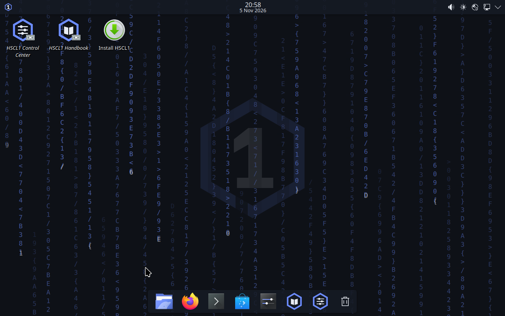
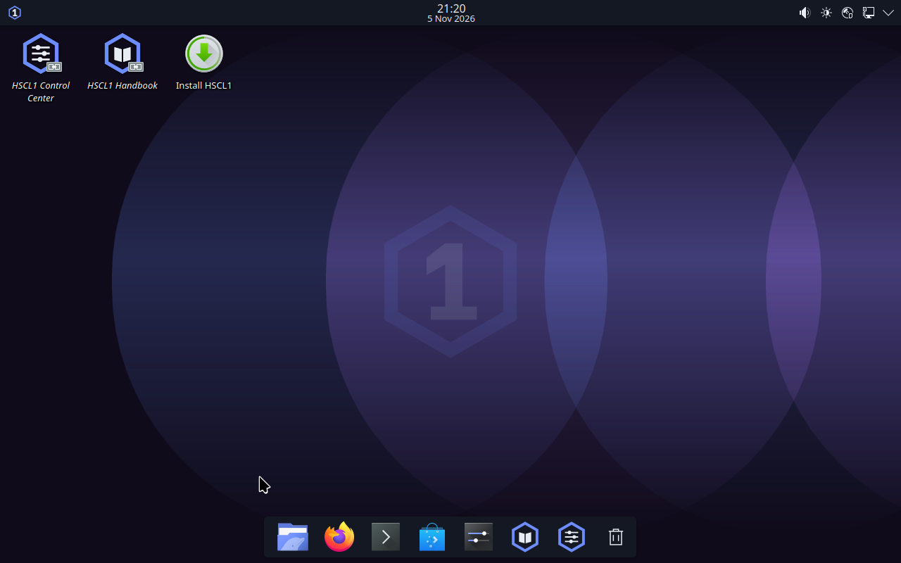
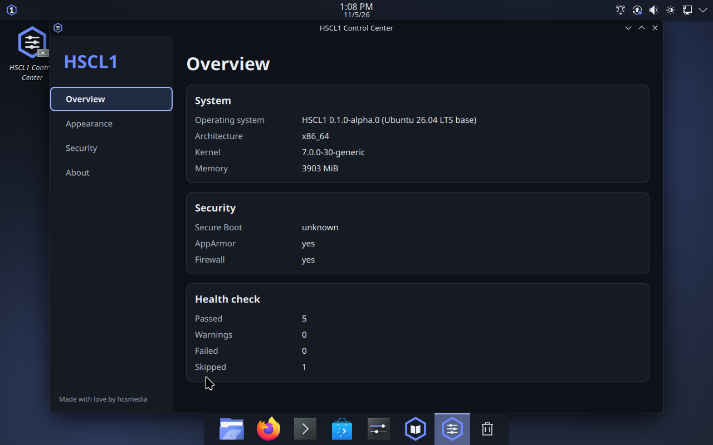
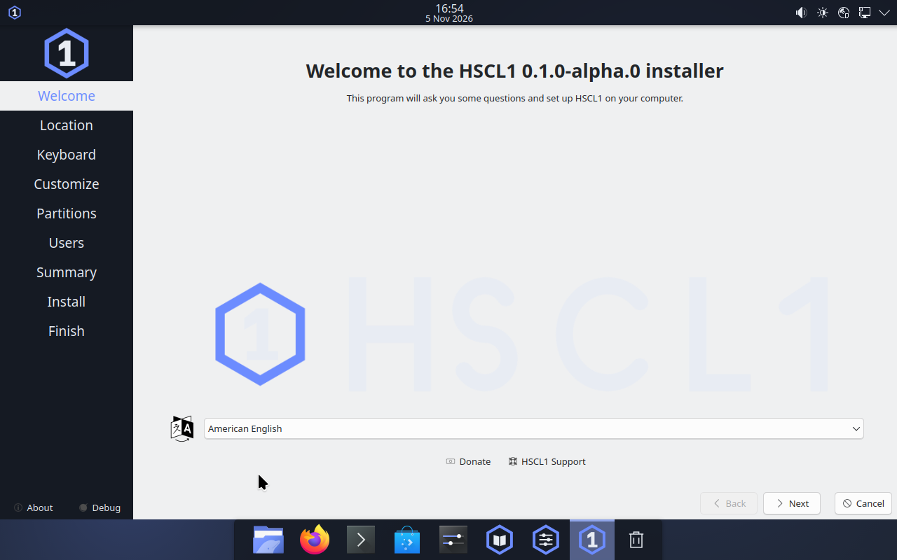
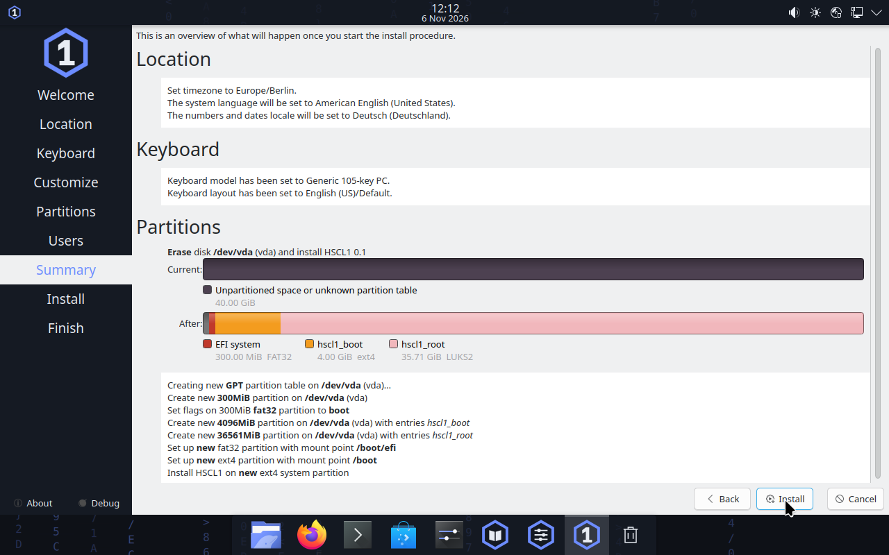
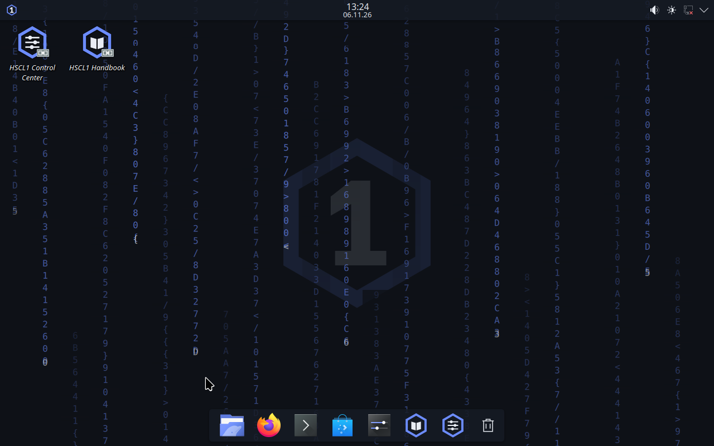

<div align="center">

# HSCL1

**HSCL1 = Hypercharged Supreme Computing Layout 1**

**One system. Three modes. Your machine, your rules.**

*Made with love by hcsmedia* · Publisher: HCSMEDIA

[](https://github.com/timfromhcs/HSCL1/actions/workflows/ci.yml)




</div>

HSCL1 is a Linux workstation built on **Ubuntu 26.04 LTS (Kubuntu base) and KDE Plasma 6**. It adds an original design language
(the *HCS Hybrid Desktop*: slim top bar plus floating dock, animated wallpapers), the `hscl` command line tool, a Control Center,
an offline trilingual handbook (English, Deutsch, Français), a conservative security baseline, a memory manager, local-AI and
coding tooling, and a **Workshop**: an opt-in developer mode that lets you drive a VM, take screenshots and re-create the ISO from
a running system.

> **Status: pre-alpha (`0.1.3-alpha.0`).** It has been run **in virtual machines only**. Nothing has been tested on physical
> hardware, the releases are **unsigned**, and many items in the plan are not built yet. Read
> [Known limitations](docs/KNOWN_LIMITATIONS.md) and the [evidence table](docs/CLAIMS.md) before you try it. Do not use it for
> anything that needs a security guarantee.

HSCL1 is **not Tails**, **not an official Kali release**, and not endorsed by Canonical, the KDE/Kubuntu projects, Offensive Security
or the Tails project. It makes **no anonymity claim**.

KALI LINUX™ is a trademark of OffSec. HSCL1 is not affiliated with or endorsed by the Tails project; where strong anonymity matters,
use the official Tails release. See [Trademarks](docs/TRADEMARKS.md).

## Screenshots

All screenshots are real captures from QEMU virtual machines.

| Animated wallpapers | Control Center |
|---|---|
|  |  |
|  |  |

### Encrypted install (release 0.1.1-alpha.0, VM)

| Erase disk + encrypt | Summary before installing |
|---|---|
|  |  |
|  |  |

Captured from the exact release ISO in a disposable 40 GB virtual disk (UEFI, no Secure Boot). The layout is an unencrypted
`/boot` plus a LUKS2 root. Not tested on physical hardware; see [`docs/CLAIMS.md`](docs/CLAIMS.md).

The aurora effect currently looks like overlapping circles rather than ribbons; this is a known design defect
(see [`docs/CLAIMS.md`](docs/CLAIMS.md)).

## What is verified and what is not

The full table with evidence is [`docs/CLAIMS.md`](docs/CLAIMS.md). Summary:

| Area | State |
|---|---|
| Remastered Kubuntu 26.04.1 live/installer ISO | boots in QEMU (UEFI, BIOS, Secure-Boot firmware); VM-verified |
| Installation to a virtual disk and boot of the installed system | VM-verified (earlier QA build of the image) |
| HCS desktop (top bar, floating dock, themes, rain/aurora/grid/starfield wallpapers) | VM-verified by screenshots; CPU cost of the animation **not measured** |
| Workshop (VM API, respin ISO from the running system) | VM-verified end to end |
| `hscl` CLI (status, doctor, graphics, memory, ai, wallpaper, code, mcp …) | unit-tested; the main commands also ran inside the live VM |
| Memory manager (zram, earlyoom, AI RAM budget) | configuration active in the VM; **effect under real memory pressure not tested** |
| Local inference with one small model (CPU) | verified on the builder; **Vulkan, MTP and TurboQuant not verified** |
| Security Lab (`hscl lab`) | CLI execution wired, rootless Podman verified on builder; in-guest image pending |
| Privacy mode, media-AI/Blender/Godot tooling, RSI loop | **planned, not implemented** |
| Physical hardware | **none tested** |
| Release signing | **none yet** (SHA256SUMS only) |

## Download

Pre-release assets are attached to the [GitHub releases](https://github.com/timfromhcs/HSCL1/releases). The ISO is larger than
GitHub's 2 GiB per-file limit, so it is published as numbered parts that you join and verify with a script:

```console
$ mkdir hscl1 && cd hscl1
$ gh release download v0.1.3-alpha.0 --repo timfromhcs/HSCL1        # or download all *.part* and SHA256SUMS by hand
$ git clone https://github.com/timfromhcs/HSCL1 ../HSCL1-src         # for the script
$ bash ../HSCL1-src/scripts/release-join.sh . --verify-only          # checks every part and the joined image, writes nothing
$ bash ../HSCL1-src/scripts/release-join.sh .                        # joins to HSCL1-<version>-amd64.iso
```

The script verifies each part, the part sequence and the SHA-256 of the joined image against `SHA256SUMS`, and never overwrites an
existing file without `--force`. The release workflow also joins the parts in the cloud and keeps the single `.iso` as a workflow artifact (90 days, GitHub login required) - see the run on the release's Actions tab. Without a signature this proves integrity of the download, not who published it.

## Try it in a VM

Tested settings: 4 GB RAM or more, 4 vCPUs, standard VGA, user-mode networking, UEFI (OVMF/edk2) or BIOS. Hypervisor
instructions and build host requirements are in [`docs/BUILDING.md`](docs/BUILDING.md) and [`docs/TESTING.md`](docs/TESTING.md);
how an artefact becomes a release (and which steps are the maintainer's) is in [`docs/RELEASE_PROCESS.md`](docs/RELEASE_PROCESS.md).

> **The installer writes to the selected disk. Use a disposable virtual disk. Do not install on a real machine with data you care
> about; HSCL1 has not been tested on hardware.**

Default Workshop state: **disabled**. The daemon is inert unless the hypervisor provides the `hscl.api` virtio port (see
[`SECURITY.md`](SECURITY.md)).

## Command line

```console
$ hscl status                      # system summary
$ hscl doctor                      # checks (redacted by default)
$ hscl graphics detect             # driver class and recommended graphics profile
$ hscl memory status               # RAM, zram, AI budget
$ hscl wallpaper list              # animated wallpaper presets
$ hscl ai model recommend          # models that fit this machine
$ hscl lab run --yes="I am authorized to test this target" -- <cmd> # isolated security lab
$ hscl mcp                         # MCP server on stdio (read-only by default)
```

Reference: [`docs/CLI.md`](docs/CLI.md).

## Build from source

Requirements and the full procedure are in [`docs/BUILDING.md`](docs/BUILDING.md). The checks CI runs:

```console
$ cargo fmt --all -- --check && cargo clippy --all-targets -- -D warnings && cargo test --all
$ python -m pytest tests -q
```

The image is produced by `scripts/remaster-iso.sh` from the official Kubuntu 26.04.1 ISO (checksum verified); the build refuses
to finish if branding or the Workshop-inert checks fail (`distro/live/verify-image.sh`).

## Repository layout

| Path | Contents |
|---|---|
| `cli/hscl` | Rust CLI and MCP server |
| `apps/control-center` | Qt 6 / QML Control Center |
| `packages/debian` | HSCL1 packages (base, branding, desktop, security, handbook, control-center, workshop, memory) |
| `distro` | live-image hooks, verification, installer config, security sysctl |
| `themes`, `scripts/gen_*.py` | design tokens and generated assets |
| `ai` | model catalogue, pinned inference backend |
| `scripts` | remaster, release split/join, QEMU test harness, Workshop host tools |
| `handbook` | offline handbook (EN/DE/FR) |
| `docs` | architecture, threat model, decisions, claims, plans |

## Documentation

[Claims & evidence](docs/CLAIMS.md) · [Known limitations](docs/KNOWN_LIMITATIONS.md) · [Architecture](docs/ARCHITECTURE.md) ·
[Threat model](docs/THREAT_MODEL.md) · [Decisions](docs/DECISIONS.md) · [Build log](docs/BUILD_LOG.md) ·
[Roadmap to v2](docs/superpowers/plans/2026-11-06-long-horizon-to-v2.md) · [Licences](docs/LICENSES.md)

## Contributing and security

See [`CONTRIBUTING.md`](CONTRIBUTING.md) and [`CODE_OF_CONDUCT.md`](CODE_OF_CONDUCT.md). Report vulnerabilities privately as described in
[`SECURITY.md`](SECURITY.md).

<details>
<summary><b>Deutsch</b></summary>

**HSCL1** ist eine Linux-Workstation auf Basis von Ubuntu 26.04 LTS (Kubuntu) und KDE Plasma 6 mit eigener Oberfläche
(Top-Bar, schwebendes Dock, animierte Wallpaper), dem Kommandozeilenwerkzeug `hscl`, einem Control Center, einem
Offline-Handbuch (EN/DE/FR), Speicherverwaltung, lokalen KI- und Coding-Werkzeugen und einer Workshop-Funktion für die Entwicklung.

**Status: Pre-Alpha.** Nur in virtuellen Maschinen getestet, nicht auf echter Hardware. Releases sind nicht signiert (nur
SHA256SUMS). HSCL1 ist nicht Tails, kein offizielles Kali und erhebt keinen Anonymitätsanspruch. Was belegt ist und was nicht,
steht in [`docs/CLAIMS.md`](docs/CLAIMS.md). Das ISO ist größer als 2 GiB und wird deshalb in Teilen veröffentlicht; mit
`scripts/release-join.sh` wird es geprüft und zusammengesetzt. **Der Installer schreibt auf den gewählten Datenträger – nur mit
virtuellen Datenträgern verwenden.** Lizenz: GPL-3.0-oder-später.

</details>

<details>
<summary><b>Français</b></summary>

**HSCL1** est une station de travail Linux basée sur Ubuntu 26.04 LTS (Kubuntu) et KDE Plasma 6, avec une interface propre
(barre supérieure, dock flottant, fonds d'écran animés), l'outil en ligne de commande `hscl`, un Centre de contrôle, un manuel
hors ligne (EN/DE/FR), une gestion de la mémoire, des outils d'IA locale et de programmation, et un mode Workshop pour le développement.

**État : pré-alpha.** Testé uniquement dans des machines virtuelles, pas sur du matériel réel. Les versions ne sont pas signées
(SHA256SUMS seulement). HSCL1 n'est ni Tails, ni une version officielle de Kali, et ne revendique aucun anonymat. Ce qui est
vérifié figure dans [`docs/CLAIMS.md`](docs/CLAIMS.md). L'ISO dépasse 2 Gio : il est publié en parties, à vérifier et assembler avec
`scripts/release-join.sh`. **L'installateur écrit sur le disque choisi – utilisez uniquement des disques virtuels.** Licence :
GPL-3.0 ou ultérieure.

</details>

## Licence

**GPL-3.0-or-later** for HSCL1-owned code, artwork and documentation ([`LICENSE`](LICENSE), [`NOTICE`](NOTICE)). Third-party
components, including the Ubuntu/Kubuntu base, keep their own licences: [`docs/LICENSES.md`](docs/LICENSES.md). Trademarks belong to
their owners.
