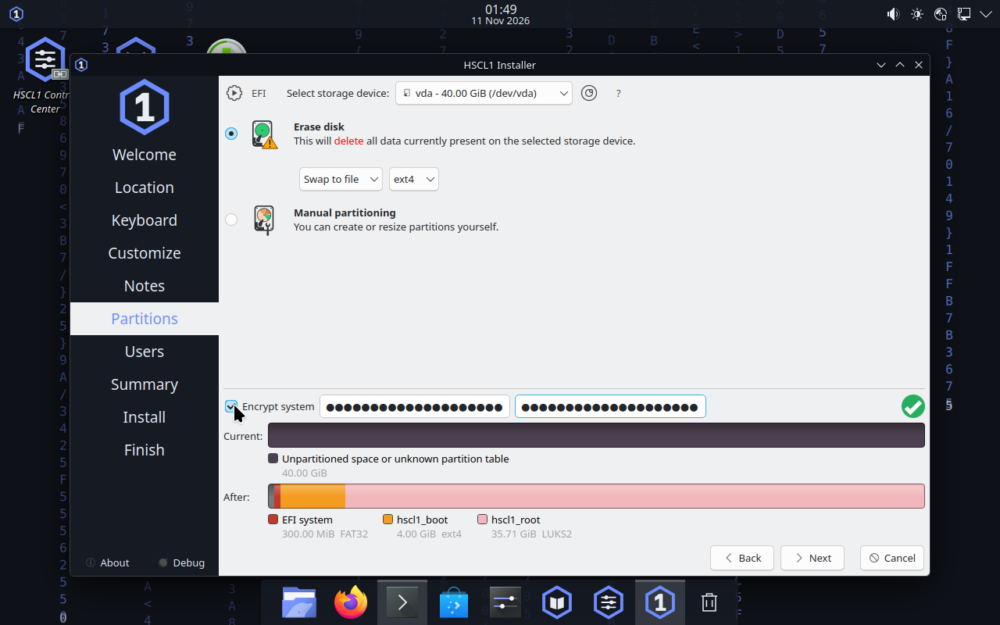
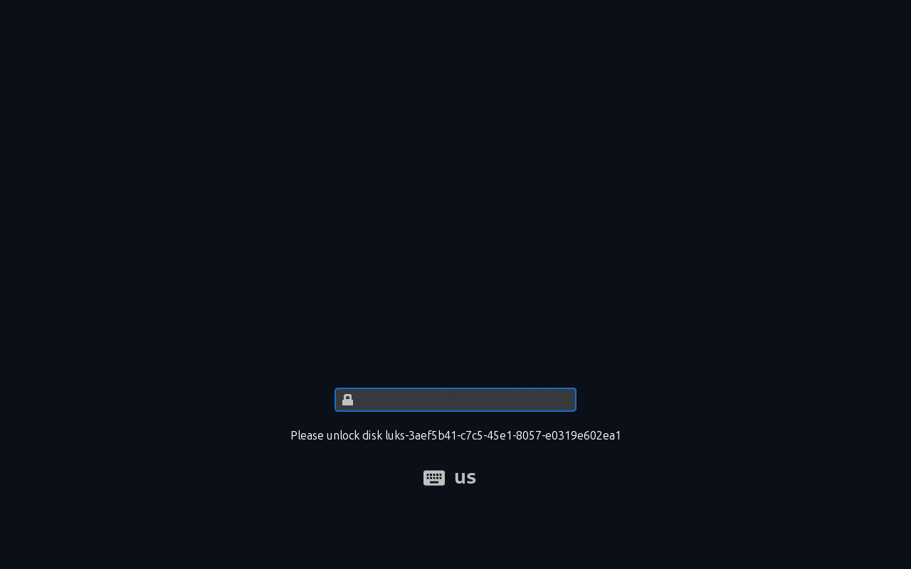
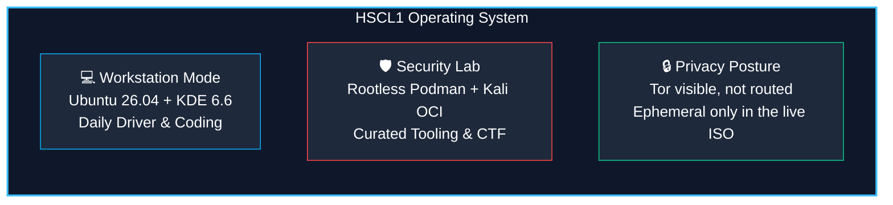

<div align="center">

# HSCL1

**HSCL1 = Hypercharged Supreme Computing Layout 1**

### *One system. Three modes. Your machine, your rules.*

*Made with love by hcsmedia* · Publisher: HCSMEDIA

[](https://github.com/timfromhcs/HSCL1/actions/workflows/ci.yml)
[](https://github.com/timfromhcs/HSCL1/releases/tag/v0.1.8-alpha.0)


<br>

[✨ Why HSCL1](#-why-hscl1) • [🚀 Quick Start](#-quickstart-try-it-in-qemu) • [📸 Live Showcase](#-live-application-showcase) • [💻 3 Modes](#-three-operating-modes) • [⚡ CLI Reference](#-command-line-interface-hscl) • [🔧 Troubleshooting](#-troubleshooting--vm-tips) • [📦 Download](#-download--verification) • [🛠️ Build From Source](#-build-from-source)

<br>


*HSCL1 0.1.8-alpha.0 running live in QEMU/WHPX - clean first boot with HCS top status bar, centered floating dock, and Midnight theme.*

</div>

---

## ✨ Why HSCL1?

1. **Cohesive Keyboard-First Ergonomics:** A unified workstation experience combining the speed and aesthetics of Omarchy with the rock-solid hardware stability of Ubuntu 26.04 LTS and KDE Plasma 6.6 LTS. Slim top status bar, centered floating dock, and dynamic GPU/CPU shader-driven wallpapers.
2. **Three Structurally Isolated Modes:** Everyday **Workstation**, isolated **Security Lab** (rootless Podman + official Kali Linux OCI containers, verified end to end in a guest), and an ephemeral **Privacy Session** (RAM overlay, unmounted host storage, honest reporting - network traffic is **not** filtered, so no anonymity is claimed).
3. **No HSCL1 telemetry & rigorous attestation:** HSCL1 adds no analytics, no crash upload and no remote control; 100% offline documentation in 3 languages (English, German, French), LUKS2 full-disk encryption with Argon2id, and an evidence-based contract—features are backed by automated tests and recorded proof. Base-system network contacts (time sync, package mirrors, the installer's connectivity and geo-IP check) are disclosed in [Known limitations](docs/KNOWN_LIMITATIONS.md).

> [!IMPORTANT]
> **Status: Pre-Alpha (`0.1.8-alpha.0`).**
> HSCL1 is verified **in virtual machines only** (UEFI firmware under QEMU on Windows with WHPX acceleration; recorded runs used QEMU 9.2.0 and 11.1). The current artifact is `HSCL1-0.1.8-alpha.0-amd64.iso` (`def7f190.`, 5,027,201,024 B, built from `91c8acb`, xz, clean tree): UEFI boot at **4 GB** reached the desktop, `scripts/qa_report.py` exits 0 (9 checks ok, one `info` line about Secure Boot), and **20 of 20 sequential installer starts survive**. Verified in QEMU:
>
> - a **full unencrypted installation at the documented 4 GB minimum** (`All done`, the disk then boots with `iso=none`, logs in, and reports `hscl doctor` 6 passed / 0 failed / 1 skipped) - the most recent complete run is from `HSCL1-rc1` (`f8ae5c52…`) and has not been repeated on 0.1.6-0.1.8;
> - an **LUKS2 installation** at 8 GB (wrong passphrase refused by cryptsetup, correct one unlocks, `LUKS volumes open: 1`); a 6 GB LUKS run panicked once - evidence from the 0.1.5 candidate line;
> - the **Security Lab chain end to end** on `rc11` in one live session: digest-pinned Kali pull → `hscl lab install --toolset basic` → `commit` → `run -- nmap --version`, last step printing **`Nmap version 7.991`**, every step exit 0.
>
> **Installer:** the startup crash that had been open since 0.1.4 is fixed on this artifact. The `notesqml` step segfaulted while the progress tree painted its name (`NotesQmlViewStep::prettyName()` → `TranslatedString::get()`), the step is out of the Calamares sequence, and the image gate now asserts that it stays disabled. One related fault is **guarded, not explained**: an install can still report "All done" with an empty EFI partition, so `hscl-verify-esp` fails such an install instead of leaving an unbootable disk.
>
> **Fixed since 0.1.6:** desktop labels are upright (Plasma italicises *link* labels; the entries are real `.desktop` files now) and carry no untrusted badge; the label centre sits within 1 px of the icon centre (measured).
>
> **Secure Boot:** the ISO carries the signed Canonical/Microsoft boot components (`artifacts/sb-0.1.3-alpha.0/report.json`) and the guest state is read (`mokutil --sb-state`), but a **positive Secure-Boot boot has not been demonstrated**: the test firmware ran with Secure Boot off, and this host cannot enter SMM under WHPX or KVM (recorded in `artifacts/boot-sb-kvm/SUMMARY.txt`).
>
> **Not verified:** bare-metal physical hardware, USB-media boot, TPM-backed encryption, a Tor-routed privacy session, signed releases (SHA-256 checksums only). Read [Known limitations](docs/KNOWN_LIMITATIONS.md) and the [evidence ledger](docs/CLAIMS.md) before installing.

> [!NOTE]
> HSCL1 is **not Tails**, **not an official Kali release**, and is not affiliated with or endorsed by the Tails project, Canonical, the KDE/Kubuntu projects, or Offensive Security. It makes **no anonymity claim**.
> KALI LINUX™ is a trademark of OffSec. Where strong anonymity matters, use the official Tails release. See [Trademarks](docs/TRADEMARKS.md).

---

## 🚀 Quickstart: Try It in QEMU

Test the verified pre-alpha live ISO in a hardware-accelerated disposable virtual machine with a single command:

### Windows (WHPX Acceleration)
```powershell
# Run with 4 GB RAM and dismiss first-run dialogs automatically:
python scripts/qemu_boot_test.py `
  --iso "path\to\HSCL1-0.1.8-alpha.0-amd64.iso" `
  --mem 4096 `
  --dismiss-welcome
```

### Linux (KVM Acceleration)
```bash
# Run with hardware KVM acceleration and UEFI firmware:
qemu-system-x86_64 -enable-kvm -m 4096 -smp 4 \
  -bios /usr/share/ovmf/OVMF.fd \
  -cdrom HSCL1-0.1.8-alpha.0-amd64.iso \
  -vga std -device virtio-net-pci,netdev=net0 \
  -netdev user,id=net0
```

---

## 📸 Live Application Showcase

*Every screenshot below is a real capture taken inside a booted HSCL1 QEMU guest through the hypervisor QMP interface and the guest Workshop daemon. The artifact is named per screenshot group, because they were taken across several candidates rather than in one session. Terminal sections show the Konsole window; the desktop frame is not part of that crop.*

### 1. Modern Desktop & Dynamic Shaders

The HCS desktop uses a shader-driven wallpaper engine, switchable with `hscl appearance wallpaper set <preset id>` (presets: `aurora`, `starfield`, `grid-pulse`, `midnight-rain`, `sparse-rain`). All four effects are captured below, each switched on a clean desktop on the same boot ([rc3 evidence](docs/BUILD_LOG.md)); the earlier audit note about `grid`/`rain` was a capture that typed effect names instead of preset ids.

| Clean Live Desktop & Floating Dock | Kickoff Application Launcher |
|:---:|:---:|
|  |  |
| **Aurora Glow** | **Starfield Deep Space Drift** |
|  |  |
| **Grid Pulse** | **Midnight Number Rain** |
|  |  |

---

### 2. Native HCS Control Center (Qt 6 / QML)

A zero-telemetry control center providing instant hardware diagnostics, security policy auditing, theme customization, and system identity verification. Eleven pages read the same `hscl --json` commands the terminal uses - Overview, Appearance, Security, Privacy, Security Lab, Local AI, Updates & Recovery, Developer, Language & Region, Miner and About - and every page is **read-only**: it reports what the system says, and the commands that change things stay in the terminal where they can ask for confirmation. Errors surface as one labelled banner, the layout has one keyboard-reachable refresh action, and the whole panel contains no animation (reduced motion by construction).

| System Overview & Hardware Profiling | Security Baseline & Firewall Policy |
|:---:|:---:|
|  |  |
| **Appearance & Desktop Design Tokens** | **System Attestation & Versioning** |
|  |  |

---

### 3. Interactive Terminal & CLI Diagnostics (`hscl`)

Built-in developer terminal with full hardware diagnostic output, redacting health checks, and containerized security lab controls.

| System Status & Diagnostic Doctor (`hscl`) | Isolated Security Lab Suite (`hscl lab`) |
|:---:|:---:|
|  |  |
| **Privacy Posture & Security Baseline (`hscl privacy/security`)** | **Diagnostic Log Redaction & Language (`hscl logs/language`)** |
|  |  |

---

### 4. Core Productivity Applications

Familiar window ergonomics, Dolphin file manager with HCS styling, Kate text editor with syntax highlighting, and an offline trilingual documentation handbook.

| Dolphin File Manager (HCS Theme) | Kate Text Editor (`/etc/os-release`) |
|:---:|:---:|
|  |  |

**Trilingual offline handbook (EN/DE/FR)** — opened from the desktop icon, fully offline:


---

### 5. Verified Encrypted Installation Flow (Calamares + LUKS2)

Automated full-disk encryption with Argon2id key derivation, unencrypted `/boot`, and encrypted root volume, verified end-to-end on disposable virtual disks.

| Calamares Welcome & Language Selection | Timezone & Geographic Location |
|:---:|:---:|
|  |  |
| **Encryption on the partition page (candidate rc3)** | **LUKS2 unlock prompt at boot (candidate rc6)** |
|  |  |

All four captures come from booted candidates (`11`/`19`/`21` from `HSCL1-rc3`, `22`/`23` from `HSCL1-rc6`);
`docs/img/showcase/manifest.json` records the ISO and SHA-256 prefix per file. `23_luks_unlock_wrong.png` shows the
same prompt after a wrong passphrase, which cryptsetup refuses without touching the disk.

---

## 💻 Three Operating Modes



### A. Workstation (Everyday Daily Driver)
- **Modern Desktop:** KDE Plasma 6.6 LTS with custom HCS top bar and dock.
- **Hardware Autotune:** Dynamic GPU detection and automatic compositing adjustments (`hscl autotune`).
- **Memory Protection:** Automated `earlyoom`, compressed `/dev/zram0` swap, and AI workload RAM budgets.
- **Offline Handbook:** Complete trilingual reference manual accessible directly offline in English, German, and French.

### B. Security Lab (Authorized Testing Only)
- **Isolation by Architecture:** Security and penetration testing tools run strictly in rootless OCI containers (Podman) or disposable VMs—**never** mixed into the host APT repositories.
- **Verified in a guest, not just implemented:** on `rc11` the whole chain ran in one 4 GB live session - digest-pinned pull of `kalilinux/kali-rolling`, `hscl lab install --toolset basic` (nmap, tshark, wireshark-common and bind9-dnsutils *inside the container*), `commit`, and `run -- nmap --version` printing `Nmap version 7.991`; every step returned 0. The image reference must be `name@sha256:<64 hex>`; a tag is refused.
- **Mandatory Authorization:** CLI execution requires explicit attestation:
  ```console
  $ hscl lab run --project demo --image localhost/hscl-lab-demo:latest \
      --yes="I am authorized to test this target" -- nmap -sV 127.0.0.1
  ```
- **Fail-Closed by default:** containers run with `--network=none`, dropped capabilities, a read-only root and no host home, credential or SSH-agent mounts. Some tools lose privileges because of that (the install log shows `unable to set CAP_SETFCAP`), which is a boundary, not a bug.

### C. Privacy (what is actually there today)

> [!WARNING]
> **Status: reporting, not routing.** This mode is **not** a Tor-routed environment and does **not** claim
> "zero host persistence". Verified on 2026-11-10 in the live ISO: `hscl privacy status` reports
> `session: ephemeral (volatile RAM overlay)`, `zram memory swap: active`, `persistent disk swap: none`,
> `core dumps: disabled`, and it reports the Tor state honestly (`tor service: inactive`,
> `tor browser: not installed`) instead of pretending. A Tor-routed privacy *boot target*, a kill switch and a
> packet-capture proof do not exist yet — [Q-17](docs/AUTONOMOUS_QUEUE.md) tracks them as open.

- **Ephemeral live session only:** the live ISO runs from a read-only squashfs with a volatile overlay; the
  installed system is persistent by design (`session: installed (persistent root)`).
- **Reporting instead of promising:** `hscl privacy status` / `hscl security status` show swap, core dumps,
  automounted disks, Tor service and LUKS state, and name the session type, so the numbers can be checked.
- **Not Tails:** no anonymity claim, no anti-forensics claim, no modified Tor Browser. Where strong anonymity
  matters, use the official signature-verified Tails release.

---

## ⛏️ Bitaxe / ESP-Miner bridge (opt-in, LAN only)

HSCL1 can inspect and update a Bitaxe-class miner that already runs the owner's
[ESP-Miner fork](https://github.com/timfromhcs/ESP-Miner). This is deliberately small and guarded:

```console
$ hscl miner status                                      # local config + esptool availability, no device contact
$ hscl miner discover --prefix 192.168.178               # find AxeOS/Bitaxe miners (read-only, by MAC)
$ hscl miner probe 192.168.178.61                        # GET /api/system/info (read-only)
$ hscl miner plan 192.168.178.61 --firmware esp-miner.bin # SHA-256, size, endpoint, rollback hint
$ hscl miner ota  192.168.178.61 --firmware esp-miner.bin --yes="I am authorized to flash this device"
$ hscl miner flash --port COM3 --offset 0x10000 --firmware esp-miner.bin --yes="I am authorized to flash this device"
$ hscl miner serve --device 192.168.178.61                # read-only API on 127.0.0.1:8787 for other tools
```

The local API is the data path for the desktop and other agents: `/v1/health`, `/v1/miners`,
`/v1/miner?host=…`; it polls in the background so a slow device never blocks a reader. The MCP server
exposes `hscl_miner_status`, `hscl_miner_probe` and `hscl_miner_discover` as read-only tools.

- **Private networks only.** Loopback, RFC1918, link-local, unique-local and `*.local` are accepted; a
  public address is refused before a socket is opened. The MCP tools (`hscl_miner_status`,
  `hscl_miner_probe`) enforce the same rule.
- **No silent flashing.** OTA and USB flashing require the exact authorization phrase; `--dry-run`
  prints the command and the hash and sends/writes nothing.
- **Honest about the firmware.** AxeOS OTA has no authentication beyond a network-range check, no TLS,
  no signature verification and no downgrade protection — the plan prints that on every run. Details and
  sources: [`docs/miner/FIRMWARE_RESEARCH.md`](docs/miner/FIRMWARE_RESEARCH.md) and the
  [miner ADR](docs/miner/ARCHITECTURE.md).
- **Not implemented:** receiver daemon, pairing, fleet discovery, pool credentials, eFuse/Secure Boot
  provisioning. Mining hardware is not shipped by HSCL1.

The Control Center has a **Miner** page that shows the last device's address, hostname, board, firmware,
hashrate, temperature, power, shares and pool from that same CLI path — read-only, localised EN/DE/FR.

## ⚡ Command Line Interface (`hscl`)

The `hscl` tool provides unified control over the workstation, security tooling, memory policies, and local AI workflows:

```console
# System status & diagnostics
$ hscl status                                                      # Hardware, kernel, and memory summary
$ hscl doctor                                                      # Diagnostic health checks (redacted by default)

# Hardware & graphics profiling
$ hscl graphics detect                                             # Identify GPU and recommended visual profile
$ hscl memory status                                               # Inspect RAM, zram, and AI inference headroom

# Dynamic desktop styling
$ hscl wallpaper list                                              # Available wallpaper shader presets
$ hscl wallpaper apply midnight-rain                               # Switch desktop wallpaper immediately
$ hscl appearance theme list                                       # Colour schemes and their wallpaper

# Privacy, language and update state (read-only)
$ hscl privacy status                                              # Ephemeral overlay, swap, Tor readiness
$ hscl language status                                             # Active language and where it comes from
$ hscl system updates --check                                      # Pending APT updates (simulation only)

# Security Lab container execution
$ hscl lab run --project demo --image localhost/hscl-lab-demo:latest \
    --yes="I am authorized to test this target" -- nmap 127.0.0.1
$ hscl lab install --project demo \
    --image kalilinux/kali-rolling@sha256:<digest> \
    --toolset web --yes="I am authorized to test this target"

# Local AI profiling
$ hscl ai model recommend                                          # Models fitting the available RAM/VRAM budget

# Model Context Protocol (MCP) server
$ hscl mcp                                                         # Stdio MCP JSON-RPC server (read-only by default)
```

Detailed CLI documentation is available in [`docs/CLI.md`](docs/CLI.md).

---

## 🔧 Troubleshooting & VM Tips

| Issue | Cause | Solution |
|---|---|---|
| **Black screen or sluggish boot** | Hardware acceleration disabled in QEMU | Ensure `-accel whpx,kernel-irqchip=off` (Windows) or `-enable-kvm` (Linux) is active. |
| **Installer closes / "Crash Handler" appears** | On 0.1.4-0.1.7 the wizard could segfault while building its first page; KCrash then let `drkonqi` SIGKILL it, which is why there was no core dump | **Fixed in `0.1.8-alpha.0`:** the crashing `notesqml` step is out of the Calamares sequence and the image gate asserts it stays disabled (20/20 starts survived). If it still happens on 0.1.8, start the installer again and record `journalctl -b` plus `/var/log/calamares.log` - that is new evidence, not the known fault. |
| **Installer stops with `hscl-verify-esp: … did not populate the EFI system partition`** | The installer wrote the system but no EFI loader reached the EFI partition, so the machine would not boot | The image refuses to report "All done" in that case instead of leaving a disk that cannot boot (Q-66, the cause is still unknown). Nothing is lost: install again, and if it repeats, keep the exact `/var/log/calamares.log` excerpt - the guard prints what it saw. |
| **Out-of-memory / kernel panic** | Allocating < 3 GB RAM to the VM | The live ISO unpacks a zstd squashfs into RAM overlay; allocate at least **3072 MB** (recommended: **4096 MB**). |
| **Welcome screen doesn't dismiss** | Plasma first-run dialog modal grab | Press `Esc` or click the bottom-left "Skip" button (`(0.288, 0.848)` screen coordinates). |
| **Secure Boot verification failure** | HSCL1 ships Microsoft- and Canonical-signed boot components, but a positive Secure-Boot boot has **not** been demonstrated: this host cannot enter SMM under WHPX or KVM | Run with standard OVMF firmware (`--firmware uefi`) and read the state inside the guest with `mokutil --sb-state`; do not treat a file signature as firmware acceptance. |
| **Installer cannot find disk** | No virtual disk attached to VM | Pass `--disk <path.qcow2>` to `qemu_boot_test.py` or `-drive file=<disk>,if=virtio` in QEMU. |

---

## 📊 Verification & Showoff Evidence

HSCL1 adheres to a strict evidence-driven development contract: **nothing is claimed as working without recorded cryptographic and automated test proof.**

| Area | Status | Evidence / Verification Metric |
|---|:---:|---|
| **Remastered Live/Installer ISO** | `VM-VERIFIED` | `HSCL1-0.1.8-alpha.0-amd64.iso` (`def7f190.`, source `91c8acb`, xz): live desktop at 4 GB under UEFI (QEMU+WHPX), `qa_report.py` exit 0 with 9 checks, `verify-image` green including `installer notes step stays disabled (Q-68)`; [`docs/img/showcase/01_desktop_clean.png`](docs/img/showcase/01_desktop_clean.png) is this artifact's own capture |
| **Signed boot components present** | `TESTED` | `artifacts/sb-0.1.3-alpha.0/report.json`: Microsoft-signed `bootx64.efi`, Canonical-signed `grubx64.efi`, `vmlinuz`, `mmx64.efi`. A **positive Secure-Boot boot is not demonstrated** — the test firmware ran with Secure Boot off and the guest says so |
| **LUKS2 Full-Disk Installation** | `VM-VERIFIED` | 40 GB virtual disk at 8 GB RAM: Argon2id, `/` = `0:0 755`, wrong passphrase refused, correct one unlocks, no passphrase in logs; image from the 0.1.3 line: [`docs/img/desktop-installed.png`](docs/img/desktop-installed.png) |
| **Rust `hscl` CLI Workspace** | `TESTED` | `cargo test --all`: **276 passed, 0 failed**; `cargo clippy --all-targets -D warnings` and `cargo fmt --check` clean (Windows, 2026-11-13) |
| **Control Center (Qt 6 / QML)** | `TESTED` | `scripts/dev/qml-gate.sh`: **16/16** page tests, **6/6** CLI-bridge tests, `qmllint` **0 warnings** on the Control Center (budget 0); `tests/unit/test_cc_pages.py` pins page/rail parity and that every page request is on the bridge allowlist; EN/DE/FR strings complete (`test_cc_i18n.py`) |
| **Static website (EN/DE/FR)** | `TESTED` | `scripts/build_website.py` builds **15 pages** (home, download, VM guide, security and privacy, each in EN/DE/FR); `test_website.py` checks one `h1` per page, `lang`, resolving internal links and assets, download links that are real release assets, and no forbidden security wording |
| **Security Lab CLI** | `VM-VERIFIED` | rc11 live guest: digest-pinned Kali pull, `install --toolset basic`, `commit`, `run` → `Nmap version 7.991`, exit 0; `run` defaults to `--network=none`, drops capabilities and requires an attestation phrase |
| **MCP Stdio Server Protocol** | `TESTED` | 7/7 protocol tests passed via `scripts/dev/mcp_selftest.py` (JSON-RPC handshake, 14 tools listed) |
| **Memory Manager Baseline** | `VM-VERIFIED` | `/dev/zram0` (1.9 GB zstd, priority 100), `earlyoom` active, `hscl-ai.slice` memory capped at 60% |
| **HCSEASYMATH Symbolic Engine** | `TESTED` | 244 math test cases green; differentiate, integrate, evaluate, simplify, solve, plot |
| **NPBENCH Algorithmic Suite** | `TESTED` | 134 tests green; DIMACS parser, DRAT checker, RUP refutations, WalkSAT, CDCL baseline |
| **Split & Rejoin Integrity** | `TESTED` | 3 parts (<1900 MiB) join byte-identically to whole ISO; verified via `release-join.sh --verify-only` |
| **Bitaxe/ESP-Miner OTA (real device)** | `HARDWARE-VERIFIED` (one device) | `timsminer`, board 201, BM1366: firmware built from source (2 758 656 B, SHA-256 `ecb7463…`), flashed via `hscl miner ota` in 263 s; version `v4.0.2-rc1-sha-research` → `v4.0.2-rc1`, board and MAC unchanged; pre/post telemetry in [docs/miner/TELEMETRY.md](docs/miner/TELEMETRY.md) |

*Full evidence log available at [`docs/CLAIMS.md`](docs/CLAIMS.md) and [`docs/BUILD_LOG.md`](docs/BUILD_LOG.md).*

---

## 📦 Download & Verification

Pre-release assets are hosted on [GitHub Releases](https://github.com/timfromhcs/HSCL1/releases). Because the ISO exceeds GitHub's 2 GiB per-file limit, it is distributed in numbered split parts with full cryptographic checksums.

> [!NOTE]
> **`v0.1.8-alpha.0` is the current prerelease** (ISO `def7f190.`, 5,027,201,024 bytes, built from `91c8acb`, xz). It supersedes `v0.1.7-alpha.0` (`400fb9d7.`) and **fixes the installer's startup crash**: the `notesqml` step segfaulted while the progress tree painted its name (`NotesQmlViewStep::prettyName()` -> `TranslatedString::get()`), the step is out of the sequence, and 20 of 20 starts now survive with a core pattern set. The release notes carry the backtrace.

```console
# 1. Download release assets (parts + SHA256SUMS)
$ mkdir hscl1-release && cd hscl1-release
$ gh release download v0.1.8-alpha.0 --repo timfromhcs/HSCL1

# 2. Clone repository to obtain verified join script
$ git clone https://github.com/timfromhcs/HSCL1 ../HSCL1-src

# 3. Verify integrity of all parts against SHA256SUMS (dry-run, writes nothing)
$ bash ../HSCL1-src/scripts/release-join.sh . --verify-only

# 4. Join parts into single bootable ISO
$ bash ../HSCL1-src/scripts/release-join.sh .
```

### Release Checksums (v0.1.8-alpha.0)
```text
26d1198d5d90a559fc15dda6097fc2ad9277c2798c22e09f5b7604e3e02bf6cd  HSCL1-0.1.8-alpha.0-amd64.iso.part000
66ec92b301cdcad650d50f72daf212c27b0f249f08f7394c1e241bba72112a61  HSCL1-0.1.8-alpha.0-amd64.iso.part001
637c833d878dbcaf0a16e4b5c269a54ff39bf3f01b4908f74962e22ecce4e8fa  HSCL1-0.1.8-alpha.0-amd64.iso.part002
def7f190a061811970f6a053d2dfbe1e2e9e797926c62c2b12a28952fcd8c84d  HSCL1-0.1.8-alpha.0-amd64.iso
```

> [!TIP]
> A single joined `.iso` file is also created automatically by the GitHub Actions Cloud Verification workflow (`.github/workflows/release.yml`) and retained as an Actions artifact for 90 days.

---

## 🛠️ Build From Source

HSCL1 uses a reproducible remastering and package build pipeline. Detailed requirements and setup guides are in [`docs/BUILDING.md`](docs/BUILDING.md).

```console
# 1. Run local rust test suite
$ cargo fmt --all -- --check
$ cargo clippy --all-targets -- -D warnings
$ cargo test --all

# 2. Run Python & shell validation gates
$ python scripts/forge.py check

# 3. High-performance developer cycle (WSL2 bridge)
$ scripts/dev/wsl-cycle.sh status
$ scripts/dev/wsl-cycle.sh iso --fast
```

---

## 📂 Repository Structure

| Path | Purpose |
|---|---|
| [`cli/hscl`](cli/hscl) | Rust CLI workspace, MCP server, security lab, memory manager, and system diagnostics |
| [`apps/control-center`](apps/control-center) | Qt 6 / QML Control Center: 11 read-only pages, one shared page frame, a narrow CLI allowlist and EN/DE/FR translations |
| [`apps/hcseasymath`](apps/hcseasymath) | Isolated symbolic mathematics engine and educational user interface |
| [`packages/debian`](packages/debian) | HSCL1 Debian packages (`base`, `branding`, `desktop`, `security`, `handbook`, `control-center`, `workshop`) |
| [`distro`](distro) | Live image hooks, Calamares installer configuration, initrd customization, and security sysctl |
| [`themes`](themes) | Design tokens (Midnight, Light, Nord, Aurora) and asset generation scripts |
| [`website`](website) | Trilingual landing page content and release metadata; `scripts/build_website.py` renders it into `website/dist` |
| [`scripts`](scripts) | Remaster pipeline, release split/join, QEMU boot test harness, and developer cycle tools |
| [`handbook`](handbook) | Trilingual offline documentation handbook (English, Deutsch, Français) |
| [`docs`](docs) | Architecture specifications, threat models, claims ledger, and roadmap plans |

---

## 📚 Project Documentation

- [Claims & Evidence Ledger](docs/CLAIMS.md) - Exact status and proof targets for every feature.
- [Installation guide](docs/INSTALLATION.md) - USB writing, the installer pages, encryption and recovery, with the untested parts named.
- [VM guide](docs/VM_GUIDE.md) - The exact QEMU settings the tests use, install/LUKS boot commands and troubleshooting.
- [Hardware compatibility](docs/HARDWARE_COMPATIBILITY.md) - What is verified (virtual machines) and what is not (everything physical).
- [Troubleshooting](docs/TROUBLESHOOTING.md) - Boot, installer, desktop, network and lab symptoms with the commands that diagnose them.
- [Local AI](docs/LOCAL_AI.md) - Detection, backends, the model catalogue, storage, and the loopback server, with the unverified parts named.
- [Known Limitations](docs/KNOWN_LIMITATIONS.md) — Honest disclosure of pre-alpha boundaries and gaps.
- [Architecture Overview](docs/ARCHITECTURE.md) — System layers, packaging, and interaction model.
- [Threat Model & Security](docs/THREAT_MODEL.md) — Security assumptions and container isolation rules.
- [Control Center](docs/CONTROL_CENTER.md) — The 11 pages, the read-only CLI allowlist, the shared page frame and how to add a page.
- [Build Log](docs/BUILD_LOG.md) — Chronological engineering execution and test logs.
- [Roadmap to v1.0.0](docs/superpowers/plans/2026-11-08-selfheal-masterplan.md) — Active self-healing research masterplan.
- [Quality audit & visual QA (2026-11-09)](docs/QA_FINDINGS_2026-11-09.md) — What works, what is weak, every known defect.
- [Autonomous work queue](docs/AUTONOMOUS_QUEUE.md) — The ordered list the agent loop executes.
- [Miner firmware research](docs/miner/FIRMWARE_RESEARCH.md) — Current ESP-Miner/AxeOS facts and limits.
- [Miner hardware plan](docs/miner/HARDWARE_PLAN.md) — What is proven on hardware, what is not.
- [Miner telemetry](docs/miner/TELEMETRY.md) — Measured pre/post-flash numbers.
- [Miner bridge ADR](docs/miner/ARCHITECTURE.md) — Receiver design and the implemented CLI slice.
- [Licenses & Attributions](docs/LICENSES.md) — Upstream component licenses and intellectual property terms.

---

<details>
<summary><b>Deutsch (German)</b></summary>
<br>

**HSCL1 (Hypercharged Supreme Computing Layout 1)** ist eine moderne Linux-Workstation auf Basis von Ubuntu 26.04 LTS (Kubuntu) und KDE Plasma 6.6 LTS mit eigenem Oberflächendesign (schlanke Top-Bar, schwebendes App-Dock, shader-basierte animierte Wallpaper), dem Kommandozeilenwerkzeug `hscl`, einem nativen Qt6/QML Control Center, einem vollständigen Offline-Handbuch (EN/DE/FR), integrierter Speicherverwaltung, lokalen KI- und Coding-Werkzeugen sowie isolierten Security-Lab-Workflows.

**Status: Pre-Alpha (`0.1.8-alpha.0`).** Bislang ausschließlich in virtuellen Maschinen (QEMU mit WHPX/KVM) getestet, nicht auf physischer Hardware. Die Releases sind unverschlüsselt/unsigniert (Integritätssicherung über SHA-256-Prüfsummen). HSCL1 ist weder Tails noch ein offizielles Kali Linux und erhebt keinen universellen Anonymitätsanspruch. Alle verifizierten Fakten und Grenzen sind transparent in [`docs/CLAIMS.md`](docs/CLAIMS.md) und [`docs/KNOWN_LIMITATIONS.md`](docs/KNOWN_LIMITATIONS.md) dokumentiert.

Das ISO-Abbild überschreitet das GitHub-Größenlimit und wird in 3 Split-Parts bereitgestellt, die mit `scripts/release-join.sh` geprüft und zusammengesetzt werden. **Der Installer schreibt auf den ausgewählten Datenträger – bitte ausschließlich disposable virtuelle Disks verwenden.**

</details>

<details>
<summary><b>Français (French)</b></summary>
<br>

**HSCL1 (Hypercharged Supreme Computing Layout 1)** est une station de travail Linux moderne basée sur Ubuntu 26.04 LTS (Kubuntu) et KDE Plasma 6.6 LTS, dotée d'une interface originale (barre supérieure épurée, dock d'applications flottant, fonds d'écran animés dynamiques), de l'outil CLI `hscl`, d'un Centre de contrôle natif en Qt6/QML, d'un manuel hors-ligne trilingue (EN/DE/FR), d'une gestion intelligente de la mémoire et d'un laboratoire de sécurité isolé.

**État : Pré-alpha (`0.1.8-alpha.0`).** Testé exclusivement dans des machines virtuelles (QEMU avec accélération WHPX/KVM), aucun test sur matériel physique réel. Les publications ne sont pas signées cryptographiquement (sommes de contrôle SHA-256 fournies). HSCL1 n'est ni Tails, ni une version officielle de Kali, et ne garantit aucun anonymat absolu. Les preuves et limitations sont détaillées dans [`docs/CLAIMS.md`](docs/CLAIMS.md) et [`docs/KNOWN_LIMITATIONS.md`](docs/KNOWN_LIMITATIONS.md).

L'image ISO dépassant 2 Gio, elle est distribuée sous forme de segments numérotés vérifiables et assemblables via `scripts/release-join.sh`. **L'installateur applique les changements sur le disque sélectionné – utilisez uniquement des disques virtuels jetables.**

</details>

---

## 🤝 Contributing & Security

Please read [`CONTRIBUTING.md`](CONTRIBUTING.md) and [`CODE_OF_CONDUCT.md`](CODE_OF_CONDUCT.md) before submitting contributions.
Security vulnerabilities must be reported privately according to our [`SECURITY.md`](SECURITY.md) vulnerability disclosure process.

## 📄 Licence

**GPL-3.0-or-later** for HSCL1-owned code, artwork, and documentation ([`LICENSE`](LICENSE), [`NOTICE`](NOTICE)).
Third-party components, including the Ubuntu/Kubuntu foundation, retain their respective upstream licenses ([`docs/LICENSES.md`](docs/LICENSES.md)).
Trademarks belong to their respective owners.
